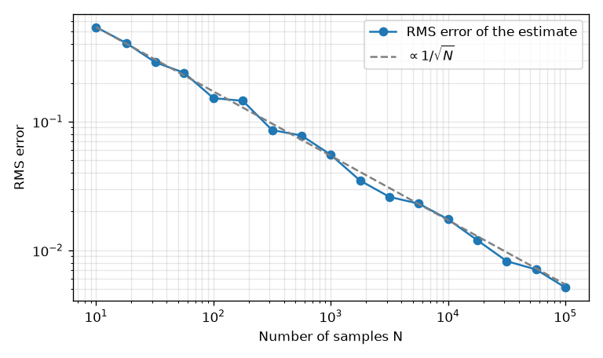
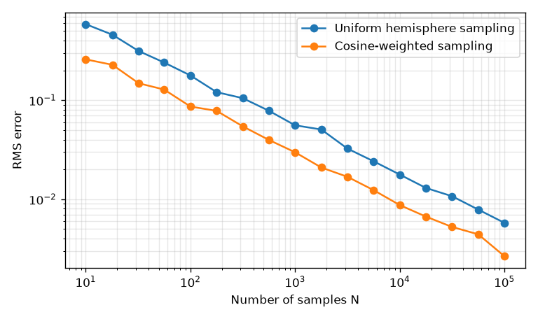

モンテカルロ積分
================

前章で見たように、レンダリング方程式を解くことは、高次元の積分を計算することに帰着する。本章では、乱数を使って積分を推定するモンテカルロ積分を説明する。モンテカルロ積分は、物理ベースレンダリングを計算機で実現するための中心的な道具である。

確率の復習
----------

必要となる確率の概念を簡単に復習する。

確率変数と確率密度関数
   値が確率的に決まる変数を確率変数と呼ぶ。連続的な値をとる確率変数 :math:`X` について、:math:`X` が区間 :math:`[a, b]` に入る確率が :math:`\int_a^b p(x) \, dx` で与えられるとき、:math:`p(x)` を :math:`X` の確率密度関数（Probability Density Function、PDF）と呼ぶ。:math:`p(x) \ge 0` であり、全範囲で積分すると 1 になる。

期待値
   確率変数 :math:`X` の関数 :math:`g(X)` の期待値（平均）は次の式で定義される。

   .. math::
      :label: expectation

      E[g(X)] = \int g(x) \, p(x) \, dx

分散
   値のばらつきの大きさを表す量で、:math:`V[Y] = E[(Y - E[Y])^2]` で定義される。その平方根を標準偏差と呼ぶ。独立な確率変数 :math:`Y_1, \dots, Y_N` が同じ分布に従うとき、それらの平均の分散は :math:`V[Y] / N` になる。

モンテカルロ推定量
------------------

関数 :math:`f(x)` の積分 :math:`I = \int f(x) \, dx` を求めたいとする。確率密度関数 :math:`p(x)` に従う乱数 :math:`X_1, \dots, X_N` を生成し、次の値を計算する。

.. math::
   :label: mc-estimator

   \langle I \rangle_N = \frac{1}{N} \sum_{k=1}^{N} \frac{f(X_k)}{p(X_k)}

これをモンテカルロ推定量と呼ぶ。この値の期待値は、式 :eq:`expectation` を使うと

.. math::

   E\left[ \langle I \rangle_N \right] = E\left[ \frac{f(X)}{p(X)} \right] = \int \frac{f(x)}{p(x)} \, p(x) \, dx = \int f(x) \, dx = I

となり、求めたい積分に一致する。このように、期待値が真の値に一致する推定量を不偏推定量と呼ぶ。ただし、:math:`f(x) \ne 0` となるすべての :math:`x` で :math:`p(x) > 0` でなければならない。

推定量の分散は :math:`V[f(X)/p(X)] / N` なので、誤差の大きさ（標準偏差）は :math:`1/\sqrt{N}` に比例して小さくなる。重要なのは、この収束の速さが積分の次元によらないことである。前章で述べたように、格子状に区切る数値積分は次元が増えると急激に効率が落ちるが、モンテカルロ積分は高次元でも同じ速さで収束する。これが、レンダリングでモンテカルロ積分が使われる理由である。

一方で、:math:`1/\sqrt{N}` という収束は遅い。誤差を半分にするには 4 倍のサンプル数が、10 分の 1 にするには 100 倍のサンプル数が必要になる。

例：円周率の推定
----------------

モンテカルロ積分の簡単な例として、円周率を推定してみる。一辺が 1 の正方形 :math:`[0, 1]^2` の中に一様な乱数で点を打つと、点が原点を中心とする半径 1 の四分円に入る確率は、四分円の面積 :math:`\pi / 4` に等しい。したがって、四分円に入った点の割合を 4 倍すれば円周率の推定値になる。これは、四分円の内部で 1、外部で 0 となる関数を正方形上で積分することにあたる。

.. literalinclude:: ../examples/monte_carlo.py
   :language: python
   :pyobject: estimate_pi
   :linenos:
   :lineno-match:

サンプル数 :math:`N` を変えて推定を 100 回ずつ繰り返し、誤差の二乗平均平方根を求めた結果を\ :numref:`fig-mc-convergence` に示す。誤差が :math:`1/\sqrt{N}` に比例して小さくなることがわかる。

   円周率の推定におけるサンプル数と誤差の関係

レンダリングにおける誤差は、画像上のノイズとして現れる。パストレーシングの画像がざらざらして見えるのは、画素ごとの推定値がばらついているためである。サンプル数を増やせばノイズは減るが、上で述べたとおり、その減り方はゆっくりである。

半球上の積分
------------

レンダリングでよく現れるのは、半球上の方向についての積分である。最も単純な方法は、半球上の方向を一様に選ぶことである。半球の立体角は :math:`2\pi` なので、確率密度関数は :math:`p(\omega) = 1 / (2\pi)` となる。

例として、次の積分を考える。厳密値は :math:`\pi / 2` である（:math:`\int_0^{2\pi} \int_0^{\pi/2} \cos^3\theta \sin\theta \, d\theta \, d\phi = 2\pi \cdot 1/4`）。

.. math::
   :label: cos3-integral

   I = \int_{\Omega} \cos^3\theta \, d\omega = \frac{\pi}{2}

半球上で一様に方向を選ぶと、:math:`\cos\theta` は区間 :math:`[0, 1]` の一様分布に従う。この被積分関数は :math:`\theta` だけに依存するので、:math:`\cos\theta` だけをサンプリングすれば推定できる。

.. literalinclude:: ../examples/monte_carlo.py
   :language: python
   :pyobject: estimate_uniform
   :linenos:
   :lineno-match:

重点サンプリング
----------------

式 :eq:`mc-estimator` の推定量は、どのような :math:`p(x)` を使っても不偏であるが、分散は :math:`p(x)` の選び方によって大きく変わる。:math:`f(x)/p(x)` がなるべく一定になるように、すなわち :math:`p(x)` が :math:`f(x)` に近い形になるように選ぶと、分散は小さくなる。被積分関数の値が大きいところを重点的にサンプリングするこの手法を、重点サンプリング（importance sampling）と呼ぶ。

極端な場合として、:math:`p(x) = f(x) / I` とすると、:math:`f(X)/p(X)` は常に :math:`I` になり、分散は 0 になる。ただし、この :math:`p(x)` を作るには求めたい :math:`I` 自体が必要なので、実際には使えない。実用上は、被積分関数の一部の形に合わせた確率密度関数を使う。

レンダリング方程式の被積分関数には、必ず :math:`\cos\theta_i` が含まれる。そこで、:math:`\cos\theta` に比例する確率密度関数

.. math::
   :label: cosine-pdf

   p(\omega) = \frac{\cos\theta}{\pi}

で方向をサンプリングする方法がよく使われる。これをコサイン重み付きサンプリングと呼ぶ。この分布に従う方向は、区間 :math:`[0, 1)` の一様乱数 :math:`\xi_1`, :math:`\xi_2` から次の式で生成できる。導出は「:doc:`appendix_math`」で示す。

.. math::
   :label: cosine-sampling

   \cos\theta = \sqrt{1 - \xi_1}, \qquad \phi = 2\pi \xi_2

式 :eq:`cos3-integral` をコサイン重み付きサンプリングで推定するコードを次に示す。

.. literalinclude:: ../examples/monte_carlo.py
   :language: python
   :pyobject: estimate_cosine
   :linenos:
   :lineno-match:

2 つの方法の誤差を比べた結果を\ :numref:`fig-mc-importance` に示す。どちらも誤差は :math:`1/\sqrt{N}` に比例して減るが、コサイン重み付きサンプリングのほうが同じサンプル数での誤差が小さい。この例では、同じ誤差を得るのに必要なサンプル数が約 4 分の 1 になっている。

   一様サンプリングとコサイン重み付きサンプリングの誤差の比較

ランバート BRDF の場合、被積分関数のうち :math:`f_r \cos\theta_i = (\rho/\pi) \cos\theta_i` の部分は、コサイン重み付きサンプリングの確率密度関数と完全に比例する。そのため、:math:`f_r \cos\theta_i / p = \rho` となり、残る変動は入射光 :math:`L_i` に由来するものだけになる。マイクロファセット BRDF に対しても、確率密度 :math:`D(\mathbf{h}) (\mathbf{n} \cdot \mathbf{h})` でハーフベクトルをサンプリングする方法が知られている。これらは次章のパストレーサーで使う。

多重重点サンプリング
--------------------

被積分関数が複数の要素の積になっている場合、1 つの確率密度関数ですべての要素の形に合わせることは難しい。レンダリング方程式の場合、BRDF の形に合わせたサンプリングと、光源の位置に合わせたサンプリングのどちらが有利かは状況によって異なる。

* 鋭い鏡面反射を持つ表面に大きな光源が映る場合、BRDF に合わせてサンプリングするほうがよい。
* 粗い表面を小さな光源が照らす場合、光源に合わせてサンプリングするほうがよい。

多重重点サンプリング（Multiple Importance Sampling、MIS）\ [VeachGuibas1995]_ は、複数のサンプリング手法で得たサンプルを、重みを付けて組み合わせる方法である。サンプリング手法 :math:`s` で得たサンプル :math:`x` に対して、たとえば次の重みを使う。

.. math::
   :label: balance-heuristic

   w_s(x) = \frac{p_s(x)}{\sum_t p_t(x)}

これはバランスヒューリスティック（各手法のサンプル数が等しい場合の形）と呼ばれ、そのサンプルを生成しやすい手法ほど大きな重みを与える。重みの和が 1 になるように選べば、組み合わせた推定量も不偏になる。MIS を使うと、どちらかの手法が得意な状況では自動的にその手法の寄与が大きくなり、さまざまな状況で安定してノイズの少ない画像が得られる。実用的なレンダラーではほぼ必ず使われており、本書のパストレーサーでも、光源のサンプリングと BRDF のサンプリングを MIS で組み合わせている（「:doc:`path_tracing`」）。

まとめ
------

* モンテカルロ積分は、確率密度関数 :math:`p` に従う乱数を使って、:math:`f/p` の平均で積分を推定する。
* 誤差は :math:`1/\sqrt{N}` に比例して減り、その速さは積分の次元によらない。
* 被積分関数に近い形の確率密度関数を使う重点サンプリングで、誤差を減らせる。
* 複数のサンプリング手法を組み合わせる多重重点サンプリングにより、さまざまな状況で安定した推定ができる。
