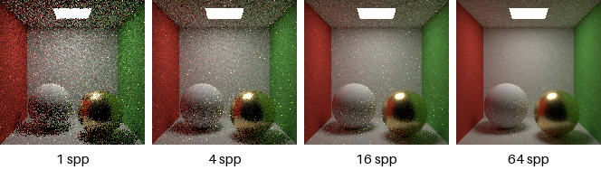
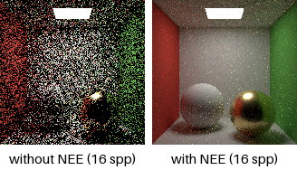

パストレーシングの実装
======================

本章では、これまでの理論をまとめて、レンダリング方程式をモンテカルロ積分で解くパストレーシング（path tracing）を実装する。サンプルコード ``path_tracer.py`` は、NumPy と Pillow だけで書かれた 550 行ほど（コメントを含む）のプログラムである。本書のトップページの画像も、このプログラムで描画した。

パストレーシングの考え方
------------------------

レンダリング方程式（式 :eq:`rendering-equation`）の積分を、モンテカルロ積分で推定することを考える。ある点で入射方向 :math:`\omega_i` を確率密度関数 :math:`p(\omega_i)` に従って 1 つだけ選ぶと、出ていく放射輝度の推定値は次のようになる。

.. math::
   :label: one-sample-estimator

   L_o(\mathbf{x}, \omega_o) \approx L_e(\mathbf{x}, \omega_o) + \frac{f_r(\mathbf{x}, \omega_i, \omega_o) \, L_i(\mathbf{x}, \omega_i) \, (\mathbf{n} \cdot \omega_i)}{p(\omega_i)}

右辺の :math:`L_i(\mathbf{x}, \omega_i)` は、方向 :math:`\omega_i` にレイを飛ばして当たった点から出ていく放射輝度なので、その点で同じ推定を繰り返せばよい。これを続けると、カメラから出発して表面で次々と反射する 1 本の経路（パス）ができる。これがパストレーシングの名前の由来である。

各点で方向を 1 つだけ選ぶので、1 本のパスから得られる推定値はノイズが大きい。そこで、1 つの画素について多数のパスを追跡し、その平均を画素の値とする。1 画素あたりのパスの本数を spp（samples per pixel）と呼ぶ。

パスに沿って掛け合わされていく係数 :math:`f_r \cos\theta_i / p` の積を、スループット（throughput）と呼ぶ。スループットは「このパスの先で見つかった光が、カメラに届くまでにどれだけ弱められるか」を表す。パストレーシングの処理の流れを\ :numref:`fig-path-tracing-flow` に示す。

.. graphviz::
   :name: fig-path-tracing-flow
   :caption: パストレーシングの処理の流れ（1 本のパス）
   :align: center

   digraph pt {
     node [shape=box, style="rounded,filled", fillcolor="#eef3fb", fontsize=11];
     edge [fontsize=10];
     start [label="カメラからレイを生成\nスループット = 1", fillcolor="#fdf2e0"];
     hit [label="最も近い交差点を求める"];
     miss [label="パスを終了", shape=ellipse, fillcolor="#f0f0f0"];
     emit [label="光源に当たったら\n放射輝度 × スループット × MIS の重み\nを加算"];
     nee [label="次イベント推定：\n光源上の点を選んで直接光を加算"];
     sample [label="BRDF に従って次の方向を選び\nスループットに f cosθ / pdf を掛ける"];
     rr [label="ロシアンルーレット"];
     start -> hit;
     hit -> miss [label="何にも当たらない"];
     hit -> emit [label="当たった"];
     emit -> miss [label="光源なら終了"];
     emit -> nee [label="光源以外"];
     nee -> sample -> rr;
     rr -> hit [label="継続"];
     rr -> miss [label="打ち切り"];
   }

以下、サンプルコードの主要な部分を順に読んでいく。サンプルコードの全体は「:doc:`appendix_examples`」から閲覧・ダウンロードできる。

シーンの記述
------------

シーンは、1 × 1 × 1 の箱の中に 2 つの球を置いたものである。このような箱型のシーンはコーネルボックスと呼ばれ、大域照明の検証によく使われる。左の壁は赤、右の壁は緑、天井の中央に下向きの正方形の面光源がある。左奥の白い球はランバート BRDF、右手前の金の球は GGX マイクロファセット BRDF（ラフネス 0.3）を持つ。

.. literalinclude:: ../examples/path_tracer.py
   :language: python
   :pyobject: cornell_box_scene
   :linenos:
   :lineno-match:

材質の ``albedo`` は、拡散反射面では反射率 :math:`\rho`、金属では :math:`F_0` として使う。金の :math:`F_0` は\ :numref:`table-f0` の値である。光源の ``emission`` は放射輝度である。

NumPy による一括処理
--------------------

Python で画素ごとにループを回すと非常に遅い。そこでこのサンプルコードでは、全画素のレイを 1 つの配列にまとめ、交差判定や BRDF の計算を配列演算として一度に行う。たとえばレイの始点は形状 (レイの本数, 3) の配列であり、関数 ``dot`` は各行の内積をまとめて計算する。

.. literalinclude:: ../examples/path_tracer.py
   :language: python
   :pyobject: dot
   :linenos:
   :lineno-match:

この書き方では、パスごとに異なる処理（光源に当たったパスだけ終了する、など）は、真偽値の配列（マスク）で該当する行を取り出して行う。

カメラレイの生成
----------------

カメラは、1 点（カメラの位置）から画素の方向へレイを飛ばすピンホールカメラとする。各画素を通るレイの位置は、画素の中でランダムにずらす。こうすることで、多数のパスの平均をとったときに、画素の範囲全体の平均の色が得られ、物体の輪郭のギザギザ（エイリアシング）も抑えられる。

.. literalinclude:: ../examples/path_tracer.py
   :language: python
   :pyobject: generate_camera_rays
   :linenos:
   :lineno-match:

交差判定
--------

レイは、始点 :math:`\mathbf{o}` と単位ベクトルの方向 :math:`\mathbf{d}` を使って :math:`\mathbf{p}(t) = \mathbf{o} + t\mathbf{d}`\ （:math:`t > 0`）と表せる。中心 :math:`\mathbf{c}`、半径 :math:`r` の球との交点は、:math:`\| \mathbf{p}(t) - \mathbf{c} \|^2 = r^2` を解いて求める。:math:`\mathbf{d}` が単位ベクトルであることを使うと、これは :math:`t` についての 2 次方程式

.. math::
   :label: ray-sphere

   t^2 + 2bt + c = 0, \qquad b = (\mathbf{o} - \mathbf{c}) \cdot \mathbf{d}, \qquad c = \| \mathbf{o} - \mathbf{c} \|^2 - r^2

になり、解は :math:`t = -b \pm \sqrt{b^2 - c}` である。判別式 :math:`b^2 - c` が負ならレイは球に当たらない。2 つの解のうち、正で小さいほうが最初の交点である。

.. literalinclude:: ../examples/path_tracer.py
   :language: python
   :pyobject: intersect_sphere
   :linenos:
   :lineno-match:

``EPSILON`` より小さい :math:`t` を交点として扱わないのは、反射後のレイが、数値誤差によって出発点の表面と再び交差するのを防ぐためである。同じ目的で、関数 ``trace_paths`` と ``direct_lighting`` では、次のレイの始点を法線方向に ``EPSILON`` だけずらしている。長方形との交差判定は、まず長方形を含む平面との交点を求め、その点が長方形の内側にあるかを調べる（関数 ``intersect_rectangle``）。

関数 ``intersect_scene`` は、すべての物体との交差判定を行い、レイごとに最も近い交点までの距離と物体の番号を返す。物体の数が少ないので、ここでは全物体を順に調べている。実用的なレンダラーでは、数百万個の三角形を扱うために、BVH（Bounding Volume Hierarchy）などの加速構造を使って、レイが当たる可能性のある物体だけを効率よく調べる。

BRDF のサンプリング
-------------------

交点では、BRDF に基づく重点サンプリングで次の方向 :math:`\omega_i` を選び、スループットに重み :math:`f_r \cos\theta_i / p(\omega_i)` を掛ける。

拡散反射面
   コサイン重み付きサンプリング（式 :eq:`cosine-sampling`）を使う。前章で見たように、重みはちょうど反射率 :math:`\rho` になる。

金属
   GGX の法線分布関数に従ってハーフベクトル :math:`\mathbf{h}` を確率密度 :math:`D(\mathbf{h}) (\mathbf{n} \cdot \mathbf{h})` でサンプリングし、:math:`\omega_o` を :math:`\mathbf{h}` に関して反射させた方向を :math:`\omega_i` とする。このとき :math:`\omega_i` の確率密度は :math:`p(\omega_i) = D(\mathbf{h}) (\mathbf{n} \cdot \mathbf{h}) / (4 \, \omega_o \cdot \mathbf{h})` となる。これを式 :eq:`cook-torrance` と組み合わせると、:math:`D` が約分されて、重みは次の簡単な式になる。

   .. math::
      :label: ggx-weight

      \frac{f_{\mathrm{spec}} \cos\theta_i}{p(\omega_i)} = \frac{F(\omega_o \cdot \mathbf{h}) \, G(\omega_i, \omega_o) \, (\omega_o \cdot \mathbf{h})}{(\mathbf{n} \cdot \omega_o)(\mathbf{n} \cdot \mathbf{h})}

   選んだ方向が表面の下を向いた場合は、重みを 0 としてパスを終了する。

どちらのサンプリングも、まず法線を :math:`z` 軸とする局所座標系で方向を生成し、それをワールド座標系に変換する（関数 ``to_world``）。局所座標系の残りの 2 軸は、Duff らの方法 [Duff2017]_ で法線から求めている。

.. literalinclude:: ../examples/path_tracer.py
   :language: python
   :pyobject: sample_brdf
   :linenos:
   :lineno-match:

次イベント推定
--------------

BRDF のサンプリングだけでパスを追跡すると、光源に当たったときにだけ光が得られる。光源が小さいと、ほとんどのパスは光源に当たらずに終わり、画像のノイズが非常に大きくなる。

そこで、各交点で光源上の点を 1 つ選び、その点から直接届く光を明示的に計算する。これを次イベント推定（Next Event Estimation、NEE）または光源サンプリングと呼ぶ。直接光の積分を、方向ではなく光源の面積についての積分に書き換えると、次のようになる。

.. math::
   :label: direct-lighting

   L_{\mathrm{direct}}(\mathbf{x}, \omega_o) = \int_{A} f_r(\mathbf{x}, \omega_i, \omega_o) \, L_e \, \frac{\cos\theta_s \cos\theta_l}{\| \mathbf{y} - \mathbf{x} \|^2} \, V(\mathbf{x}, \mathbf{y}) \, dA_{\mathbf{y}}

ここで :math:`\mathbf{y}` は光源上の点、:math:`\omega_i` は :math:`\mathbf{x}` から :math:`\mathbf{y}` への方向、:math:`\theta_s` と :math:`\theta_l` はそれぞれ表面の法線と光源の法線が :math:`\mathbf{x}` と :math:`\mathbf{y}` を結ぶ線となす角である。:math:`V` は可視関数であり、:math:`\mathbf{x}` と :math:`\mathbf{y}` の間に遮る物体がなければ 1、あれば 0 となる。方向の積分から面積の積分への変換には、光源上の微小な面積 :math:`dA` が点 :math:`\mathbf{x}` から見て張る立体角が :math:`d\omega = \cos\theta_l \, dA / \| \mathbf{y} - \mathbf{x} \|^2` であることを使っている。

光源上の点を一様に選ぶと確率密度は :math:`1/A`\ （:math:`A` は光源の面積）なので、推定値は被積分関数に :math:`A` を掛けたものになる。可視関数は、:math:`\mathbf{x}` から :math:`\mathbf{y}` へレイ（シャドウレイ）を飛ばし、最初に当たる物体が光源かどうかで判定する。

.. literalinclude:: ../examples/path_tracer.py
   :language: python
   :pyobject: direct_lighting
   :linenos:
   :lineno-match:

次イベント推定を使うと、光源から直接届く光は 2 通りの方法で数えられることになる。1 つは次イベント推定で光源上の点を選ぶ方法、もう 1 つは BRDF のサンプリングで選んだ方向のレイがたまたま光源に当たる方法である。両方の寄与をそのまま足すと、直接光を二重に数えてしまう。

単純な解決法は、BRDF のサンプリングで光源に当たった場合の寄与を捨てることである。しかし、この方法では、光沢のある表面を経由する経路でノイズが大きくなる。たとえば、カメラ → 床 → 金の球 → 光源という経路（金の球に映った光源の光が床を照らすもの）を考える。金の球の BRDF は鋭い山を持つため、金の球の上で光源上の点を一様に選ぶと、たまたま山の頂上付近を選んだときだけ非常に大きな値になる。その結果、床や壁に明るい点状のノイズが現れる。

そこで、サンプルコードでは「:doc:`monte_carlo`」で紹介した多重重点サンプリングを使い、2 つの方法の寄与を重みを付けて足し合わせる。重みにはバランスヒューリスティック（式 :eq:`balance-heuristic`）を使う。2 つの方法の確率密度を同じ尺度で比べるため、光源上の点を選ぶ確率密度 :math:`1/A` は、立体角に関する確率密度 :math:`\| \mathbf{y} - \mathbf{x} \|^2 / (A \cos\theta_l)` に換算する（関数 ``light_pdf``）。BRDF のサンプリングの確率密度は関数 ``brdf_pdf`` で求める。

.. literalinclude:: ../examples/path_tracer.py
   :language: python
   :pyobject: mis_weight
   :linenos:
   :lineno-match:

粗い表面では光源上の点を選ぶ方法の確率密度が相対的に大きくなるので、次イベント推定の寄与が重視される。光沢のある表面では BRDF のサンプリングの確率密度が大きくなるので、そちらの寄与が重視される。なお、カメラから直接光源が見える場合（最初の交点が光源の場合）は、次イベント推定の対象にならないので、重みを付けずにそのまま加える。

ロシアンルーレット
------------------

パスを何回目の反射で打ち切るかは難しい問題である。固定の回数で打ち切ると、それより多く反射した光が失われ、画像が本来より暗くなる（推定に偏りが生じる）。

ロシアンルーレットは、偏りを生じさせずにパスを確率的に打ち切る方法である。ある確率 :math:`q` でパスを継続し、継続した場合はスループットを :math:`q` で割る。打ち切った場合の寄与は 0 である。推定値の期待値は :math:`q \cdot (X / q) + (1 - q) \cdot 0 = X` となり、打ち切らない場合と変わらない。

サンプルコードでは、4 回目の反射以降でロシアンルーレットを行い、継続確率 :math:`q` をスループットの RGB 成分の最大値（0.05 以上 0.95 以下に制限）とする。スループットが小さい、つまりカメラへの寄与が小さいパスほど打ち切られやすくなり、計算の無駄が減る。なお、サンプルコードでは計算時間を抑えるため、反射回数の上限（既定値 8）も設けている。この上限によるわずかな偏りは、このシーンでは目立たない。

メインループ
------------

ここまでの要素をまとめたのが、関数 ``trace_paths`` である。ループの 1 回が 1 回の反射に対応し、すべてのパスを同時に 1 段階ずつ進める。終了したパスは配列から取り除いていく。

.. literalinclude:: ../examples/path_tracer.py
   :language: python
   :pyobject: trace_paths
   :linenos:
   :lineno-match:

関数 ``render`` は、``trace_paths`` を spp の回数だけ呼び出して平均をとる。結果は線形な放射輝度の画像なので、関数 ``save_image`` で sRGB に符号化してから PNG として保存する。この例ではトーンマッピングは行わず、1 を超える値を 1 に切り詰めている。

実行結果
--------

サンプルコードは次のように実行する。

.. code-block:: console
   :linenos:

   python path_tracer.py --width 256 --height 256 --spp 64 --output cornell_box.png

spp を変えて描画した結果を\ :numref:`fig-spp-series` に示す。

   spp を変えて描画した結果（160 × 160 画素）

1 spp では画像はノイズだらけだが、spp を増やすにつれてノイズが減っていく。spp を 4 倍にするとノイズの大きさ（標準偏差）はおよそ半分になる。これは前章で見た :math:`1/\sqrt{N}` の収束そのものである。

次イベント推定の効果を\ :numref:`fig-nee-comparison` に示す。どちらも 16 spp である。

   次イベント推定の有無による比較（16 spp。右は多重重点サンプリングも併用）

次イベント推定を使わない場合は、BRDF のサンプリングで選んだ方向がたまたま光源に当たったパスだけが光を運ぶ。光源は天井の一部を占めるだけなので、ほとんどのパスは光を運ばず、まれに光源に当たったパスが明るい点として現れる。次イベント推定を使うと、すべての交点で直接光が計算されるため、同じ spp でもノイズが大幅に減る。どちらの画像も、spp を十分に増やせば同じ画像に収束する。

計算時間について
----------------

256 × 256 画素、128 spp のトップページの画像の描画には、筆者の環境で 80 秒程度かかった。実用的なレンダラーは、C++ や GPU による並列処理、加速構造、より高度なサンプリング手法、そして「:doc:`advanced`」で紹介するデノイズを組み合わせることで、はるかに複雑なシーンを短時間で描画している。とはいえ、その中心にあるアルゴリズムは、本章で見たコードと本質的に同じである。

まとめ
------

* パストレーシングは、レンダリング方程式の積分を、各交点で 1 方向だけ選ぶモンテカルロ積分で推定する。
* BRDF に基づく重点サンプリングと、光源上の点を直接選ぶ次イベント推定を、多重重点サンプリングで組み合わせることで、ノイズを減らせる。
* ロシアンルーレットを使うと、偏りを生じさせずにパスを打ち切れる。
* ノイズは spp の平方根に反比例して減る。
