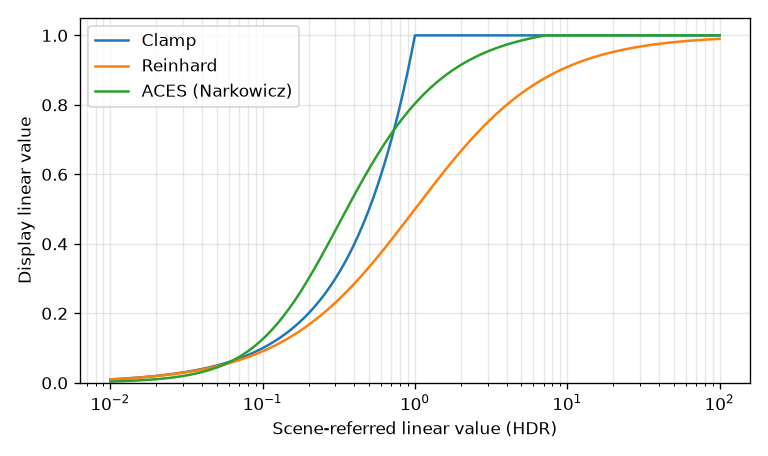
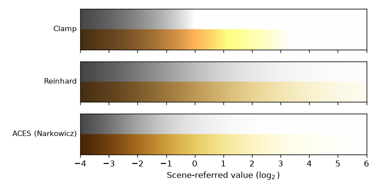

実用 PBR ワークフロー
=====================

ここまでは、物理的な原理とパストレーシングによる計算を中心に説明してきた。本章では、ゲームエンジンや 3D モデリングツールで PBR がどのように使われているかを説明する。実際の制作現場では、理論をそのまま使うのではなく、アーティストが扱いやすいパラメーターに整理した「ワークフロー」として PBR が提供されている。

メタリック／ラフネスワークフロー
--------------------------------

現在最も広く使われているのが、メタリック／ラフネスワークフローである。材質を次の 3 つの主要なパラメーターで表す。

ベースカラー
   材質の基本的な色。非金属では拡散反射の色（反射率 :math:`\rho`）、金属では鏡面反射の色（:math:`F_0`）を表す。

メタリック
   材質が金属かどうか。0 が非金属（誘電体）、1 が金属を表す。

ラフネス
   表面の粗さ。0 が完全に滑らか、1 が非常に粗い表面を表す。内部では :math:`\alpha = r^2` に変換して GGX 分布に使うことが多い。

このワークフローでは、レンダラーの内部で次のように BRDF のパラメーターを求める。

.. math::
   :label: metallic-workflow

   F_0 = (1 - m) \cdot 0.04 + m \cdot c_{\mathrm{base}}, \qquad \rho = (1 - m) \cdot c_{\mathrm{base}}

ここで :math:`m` はメタリック、:math:`c_{\mathrm{base}}` はベースカラーである。非金属（:math:`m = 0`）では、:math:`F_0` は誘電体の典型的な値 0.04 に固定され、ベースカラーが拡散反射の色になる。金属（:math:`m = 1`）では、拡散反射がなくなり、ベースカラーが :math:`F_0` になる。これは「:doc:`light_matter`」で説明した金属と誘電体の違いを、そのままパラメーターにしたものである。

このワークフローの利点は、パラメーターが少なく、物理的にありえない組み合わせ（色の付いた鏡面反射を持つ非金属など）を作りにくいことである。メタリックは原則として 0 か 1 のどちらかを使う。中間の値は、錆びた金属や、金属の上に薄く付いたほこりなど、金属と非金属が 1 画素の中で混ざっている場合に使う。

ベースカラーには、物理的にありうる範囲の値を使う必要がある。自然界で最も暗い物質（木炭など）でも反射率は数%あり、新雪のような最も白い物質でも 1 より小さい。真っ黒（0）や真っ白（1）のベースカラーは避けるべきである。

スペキュラー／グロッシネスワークフロー
--------------------------------------

もう 1 つのワークフローが、スペキュラー／グロッシネスワークフローである。拡散反射の色、鏡面反射の色（:math:`F_0`）、グロッシネス（光沢度。ラフネスとは逆に、1 が滑らか）を直接指定する。

メタリック／ラフネスワークフローより自由度が高く、たとえば宝石のように :math:`F_0` が 0.04 から大きく外れる誘電体も表現できる。その反面、エネルギー保存を破る組み合わせ（拡散反射と鏡面反射の和が 1 を超えるなど）を作れてしまうため、扱いには注意が必要である。現在は、メタリック／ラフネスワークフローを基本とし、必要に応じて :math:`F_0` を調整するパラメーター（スペキュラー）を追加する形が主流になっている。

テクスチャ
----------

実際の材質は、場所によって色や粗さが異なる。そのため、各パラメーターは画像（テクスチャ）として与えることが多い。主なテクスチャを\ :numref:`table-textures` に示す。

.. list-table:: PBR で使われる主なテクスチャ
   :name: table-textures
   :header-rows: 1
   :widths: 25 45 30

   * - テクスチャ
     - 内容
     - 値の扱い
   * - ベースカラー
     - 材質の色
     - sRGB（線形に変換して使う）
   * - メタリック
     - 金属かどうか（0〜1）
     - 線形
   * - ラフネス
     - 表面の粗さ（0〜1）
     - 線形
   * - 法線マップ
     - 細かな凹凸による法線の向きの変化
     - 線形
   * - アンビエントオクルージョン
     - 凹んだ部分での環境光の遮られ具合
     - 線形
   * - エミッシブ
     - 自ら発する光の色
     - sRGB（線形に変換して使う）

「:doc:`light_and_color`」で説明したように、色を表すテクスチャは sRGB で符号化されているのが普通であり、計算の前に線形な値に変換する必要がある。一方、メタリックやラフネスのように色ではない数値を表すテクスチャは、もともと線形な値として保存されている。この 2 種類を取り違えると、材質の見た目が大きく変わってしまう。GPU やゲームエンジンでは、テクスチャごとに「sRGB として扱うかどうか」を設定できる。

法線マップは、ポリゴンの数を増やさずに細かな凹凸を表現するためのテクスチャである。各画素に法線の向きを RGB の値として格納しておき、シェーディングのときに幾何的な法線の代わりに使う。

Disney の Principled BRDF
--------------------------

映画制作の分野で PBR を普及させるきっかけとなったのが、Walt Disney Animation Studios の Burley による Principled BRDF [Burley2012]_ である。Burley は、MERL の実測 BRDF の分析に基づいて、次のような原則を掲げた。

* 物理的なパラメーターではなく、直感的なパラメーターを使う。
* パラメーターの数はできるだけ少なくする。
* パラメーターの値は 0 から 1 の範囲とする。
* 意味がある場合は、範囲を超える値も許す。
* パラメーターのあらゆる組み合わせが、破綻のない、もっともらしい結果になるようにする。

Principled BRDF は、ベースカラー、メタリック、ラフネスに加えて、スペキュラー、スペキュラーティント、異方性、シーン（sheen。布の表面の毛羽による光沢）、クリアコート（自動車の塗装のような透明な上塗り層）などのパラメーターを持つ。このモデルの考え方は、Epic Games の Unreal Engine 4 [Karis2013]_ をはじめとする多くのゲームエンジンや、Blender の Principled BSDF などの 3D ツールに取り入れられ、メタリック／ラフネスワークフローが業界標準となるきっかけとなった。

イメージベースドライティング
----------------------------

現実の物体は、点光源だけでなく、空、周囲の建物、部屋の壁など、あらゆる方向からの光に照らされている。周囲の光の分布を、全方向を写した HDR 画像（環境マップ）として与え、それを光源として使う方法をイメージベースドライティング（Image Based Lighting、IBL）と呼ぶ。金属が金属らしく見えるためには、周囲の環境の映り込みが欠かせないため、IBL は PBR と組み合わせて広く使われている。

パストレーシングでは、レイが何にも当たらなかったときに、その方向の環境マップの値を入射光とすればよい。一方、リアルタイムのラスタライズでは、画素ごとに反射方程式の積分をモンテカルロ積分で計算する余裕はない。そこで、Karis [Karis2013]_ が紹介した Split Sum 近似がよく使われる。これは、反射方程式の積分を、次の 2 つの積分の積で近似する方法である。

.. math::
   :label: split-sum

   \int_{\Omega} L_i(\omega_i) f_r(\omega_i, \omega_o) \cos\theta_i \, d\omega_i
   \approx
   \underbrace{\frac{\int_{\Omega} L_i(\omega_i) D(\mathbf{h}) \cos\theta_i \, d\omega_i}{\int_{\Omega} D(\mathbf{h}) \cos\theta_i \, d\omega_i}}_{\text{前処理済みの環境マップ}}
   \cdot
   \underbrace{\int_{\Omega} f_r(\omega_i, \omega_o) \cos\theta_i \, d\omega_i}_{\text{BRDF の積分}}

1 つ目の積分は、環境マップをラフネスに応じてぼかしたものであり、ラフネスの段階ごとにあらかじめ計算しておく（ここでの :math:`D` の重み付けは、:math:`\omega_o` を法線方向に固定するなどの近似のもとで計算する）。2 つ目の積分は環境マップによらず、:math:`\mathbf{n} \cdot \omega_o` とラフネスの 2 つの変数の関数として表にしておける（:math:`F_0` は Schlick 近似を使って括り出す）。実行時には、2 つの表を引いて掛け合わせるだけで、環境マップによる鏡面反射をおおよそ再現できる。

トーンマッピングと露出
----------------------

「:doc:`light_and_color`」で述べたように、物理に基づいて計算した HDR の値は、トーンマッピングによって表示できる範囲に変換する必要がある。

トーンマッピングの前には、写真撮影と同じように露出を調整する。露出は、HDR の値に一定の係数を掛ける操作である。明るい屋外のシーンでは係数を小さく、暗い室内のシーンでは大きくする。

代表的なトーンマッピング関数を\ :numref:`fig-tone-curves` に示す。

   トーンマッピング関数の比較（横軸は対数目盛）

切り詰め（Clamp）
   1 を超える値を 1 にするだけの方法である。明るい部分の情報がすべて失われる。

Reinhard
   :math:`x / (1 + x)` で変換する Reinhard らの方法 [Reinhard2002]_ である。どれほど大きな値も 1 未満に収まり、明るい部分の階調が残る。一方で、画像全体のコントラストが低くなりやすい。

ACES
   映画業界の色管理の規格 ACES（Academy Color Encoding System）に含まれる変換を模したものである。暗い部分と明るい部分をなだらかに圧縮し、中間の明るさのコントラストを保つ、フィルム写真に似た S 字型の曲線になる。:numref:`fig-tone-curves` では、Narkowicz による近似式 [Narkowicz2016]_ を用いている。

これらを、明るさが指数的に増える HDR 画像に適用した結果を\ :numref:`fig-tone-comparison` に示す。上半分は無彩色、下半分はオレンジ色の光である。

   HDR 画像に各トーンマッピングを適用した結果

切り詰めでは、ある明るさを超えると真っ白になる。また、オレンジ色の部分は、成分ごとに 1 に切り詰められる順番が異なるため、明るくなるにつれて黄色に色相が変わってしまう。Reinhard と ACES では、明るい部分も階調を保ったまま白に近づいていく。

なお、本書のパストレーサーは簡単のため切り詰めを使っている。光源そのものと金の球のハイライトを除けば、値がほとんど 1 を超えないように光源の強さを調整してある。

glTF 2.0 のマテリアル
---------------------

glTF 2.0 [glTF2]_ は、Khronos Group が策定した 3D モデルの標準的なファイル形式であり、メタリック／ラフネスワークフローをマテリアルの標準として採用している。glTF のマテリアルのパラメーターと、本書で説明した概念との対応を\ :numref:`table-gltf` に示す。

.. list-table:: glTF 2.0 のマテリアルのパラメーター
   :name: table-gltf
   :header-rows: 1
   :widths: 40 60

   * - パラメーター
     - 対応する概念
   * - baseColorFactor, baseColorTexture
     - ベースカラー。テクスチャは sRGB で符号化される。
   * - metallicFactor, roughnessFactor
     - メタリックとラフネス。
   * - metallicRoughnessTexture
     - メタリック（B チャンネル）とラフネス（G チャンネル）をまとめたテクスチャ。
   * - normalTexture
     - 法線マップ。
   * - occlusionTexture
     - アンビエントオクルージョン（R チャンネル）。
   * - emissiveFactor, emissiveTexture
     - 自ら発する光。

glTF 2.0 の仕様書は、これらのパラメーターから BRDF を計算する方法も示しており、そこでは本書で説明した GGX 分布、Smith の幾何減衰項、Schlick 近似、:math:`\alpha = r^2` の変換が使われている。さらに、クリアコート、透過、シーン（sheen）などを追加する拡張機能も定められている。

まとめ
------

* メタリック／ラフネスワークフローは、ベースカラー、メタリック、ラフネスの 3 つのパラメーターで材質を表し、金属と誘電体の物理的な違いをそのまま反映している。
* 色を表すテクスチャは sRGB、数値を表すテクスチャは線形として扱う。
* IBL は周囲の環境を光源として使う方法であり、リアルタイムでは Split Sum 近似などの事前計算を用いる。
* 表示の前には、露出の調整とトーンマッピングを行う。
* glTF 2.0 は、本書で説明したモデルに基づくマテリアルを標準として採用している。
