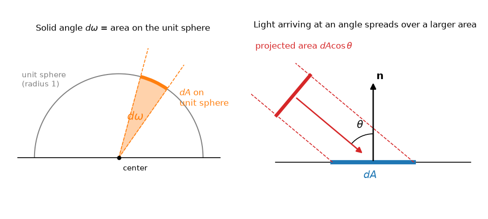

放射測定（ラジオメトリ）
========================

「明るさ」という言葉は日常的には曖昧に使われるが、物理的に正しい計算をするには、光の量を厳密に定義する必要がある。光のエネルギーを測る体系を放射測定（ラジオメトリ、radiometry）と呼ぶ。本章では、レンダリングで最も重要な物理量である放射輝度を定義する。

立体角
------

平面上の角度が「円周上の弧の長さ」で測れるように、空間内の方向の広がりは「球面上の面積」で測れる。これを立体角（solid angle）と呼ぶ。

半径 :math:`r` の球の中心から見て、球面上の面積 :math:`A` の領域が張る立体角 :math:`\sigma` は次の式で定義される。単位はステラジアン（sr）である。

.. math::
   :label: solid-angle

   \sigma = \frac{A}{r^2}

半径 1 の球（単位球）で考えれば、立体角は単位球面上の面積そのものである（:numref:`fig-solid-angle` の左）。球面全体の面積は :math:`4\pi r^2` なので、全方向の立体角は :math:`4\pi` sr、半球の立体角は :math:`2\pi` sr となる。

   立体角（左）と投影面積（右）

微小な立体角 :math:`d\omega` は、方向を球面座標の天頂角 :math:`\theta`\ （基準となる軸からの角度）と方位角 :math:`\phi` で表すと、次のように書ける。

.. math::
   :label: d-omega

   d\omega = \sin\theta \, d\theta \, d\phi

レンダリングでは、表面の法線 :math:`\mathbf{n}` を天頂（:math:`\theta = 0`）とする座標系をよく使う。この式の導出は「:doc:`appendix_math`」で示す。

放射量の定義
------------

レンダリングで使う主な放射量を順に定義する。

放射束
   単位時間あたりに流れる光のエネルギーで、記号 :math:`\Phi`、単位はワット（W）である。光源全体が放つ光の総量などを表す。

放射照度
   表面の単位面積あたりに入射する放射束で、記号 :math:`E`、単位は W/m² である。「面がどれだけ照らされているか」を表す。

   .. math::
      :label: irradiance

      E = \frac{d\Phi}{dA}

   なお、表面から出ていく単位面積あたりの放射束は放射発散度（radiant exitance）と呼び、記号 :math:`M` で表す。

放射強度
   光源から単位立体角あたりに放たれる放射束で（主に点光源に対して用いる）、記号 :math:`I`、単位は W/sr である。「点光源がその方向にどれだけ強く光っているか」を表す。

   .. math::
      :label: intensity

      I = \frac{d\Phi}{d\omega}

放射輝度
   単位投影面積・単位立体角あたりの放射束で、記号 :math:`L`、単位は W/(m²·sr) である。

   .. math::
      :label: radiance

      L = \frac{d^2\Phi}{dA \cos\theta \, d\omega}

   ここで :math:`\theta` は、面の法線と光の進む方向とのなす角である。

これらの量を\ :numref:`table-radiometry` にまとめる。

.. list-table:: 主な放射量
   :name: table-radiometry
   :header-rows: 1
   :widths: 20 15 25 40

   * - 名称
     - 記号
     - 単位
     - 意味
   * - 放射束
     - :math:`\Phi`
     - W
     - 単位時間あたりのエネルギー
   * - 放射照度
     - :math:`E`
     - W/m²
     - 単位面積あたりに入射する放射束
   * - 放射強度
     - :math:`I`
     - W/sr
     - 単位立体角あたりの放射束
   * - 放射輝度
     - :math:`L`
     - W/(m²·sr)
     - 単位投影面積・単位立体角あたりの放射束

投影面積とコサイン則
--------------------

放射輝度の定義に現れる :math:`\cos\theta` の意味を考える。

:numref:`fig-solid-angle` の右のように、平行な光の束が面に斜めから当たると、同じ光の束がより広い面積に広がる。光の束に垂直な断面の面積を :math:`dA_\perp` とすると、面の上での面積は :math:`dA = dA_\perp / \cos\theta` となる。したがって、光の束に垂直な面での放射照度を :math:`E_\perp` とすると、面の放射照度は次のようになる。

.. math::
   :label: cosine-law

   E = E_\perp \cos\theta

斜めから光が当たるほど面は暗くなる。これをランバートの余弦則と呼ぶ。冬の太陽の光が夏よりも弱く感じられるのは、太陽の高度が低く、地面に対して斜めに光が当たるためである。

放射輝度の定義で :math:`dA` ではなく :math:`dA \cos\theta`\ （投影面積）で割っているのは、この見かけの面積の変化を打ち消すためである。こうすることで、放射輝度は面の向きによらず、光そのものの強さを表す量になる。

なぜ放射輝度が主役なのか
------------------------

レンダリングで計算したい量は放射輝度である。その理由は 2 つある。

カメラや目が測っているのは放射輝度である
   カメラの 1 つの画素は、レンズを通して、シーン中のある方向から届く光を、ある面積で受け取る。画素の値は、その方向の小さな立体角から来る光を、画素の面積で受けた量に比例する。これはまさに放射輝度である。

放射輝度は光線に沿って変化しない
   真空中（あるいは光を吸収・散乱しない空気中）では、放射輝度は光線に沿って一定である。白い壁を 1 m の距離から見ても 10 m の距離から見ても、壁の見かけの明るさは同じである。遠ざかると壁から目に届く光の総量は減るが、壁が視野に占める立体角も同じ割合で小さくなるため、単位立体角あたりの量である放射輝度は変わらない。

2 つ目の性質は、レイトレーシングにとって重要である。カメラから飛ばしたレイが表面上の点 :math:`\mathbf{x}` に当たったとき、カメラに届く放射輝度は、点 :math:`\mathbf{x}` からカメラの方向に出ていく放射輝度に等しい。途中の距離を考える必要はない。

点光源と逆二乗の法則
--------------------

一方、点光源からの放射照度は距離の 2 乗に反比例して小さくなる。放射強度 :math:`I` の点光源から距離 :math:`r` だけ離れた面の放射照度は、面の法線と光源方向のなす角を :math:`\theta` として、次の式で表される。

.. math::
   :label: inverse-square

   E = \frac{I \cos\theta}{r^2}

面が遠ざかると、点光源から見た面の立体角が :math:`1/r^2` に比例して小さくなるためである。放射輝度が距離によらないことと、放射照度が距離の 2 乗に反比例することは矛盾しない。前者は「1 点から見た明るさ」、後者は「面の単位面積が受け取る光の量」を表している。

放射照度と放射輝度の関係
------------------------

ある点が受け取る放射照度は、その点の上側の半球 :math:`\Omega` 内のあらゆる方向から入射する放射輝度 :math:`L_i(\omega)` を、コサイン則で重み付けして足し合わせたものである。

.. math::
   :label: irradiance-integral

   E = \int_{\Omega} L_i(\omega) \cos\theta \, d\omega

特に、すべての方向から同じ放射輝度 :math:`L` の光が届く場合（一様な曇り空の下など）、式 :eq:`d-omega` を使って積分を計算すると、次のようになる。

.. math::
   :label: uniform-irradiance

   E = L \int_0^{2\pi} \int_0^{\pi/2} \cos\theta \sin\theta \, d\theta \, d\phi = L \cdot 2\pi \cdot \frac{1}{2} = \pi L

半球の立体角は :math:`2\pi` だが、コサインの重みがかかるため、結果は :math:`\pi L` になる。この :math:`\pi` は、次章以降で何度も登場する。

測光量との違い
--------------

放射量はエネルギーそのものを測るのに対し、人間の目の感度で重み付けした量を測光量と呼ぶ。人間の目は緑色（波長 555 nm 付近）の光に最も敏感で、赤や青には鈍感である。測光量の単位には、ルーメン（lm、放射束に対応）、ルクス（lx、放射照度に対応）、カンデラ（cd、放射強度に対応）、cd/m²（放射輝度に対応する輝度の単位）がある。照明器具のカタログやディスプレイの仕様ではこちらが使われる。

RGB で計算するレンダラーでは、各成分を「その色の帯域の放射量」とみなして計算するのが一般的であり、本書もそれに従う。

まとめ
------

* 方向の広がりは立体角で測る。半球の立体角は :math:`2\pi` sr である。
* 放射輝度は、単位投影面積・単位立体角あたりの放射束であり、カメラの画素が測る量である。
* 放射輝度は光線に沿って変化しない。
* 放射照度は、入射する放射輝度をコサインで重み付けして半球上で積分したものである。
