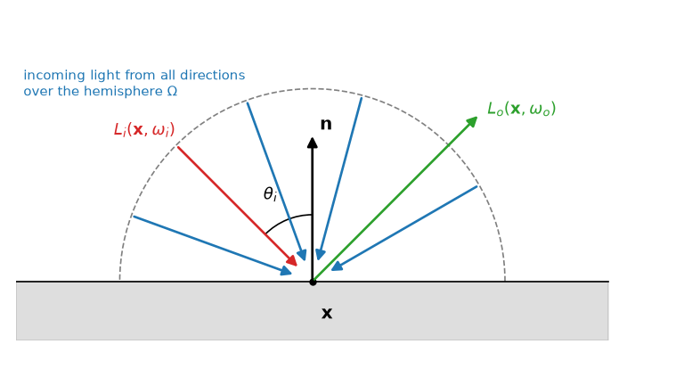

レンダリング方程式
==================

前章までで、光の量（放射輝度）と、表面での反射の仕方（BRDF）を表す道具がそろった。本章では、これらを組み合わせて、シーン全体での光の伝わり方を 1 つの式で表す。この式をレンダリング方程式と呼ぶ。1986 年に Kajiya [Kajiya1986]_ によって定式化されたもので、現在の物理ベースレンダリングの理論的な基礎となっている。

レンダリング方程式
------------------

表面上の点 :math:`\mathbf{x}` から方向 :math:`\omega_o` へ出ていく放射輝度 :math:`L_o` は、その点自身が放つ光と、ほかの方向から入射して反射された光の和である。後者は反射方程式（式 :eq:`reflection-equation`）で表されるので、次の式が成り立つ。

.. math::
   :label: rendering-equation

   L_o(\mathbf{x}, \omega_o) = L_e(\mathbf{x}, \omega_o) + \int_{\Omega} f_r(\mathbf{x}, \omega_i, \omega_o) \, L_i(\mathbf{x}, \omega_i) \, (\mathbf{n} \cdot \omega_i) \, d\omega_i

各量の意味を\ :numref:`fig-rendering-equation` と次の表に示す。

   レンダリング方程式に現れる量

.. list-table::
   :header-rows: 1
   :widths: 30 70

   * - 記号
     - 意味
   * - :math:`L_o(\mathbf{x}, \omega_o)`
     - 点 :math:`\mathbf{x}` から方向 :math:`\omega_o` へ出ていく放射輝度。求めたい量。
   * - :math:`L_e(\mathbf{x}, \omega_o)`
     - 点 :math:`\mathbf{x}` が方向 :math:`\omega_o` へ自ら放つ放射輝度。光源以外では 0。
   * - :math:`f_r(\mathbf{x}, \omega_i, \omega_o)`
     - 点 :math:`\mathbf{x}` の BRDF。
   * - :math:`L_i(\mathbf{x}, \omega_i)`
     - 方向 :math:`\omega_i` から点 :math:`\mathbf{x}` に入射する放射輝度。
   * - :math:`\mathbf{n} \cdot \omega_i`
     - 入射角の余弦 :math:`\cos\theta_i`。コサイン則による重み。
   * - :math:`\Omega`
     - 点 :math:`\mathbf{x}` の法線側の半球。

この式が言っていることは単純である。「ある点がある方向に放つ光は、自分で出す光と、周囲から受けた光を BRDF に従って反射した光の和である」。

入射光はどこから来るか
----------------------

式 :eq:`rendering-equation` の右辺の :math:`L_i` は、どこから来るのだろうか。

点 :math:`\mathbf{x}` から方向 :math:`\omega_i` へレイを飛ばし、最初に当たる表面上の点を :math:`\mathbf{x}'` とする。「:doc:`radiometry`」で見たように、放射輝度は光線に沿って変化しないので、点 :math:`\mathbf{x}` に方向 :math:`\omega_i` から入射する放射輝度は、点 :math:`\mathbf{x}'` から逆向き :math:`-\omega_i` に出ていく放射輝度に等しい。

.. math::
   :label: incoming-radiance

   L_i(\mathbf{x}, \omega_i) = L_o(\mathbf{x}', -\omega_i)

つまり、左辺で求めたい :math:`L_o` が、右辺の積分の中にも（別の点での値として）現れる。ある点の明るさを求めるにはほかの点の明るさが必要であり、その点の明るさを求めるにはさらに別の点の明るさが必要になる。このように、未知の関数が積分の中に現れる方程式を積分方程式と呼ぶ。レンダリング方程式は、シーン中のすべての点の間で光がやりとりされる様子を表す積分方程式である。

反射の回数で分解する
--------------------

レンダリング方程式の解は、光が反射した回数ごとの寄与の和として理解できる。光源から出た光がカメラに届くまでの経路は、反射の回数で次のように分類できる。

.. list-table::
   :header-rows: 1
   :widths: 20 40 40

   * - 反射回数
     - 経路
     - 対応する現象
   * - 0 回
     - 光源 → カメラ
     - 光源そのものが見える
   * - 1 回
     - 光源 → 表面 → カメラ
     - 直接照明。影もここで決まる
   * - 2 回以上
     - 光源 → 表面 → … → 表面 → カメラ
     - 間接照明。カラーブリーディング、映り込みなど

式 :eq:`rendering-equation` の右辺の :math:`L_i` に、再び式 :eq:`rendering-equation` を代入することを繰り返すと、この分類どおりに、反射 0 回の項、1 回の項、2 回の項、…の無限和が得られる。物理的には、表面は入射した光の一部しか反射しない（エネルギー保存）ので、反射の回数が増えるほど寄与は小さくなり、この無限和は収束する。

局所照明は、この和を反射 1 回の項で打ち切ったものに相当する。大域照明は、すべての項を（実用上は十分な回数まで）計算する。

なぜ数値的に解くのか
--------------------

レンダリング方程式を解析的に（式の変形だけで）解けるのは、ごく単純なシーンに限られる。現実的なシーンでは、次の理由から解析的に解くことはできない。

* 物体の形状が複雑で、点 :math:`\mathbf{x}` から方向 :math:`\omega_i` へ飛ばしたレイがどこに当たるか（可視性）が、方向によって不連続に変化する。
* BRDF や光源の分布が複雑である。
* 反射 :math:`k` 回の項は、:math:`k` 回分の方向についての積分、つまり :math:`2k` 次元の積分になる。反射回数が増えると、積分の次元が非常に高くなる。

高次元の積分を通常の数値積分（積分範囲を格子状に区切る方法）で計算すると、計算量は次元に対して指数関数的に増える。そこで、次元によらずに使えるモンテカルロ積分が用いられる。次章では、モンテカルロ積分の考え方を説明する。

レンダリング方程式が扱わないもの
--------------------------------

式 :eq:`rendering-equation` は、多くの現象を表せる一方で、次のものは扱っていない。

* 透過（ガラスや水を通り抜ける光）。BRDF を透過も含む関数（BSDF）に一般化すれば扱える。
* 霧や煙のように、空間を満たす物質（関与媒質）による光の吸収や散乱。放射輝度が光線に沿って変化しないという前提が成り立たなくなる。
* 表面下散乱。入射点と出射点が異なるため、BRDF では表せない。
* 偏光や干渉などの、光の波の性質に由来する現象。

これらの拡張は「:doc:`advanced`」で簡単に紹介する。

まとめ
------

* レンダリング方程式は、ある点から出ていく放射輝度を、自ら放つ光と、入射光を BRDF に従って反射した光の和として表す。
* 入射光はほかの点から出ていく光であるため、レンダリング方程式は積分方程式になる。
* 解は反射回数ごとの寄与の和として理解でき、反射 1 回の項が直接照明、2 回以上の項が間接照明にあたる。
* 現実的なシーンでは解析的に解けず、高次元の積分になるため、モンテカルロ積分で数値的に解く。
