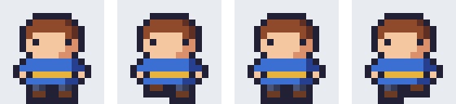
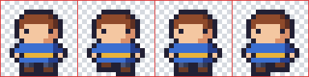

アニメーション
==============

ドット絵は 1 枚の絵が小さいので、何枚も描いてアニメーションにしやすい。この章では、アニメーションの基本となるフレームとタイミングの考え方、歩行アニメーションの作り方、ゲームで使うためのスプライトシートについて説明する。

フレームとタイミング
--------------------

アニメーションは、少しずつ異なる絵を順番に切り替えて表示することで、動いているように見せるものである。1 枚 1 枚の絵を\ :term:`フレーム`\ と呼ぶ。

アニメーションの印象は、フレームの枚数と、各フレームを表示する時間（タイミング）で決まる。ゲームの画面は 1 秒間に 30 回や 60 回書き換えるのが普通だが、ドット絵のアニメーションをそれと同じ速さで切り替える必要は無い。たとえば 30 fps（1 秒に 30 回の書き換え）のゲームで、5 回の書き換えごとにフレームを切り替えれば、1 フレームあたり約 167 ミリ秒、1 秒あたり 6 フレームのアニメーションになる。16×16 ピクセル程度のキャラクターの歩行なら、1 フレームあたり 100 ミリ秒から 200 ミリ秒程度がよく使われる。

すべてのフレームを同じ時間だけ表示する必要も無い。動きの頂点や、溜めの姿勢のフレームを長めに表示すると、動きに強弱が付く。

歩行アニメーション
------------------

主人公の歩行アニメーションを :numref:`fig-walk-frames` に示す。

.. _fig-walk-frames:

   歩行アニメーションの 4 フレーム。左から、直立、左足を上げる、直立、右足を上げる。

この 4 フレームを左から順に繰り返し表示する。1 フレーム目と 3 フレーム目は同じ絵である。同じ絵を使い回すと、描く枚数を減らせる。変えているのは脚の部分だけで、上げた足は 1 ピクセル上にずらしている。

16×16 ピクセルのキャラクターでは、動かせるピクセルの数が限られる。数ピクセルの違いでも動きは十分に伝わるので、最初はこのように変化の少ないアニメーションから始めるとよい。慣れてきたら、腕を振る、体を上下に揺らすなどの変化を加える。

タイミングの違いを確認するため、同じ 4 フレームを異なる速さで再生した GIF アニメーションを次に示す。

.. list-table:: 表示時間による印象の違い（6 倍）
   :header-rows: 1
   :widths: 33 34 33

   * - 80 ミリ秒
     - 150 ミリ秒
     - 300 ミリ秒
   * - .. image:: _generated/walk_fast.gif
          :alt: 1 フレーム 80 ミリ秒で再生した歩行アニメーション
     - .. image:: _generated/walk.gif
          :alt: 1 フレーム 150 ミリ秒で再生した歩行アニメーション
     - .. image:: _generated/walk_slow.gif
          :alt: 1 フレーム 300 ミリ秒で再生した歩行アニメーション

80 ミリ秒では急いで走っているように、300 ミリ秒ではゆっくり足踏みしているように見える。このように、同じ絵でもタイミングだけで印象が変わる。

アニメーションを描くときは、エディタのオニオンスキン（前後のフレームを半透明で重ねて表示する機能）を使い、前のフレームとの違いを確認しながら描くとよい。

スプライトシート
----------------

ゲームでは、アニメーションの各フレームを別々のファイルにせず、1 枚の画像にまとめて扱うことが多い。この画像を\ :term:`スプライトシート`\ と呼ぶ。

.. _fig-walk-sheet:

   歩行アニメーションのスプライトシート（6 倍）。赤い線は各フレームの区切りを示すためのもので、実際の画像には含まれない。

スプライトシートにまとめると、ファイルの管理が楽になり、読み込みも 1 回で済む。各フレームの大きさをそろえ、決まった順に並べておけば、プログラムからは「何番目のフレームか」だけでフレームの位置を計算できる。

``sprite_sheet.py`` は、フレームを並べてスプライトシートを作り、それを再び切り出して GIF アニメーションとして保存する。スプライトシートを作る関数と切り出す関数を次に示す。

.. literalinclude:: ../examples/sprite_sheet.py
   :language: python
   :linenos:
   :lineno-match:
   :pyobject: make_sheet
   :caption: sprite_sheet.py（スプライトシートを作る関数）

.. literalinclude:: ../examples/sprite_sheet.py
   :language: python
   :linenos:
   :lineno-match:
   :pyobject: split_sheet
   :caption: sprite_sheet.py（スプライトシートを切り出す関数）

``columns`` 列で並べる場合、:math:`i` 番目（0 から数える）のフレームは、左から :math:`i \bmod \mathit{columns}` 番目、上から :math:`\lfloor i / \mathit{columns} \rfloor` 番目の位置に置かれる。

GIF 形式は半透明を扱えないため、``save_gif`` 関数では、透明な部分を背景色で塗りつぶしてから保存している。

.. code-block:: console
   :linenos:

   python sprite_sheet.py --duration 150

実行すると、``output/hero_walk_sheet.png`` と ``output/hero_walk.gif`` が保存される。

Pyxel で再生する
----------------

作ったスプライトシートを、Pyxel を使ってゲームの画面に表示してみる。``pyxel_walk.py`` は、スプライトシートを読み込み、歩行アニメーションと、スプライトシート全体を表示する。

.. literalinclude:: ../examples/pyxel_walk.py
   :language: python
   :linenos:
   :caption: pyxel_walk.py

Pyxel では、画面の書き換えのたびに ``update`` と ``draw`` が呼ばれる。``draw`` の中で、経過したフレーム数 ``pyxel.frame_count`` を ``FRAME_TICKS`` で割り、さらにフレーム数で割った余りを求めると、表示するフレームの番号になる。``pyxel.blt`` は、画像の一部（ここではスプライトシートの中の 1 フレーム）を画面に描く関数である。

Pyxel は、パレットの番号で色を扱う。``Image.from_image`` に ``include_colors=True`` を指定すると、画像に含まれる色がパレットとして読み込まれる。透明なピクセルは 0 番の色になるので、``blt`` の ``colkey`` に 0 を指定して透過させている。背景色はパレットに無いため、``pyxel.colors`` に追加して使っている。

次のように実行すると、ウィンドウが開いてアニメーションが再生される。Esc キーで終了する。

.. code-block:: console
   :linenos:

   python sprite_sheet.py
   python pyxel_walk.py
