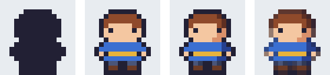
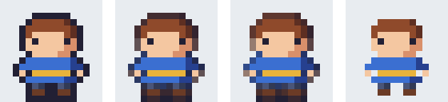
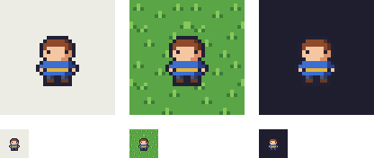

キャラクターを描く
==================

これまでの章で説明した線、色、陰影の規則を使って、16×16 ピクセルのキャラクターを描く。この章では、本書のサンプルの主人公を例にして、描く手順とアウトラインの扱い、見え方の確認方法を説明する。

描く前に決めること
------------------

描き始める前に、次のことを決めておく。

* **大きさ**：ここでは 16×16 ピクセルとする。
* **向き**：最初は正面向きが描きやすい。左右対称に近い形になるので、片側を描いてから反転してコピーできる。
* **頭身**：16×16 ピクセルでは、顔に表情を描く広さを確保するため、頭を大きくした 2 頭身前後にすることが多い。主人公も、高さ 14 ピクセルのうち頭が 7 ピクセルを占める。
* **パレット**：髪、肌、服、ズボン、靴、ベルトに、それぞれ 1 色から 2 色を割り当てる。

描く手順
--------

主人公を描く手順を :numref:`fig-character-steps` に示す。

.. _fig-character-steps:

   キャラクターを描く手順。左から、シルエット、基本色、陰影、アウトラインの調整。

1. シルエットを描く
^^^^^^^^^^^^^^^^^^^

最初に、1 色だけで全体の形（\ :term:`シルエット`\ ）を描く。シルエットだけで何の絵か分かることが、良いキャラクターの条件である。ゲームの画面ではキャラクターは小さく、動き回るので、細部よりも形で見分けられることが多いからである。

このとき、頭、胴、腕、脚の位置と大きさを決める。主人公では、横に広い頭、左右に張り出した手、2 本に分かれた脚が、シルエットだけで分かるようにしている。

2. 基本色を塗る
^^^^^^^^^^^^^^^

シルエットの内側を、部位ごとの基本色で塗り分ける。この段階で、隣り合う部位の明るさに差があるかを確認する。たとえば、髪と肌、服とズボンの明るさが近いと、等倍で見たときに境界が分からなくなる。

顔は特に重要である。16×16 ピクセルの主人公では、目を 1 ピクセルずつ、間を 4 ピクセル空けて置いている。口は描いていない。この大きさでは、口を描くと顔が窮屈になり、かえって表情が分かりにくくなることが多い。

3. 陰影を付ける
^^^^^^^^^^^^^^^

第 6 章と同じく、左上に光源があるものとして、各部位の右側と下側に陰の色を置く。主人公では、髪の右端、顔の右側とあごの下、服の右側、左右の脚それぞれの右半分に陰を付けている。

小さなキャラクターでは、陰は部位ごとに 1 色で十分である。明部やハイライトまで入れると、ピクセルの数が足りずにノイズになりやすい。

4. アウトラインを調整する
^^^^^^^^^^^^^^^^^^^^^^^^^

最後に、輪郭の線（\ :term:`アウトライン`\ ）の色を調整する。次の節で説明する。

主人公のデータは ``sprite_data.py`` の ``HERO`` にあり、第 2 章で説明した形式で書かれている。エディタで描く前に、方眼紙やテキストエディタで文字を並べて形を考えるのも、エンジニアには取り組みやすい方法である。

アウトライン
------------

アウトラインは、キャラクターを背景から切り離して見やすくする。アウトラインの付け方には、いくつかの種類がある。

.. _fig-outline-styles:

   アウトラインの種類。左から、暗い色のアウトライン、色付きのアウトライン、セルアウト、アウトラインなし。

.. list-table:: アウトラインの種類
   :header-rows: 1
   :widths: 25 75

   * - 種類
     - 特徴
   * - 暗い色のアウトライン
     - すべての輪郭を同じ暗い色で描く。最も簡単で、どんな背景の上でもくっきり見える。純粋な黒（``#000000``）より、少し色味のある暗い色のほうがなじみやすい。本書では紺に近い ``#222034`` を使っている。
   * - 色付きのアウトライン
     - 輪郭の色を、内側に接する部位の色を暗くした色にする。髪の輪郭は暗い茶色、服の輪郭は暗い青になり、柔らかい印象になる。
   * - :term:`セルアウト`
     - 色付きのアウトラインのうち、光の当たる側（上と左）の輪郭を明るめに、陰の側を暗めにしたもの。輪郭にも光の向きが表れ、立体感が増す。
   * - アウトラインなし
     - 輪郭を描かない。キャラクターに使える面積が増えるが、背景と区別しにくくなる。

どれを選ぶかは作品の雰囲気と背景によるが、最初は暗い色のアウトラインから始めるとよい。描くのが簡単で、失敗が少ないからである。色付きのアウトラインやセルアウトは、アウトラインの色が増えるぶんパレットの色数も増える点に注意する。

見え方を確認する
----------------

描き終わったら、実際に使う状況に近い条件で見え方を確認する。

.. _fig-visibility:

   明るい背景、草地、暗い背景の上に置いた主人公。上段は 4 倍、下段は等倍。

:numref:`fig-visibility` の右の暗い背景では、暗い色のアウトラインが背景に溶け込み、髪や服の外形がぼやけている。暗い背景が多い作品では、アウトラインを少し明るくするか、セルアウトを使うとよい。

確認するときは、次の点を見る。

* **等倍で見る**：下段のような実際の大きさで、何の絵か分かるか。
* **背景を変える**：使う予定の背景の上で、輪郭が埋もれていないか。
* **シルエットで見る**：他のキャラクターと並べたとき、シルエットだけで区別できるか。
* **しばらく時間を空ける**：描いた直後は、自分の意図で補って見てしまう。時間を空けると、気付かなかった問題が見えることが多い。
