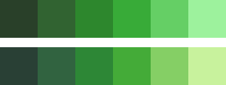
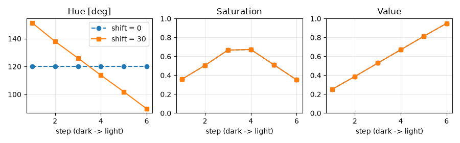
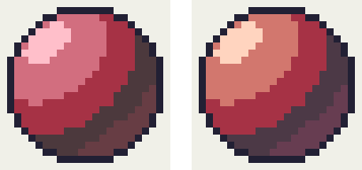

色を選ぶ
========

ドット絵は使う色が少ないため、1 色 1 色の選び方が全体の印象を決める。この章では、色数を制限する理由と、陰影に使う色の組み合わせ（カラーランプ）の作り方を説明する。

色数を制限する
--------------

ドット絵では、あらかじめ使う色を決めておき、その中からだけ色を選んで描く。この色の組を\ :term:`パレット`\ と呼ぶ。:numref:`fig-pixel-grid` のスライムは 5 色、第 7 章の主人公は 11 色で描いている。

色数を制限することには、次の利点がある。

* **統一感が出る**：同じ色を何度も使うため、キャラクターと背景、複数のキャラクターの間で色調がそろう。
* **迷いが減る**：色の候補が少ないので、どの色を置くかの判断が速くなる。
* **ピクセルの役割がはっきりする**：似た色が何色もあると、拡大しないと区別できないピクセルが増え、ノイズのように見える。

目安として、16×16 ピクセルのキャラクター 1 体なら 4 色から 12 色程度、ゲーム全体でも 16 色から 32 色程度のパレットで十分に表現できる。

色の表し方
----------

画面に表示される色は、光の三原色である赤（R）、緑（G）、青（B）の強さの組で表す。これを :term:`RGB` と呼び、各成分を 0 から 255 の整数で表すことが多い。``#4fb05a`` のような表記は、RGB の各成分を 2 桁の 16 進数で並べたものである。

RGB はコンピューターにとっては扱いやすいが、人が色を選ぶときには直感的でない。色を選ぶときは、次の 3 つの値で色を表す :term:`HSV` のほうが考えやすい。

.. list-table:: HSV の 3 つの値
   :header-rows: 1
   :widths: 20 20 60

   * - 値
     - 範囲
     - 意味
   * - 色相（H）
     - 0 度～360 度
     - 赤、黄、緑、青などの色味。0 度が赤、120 度が緑、240 度が青で、360 度で赤に戻る。
   * - 彩度（S）
     - 0～1
     - 色の鮮やかさ。0 で灰色になる。
   * - 明度（V）
     - 0～1
     - 色の明るさ。0 で黒になる。

多くのエディタのカラーピッカーは HSV（または似た考え方の HSL や HSB）で色を指定できる。Python では標準ライブラリの ``colorsys`` モジュールで RGB と HSV を相互に変換できる。

カラーランプ
------------

陰影を付けるには、同じ物体の明るい部分から暗い部分までを表す、明るさの異なる色の組が必要になる。この色の組を明度の順に並べたものを\ :term:`カラーランプ`\ （以下、ランプ）と呼ぶ。:numref:`fig-pixel-grid` のスライムは、陰、基本色、明部、ハイライトの 4 色からなる緑のランプと、輪郭の色でできている。

ランプの色数は、16×16 ピクセルのキャラクターなら 3 色から 5 色程度で足りる。色数を増やしても、それを置くための広さが無ければ区別がつかないからである。

色相をずらす
------------

ランプを作るとき、最も単純なのは色相を固定し、明度だけを変える方法である。しかし、この方法で作ったランプは、暗い色が濁り、明るい色が白っぽく抜けて、生気の無い印象になりやすい。

そこでドット絵では、明度に応じて色相を少しずつずらすことが多い。これを\ :term:`ヒューシフト`\ と呼ぶ。よく使われるのは、暗い色ほど色相を青（寒色）の側へ、明るい色ほど黄（暖色）の側へずらす方法である。太陽の光は暖かい色をしており、光の当たらない部分は青い空からの光に照らされる、という現実の見え方に近づけることになる。

.. _fig-ramps:

   緑のランプ（6 色）。上は色相を 120 度に固定したランプ、下は色相を最大 30 度ずらしたランプ。

.. _fig-ramp-hsv:

   :numref:`fig-ramps` の 2 つのランプの色相（Hue）、彩度（Saturation）、明度（Value）。横軸は暗い色から明るい色への順番、shift は色相をずらす量（度）である。

:numref:`fig-ramp-hsv` のように、2 つのランプは彩度と明度が同じで、色相だけが異なる。どちらのランプも、彩度は中央の色で最も高く、両端の色ほど低くしている。暗い色や明るい色の彩度を高くしすぎると、どぎつい印象になるからである。

ヒューシフトの効果は、同じ形を塗り比べるとよく分かる。

.. _fig-ramp-spheres:

   赤い球。左は色相を固定したランプ、右は色相をずらしたランプで塗った。

:numref:`fig-ramp-spheres` の右の球は、明部が暖かい橙色に、陰が紫寄りの色になっている。左の球より光の色が感じられ、立体感も強い。ただし、ずらしすぎると別の色の物体に見えてしまう。ずらす量は、隣り合う色の間で 10 度から 20 度程度を目安にし、見た目で調整する。

ランプを作るプログラム
----------------------

``make_palette.py`` は、色相、色数、色相をずらす量を指定してランプを作る。次のリストはランプを作る関数である。

.. literalinclude:: ../examples/make_palette.py
   :language: python
   :linenos:
   :lineno-match:
   :pyobject: make_ramp
   :caption: make_palette.py（ランプを作る関数）

``t`` は暗い側の端を 0.0、明るい側の端を 1.0 とした位置である。中央より暗い色は色相を 240 度（青）へ、明るい色は 60 度（黄）へ近づける。近づける量は中央からの距離に比例させ、両端で ``shift`` 度になるようにしている。``shift_hue_toward`` は、色相環の上で近いほうの向きに色相を回す関数である。

次のように実行すると、ランプの各色が表示され、色見本の ``output/ramp.png`` と、パレットファイルの ``output/ramp.gpl`` が保存される。

.. code-block:: console
   :linenos:

   python make_palette.py --hue 120 --steps 5 --shift 20

``.gpl`` は GIMP のパレット形式で、GIMP や Aseprite などで読み込める。作ったランプはそのまま使うのではなく、出発点として、エディタ上で実際に塗りながら調整するとよい。

既存のパレットを使う
--------------------

パレットを一から作るのは難しい。最初は、公開されている既存のパレットを使うのがよい。Lospec のパレット一覧（\ :doc:`参考文献 <references>`\ を参照）には、色数や用途ごとに多くのパレットが登録されており、各種エディタ向けの形式でダウンロードできる。Pyxel エディタを使う場合は、:numref:`fig-pyxel-palette` の既定の 16 色から始めてもよい。

既存のパレットを選ぶときは、次の点を確認する。

* 描きたいものの色（肌、草、空、金属など）のランプが作れるか。
* 最も暗い色と最も明るい色の差が十分にあるか。
* 色相の異なるランプの暗い色どうし、明るい色どうしがなじむか。

明るさの差を確認する
--------------------

色を選んだら、明るさの差が十分にあるかを確認する。色相や彩度が違っても明るさが近い色どうしは、等倍で見たときに区別しにくい。画像を\ :term:`グレースケール`\ に変換してみると、明るさの差だけを確認できる。多くのエディタにはグレースケールで表示する機能があり、Python では Pillow で次のように変換できる。

.. code-block:: python
   :linenos:

   from PIL import Image

   image = Image.open("output/slime.png")
   image.convert("LA").save("output/slime_gray.png")

``"LA"`` は明るさと透明度の 2 つの値を持つ形式である。グレースケールにした画像で、輪郭と陰、陰と基本色などの境界が見分けにくい場合は、どちらかの色の明度を調整する。
