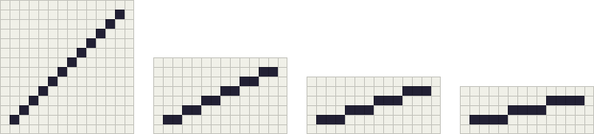
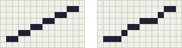
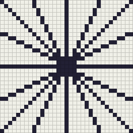
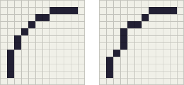
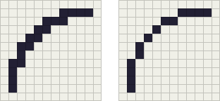

線を描く
========

ドット絵の輪郭や模様は、1 ピクセル幅の線でできている。線の質はドット絵全体の印象を大きく左右する。この章では、ピクセルの線がどのように見えるかを整理し、きれいな直線と曲線を描くための規則を説明する。

ピクセルの線とラン
------------------

ピクセルで描いた線は、水平または垂直に連続するピクセルの並びをつなげたものと見なせる。本書では、この連続するピクセルの並びを\ :term:`ラン`\ と呼ぶ。たとえば、横に 2 ピクセル並べては 1 ピクセル上がる、という操作を繰り返すと、右上がりの直線になる。

1 ピクセル幅の線では、ランとランは角だけで接するようにつなぐ。辺で接するようにつなぐと、つなぎ目の部分だけ線が太く見える。これについては「\ `ダブルドットを取り除く`_\ 」で説明する。

きれいに見える直線
------------------

水平と垂直以外の直線は、必ず階段状になる。この階段のガタガタを\ :term:`ジャギー`\ と呼ぶ。ジャギーを無くすことはできないが、目立たなくすることはできる。最も重要な規則は、\ **ランの長さをそろえる**\ ことである。

.. _fig-lines-clean:

   ランの長さがそろった直線。左から 1:1、2:1、3:1、4:1。

:numref:`fig-lines-clean` は、ランの長さをそれぞれ 1、2、3、4 ピクセルにそろえた直線である。本書では、横に :math:`a` ピクセル進むごとに縦に 1 ピクセル進む傾きを「:math:`a`:1」と表す。これらの傾きの直線は、拡大しても等倍でも整って見える。ドット絵では、斜めの線をなるべくこれらの傾き（と、縦横を入れ替えた 1:2、1:3 など）で描く。

.. _fig-lines-compare:

   全体の傾きが同じ 2:1 の直線。左はランの長さが 2 でそろっている。右はランの長さが 3、1、2、3、1、2 とばらばらである。

:numref:`fig-lines-compare` の 2 本は、どちらも横に 12 ピクセル、縦に 6 ピクセル進む線である。右の線はランの長さが不ぞろいなため、途中で折れ曲がっているように見える。マウスで直線を手描きすると、このような線になりやすい。直線はエディタの直線ツールで引くか、ランの長さを数えながら描くとよい。

ブレゼンハムのアルゴリズム
--------------------------

エディタの直線ツールは、2 点を結ぶ直線に最も近いピクセルを選んで線を引く。この処理によく使われるのが\ :term:`ブレゼンハムのアルゴリズム`\ である。

傾きが 0 以上 1 以下で、左から右へ引く直線を考える。始点を :math:`(x_0, y_0)`、終点を :math:`(x_1, y_1)` とし、:math:`\Delta x = x_1 - x_0`、:math:`\Delta y = y_1 - y_0` とする。理想の直線は次の式で表される。

.. math::

   y = y_0 + \frac{\Delta y}{\Delta x}(x - x_0)

:math:`x` を 1 ずつ増やすたびに、理想の :math:`y` は :math:`\Delta y / \Delta x` だけ増える。そこで、現在のピクセルの :math:`y` と理想の :math:`y` との差（誤差）を記録しておき、誤差が :math:`1/2` を超えたら :math:`y` を 1 増やして誤差から 1 を引く。この判定の両辺に :math:`2\Delta x` を掛けると、分数を使わずに整数の加減算だけで計算できる。これがブレゼンハムのアルゴリズムの考え方である。

次のリストは、すべての向きの直線を扱えるようにした実装である。``error`` が上で説明した誤差に当たり、:math:`x` 方向と :math:`y` 方向のどちらに進むかを ``error`` の値で判定している。

.. literalinclude:: ../examples/bresenham_line.py
   :language: python
   :linenos:
   :lineno-match:
   :pyobject: bresenham
   :caption: bresenham_line.py（ブレゼンハムのアルゴリズム）

``bresenham_line.py`` を実行すると、キャンバスの中心から外周へ 16 本の直線を引いた画像が ``output/lines.png`` に保存される。

.. _fig-bresenham:

   ブレゼンハムのアルゴリズムで中心から放射状に引いた直線（8 倍）

ブレゼンハムのアルゴリズムで引いた直線は、ランの長さの差が最大でも 1 ピクセルに収まる。ただし、両端のランはそれより短くなることがある。始点と終点のピクセルの中心を通るように線を引くからである。また、傾きによっては長さ 2 と 3 のランが混在する線になる。これは理想の直線に最も近い線だが、ドット絵としては前の節の規則どおりの線ほど整っては見えない。:numref:`fig-bresenham` では、水平・垂直と :numref:`fig-lines-clean` にある傾き（1:1 と 2:1、およびその縦横を入れ替えたもの）の直線だけを引いているので、端のランを除けばどの線もランの長さがそろっている。

曲線
----

曲線では、ランの長さを\ **単調に変化させる**\ ことが重要である。たとえば円弧であれば、ランの長さを 4、2、1、1、2、4 のように、長い → 短い → 長いと滑らかに変える。

.. _fig-curves:

   左はランの長さが 4、2、1、1、2、4 と単調に変化する曲線。右は 3、1、3、2、1、4 と不規則に変化する曲線。

:numref:`fig-curves` の右の曲線は、途中でランが短くなったり長くなったりするため、こぶのある線に見える。曲線を描いたら、ランの長さを数えて、増減が途中で逆転していないかを確認するとよい。

ダブルドットを取り除く
----------------------

ランとランを辺で接するようにつなぐと、つなぎ目に L 字型の角ができる。このような余分なピクセルを\ :term:`ダブルドット`\ と呼ぶ。

.. _fig-doubles:

   左はダブルドットのある線、右は取り除いた線

:numref:`fig-doubles` の左の線は、つなぎ目ごとに線が太くなり、全体がぼってりと重く見える。L 字型の角を見つけたら、角のピクセルを消す。ただし、消したことで線が途切れたり、ランの長さが不ぞろいになったりしないかを確認する。

太い線を描きたい場合は、ダブルドットに頼らず、全体を 2 ピクセル幅でそろえて描く。線の太さが場所によって変わると、意図しない強弱に見えるからである。
