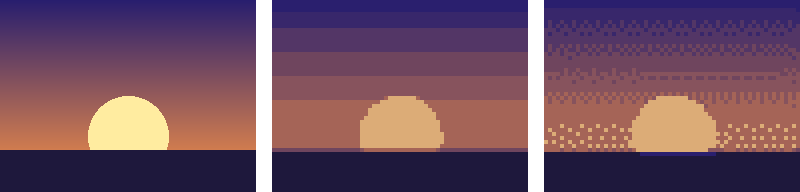

Python で後処理する
===================

ドット絵を描くのはエディタの仕事だが、描いた後の拡大、検査、変換などの作業は、Python で自動化できる。この章では、これまでの章で使ってきたサンプルコードのうち、後処理に関するものをまとめて説明する。

後処理の流れ
------------

描いたドット絵をゲームや公開用の画像として使うまでの流れを次の図に示す。

.. graphviz::
   :caption: 描いた後の処理の流れ
   :align: center

   digraph post {
       rankdir=LR;
       node [shape=box, style="rounded,filled", fillcolor="#e8ecf0", color="#222034", fontsize=11];
       edge [color="#222034"];
       draw [label="エディタで描く"];
       png [label="PNG で書き出す"];
       check [label="検査する\n(check_sprite.py)"];
       sheet [label="スプライトシートに\nまとめる\n(sprite_sheet.py)"];
       scale [label="整数倍に拡大する\n(scale_nearest.py)"];
       game [label="ゲームで使う"];
       share [label="公開・共有する"];
       draw -> png -> check;
       check -> sheet -> game;
       check -> scale -> share;
       check -> draw [label="問題あり", style=dashed, fontsize=10];
   }

いずれも単純な処理だが、絵の枚数が増えると手作業では間違いやすい。スクリプトにしておけば、何度でも同じ結果を得られる。

整数倍に拡大する
----------------

SNS に投稿したり、ストアのアイコンにしたりするときは、ドット絵を拡大した画像が必要になる。第 2 章で説明したとおり、拡大は最近傍補間で、倍率は整数にする。``scale_nearest.py`` の拡大の処理は次のとおりである。

.. literalinclude:: ../examples/scale_nearest.py
   :language: python
   :linenos:
   :lineno-match:
   :pyobject: scale_nearest
   :caption: scale_nearest.py（整数倍に拡大する関数）

Pillow の ``Image.resize`` は、補間の方法を指定しないと、画像の種類に応じた別の方法（多くの場合はバイキュービック補間）を使う。ドット絵では、必ず ``Image.Resampling.NEAREST`` を指定する。

.. code-block:: console
   :linenos:

   python scale_nearest.py my_sprite.png -s 8 -o output/my_sprite_x8.png

SNS の中には、投稿した画像を JPEG に変換するものがある。その場合でも、拡大してから投稿すれば、圧縮ノイズは拡大後の大きなピクセルの境界に出るだけなので、目立ちにくくなる。

制作物を検査する
----------------

エディタで描いていると、気付かないうちに次のような問題が入り込むことがある。

* パレットに無い色を使ってしまい、色数が増える。
* 消しゴムやブラシの設定のせいで、半透明のピクセルができる。
* キャンバスの大きさを変えたとき、タイルの大きさの倍数でなくなる。

半透明のピクセルは、等倍では見落としやすいうえ、GIF 形式や Pyxel のように半透明を扱えない環境では、不透明か透明のどちらかに変換され、意図しない色の点として現れることがある。``check_sprite.py`` は、これらの問題を検査する。

.. literalinclude:: ../examples/check_sprite.py
   :language: python
   :linenos:
   :lineno-match:
   :pyobject: check
   :caption: check_sprite.py（検査する関数）

色数の上限は ``--max-colors`` で、幅と高さが倍数になるべき値は ``--grid`` で指定する。主人公の画像を、色数の上限を 8 色にして検査すると、次のように表示される。

.. code-block:: console
   :linenos:

   python sprite_data.py
   python check_sprite.py output/hero.png --max-colors 8

.. code-block:: text
   :linenos:

   大きさ: 16x16
   色数: 11
     #222034 (alpha=255): 46 ピクセル
     #f4c7a1 (alpha=255): 22 ピクセル
     #3b6fd1 (alpha=255): 21 ピクセル
     #8f4a2b (alpha=255): 14 ピクセル
     #e8b33c (alpha=255): 6 ピクセル
     #d9906b (alpha=255): 5 ピクセル
     #26408f (alpha=255): 5 ピクセル
     #6b3b26 (alpha=255): 4 ピクセル
     #5e2f22 (alpha=255): 3 ピクセル
     #4a5578 (alpha=255): 2 ピクセル
     #323a55 (alpha=255): 2 ピクセル
   問題: 色数が 11 色あり、上限の 8 色を超えている

問題が見つかると終了コード 1 で終了するので、複数の画像をまとめて検査するスクリプトや、継続的インテグレーション（CI）に組み込むこともできる。色ごとのピクセル数を見ると、ほとんど使われていない色も分かる。2 ピクセルしか使われていない色は、他の色で代用できないかを検討する材料になる。

縮小・減色で下書きを作る
------------------------

写真やイラストを縮小し、色数を減らすと、ドット絵のような画像が得られる。``reduce_colors.py`` はこの処理を行う。

.. literalinclude:: ../examples/reduce_colors.py
   :language: python
   :linenos:
   :lineno-match:
   :pyobject: reduce_colors
   :caption: reduce_colors.py（縮小・減色する関数）

縮小には、元の画像の範囲内の色を平均する ``BOX`` を使う。減色は 2 段階で行う。まず ``quantize`` で指定した色数のパレットを求め、次にそのパレットを使って各ピクセルの色を決め直す。2 回目の ``quantize`` で誤差拡散法の\ :term:`ディザリング`\ を指定できる。

.. _fig-reduce:

   左から、元の画像（256×192 ピクセル）、64×48 ピクセルに縮小して 8 色に減色したもの、同じくディザリング付きで減色したもの。右の 2 枚は 4 倍で表示している。

.. code-block:: console
   :linenos:

   python reduce_colors.py photo.jpg -W 48 -c 8 --dither

:numref:`fig-reduce` の中央の画像では空のグラデーションが縞になり、右の画像では縞の境界がディザで和らいでいる。どちらもドット絵らしく見えるが、これは完成したドット絵ではない。第 4 章から第 6 章で説明した線の規則やクラスタの整理は、まったく考慮されていないからである。孤立ドットも多く、拡大するとノイズが目立つ。

この処理は、構図や配色を検討するための下書きとして使う。下書きを別のレイヤーに置き、その上に、これまでの章の規則に従って描き直すとよい。

おわりに
--------

本書では、ドット絵の基本的な規則と制作の手順を説明した。最後に、この先の進み方の例を挙げる。

* **たくさん描く**：同じ題材を何度も描き直すと、規則が身に付き、判断が速くなる。
* **好きな作品を観察する**：好きなゲームのドット絵を拡大して、ランの長さ、ランプの色数、アウトラインの色などを調べる。練習として模写するのもよいが、模写した絵を自分の作品として公開してはいけない。
* **大きさを変える**：16×16 ピクセルに慣れたら、32×32 ピクセルや、タイルを組み合わせた大きな背景に挑戦する。
* **ゲームを作る**：Pyxel などを使って、描いたキャラクターを実際に動かしてみる。動かしてみて初めて分かることも多い。
