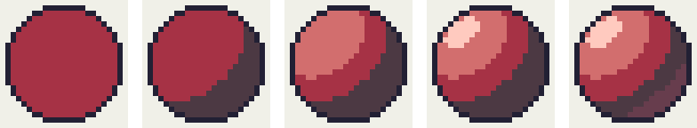
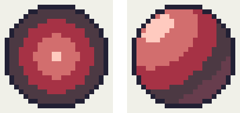
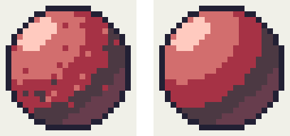
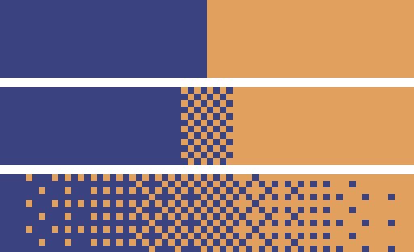
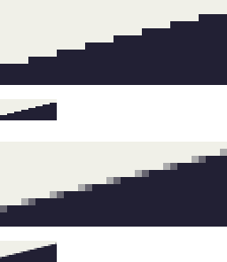

陰影と立体感
============

平らに塗っただけの絵に陰影を付けると、立体感が生まれる。この章では、球を例にして陰影の付け方を説明し、避けるべき塗り方と、少ない色数で中間の明るさを表す技法を紹介する。

光源を決める
------------

陰影を付ける前に、光がどの方向から当たっているか（\ :term:`光源`\ の位置）を決める。ドット絵では、左上の手前から光が当たると決めることが多い。本書の図もすべてこの設定で描いている。

光源の位置は、1 つの作品の中では必ず統一する。キャラクターごと、タイルごとに光の向きが違うと、画面全体がちぐはぐに見える。

陰影の段階
----------

球に陰影を付けていく過程を :numref:`fig-shading-steps` に示す。使うのは、第 5 章の方法で作った赤のランプと、輪郭の色である。

.. _fig-shading-steps:

   球に陰影を付けていく過程。左から、基本色のみ、陰、明部、ハイライト、反射光を加えたもの。

各段階で加える色の役割は次のとおりである。

.. list-table:: 陰影を構成する色
   :header-rows: 1
   :widths: 20 80

   * - 名前
     - 役割
   * - 基本色
     - 物体の本来の色。光が斜めに当たる部分の色でもあり、最も広い面積を占める。
   * - :term:`陰`
     - 光源と反対を向いていて、光が直接当たらない部分。形の大部分は、基本色と陰の境界の形で決まる。
   * - 明部
     - 光源のほうを向いていて、光が強く当たる部分。
   * - :term:`ハイライト`
     - 光源の光が反射して最も明るく見える部分。小さく置くと、表面のつやを表せる。
   * - :term:`反射光`
     - 地面などで跳ね返った光が陰の中を弱く照らす部分。陰の縁に、陰より少し明るい色で置く。

最も重要なのは、基本色と陰の 2 色の段階である。この段階で立体に見えなければ、色を増やしても立体には見えない。明部とハイライトは、形がはっきりしてから加える。反射光は陰と区別できる程度に控えめにし、基本色より明るくしない。明るくしすぎると、光源が 2 つあるように見えるからである。

なお、物体の表面にできる暗い部分（陰）とは別に、物体が光を遮って地面などにできる暗い部分を\ :term:`影`\ （落ち影）と呼ぶ。ゲームのキャラクターでは、足元に小さな楕円の影を置くと、地面に立っている感じが出る。

ピロー・シェーディングを避ける
------------------------------

初心者がやりがちな塗り方に、\ :term:`ピロー・シェーディング`\ がある。光源を考えずに、輪郭に沿って外側ほど暗く、中心ほど明るく塗る方法である。

.. _fig-pillow-shading:

   左はピロー・シェーディング、右は左上の光源を意識して塗った球

:numref:`fig-pillow-shading` の左の球は、枕（pillow）のように膨らんで見え、光がどこから来ているのか分からない。輪郭の線をなぞって暗い色を置きたくなったら、光源の位置を思い出し、光源と反対側だけを暗くする。

クラスタを整える
----------------

同じ色のピクセルがまとまった部分を\ :term:`クラスタ`\ と呼ぶ。陰影は、大きさと形の整ったクラスタの組み合わせで表すとよい。

.. _fig-orphans:

   左は孤立したピクセルが散らばった陰影、右はクラスタを整えた陰影

:numref:`fig-orphans` の左の球には、周りと違う色のピクセルがぽつぽつと散らばっている。このようなピクセルを\ :term:`孤立ドット`\ と呼ぶ。孤立ドットは、意図して置いたもの（ハイライトや目など）でない限り、ざらついたノイズに見える。見つけたら、周りの色で塗りつぶすか、隣のクラスタにつなげる。

ディザリング
------------

色数が限られていると、2 色の中間の明るさを表す色が無いことがある。このとき、2 色のピクセルを規則的に混ぜて、離れて見たときに中間の色に見せる技法を\ :term:`ディザリング`\ と呼ぶ。

.. _fig-dithering:

   上から、2 色をそのまま接したもの、境界に市松模様を挟んだもの、4×4 の規則的ディザで左から右へ変化させたもの

:numref:`fig-dithering` の 2 段目は、境界に 2 色を市松模様に並べた帯を挟んだもので、境界が和らいで見える。3 段目は、混ぜる割合を少しずつ変えてグラデーションを表したものである。

3 段目のような規則的なディザは、次の 4×4 の行列（Bayer 行列）を使って求めた。

.. math::

   M = \begin{pmatrix}
   0 & 8 & 2 & 10 \\
   12 & 4 & 14 & 6 \\
   3 & 11 & 1 & 9 \\
   15 & 7 & 13 & 5
   \end{pmatrix}

位置 :math:`(x, y)` のピクセルで明るい色を混ぜたい割合を :math:`t`\ （0 以上 1 以下）とするとき、次の条件を満たせば明るい色、満たさなければ暗い色にする。

.. math::

   t > \frac{M_{y \bmod 4,\, x \bmod 4} + 0.5}{16}

行列の値は、割合 :math:`t` を少しずつ大きくしていったときに、明るい色のピクセルがなるべく均等に散らばりながら増えていくように並んでいる。たとえば :math:`t = 0.5` のときは、ちょうど市松模様になる。乱数を使わないので、割合が同じ範囲には同じ模様が繰り返し現れ、ドット絵になじみやすい。

ディザリングは便利だが、使いどころを選ぶ。16×16 ピクセル程度の小さなキャラクターでは、ディザの模様を置く広さが無く、ノイズに見えやすい。ディザリングは、空や地面、岩肌などの広い面や、質感を表したい部分に使うとよい。

アンチエイリアス
----------------

輪郭の段差を目立たなくするため、段差の部分に、線の色と背景の色の中間の色を置く技法を\ :term:`アンチエイリアス`\ と呼ぶ。ドット絵では、ソフトウェアに自動でかけさせるのではなく、置く場所と色を描き手が選ぶ。

.. _fig-antialias:

   傾き 4:1 の境界線。上はアンチエイリアスなし、下は段差の部分に中間色を 2 段階加えたもの。それぞれ 8 倍と 2 倍で表示している。

:numref:`fig-antialias` の下の図では、ランの端に中間色を置いたことで、2 倍で表示したときの段差が目立たなくなっている。

アンチエイリアスに使う中間色は、隣り合う 2 色から決まる。そのため、背景が決まっていない部分には使えない。たとえば、ゲームのキャラクターの外側の輪郭にアンチエイリアスをかけると、背景が変わったときに、周りに色の付いた縁が見えてしまう。アンチエイリアスは、キャラクターの内側の線や、背景と一体で描く絵に使う。
