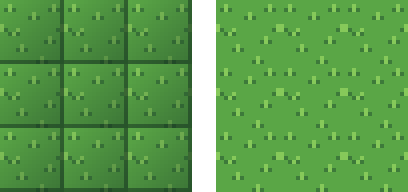
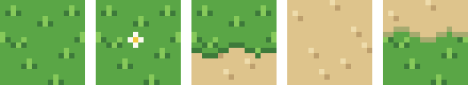
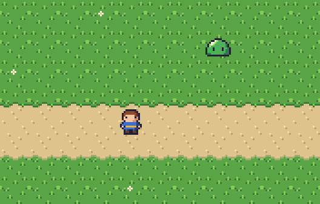
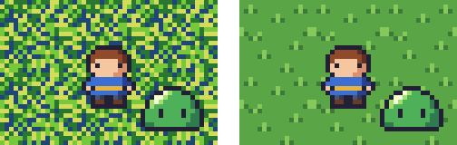

タイルと背景
============

ゲームの背景の多くは、同じ大きさの正方形の画像を格子状に並べて作る。この章では、並べても継ぎ目の目立たないタイルの描き方と、タイルを組み合わせたマップの作り方、背景とキャラクターの関係について説明する。

タイルとは
----------

背景を組み立てるための、同じ大きさの小さな画像を\ :term:`タイル`\ と呼ぶ。マップチップとも呼ばれる。16×16 ピクセルのタイルを横に 20 枚、縦に 15 枚並べれば、320×240 ピクセルの画面を埋められる。

タイルで背景を作ると、次の利点がある。

* 少ない枚数の絵で広い背景を作れる。
* 地形の配置を変えるだけで、別のマップを作れる。
* プログラムからは、マップを「どの位置にどのタイルを置くか」という 2 次元配列として扱える。

Pyxel エディタや Tiled などのタイルマップエディタを使うと、描いたタイルを並べてマップを作れる。

継ぎ目の無いタイル
------------------

草地や地面のように同じタイルを敷き詰めて使うタイルは、並べたときに継ぎ目が目立たないように描く必要がある。

.. _fig-tile-seams:

   タイルを 3×3 枚並べたもの（4 倍）。左は継ぎ目が目立つタイル、右は継ぎ目が目立たないタイル。

:numref:`fig-tile-seams` の左のタイルには、右端と下端に濃い線があり、さらに左上から右下に向かって暗くなっている。1 枚だけ見るとまとまって見えるが、並べると格子模様が浮かび上がる。継ぎ目を目立たなくするには、次の規則を守る。

* タイルの縁を囲む線を描かない。
* タイルの中で明るさを大きく変えない（グラデーションを付けない）。
* 縁をまたぐ模様は、反対側の縁に続きを描く。

最後の規則は、整数の剰余で考えると分かりやすい。幅 16 ピクセルのタイルでは、x 座標が 16 のピクセルは、隣のタイルの x 座標が 0 のピクセルである。つまり、模様を描くときに座標を 16 で割った余りを使えば、縁をまたいでも模様がつながる。右のタイルでは、左右の縁をまたぐ位置に草を 1 つ描いている。

描いたタイルは、実際に並べて確認する。多くのエディタには、画像を縦横に半分ずつずらす機能や、画像を敷き詰めて表示する機能（Aseprite のタイルモードなど）がある。``tile_preview.py`` を使うと、タイルを並べた画像を作れる。

.. literalinclude:: ../examples/tile_preview.py
   :language: python
   :linenos:
   :lineno-match:
   :pyobject: tile_image
   :caption: tile_preview.py（タイルを並べる関数）

.. code-block:: console
   :linenos:

   python tile_preview.py my_tile.png -n 4

繰り返しを目立たなくする
------------------------

継ぎ目が目立たなくても、同じタイルを広く敷き詰めると、模様の繰り返しが見えてしまう。:numref:`fig-tile-map` の草地でも、同じ位置に同じ草が並んでいるのが分かる。繰り返しを目立たなくするには、次の方法がある。

* 基本のタイルには、目を引く特徴的な模様を描かない。
* 模様を少し変えたタイルを数種類用意し、混ぜて並べる。
* 花や石などの飾りを描いたタイルを、ところどころに置く。

マップを組み立てる
------------------

地面の種類が変わる場所には、2 つの地面の境界を描いたタイルを使う。:numref:`fig-tile-set` は、本書のマップで使ったタイルである。

.. _fig-tile-set:

   マップに使ったタイル（6 倍）。左から、草地、花、道の上側の境界、道、道の下側の境界。

境界のタイルでは、境界線の高さを左右の縁でそろえておく。そうすれば、同じタイルを横に並べても境界線がつながる。ここでは横に延びる道だけを扱ったが、道の曲がり角や行き止まりを表すには、角や端の形をした境界のタイルがさらに必要になる。

これらのタイルを並べ、キャラクターを置いたものが :numref:`fig-tile-map` である。

.. _fig-tile-map:

   タイルを並べたマップ（3 倍）

背景とキャラクターのコントラスト
--------------------------------

ゲームの画面では、プレイヤーが操作するキャラクターや敵が、背景よりも目立たなければならない。そのため、背景はキャラクターより控えめに描くのが基本である。

.. _fig-contrast:

   同じキャラクターを、模様の強い背景（左）と落ち着いた背景（右）に置いたもの（5 倍）

:numref:`fig-contrast` の左の背景は、明るさの差が大きい色を細かく混ぜているため、キャラクターの輪郭が背景の模様に埋もれている。背景とキャラクターを区別しやすくするには、次の点に気を付ける。

* 背景は、キャラクターより明るさの差（コントラスト）と彩度を抑える。
* 背景の模様は、キャラクターより大きく、まばらにする。
* キャラクターと背景で、同じ系統の色を使いすぎない。

最後の点については、:numref:`fig-tile-map` のスライムが良い例である。緑のスライムは緑の草地の上で目立ちにくい。アウトラインがあるので見分けられるが、色を変えるか、背景の緑を暗くするほうが見やすくなる。
