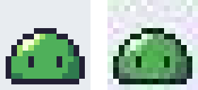

道具を準備する
==============

ドット絵は、ピクセル単位で色を置けるソフトウェアであれば何でも描ける。ただし、ドット絵に向いた機能を持つ専用のエディタを使うと、作業がずっと楽になる。この章では、エディタの選び方と設定、保存形式について説明する。

エディタに求める機能
--------------------

ドット絵のエディタには、次の機能があるとよい。

* **1 ピクセル単位の鉛筆ツール**：\ :term:`アンチエイリアス`\ がかからず、クリックしたピクセルだけが指定した色になる。
* **拡大表示とグリッド表示**：作業中は大きく拡大し、ピクセルの境界やタイルの区切りを格子で表示する。
* **等倍のプレビュー**：拡大して描いている最中に、実際の大きさでの見え方を別の窓で確認できる。
* **パレットの管理**：使う色を\ :term:`パレット`\ として登録し、パレットから色を選んで描ける。
* **レイヤー**：線、塗り、背景などを分けて描ける。
* **アニメーションの機能**：\ :term:`フレーム`\ を追加し、前後のフレームを半透明で重ねて表示（オニオンスキン）できる。
* **書き出し**：PNG 形式での保存や、\ :term:`スプライトシート`\ の書き出しができる。

エディタの選択肢
----------------

代表的なエディタを次の表に示す。いずれも上の機能の多くを備えている。

.. list-table:: 代表的なドット絵のエディタ
   :header-rows: 1
   :widths: 20 20 60

   * - 名前
     - 費用
     - 特徴
   * - Aseprite
     - 有料
     - ドット絵とアニメーションの制作に特化したエディタ。機能が充実しており、利用者も多い。ソースコードが公開されており、自分でビルドすれば個人利用に限り無料で使える。
   * - LibreSprite
     - 無料
     - Aseprite の古い版から派生したエディタ。最新の Aseprite より機能は少ないが、基本的な機能はそろっている。
   * - Piskel
     - 無料
     - ウェブブラウザ上で動作するエディタ。インストール不要で、すぐに試せる。
   * - GIMP
     - 無料
     - 汎用の画像編集ソフト。鉛筆ツールを使えばドット絵も描けるが、アニメーションの機能は弱い。
   * - Pyxel エディタ
     - 無料
     - Python 向けのレトロゲームエンジン Pyxel に付属するエディタ。画像、タイルマップ、効果音、音楽を編集できる。

これからドット絵を続けていくつもりなら、Aseprite が第一の候補になる。まず無料で試したい場合は Piskel か LibreSprite がよい。Python でゲームを作るつもりなら、Pyxel エディタも選択肢になる。各エディタの入手先は\ :doc:`参考文献 <references>`\ に示した。

本書の内容は特定のエディタに依存しない。以降の章では、どのエディタにもある基本的な機能だけを使う。

Pyxel エディタを使う場合
------------------------

Pyxel が導入済みであれば、追加のインストールなしで Pyxel エディタを使える。次のコマンドを実行すると、リソースファイル ``my_resource.pyxres`` を編集する画面が開く。ファイルが無い場合は新しく作成される。

.. code-block:: console
   :linenos:

   pyxel edit my_resource.pyxres

Pyxel エディタには次の特徴がある。

* 画像は 256×256 ピクセルのイメージバンク（3 枚）に描く。キャラクターやタイルは、イメージバンクの一部を切り出して使う。
* 色は既定で 16 色のパレットから選ぶ。リソースファイルと同じ名前の ``.pyxpal`` ファイル（1 行に 1 色を ``RRGGBB`` 形式の 16 進数で書いたテキストファイル）を置くと、そのパレットで編集できる。
* PNG などの画像ファイルを画像エディタの画面にドラッグ＆ドロップすると、イメージバンクに読み込める。このとき、各ピクセルの色はパレットの中で最も近い色に置き換わる。
* ``Ctrl+S`` で保存し、``Ctrl+Z`` で元に戻す。

.. _fig-pyxel-palette:

   Pyxel の既定のパレット（16 色）

色数が 16 色に限られるのは不便に思えるかもしれないが、第 5 章で説明するように、色数の制限はドット絵ではむしろ利点になる。描いた画像を Python のプログラムから使う方法は、第 9 章で説明する。

エディタの設定
--------------

どのエディタを使う場合も、描き始める前に次の設定をしておく。

#. **キャンバスの大きさを決める**：最初は 16×16 ピクセルにする。
#. **グリッドを表示する**：1 ピクセルごとの格子に加えて、タイルを描くときは 16 ピクセルごとの格子も表示する。
#. **鉛筆ツールを選ぶ**：ブラシの大きさは 1 ピクセルにし、アンチエイリアスやぼかしの設定は無効にする。
#. **等倍のプレビューを表示する**：拡大した画面だけを見て描くと、実際の大きさで見たときの印象とずれる。描きながら、こまめに等倍の表示を確認する。

拡大した画面では細部がよく見えるため、つい描き込みすぎてしまう。等倍で見て伝わらない描き込みは、ノイズにしかならない。

保存形式
--------

ドット絵は :term:`PNG` 形式で保存する。PNG は\ :term:`可逆圧縮`\ の形式で、保存しても色が変わらず、透明も扱える。

写真でよく使われる :term:`JPEG` 形式は、ドット絵の保存には使ってはいけない。JPEG は人の目に目立ちにくい情報を捨ててデータを小さくする\ :term:`非可逆圧縮`\ の形式で、色の境界に\ :term:`圧縮ノイズ`\ が出る。

.. _fig-png-jpeg:

   保存形式による違い（8 倍）。左は PNG、右は JPEG（品質 75）。

:numref:`fig-png-jpeg` の右の図では、輪郭の周りに本来無い色がにじんでいる。実際に色の数を数えると、PNG で保存した画像は背景を含めて 6 色のままだったが、JPEG で保存した画像は 200 色以上に増えていた。一度 JPEG で保存した画像を元に戻すことはできない。

アニメーションを手軽に共有するには :term:`GIF` 形式が便利である。ただし GIF は 1 枚の画像で 256 色までしか使えず、半透明も扱えない。編集の途中のデータは、レイヤーやフレームの情報を残すため、エディタ固有の形式（Aseprite の ``.aseprite`` 形式など）で保存しておき、使うときに PNG や GIF に書き出す。
