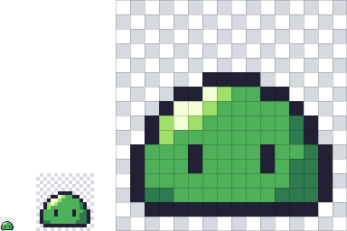
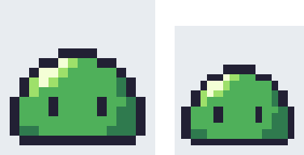

ドット絵とは
============

この章では、ドット絵がどのような絵なのかを整理し、ドット絵を扱ううえで前提となるピクセル、大きさ、拡大の方法について説明する。

ピクセルと解像度
----------------

コンピューターで扱う画像の多くは、色の付いた小さな正方形を格子状に並べたものである。この正方形を\ :term:`ピクセル`\ と呼び、このように表した画像を\ :term:`ラスター画像`\ と呼ぶ。写真もイラストも、画面に表示されるときはラスター画像になっている。

普通のイラストでは、ピクセルは細かすぎて見えないことが前提になっている。描き手はブラシで線を引き、ピクセルの色はソフトウェアが決める。これに対して\ :term:`ドット絵`\ は、ピクセルが見えることを前提にした絵である。画像の\ :term:`解像度`\ （縦横のピクセル数）を小さく抑え、1 つ 1 つのピクセルの色を描き手が意図して決める。

.. _fig-pixel-grid:

   16×16 ピクセルのスライム。左から等倍、4 倍、16 倍（格子付き）。市松模様の部分は透明である。

:numref:`fig-pixel-grid` のスライムは 16×16 ピクセル、つまり 256 個のピクセルでできている。そのうち色が付いているのは 114 個で、使っている色は 5 色だけである。目は縦 2 ピクセルの線、ハイライトは数ピクセルの白で表している。このように、少ない情報で「それらしく見せる」ことがドット絵の面白さであり、難しさでもある。

ドット絵をデータとして見る
--------------------------

ドット絵は、プログラムからも扱いやすい。本書のサンプルコードでは、ドット絵を「1 文字が 1 ピクセルを表す文字列のリスト」と、「文字から色への対応表（パレット）」の組で表している。次のリストは :numref:`fig-pixel-grid` のスライムのデータである。``.`` は透明を表す。

.. literalinclude:: ../examples/sprite_data.py
   :language: python
   :linenos:
   :lineno-match:
   :start-at: SLIME_PALETTE: Palette
   :end-before: # 主人公
   :caption: sprite_data.py（スライムのデータ）

文字の並びを眺めると、輪郭（``K``）、陰（``d``）、明部（``l``）、ハイライト（``w``）の配置がそのまま見て取れる。後の章でも、ドット絵のデータは同じ形式で示す。

代表的な大きさ
--------------

ドット絵の大きさには決まりは無いが、よく使われる大きさがある。代表的なものを次の表に示す。

.. list-table:: よく使われるドット絵の大きさ
   :header-rows: 1
   :widths: 20 40 40

   * - 大きさ
     - 主な用途
     - 特徴
   * - 8×8
     - 小さなアイコン、文字、小物
     - 形を記号的に表すしかない。
   * - 16×16
     - キャラクター、マップのタイル、アイテム
     - 顔や服の色分けができる。入門に向く。
   * - 32×32
     - 細かいキャラクター、大きめのアイテム
     - 表情や服のしわなども描ける。
   * - 64×64 以上
     - ボスキャラクター、立ち絵、背景
     - 描き込む量が多く、時間がかかる。

大きさを 8 の倍数にするのは、かつてのゲーム機が 8×8 ピクセルを単位として画像を扱っていた名残である。現在のゲームエンジンではこの制約はほとんど無いが、タイルを格子状に並べるときに計算しやすいので、今でも 8 の倍数がよく使われる。

最初は 16×16 ピクセルから始めるとよい。8×8 では表現できることが少なすぎ、32×32 ではピクセルの数が 4 倍になって、1 つ 1 つの判断の影響が見えにくくなる。本書の例も、ほとんどを 16×16 ピクセルで描いている。

拡大して表示する
----------------

16×16 ピクセルの画像は、現在の画面ではとても小さい。ドット絵は普通、拡大して表示する。このとき、拡大の方法によって見た目が大きく変わる。

画像を拡大するとき、拡大後のピクセルの色を元の画像のピクセルから求める方法を\ :term:`補間`\ という。代表的な方法に、最も近いピクセルの色をそのまま使う\ :term:`最近傍補間`\ と、周囲 4 個のピクセルの色を距離に応じて混ぜる\ :term:`バイリニア補間`\ がある。

.. _fig-scaling:

   8 倍に拡大したスライム。左は最近傍補間、右はバイリニア補間。

:numref:`fig-scaling` のように、バイリニア補間では境界がぼやけてしまう。ドット絵を拡大するときは、必ず最近傍補間を使う。画像編集ソフトでは「ニアレストネイバー」「最近傍法」などと表示されることが多い。

さらに、倍率は整数にする。最近傍補間でも、倍率が整数でないと、元の 1 ピクセルが拡大後に何ピクセル分になるかが場所によって変わってしまう。

.. _fig-non-integer:

   最近傍補間で拡大したスライム。左は 3 倍、右は 2.5 倍。違いが分かるように、どちらもさらに 4 倍で表示している。

:numref:`fig-non-integer` の右の図では、2.5 倍にしたため、元の 1 ピクセルが 2 ピクセル分になる所と 3 ピクセル分になる所が混在している。目の幅や輪郭の太さが不ぞろいになっているのが分かる。

ゲームやウェブページでドット絵を表示するときも同じ考え方をする。ゲームエンジンでは画像の補間方法（フィルター）を最近傍補間に設定し、ウェブページでは CSS で ``image-rendering: pixelated`` を指定する。Python で拡大する方法は第 10 章で説明する。
