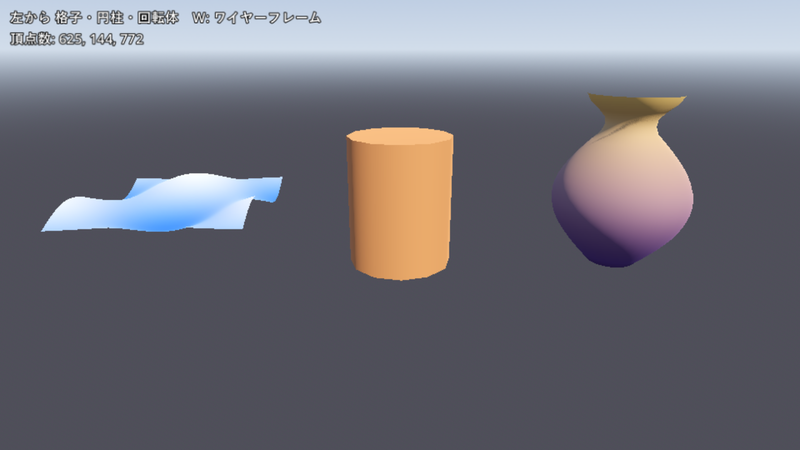
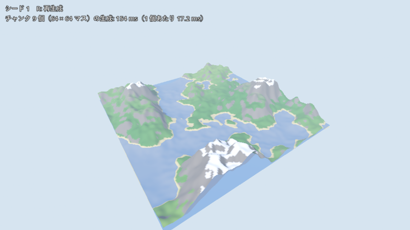
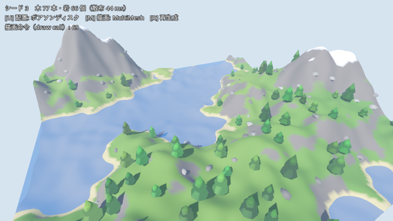
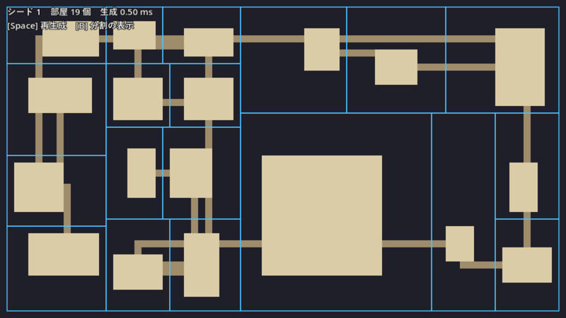
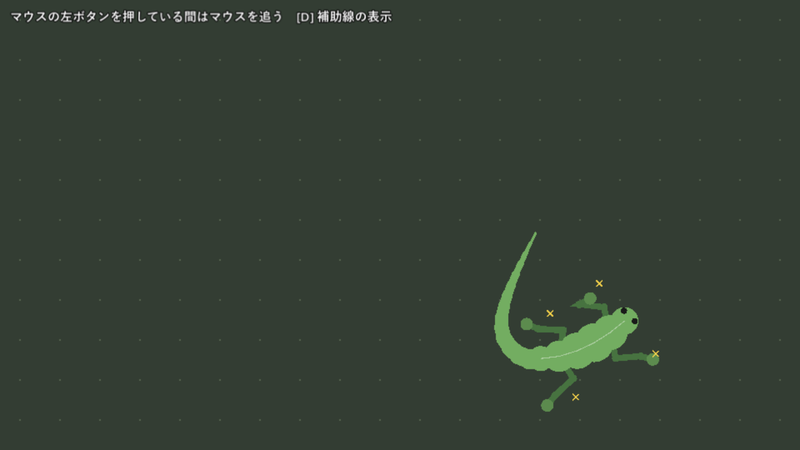
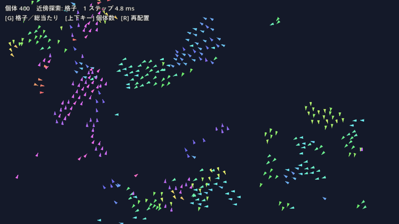

第 15 章　Godot での統合例
============================================================

第 6〜13 章では、メッシュ・地形・配置・ダンジョン・アニメーション・群れの手法を Python で実装し、図や動画で確かめた。本章では、これらの手法をゲームエンジン Godot の中で動かし、ゲームの実行中に（\ **実行時に**\ ）生成する例を示す。

Python で図を作るときは、1 枚の図に何秒かかっても困らない。ゲームでは事情が違う。60 fps で動かすなら、1 フレームに使える時間は約 16.7 ms で、その中で入力・物理・描画もこなさなければならない。生成に時間がかかると、その間ゲームが止まる。また、生成した結果は、エンジンが描ける形（メッシュ・ノード）に変換して渡す必要がある。本章では、各手法の GDScript での実装を示したあと、最後の統合例で、地形と配置を別のスレッドで生成しながら世界の上を飛ぶシーンを作り、実行時生成の性能について考える。

GDScript の文法と Godot エディターの操作は前提とし、説明しない。

サンプルプロジェクト
------------------------------------------------------------

本章のコードはすべて 1 つの Godot プロジェクトにまとめてある。

* :download:`godot_examples.zip <_generated/downloads/godot_examples.zip>`: Godot のサンプルプロジェクト（\ ``examples/godot``\ ）

Godot 4.7.2 で動作を確かめた。zip を展開し、Godot のプロジェクトマネージャーで「インポート」を選び、\ ``examples/godot/project.godot`` を開く。実行するとメニューが表示されるので、見たいシーンを選ぶ。どのシーンからも Esc キーでメニューに戻れる。画像や音声のファイルは使っておらず、画面に出るものはすべて実行時にコードで作っている。

.. list-table:: シーンとスクリプト（シーンは examples/godot、スクリプトは examples/godot/scripts にある）
   :header-rows: 1
   :widths: 22 38 25 15

   * - シーン
     - 内容
     - 主なスクリプト
     - 対応する章
   * - main.tscn
     - シーンを選ぶメニュー
     - main_menu.gd
     -
   * - mesh_primitives.tscn
     - 格子・円柱・回転体のメッシュ
     - mesh_builder.gd
     - :doc:`第 6 章 <mesh>`
   * - terrain.tscn
     - ノイズによる地形のチャンク
     - terrain_generator.gd
     - :doc:`第 7 章 <terrain>`
   * - scatter.tscn
     - ポアソンディスクによる木と岩の散布、MultiMesh
     - poisson_disk.gd、scatterer.gd
     - :doc:`第 10 章 <scattering>`
   * - dungeon.tscn
     - BSP による部屋と通路
     - dungeon.gd
     - :doc:`第 11 章 <dungeon>`
   * - procedural_walk.tscn
     - FABRIK で脚を動かす 4 本足の生き物
     - fabrik.gd、creature.gd
     - :doc:`第 12 章 <animation>`
   * - boids.tscn
     - 格子で近傍を探すボイド
     - boids.gd
     - :doc:`第 13 章 <particles>`
   * - world.tscn
     - 統合例。地形と散布を別スレッドで生成しながら飛ぶ
     - world.gd、chunk_job.gd
     - 本章

エディターを使わずに、コマンドラインから特定のシーンを実行することもできる。Godot の実行ファイルの名前は版と OS によって異なる。以下では Windows 版のコンソール用実行ファイル ``Godot_v4.7.2-stable_win64_console.exe`` を ``godot`` と書く。

.. code-block:: bat
   :linenos:

   rem 最初に 1 回、プロジェクトを読み込んでキャッシュ（.godot フォルダー）を作る
   godot --headless --path examples/godot --import
   rem 統合例のシーンを実行する
   godot --path examples/godot res://world.tscn

複数のシーンで使うスクリプト（\ ``mesh_builder.gd``\ 、\ ``terrain_generator.gd`` など）は、\ ``class_name`` でグローバルな名前を付けず、使う側で ``const TerrainGenerator := preload("res://scripts/terrain_generator.gd")`` のように読み込んでいる。どのファイルに依存しているかが、ファイルの先頭を見れば分かるようにするためである。

メッシュを作る
------------------------------------------------------------

:doc:`mesh` で扱ったように、\ **メッシュ**\ は頂点の座標と、頂点をつないだ三角形の並びで形を表す。Godot では、メッシュを手続きで作る方法として、頂点を 1 つずつ追加できる ``SurfaceTool`` と、頂点・法線・色などの配列をまとめて渡す ``ArrayMesh`` がある。ここでは分かりやすい ``SurfaceTool`` を使い、次節の地形では速い ``ArrayMesh`` の配列を直接使う。

次のコードは、正方形を格子に分け、各頂点の高さを関数で決める。高さの関数を変えれば、波・丘・ハイトマップなど、どのような面でも作れる。

.. literalinclude:: ../examples/godot/scripts/mesh_builder.gd
   :language: gdscript
   :tab-width: 4
   :start-at: static func grid(
   :end-before: ## 円柱。
   :lineno-match:
   :caption: examples/godot/scripts/mesh_builder.gd（grid）

Godot は、表から見て頂点が時計回りに並ぶ三角形を表の面とし、裏の面は描かない（\ **バックフェースカリング**\ ）。上から見て「左奥 → 右奥 → 左手前」の順に並べると、上から見える面になる。順番を逆にすると、面が裏返って見えなくなる。最後の ``generate_normals()`` は、各三角形の向きから\ **法線**\ （面に垂直な単位ベクトル。光の当たり方の計算に使う）を求め、頂点を共有する三角形の法線を平均して、滑らかな陰影にする。

円柱の側面とふたの境目のように角を立てたい所では、境目の頂点を共有せず、面ごとに頂点を作って法線を与える（\ ``mesh_builder.gd`` の ``cylinder``\ ）。\ **回転体**\ は、断面の輪郭を y 軸の周りに回して作る。壺・柱・木の幹のように軸対称な形を、輪郭の数個から十数個の点だけで表せる。

.. literalinclude:: ../examples/godot/scripts/mesh_builder.gd
   :language: gdscript
   :tab-width: 4
   :start-at: static func lathe(
   :end-before: ## 頂点の色をそのまま
   :lineno-match:
   :caption: examples/godot/scripts/mesh_builder.gd（lathe）

最後の列を最初の列とつなぐ（\ ``(s + 1) % segments``\ ）ので、1 周した所で頂点が重複せず、継ぎ目に陰影の段差ができない。回転体の滑らかさは、輪郭の点の数と、周方向の分割数 ``segments`` で決まる。\ :numref:`fig-godot-mesh` の壺は、輪郭を式で 25 点作り、周方向を 32 分割した。

.. _fig-godot-mesh:

   mesh_primitives.tscn。左から格子（24 × 24 マス）、円柱（12 分割）、回転体。色は頂点の色。W キーでワイヤーフレーム表示になる

地形のチャンク
------------------------------------------------------------

広い地形を 1 枚のメッシュで作ると、作るのに時間がかかり、見えない所まで描くことになる。そこで、地形を一定の大きさの区画に分けて扱う。この区画を\ **チャンク**\ と呼ぶ。ここでは 64 m 四方のチャンクを 64 × 64 マスの格子で表す。

チャンクに分けても地形が自然につながるのは、高さを世界座標の関数として定義しているからである（第 1 章の分類でいう関数型の生成）。Godot に組み込まれている ``FastNoiseLite`` の fBm（\ :doc:`noise`\ ）で値を作り、累乗で再分配する（\ :doc:`terrain`\ ）。

.. literalinclude:: ../examples/godot/scripts/terrain_generator.gd
   :language: gdscript
   :tab-width: 4
   :start-at: func height_at(
   :end-before: ## 世界座標 (x, z) の湿り気
   :lineno-match:
   :caption: examples/godot/scripts/terrain_generator.gd（height_at）

チャンクのメッシュは、頂点・法線・色・インデックスの配列として作る。

.. literalinclude:: ../examples/godot/scripts/terrain_generator.gd
   :language: gdscript
   :tab-width: 4
   :start-at: func generate_arrays(
   :end-before: ## 配列から ArrayMesh
   :lineno-match:
   :caption: examples/godot/scripts/terrain_generator.gd（generate_arrays）

要点は次の 3 つである。

* **境目の法線**: 法線は、左右・前後の頂点の高さの差（中心差分）から求める。チャンクの端の頂点では、隣のチャンクの頂点の高さも要る。そこで、ハイトマップを周囲に 1 列ずつ余分に計算しておく。こうすると、隣り合うチャンクの境目の法線が一致し、継ぎ目に陰影の段差が出ない。
* **頂点の色によるバイオーム**: 高さ・湿り気（別のノイズ）・傾き（法線の y 成分）から、砂浜・草地・岩・雪の色を頂点ごとに決める（\ ``ground_color``\ ）。テクスチャを使わずに、地形の種類（\ **バイオーム**\ ）を色分けできる。
* **スレッドから呼べる**: この関数は配列を作って返すだけで、ノードやシーンに触れない。この性質を、後の統合例で使う。

ArrayMesh への変換（\ ``build_mesh``\ ）は ``add_surface_from_arrays`` を呼ぶだけである。

.. _fig-godot-terrain:

   terrain.tscn。3 × 3 個のチャンクを並べた地形。R キーでシードを変えて作り直す

地形の性格を決める主なパラメーターを次の表に示す。いずれも ``terrain_generator.gd`` の先頭と ``_init`` にある。

.. list-table:: 地形のパラメーター
   :header-rows: 1
   :widths: 30 20 50

   * - パラメーター
     - 値
     - 制御できること
   * - ``frequency``
     - 0.007
     - 山や谷の大きさ。小さくすると大きな山がゆるやかに続く
   * - ``fractal_octaves``
     - 5
     - 細部の量。増やすと細かい起伏が増え、計算時間も増える
   * - 累乗の指数
     - 2.2
     - 大きいほど低地が平らになり、山が鋭くなる
   * - ``HEIGHT_SCALE``
     - 40 m
     - 起伏の大きさ
   * - ``WATER_LEVEL``、\ ``SNOW_LEVEL``
     - 5 m、26 m
     - 水面と雪の高さ。陸と海の割合が変わる
   * - ``RESOLUTION``
     - 64
     - チャンクの細かさ。頂点の数は 2 乗に比例する

画面左上の表示によると、9 個のチャンクを作るのに約 154 ms（1 個あたり約 17 ms）かかっている（Xeon Silver 4208、2.1 GHz での値）。これはメインスレッドで順に作っているので、その間ゲームが止まる。1 フレームの予算 16.7 ms をチャンク 1 個で使い切ってしまうので、このままでは、移動しながら新しいチャンクを作ることはできない。この問題は統合例で扱う。

配置と散布
------------------------------------------------------------

地形の上に木と岩を置く。まず\ **ポアソンディスク・サンプリング**\ （\ :doc:`scattering`\ ）で、互いに一定距離以上離れた候補の点を作る。Bridson の方法をそのまま GDScript で書いたものが次のコードである。

.. literalinclude:: ../examples/godot/scripts/poisson_disk.gd
   :language: gdscript
   :tab-width: 4
   :start-at: static func sample(
   :end-before: ## 候補の周り
   :lineno-match:
   :caption: examples/godot/scripts/poisson_disk.gd（sample）

次に、各点の高さ・傾き・湿り気から、何を置くかを決める。水辺と雪の上には何も置かず、急な斜面には岩だけを置き、湿った所ほど木を多くする。

.. literalinclude:: ../examples/godot/scripts/scatterer.gd
   :language: gdscript
   :tab-width: 4
   :start-at: static func scatter(
   :end-before: static func _add_tree(
   :lineno-match:
   :caption: examples/godot/scripts/scatterer.gd（scatter）

同じ形の木が同じ向き・大きさで並ぶと、すぐに作り物だと分かる。そこで、個体ごとに向き・大きさ・色を乱数で変える。高さだけを別の倍率で伸ばすと、太さと高さの比も変わり、形にも個体差が出る。

.. literalinclude:: ../examples/godot/scripts/scatterer.gd
   :language: gdscript
   :tab-width: 4
   :start-at: static func _add_tree(
   :end-before: static func _add_rock(
   :lineno-match:
   :caption: examples/godot/scripts/scatterer.gd（_add_tree）

木と岩のメッシュも、前節の回転体で作っている。木は針葉樹の輪郭を 7 分割で回し、葉の部分の頂点の色を白にしておく。描くときに個体ごとの色が頂点の色に掛けられるので、葉の色だけが個体ごとに変わる。

MultiMesh でドローコールを減らす
^^^^^^^^^^^^^^^^^^^^^^^^^^^^^^^^^^^^^^^^^^^^^^^^^^^^^^^^^^^^

木を 1 本ずつ ``MeshInstance3D`` のノードにすると、木の数だけ CPU から GPU への\ **ドローコール**\ （draw call。画面の表示では「描画命令」）が出る。ドローコールは 1 回ごとに CPU 側の準備の手間がかかるので、数千本の木を 1 本ずつ描くと、GPU に余裕があっても CPU が追いつかなくなる。

``MultiMesh`` は、同じメッシュを、変換（位置・回転・拡大率）と色だけを変えて多数描くための仕組みである。全個体を 1 回のドローコールで描く。このように同じメッシュを多数まとめて描く方法を\ **インスタンシング**\ と呼ぶ。

.. literalinclude:: ../examples/godot/scripts/scatterer.gd
   :language: gdscript
   :tab-width: 4
   :start-at: static func create_multimesh(
   :lineno-match:
   :caption: examples/godot/scripts/scatterer.gd（create_multimesh）

``use_colors`` などの形式は ``instance_count`` を設定する前に決めておく。\ :numref:`fig-godot-scatter` のシーンでは、M キーで、MultiMesh と、個体ごとの ``MeshInstance3D`` を切り替えられる。木 77 本・岩 66 個で、ドローコールの数は MultiMesh なら 69、個別のノードなら 504 だった。この数には、地形・水面の描画と、太陽の光の影を作るための描画も含まれる。個体の数を増やしても、MultiMesh ならドローコールの数はほとんど変わらない。

.. _fig-godot-scatter:

   scatter.tscn。ポアソンディスクで置いた木と岩。U キーで一様乱数による配置に切り替えると、木が重なったり、まばらな所ができたりする

ダンジョン
------------------------------------------------------------

:doc:`dungeon` の BSP（空間の 2 分割）によるダンジョンを、2D で描く。マップ全体の長方形を、長い方の辺を切るように 2 つに分け、それを再帰的に繰り返す。区画が小さくなるか、深さが上限に達したら、その区画の中に部屋を作る。

.. literalinclude:: ../examples/godot/scripts/dungeon.gd
   :language: gdscript
   :tab-width: 4
   :start-at: func _split(
   :end-before: ## 区画の内側に
   :lineno-match:
   :caption: examples/godot/scripts/dungeon.gd（_split）

部屋をつなぐ通路は、分割の木をたどって作る。各節で、左の部分木の部屋の 1 つと、右の部分木の部屋の 1 つを L 字の通路でつなぐ。木のすべての節でこれを行うので、すべての部屋が 1 つにつながることが保証される。

.. literalinclude:: ../examples/godot/scripts/dungeon.gd
   :language: gdscript
   :tab-width: 4
   :start-at: func _connect(
   :end-before: ## 縦か横の直線
   :lineno-match:
   :caption: examples/godot/scripts/dungeon.gd（_connect）

.. _fig-godot-dungeon:

   dungeon.tscn。青い線が分割の区画、明るい四角が部屋、暗い線が通路。Space キーで新しいシードの配置になる

80 × 45 マスのマップの生成は 1 ms もかからない。この規模なら、プレイヤーが階段を降りた瞬間に次の階を作っても、ゲームが止まることはない。描画は ``_draw()`` で、床のマスを ``draw_rect`` で塗っている。実際のゲームでは、生成したマスの種類を ``TileMapLayer`` のタイルに置き換えれば、衝突判定や見た目の作り込みをエンジンに任せられる。

手続き的な歩行
------------------------------------------------------------

:doc:`animation` の手法で、上から見た 4 本足の生き物を歩かせる。アニメーションのデータは一切持たず、「足を置きたい位置から離れすぎたら踏み出す」という規則だけで歩き方が生まれる。

脚の関節の角度は、FABRIK（Forward And Backward Reaching Inverse Kinematics）で解く。先端を目標の位置に置いて根元の方へ長さをそろえ、次に根元を元の位置に戻して先端の方へ長さをそろえる。これを数回繰り返すと、関節の列が目標に届く形に収まる。

.. literalinclude:: ../examples/godot/scripts/fabrik.gd
   :language: gdscript
   :tab-width: 4
   :start-at: static func solve(
   :lineno-match:
   :caption: examples/godot/scripts/fabrik.gd（solve）

脚ごとに、体に対して決まる「足を置きたい位置」（休みの位置）を毎フレーム計算する。体が進むと、地面に置いた足はその場に残るので、休みの位置から離れていく。離れた距離が ``STEP_DISTANCE`` を超えたら踏み出し、``STEP_TIME`` 秒かけて新しい位置へ足を運ぶ。

.. literalinclude:: ../examples/godot/scripts/creature.gd
   :language: gdscript
   :tab-width: 4
   :start-at: func _update_leg(
   :end-before: ## 反対の組の脚
   :lineno-match:
   :caption: examples/godot/scripts/creature.gd（_update_leg）

左前と右後ろ、右前と左後ろの脚をそれぞれ組にし、反対の組が踏み出している間は踏み出さない。これで、トカゲのように対角の脚が交互に動く歩き方になる。踏み出しの到着点を休みの位置より少し前にするのは、足が着いた後も体が進み続けるのを見越すためである。FABRIK は解が 1 つに決まらないので、初期値の膝を体の外側に置き、膝が曲がる向きをそろえている。

尾は、ばねでつないだ点の列である。各点を、1 つ前の区間をまっすぐ延ばした位置へばねで引き、速度を減衰させてから、区間の長さを一定に戻す（\ ``_update_tail``\ ）。ばねの強さ ``TAIL_STIFFNESS`` を下げると尾がよくしなり、減衰 ``TAIL_DAMPING`` を 1 に近づけると振れが長く残る。

.. _fig-godot-walk:

   procedural_walk.tscn。黄色の × が休みの位置。マウスの左ボタンを押している間は、マウスの方へ歩く

ボイド
------------------------------------------------------------

:doc:`particles` のボイドを 2D で動かす。各個体は、近くの個体から離れる（分離）、近くの個体と向きをそろえる（整列）、近くの個体の中心へ向かう（結合）の 3 つの力で向きを変える。

計算の大部分は、近くの個体を探す処理である。全個体との距離を調べると、個体数 :math:`N` に対して :math:`N^2` 回の計算になる。そこで、画面を「近く」とみなす距離と同じ大きさのマスに分け、各個体をマスに登録しておく。近くの個体は、自分のマスと周りの 8 マスにしかいないので、そこだけを調べればよい。

.. literalinclude:: ../examples/godot/scripts/boids.gd
   :language: gdscript
   :tab-width: 4
   :start-at: func _build_grid(
   :end-before: ## 比較用: 全個体
   :lineno-match:
   :caption: examples/godot/scripts/boids.gd（_build_grid、_neighbors_grid）

.. _fig-godot-boids:

   boids.tscn。個体 400 の群れ。色は進む向きを表す

G キーで、格子と総当たりを切り替えられる。1 ステップ（全個体の更新）にかかった時間を次の表に示す。

.. list-table:: ボイドの 1 ステップの時間（GDScript、Xeon Silver 4208）
   :header-rows: 1
   :widths: 30 35 35

   * - 個体数
     - 格子
     - 総当たり
   * - 400
     - 約 5 ms
     - 約 16 ms
   * - 1000
     - 約 18 ms
     - 約 106 ms

個体数が 2.5 倍になると、総当たりの時間は約 6.5 倍（:math:`2.5^2 \approx 6.3`\ ）になり、格子では約 3.6 倍にとどまる。格子でも 1 個体あたりの時間が増えているのは、個体が群れになって集まり、1 マスあたりの個体数が増えるからである。

統合例：生成される世界の上を飛ぶ
------------------------------------------------------------

ここまでの部品を組み合わせて、カメラが飛ぶにつれて周りの世界が生成されるシーン（world.tscn）を作る。カメラの周り 7 × 7 個のチャンクを保ち、カメラが進むと、前方に新しいチャンクを作り、後方のチャンクを消す。各チャンクには、地形のメッシュと、木と岩の MultiMesh が 1 つずつある。

.. raw:: html

   
<video src="_static/godot/world.mp4" width="640" autoplay loop muted playsinline controls preload="metadata"></video>
world.tscn を Godot のムービー出力で書き出した動画（5 秒）。最初の数フレームは、まだチャンクができていない

前節までの測定では、チャンク 1 個の生成に約 17 ms かかった。これをメインスレッドで行うと、新しいチャンクが必要になるたびに画面が止まる。そこで、生成をメインスレッドとは別の\ **ワーカースレッド**\ で行う。Godot には、あらかじめ用意したスレッドに仕事を割り当てる ``WorkerThreadPool`` がある。

スレッドを使うときの規則は 1 つである。\ **ワーカースレッドではシーンのノードに触れず、データを作るだけにする。**\ シーンツリーへのノードの追加などは、メインスレッドで行う。そこで、1 個のチャンクの生成を、ワーカーで行う ``compute()`` と、メインスレッドで行う ``create_node()`` に分けた。

.. graphviz::
   :caption: チャンクの非同期生成の流れ
   :align: center

   digraph G {
       rankdir=LR;
       node [shape=box, style="rounded,filled", fillcolor="#eef3fb", color="#4c72b0"];
       edge [color="#555555"];
       subgraph cluster_main {
           label="メインスレッド（毎フレーム）";
           color="#999999";
           req [label="足りないチャンクを\n近い順に依頼"];
           done [label="終わった仕事を\n受け取る"];
           node_ [label="ノードを作って\nシーンに加える\n（1 フレーム 1 個まで）"];
       }
       subgraph cluster_worker {
           label="ワーカースレッド";
           color="#999999";
           compute [label="地形の配列と\n散布の結果を計算", fillcolor="#fdf0e6", color="#dd8452"];
       }
       req -> compute [label="add_task"];
       compute -> done [label="is_task_completed"];
       done -> node_;
   }

ワーカーで実行する部分は次のとおりである。地形の配列を作り、同じスレッドで散布も計算する。

.. literalinclude:: ../examples/godot/scripts/chunk_job.gd
   :language: gdscript
   :tab-width: 4
   :start-at: func compute(
   :end-before: ## メインスレッドで実行する部分
   :lineno-match:
   :caption: examples/godot/scripts/chunk_job.gd（compute）

メインスレッドでは、毎フレーム、足りないチャンクをカメラに近い順に依頼し、終わった仕事を受け取る。

.. literalinclude:: ../examples/godot/scripts/world.gd
   :language: gdscript
   :tab-width: 4
   :start-at: func _request_chunks(
   :end-before: ## 見える範囲から外れた
   :lineno-match:
   :caption: examples/godot/scripts/world.gd（_request_chunks、_collect_finished_jobs）

``WorkerThreadPool.add_task`` は仕事の番号を返す。``is_task_completed`` で終わったかどうかを確かめ、終わっていれば ``wait_for_task_completion`` を呼んで後始末をする。\ ``wait_for_task_completion`` は、どの仕事についても必ず 1 回呼ぶ決まりになっている。シーンを終えるときも、実行中の仕事の完了を待ってから終える（\ ``_exit_tree``\ ）。

シードによる世界の再生成
------------------------------------------------------------

world.tscn で R キーを押すと、シードを 1 つ増やして世界を作り直す。同じシードからは、何度作っても同じ世界ができる。そのために、乱数の使い方を次のように決めている。

* **地形**: 高さと湿り気は、シードを設定した ``FastNoiseLite`` の関数なので、どのチャンクをどの順番で作っても同じ値になる。
* **散布**: チャンクごとに ``RandomNumberGenerator`` を作り、そのシードを、世界のシードとチャンクの番号から ``hash([world_seed, cx, cz])`` で決める（\ ``compute()`` の中）。1 つの乱数列を全チャンクで共有すると、チャンクを作る順番（カメラの動きやスレッドの終わる順番で変わる）によって配置が変わってしまう。チャンクごとに独立した乱数列を使えば、順番に依存しない。これは、\ :doc:`basics` で述べた、座標から乱数を得るハッシュの考え方と同じである。

なお、Godot の ``hash()`` の値が将来の版でも変わらないとは限らない。シードをセーブデータに保存して、版をまたいで同じ世界を再現したい場合は、第 2 章の PCG ハッシュのように、式を自分で書いたハッシュを使うほうが確実である。

シードを変えるとき、実行中の仕事は古いシードの世界のチャンクを計算している。スレッドの仕事は途中で止められないので、仕事に\ **世代**\ の番号を持たせ、終わったときに今の世代と違えば結果を捨てる（前のリストの ``job.generation != _generation``\ ）。作り直しの処理そのものは、世代を進めて、作ったチャンクを消すだけである。

.. literalinclude:: ../examples/godot/scripts/world.gd
   :language: gdscript
   :tab-width: 4
   :start-at: func _regenerate(
   :end-before: func _record(
   :lineno-match:
   :caption: examples/godot/scripts/world.gd（_regenerate）

実行時生成の性能
------------------------------------------------------------

world.tscn の画面左上には、チャンクの数、実行中の仕事の数、ドローコールの数と、チャンク 1 個あたりの時間を表示している。筆者の環境（Xeon Silver 4208、論理コア 16、Quadro GV100）での値を次の表に示す。

.. list-table:: 統合例の測定値
   :header-rows: 1
   :widths: 45 20 35

   * - 項目
     - 値
     - 備考
   * - チャンク 1 個の計算（ワーカー）
     - 約 42 ms
     - 地形と散布。6 個の仕事が並行して動いているときの値
   * - チャンク 1 個のノード作成（メイン）
     - 約 1 ms
     - ArrayMesh と MultiMesh の作成、シーンへの追加
   * - 保持するチャンク
     - 49〜63 個
     - 7 × 7 個と、消す前の外側のチャンク
   * - ドローコール
     - 約 220
     - 影の描画を含む

ワーカーでの計算は、地形だけをメインスレッドで作ったとき（約 17 ms）より長い。散布の計算が加わり、複数のスレッドが同時に動くためである。それでも、メインスレッドで使うのは 1 チャンクあたり約 1 ms で済み、カメラは止まらずに飛び続ける。この例で使った、実行時生成の性能のための工夫をまとめる。

* **チャンクに分ける**: 生成の単位を小さくし、必要な所だけを作る。見えなくなったチャンクは消し、必要になればまた作る。シードから決定的に作れるので、消しても同じ形に戻る。
* **計算と登録を分ける**: 重い計算はワーカースレッドで行い、メインスレッドではノードの作成とシーンへの追加だけを行う。
* **1 フレームの仕事を制限する**: 同時に実行する仕事の数（\ ``MAX_JOBS``\ ）と、1 フレームにシーンへ加えるチャンクの数（\ ``MAX_UPLOADS_PER_FRAME``\ ）に上限を設け、フレームの時間が急に伸びないようにする。
* **近い所から作る**: 依頼をカメラに近い順に並べ、目の前に穴があく時間を短くする。遠くは霧（\ ``Environment`` の fog）で隠し、チャンクが現れる瞬間を目立たなくする。
* **ドローコールを減らす**: 木や岩は、チャンクごとに種類ごとの MultiMesh にまとめる。1 チャンクのドローコールは、影を除けば地形・木・岩の 3 回である。
* **時間を測る**: ``Time.get_ticks_usec()`` で生成の時間を測り、画面に出す。ドローコールの数は ``Performance.get_monitor(Performance.RENDER_TOTAL_DRAW_CALLS_IN_FRAME)`` で得られる。どこに時間がかかっているかを測らずに最適化しても、効果は確かめられない。

さらに速くするには、頂点の多重ループのような重い部分を、C# や GDExtension（C++ などで書く拡張）に移す方法や、GPU のコンピュートシェーダーで高さを計算する方法がある。その場合も、データを作る部分とエンジンに登録する部分を分けるという構成は変わらない。

ムービー出力による動画化
------------------------------------------------------------

本章の図と動画は、Godot の\ **ムービー出力**\ （Movie Maker モード）で書き出した。コマンドラインで ``--write-movie`` に出力先のファイル名を指定すると、Godot は各フレームを画像として保存する。拡張子を ``.png`` にすると、\ ``frame00000000.png``\ 、\ ``frame00000001.png``\ 、… という連番の PNG ファイルになる（音声は ``frame.wav`` に書き出される）。

.. code-block:: bat
   :linenos:

   rem キャッシュを作る（初回だけ）
   godot --headless --path examples/godot --import
   rem 30 fps で 150 フレーム（5 秒）を書き出して終了する
   mkdir frames
   godot --path examples/godot --write-movie frames/frame.png --fixed-fps 30 --quit-after 150 res://world.tscn

``--fixed-fps 30`` を付けると、実際にかかった時間とは無関係に、1 フレームを 1/30 秒として進める。PNG の保存に時間がかかって実際の表示が遅くなっても、動画の中の時間は正確に進む。``--quit-after`` は、指定したフレーム数を実行したら終了するオプションである。描画には GPU を使うので、\ ``--headless`` は付けられない（実行中にウィンドウが開く）。ウィンドウの大きさは、プロジェクト設定の 1280 × 720 である。

連番の PNG は、ffmpeg で動画にする。本書の容量の上限（2 MB 以下、640 × 360 以下）に合わせて縮小し、H.264 で圧縮する。

.. code-block:: bat
   :linenos:

   ffmpeg -framerate 30 -i frames/frame%08d.png -vf scale=640:360:flags=lanczos -c:v libx264 -crf 28 -pix_fmt yuv420p -movflags +faststart world.mp4

``-crf`` は画質の指定で、値が大きいほど画質が下がり、ファイルが小さくなる。``-pix_fmt yuv420p`` は、多くのブラウザーや再生ソフトが扱える色の形式にするための指定である。``-movflags +faststart`` は、動画の目次の情報をファイルの先頭に置き、ダウンロードの途中から再生を始められるようにする。この動画は 154 KB になった。

本章の静止画は、同じ方法で各シーンを 120 フレーム書き出し、最後のフレームを幅 800 px に縮小して作った。

.. code-block:: bat
   :linenos:

   godot --path examples/godot --write-movie shots/frame.png --fixed-fps 30 --quit-after 120 res://terrain.tscn
   ffmpeg -i shots/frame00000119.png -vf scale=800:-1:flags=lanczos terrain.png

本書のほかの図はビルドのたびに Python のスクリプトで作り直すが、Godot の画面の書き出しには Godot と GPU が必要なので、ビルドでは作らない。書き出した PNG と MP4 を ``source/_static/godot/`` に置いている。シーンがエラーなく動くかどうかだけを確かめるなら、画面を出さない ``--headless`` で実行し、出力に ``ERROR`` や ``SCRIPT ERROR`` が無いかを見ればよい。

.. code-block:: bat
   :linenos:

   godot --headless --path examples/godot --quit-after 120 res://world.tscn

ムービー出力は、ゲームの録画だけでなく、プロシージャル生成の結果をシードごとに画像にして並べ、出来を見比べる用途にも使える（第 17 章）。

まとめ
------------------------------------------------------------

* Godot では、\ ``SurfaceTool`` で頂点を 1 つずつ、または ``ArrayMesh`` に配列をまとめて渡して、実行時にメッシュを作る。三角形は表から見て時計回りに並べる。
* 地形はチャンクに分けて作る。高さを世界座標の関数にし、ハイトマップを周囲に 1 列余分に計算すると、チャンクの境目で形も法線もつながる。
* 多数の木や岩は MultiMesh にまとめ、ドローコールの数を減らす。個体ごとの向き・大きさ・色の違いは、変換と色で与える。
* ダンジョン、歩行、ボイドのような 2D の生成やシミュレーションも、Python と同じ手順をそのまま GDScript に移せる。ボイドの近傍探索は、格子を使うと個体数が増えても遅くなりにくい。
* 重い生成はワーカースレッドで行い、シーンのノードはメインスレッドで作る。1 フレームの仕事に上限を設け、近い所から作る。
* チャンクごとの乱数のシードを世界のシードと座標から決めると、生成の順番に依存せず、同じシードから同じ世界を再現できる。シードを変えたときは、世代の番号で古い仕事の結果を捨てる。
* ``--write-movie`` と ``--fixed-fps`` で、実行時間に左右されない連番画像を書き出し、ffmpeg で動画にできる。
