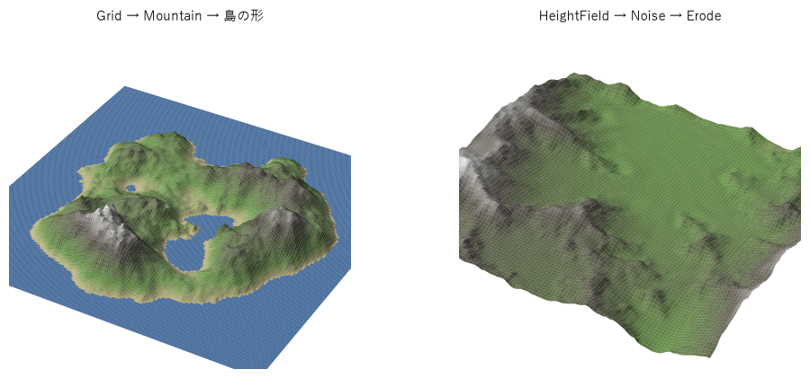
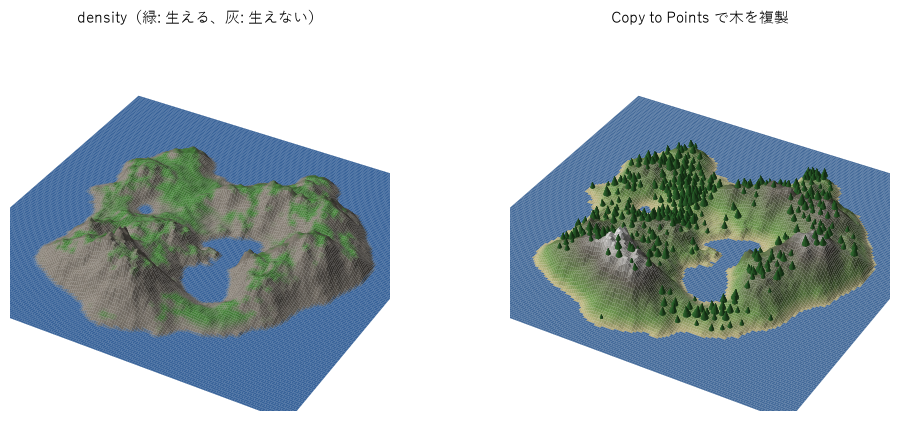
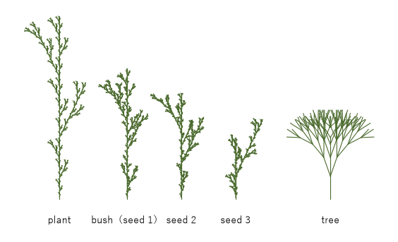
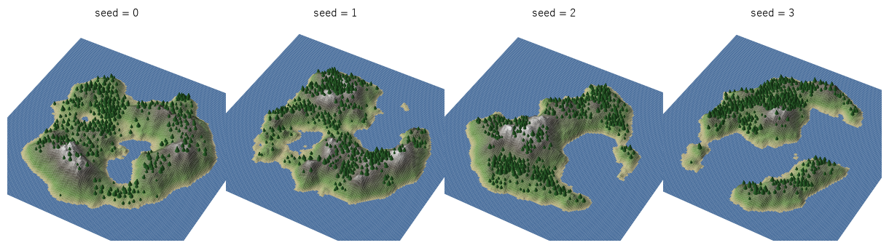

第 16 章　Houdini によるノードベースの生成
============================================================

映画やゲームの制作現場では、プロシージャル生成の多くを Houdini のようなノードベースのツールで行う。処理の 1 段階を 1 つの\ **ノード**\ で表し、ノードをつないだグラフ（\ **ネットワーク**\ ）で生成の手順全体を表す。本章では、第 II 部で Python で実装した地形（第 7 章）、L-system（第 8 章）、散布（第 10 章）を Houdini のネットワークで組み直し、ノードベースの生成の考え方と、Python で書いた場合との違いを確かめる。

Houdini の画面の操作やノードの一覧は、別の文書「Houdini 入門」で扱っている。本章ではそれらを前提とせず、ネットワークを Python スクリプトから組み立てる。スクリプトなら、本文と同じネットワークを誰でも再現できるし、どのノードのどのパラメーターを設定したかを、文字として正確に示せるからである。

本章のスクリプトは examples/houdini にあり、:download:`houdini_examples.zip <_generated/downloads/houdini_examples.zip>` からまとめてダウンロードできる。

* :download:`hou_common.py <../examples/houdini/hou_common.py>`: 各スクリプトで共通に使う関数
* :download:`build_terrain.py <../examples/houdini/build_terrain.py>`: 地形のネットワーク
* :download:`build_scatter.py <../examples/houdini/build_scatter.py>`: 地形に木を散布するネットワーク
* :download:`build_lsystem.py <../examples/houdini/build_lsystem.py>`: L-system のネットワーク
* :download:`export_variations.py <../examples/houdini/export_variations.py>`: シードを変えた結果の一括書き出し
* :download:`render_previews.py <../examples/houdini/render_previews.py>`: 書き出した OBJ ファイルから本章の図を描く（通常の Python で実行する）
* examples/houdini/vex/: Attribute Wrangle に設定する VEX のコード

動作は Houdini 22.0.466 で確かめた。

非破壊ワークフローとノードグラフ
------------------------------------------------------------

ノードとジオメトリ
^^^^^^^^^^^^^^^^^^^^^^^^^^^^^^^^^^^^^^^^^^^^^^^^^^^^^^^^^^^^

Houdini で形を扱うノードは\ **SOP**\ （Surface Operator）と呼ばれる。SOP は、入力のジオメトリ（形のデータ）を受け取り、加工したジオメトリを出力する。ジオメトリは次の要素から成る。

* **ポイント**: 位置を持つ点。第 6 章のメッシュの頂点に当たる。
* **プリミティブ**: ポイントを結んでできる多角形・折れ線や、ボリューム（3 次元の格子に値を持つデータ）など。
* **属性**: ポイントやプリミティブに付けた名前付きの値。位置 ``P`` も属性の 1 つである。

属性は、ノードの間で情報を受け渡す手段になる。あるノードが計算した値を属性として書き込み、下流のノードがその属性を読んで処理を変える。本章で使う主な属性を次の表に示す。

.. list-table:: 本章で使う主な属性
   :header-rows: 1
   :widths: 18 22 60

   * - 属性
     - 型
     - 意味
   * - ``P``
     - 3 次元ベクトル
     - ポイントの位置
   * - ``N``
     - 3 次元ベクトル
     - 法線（面の向き）。斜面の傾きの計算に使う
   * - ``Cd``
     - 3 次元ベクトル
     - 色（RGB）。本章では確認用の色に使う
   * - ``density``
     - 実数
     - 本章で独自に定義した、木の生えやすさ。Scatter SOP が散布の密度に使う
   * - ``pscale``
     - 実数
     - 複製するときの大きさの倍率。Copy to Points SOP が読む
   * - ``orient``
     - 4 次元ベクトル
     - 複製するときの向きを表す四元数（クォータニオン）。Copy to Points SOP が読む

非破壊ワークフロー
^^^^^^^^^^^^^^^^^^^^^^^^^^^^^^^^^^^^^^^^^^^^^^^^^^^^^^^^^^^^

ノードベースの生成の最大の特徴は、作業が\ **非破壊**\ になることである。モデリングソフトで頂点を手で動かすと、元の形は失われる。ノードのネットワークでは、各ノードが「何をするか」とそのパラメーターだけを持ち、結果のジオメトリは入力から毎回計算し直される。そのため、どの段階に戻ってパラメーターを変えても、それより後の処理はすべて新しい値で計算し直される。地形の起伏を変えれば、その上に散布した木の位置も自動的に変わる。

ノードの出力を計算することを、Houdini では\ **クック**\ と呼ぶ。Houdini は各ノードの出力を保存しておき、パラメーターや入力が変わったノードと、その下流のノードだけを「要再計算」の状態にする。表示や書き出しで出力が必要になったとき、要再計算のノードだけをクックし直す。上流の重い処理（たとえば侵食のシミュレーション）は、下流のパラメーターを変えても計算し直さずに済む。

Python のスクリプトで書いた生成と比べると、次のようになる。

.. list-table:: Python のスクリプトとノードのネットワークの比較
   :header-rows: 1
   :widths: 20 40 40

   * - 観点
     - Python のスクリプト（第 II 部）
     - ノードのネットワーク
   * - 処理の単位
     - 関数
     - ノード
   * - 途中の結果
     - 変数に入り、実行が終わると消える。見るには図を出力するコードを書く
     - 各ノードに残り、どのノードの出力でも画面に表示できる
   * - 変更したとき
     - 最初から実行し直す（キャッシュは自分で作る）
     - 変わったノードより下流だけを計算し直す
   * - パラメーター
     - 関数の引数や定数
     - ノードのパラメーター。式で別のパラメーターと結べる
   * - 差分の管理
     - テキストなので git で差分を取りやすい
     - シーンファイル（.hip）はバイナリなので差分を取りにくい

最後の行の欠点を補うため、本章ではネットワークを Python スクリプトで組み立て、スクリプトを管理の対象にする。

つまみとなるパラメーター
^^^^^^^^^^^^^^^^^^^^^^^^^^^^^^^^^^^^^^^^^^^^^^^^^^^^^^^^^^^^

ネットワークが大きくなると、調整したいパラメーターがあちこちのノードに散らばる。そこで、ネットワークを包む Geometry オブジェクトに、全体を操作する少数のパラメーター（\ **スペアパラメーター**\ ）を追加し、各ノードのパラメーターを式でそれに結び付ける。たとえば Scatter SOP の乱数のシードに ``ch("../seed")`` という式を設定すると、1 つ上の階層のパラメーター ``seed`` の値が使われる。

.. literalinclude:: ../examples/houdini/hou_common.py
   :language: python
   :pyobject: add_controls
   :lineno-match:
   :caption: examples/houdini/hou_common.py（add_controls）

本章の散布の例では、``seed``\ ・\ ``tree_count``\ ・\ ``max_slope`` の 3 つを用意し、地形のノイズ・散布の乱数・木の向きの乱数を 1 つの ``seed`` で切り替える。少数の「つまみ」から多数の内部パラメーターを決めるこの設計は、第 17 章で改めて扱う。

スクリプトでネットワークを組む
------------------------------------------------------------

Houdini の Python の API は ``hou`` モジュールで提供される。``hou`` は Houdini の中（Python Shell など）か、Houdini に付属するコマンドラインの Python である\ **hython**\ からだけ使える。hython は画面を開かずに Houdini のシーンを作り、クックし、ファイルに書き出せる。

本章のスクリプトは、どれも同じ形をしている。``build()`` がネットワークを作って出力ノードを返し、``main()`` がそれを呼んでから、全ノードをクックしてエラーが無いことを確かめ、ポイント数などを表示し、シーンを examples/houdini/out/ に .hip ファイルとして保存する。ノードの作成とエラーの確認は hou_common.py にまとめた。

.. literalinclude:: ../examples/houdini/hou_common.py
   :language: python
   :pyobject: check_errors
   :lineno-match:
   :caption: examples/houdini/hou_common.py（check_errors）

コマンドプロンプトで次のように実行する。

.. code-block:: bat
   :linenos:

   cd examples\houdini
   set HYTHON="C:\Program Files\Side Effects Software\Houdini 22.0.466\bin\hython.exe"
   %HYTHON% build_terrain.py
   %HYTHON% build_scatter.py
   %HYTHON% build_lsystem.py

保存した out/terrain.hip などを Houdini で開くと、スクリプトが組んだネットワークをそのまま調べたり、パラメーターを変えて試したりできる。Houdini の Python Shell から ``build()`` を呼んで、開いているシーンの中にネットワークを作ることもできる（各スクリプトの冒頭の説明を参照）。

なお、Houdini のライセンスの種類によっては .hip の形式で保存できず、.hipnc（Apprentice 版）や .hiplc（Indie 版）の形式を使う。その場合は hou_common.py の ``save_hip`` の拡張子を変更する。

地形：第 7 章との対比
------------------------------------------------------------

build_terrain.py は、2 通りの方法で地形を作る。1 つはポリゴンの格子を変位させる方法、もう 1 つはハイトフィールドを使う方法である。

.. _fig-houdini-terrain-network:

.. graphviz::
   :caption: build_terrain.py が作るネットワーク（/obj/terrain）。緑は VEX のコードを持つノード、橙は出力ノード
   :align: center

   digraph G {
       rankdir=TB;
       node [shape=box, style="rounded,filled", fillcolor="#eef3fb", color="#4c72b0", fontsize=11];
       edge [color="#555555"];
       grid [label="grid\n(Grid)"];
       mountain [label="mountain\n(Mountain)"];
       island [label="island\n(Attribute Wrangle)\nisland.vex", fillcolor="#e8f4ea", color="#55a868"];
       normal [label="normal\n(Normal)"];
       out1 [label="OUT_island", shape=ellipse, fillcolor="#fdf0e6", color="#dd8452"];
       hf [label="heightfield\n(HeightField)"];
       hfn [label="heightfield_noise\n(HeightField Noise)"];
       hfe [label="heightfield_erode\n(HeightField Erode)"];
       conv [label="convert_to_polygons\n(Convert HeightField)"];
       out2 [label="OUT_heightfield", shape=ellipse, fillcolor="#fdf0e6", color="#dd8452"];
       grid -> mountain -> island -> normal -> out1;
       hf -> hfn -> hfe -> conv -> out2;
   }

ポリゴンの地形
^^^^^^^^^^^^^^^^^^^^^^^^^^^^^^^^^^^^^^^^^^^^^^^^^^^^^^^^^^^^

左の流れは、第 7 章のハイトマップの地形と同じ考え方である。Grid SOP で 20 × 20 の正方形を 160 × 160 の四角形に分割し、Mountain SOP で各ポイントを法線の向き（上向き）にフラクタルノイズの値だけ動かす。Mountain SOP の ``height`` が起伏の高さ、``elementsize`` が山の大きさ（ノイズの波長）、``oct`` がオクターブ数、``rough`` がオクターブごとの振幅の倍率で、第 3 章の fBm のパラメーターにそのまま対応する。

.. literalinclude:: ../examples/houdini/build_terrain.py
   :language: python
   :pyobject: add_island_terrain
   :lineno-match:
   :caption: examples/houdini/build_terrain.py（add_island_terrain）

Mountain SOP には乱数のシードのパラメーターが無いので、ノイズを読み取る位置（``offsetx``\ ・\ ``offsetz``\ ）をシードに比例してずらし、シードの代わりにしている（47〜48 行目）。ノイズは場所ごとに値が決まる関数なので、読み取る場所をずらせば別の地形が得られる。

その後の Attribute Wrangle で、中心から離れるほど高さを下げて島の形にする。ハイトマップの値を位置に応じて変換する処理を、VEX という言語で書いたものである（VEX は後の節で説明する。本文の VEX のコードは、文法の近い C# の規則で色分けして表示している）。

.. literalinclude:: ../examples/houdini/vex/island.vex
   :language: csharp
   :linenos:
   :caption: examples/houdini/vex/island.vex

``smooth`` は VEX の関数で、GLSL の ``smoothstep`` に当たる。最後の Normal SOP は、変位した後の形から法線を計算し直す。次節の散布で斜面の傾きを求めるのに使う。

ハイトフィールドの地形
^^^^^^^^^^^^^^^^^^^^^^^^^^^^^^^^^^^^^^^^^^^^^^^^^^^^^^^^^^^^

右の流れは、Houdini の\ **ハイトフィールド**\ を使う。ハイトフィールドは、2 次元の格子の各マスに高さなどの値を持つボリュームで、第 7 章で NumPy の 2 次元配列として扱ったハイトマップそのものである。高さのほかに、マスク（処理を効かせる範囲）などの値を「レイヤー」として重ねて持てる。HeightField Noise でノイズを足し、HeightField Erode で水による侵食を計算する。

HeightField Erode は、時間を進めながら侵食を計算するシミュレーションのノードである。``freezeframe`` に指定したフレームまで侵食を進めた結果で止まるので、スクリプトでは 20 にしている。第 7 章の侵食と同じく、計算には時間がかかる（100 × 100 の格子で数秒）。最後に Convert HeightField でポリゴンに変換する。

.. _fig-houdini-terrain:

   build_terrain.py の 2 つの出力。左はポリゴンの島、右はハイトフィールドの地形（侵食後）。高さに応じて色を付けた

2 つの方法は、次のように使い分ける。ポリゴンの方法は、地形を普通のメッシュとして扱えるので、任意の形（球の表面など）に応用しやすい。ハイトフィールドは高さの 2 次元配列に特化しているぶん、侵食・マスク・テクスチャ用のレイヤーなど地形向けのノードがそろっていて、大きな地形も速く扱える。

.. list-table:: 第 7 章の Python 実装と Houdini のノードの対応
   :header-rows: 1
   :widths: 35 65

   * - 第 7 章の処理
     - Houdini のノード
   * - 格子を作る
     - Grid、HeightField
   * - fBm のノイズで高さを決める
     - Mountain、HeightField Noise
   * - 島の形への整形・高さの変換
     - Attribute Wrangle（VEX）、HeightField Remap など
   * - 水による侵食
     - HeightField Erode
   * - メッシュに変換して法線を求める
     - Convert HeightField、Normal

散布：第 10 章との対比
------------------------------------------------------------

build_scatter.py は、前節の島の地形に木を散布する。第 10 章で扱った「マスクに従った散布」「点の間隔をそろえる配置」「インスタンスの大きさと向きのばらつき」を、それぞれノードで表す。点の間隔は、第 10 章ではポアソンディスク・サンプリングでそろえたが、Houdini の Scatter SOP では、置いた点を互いに押し離す緩和（relax）でそろえる。

.. _fig-houdini-scatter-network:

.. graphviz::
   :caption: build_scatter.py が作るネットワーク（/obj/scatter）。左上の 4 ノードは build_terrain.py と同じ
   :align: center

   digraph G {
       rankdir=TB;
       node [shape=box, style="rounded,filled", fillcolor="#eef3fb", color="#4c72b0", fontsize=11];
       edge [color="#555555"];
       grid [label="grid"];
       mountain [label="mountain"];
       island [label="island\nisland.vex", fillcolor="#e8f4ea", color="#55a868"];
       normal [label="normal"];
       density [label="slope_density\n(Attribute Wrangle)\nslope_density.vex", fillcolor="#e8f4ea", color="#55a868"];
       scatter [label="scatter\n(Scatter)"];
       inst [label="instance_attribs\n(Attribute Wrangle)\ninstance_attribs.vex", fillcolor="#e8f4ea", color="#55a868"];
       leaves [label="leaves\n(Tube)"];
       trunk [label="trunk\n(Tube)"];
       lc [label="leaves_color\n(Color)"];
       tc [label="trunk_color\n(Color)"];
       cone [label="cone_tree\n(Merge)"];
       lsys [label="lsystem_tree\n(L-System)"];
       sw [label="tree_shape\n(Switch)"];
       copy [label="copy_to_points\n(Copy to Points)"];
       oterrain [label="OUT_terrain", shape=ellipse, fillcolor="#fdf0e6", color="#dd8452"];
       opoints [label="OUT_points", shape=ellipse, fillcolor="#fdf0e6", color="#dd8452"];
       otrees [label="OUT_trees", shape=ellipse, fillcolor="#fdf0e6", color="#dd8452"];
       merge [label="merge\n(Merge)"];
       oscene [label="OUT_scene", shape=ellipse, fillcolor="#fdf0e6", color="#dd8452"];
       grid -> mountain -> island -> normal -> density -> scatter -> inst;
       leaves -> lc -> cone;
       trunk -> tc -> cone;
       cone -> sw [label="0", fontsize=10];
       lsys -> sw [label="1", fontsize=10];
       sw -> copy [headlabel="入力 0", labeldistance=3.5, labelangle=-35, fontsize=10];
       inst -> copy [headlabel="入力 1", labeldistance=3.5, labelangle=35, fontsize=10];
       density -> oterrain;
       inst -> opoints;
       copy -> otrees;
       oterrain -> merge;
       otrees -> merge;
       merge -> oscene;
   }

.. literalinclude:: ../examples/houdini/build_scatter.py
   :language: python
   :pyobject: build
   :lineno-match:
   :caption: examples/houdini/build_scatter.py（build）

各段階の役割は次のとおりである。

#. **密度の計算**\ （slope_density）: 斜面の傾きと高さから、木の生えやすさを 0〜1 の属性 ``density`` として各ポイントに書き込む。第 10 章のマスクに従った散布で使う、密度のマスクに当たる。
#. **散布**\ （scatter）: Scatter SOP は、面の上にランダムに点を置く。``usedensityattrib`` を有効にすると、属性 ``density`` に比例する密度で置く。``relaxpoints`` を有効にすると、置いた点を互いに押し離して間隔をそろえる（第 10 章で扱う、点の間隔をそろえる処理に当たる）。点の総数は ``tree_count`` で決まる。
#. **インスタンスの属性**\ （instance_attribs）: 点ごとに大きさ ``pscale`` と向き ``orient`` を乱数で決める。
#. **複製**\ （copy_to_points）: Copy to Points SOP は、入力 0 の形を、入力 1 の各ポイントに複製する。その際、ポイントの ``pscale`` で拡大し、``orient`` で回転する。インスタンスごとに変換を計算して形を置く処理を、属性を書くだけで指示できる。

Scatter SOP は、入力のポイントの属性を、散布した点の位置で補間して引き継ぐ。そのため、instance_attribs では散布した点の ``density`` を読んで、生えやすい所ほど木を大きくできる。

.. _fig-houdini-scatter:

   散布の結果（seed = 0）。左は density を色で表したもの（緑ほど生えやすい）、右は 400 本の木を複製した結果

複製する木の形は Switch SOP で選ぶ。入力 0 は円錐と円柱を組み合わせた簡易な木、入力 1 は次々節の L-system の木である。Switch の ``input`` を 1 にするだけで、散布の結果はそのままに木の形だけが差し替わる。下流のノードは、受け取る形が何であるかを知らなくてよい。非破壊のネットワークでは、このように部品を差し替えて試すことが容易である。

VEX によるポイント処理
------------------------------------------------------------

**VEX**\ は、Houdini でジオメトリやボリュームを処理するための、C 言語に似た文法の言語である。Attribute Wrangle SOP に VEX のコードを書くと、そのコードが各ポイントに対して 1 回ずつ実行される。各ポイントの処理は互いに独立しているので、Houdini は多数のポイントを並列に処理する。1 つのコードを全画素で並列に実行する GLSL のフラグメントシェーダーと同じ考え方である。

コードの中では、``@`` を付けた名前で属性を読み書きする。``@P`` は処理中のポイントの位置、``@ptnum`` はポイントの番号である。新しい属性は、``f@density`` のように型を表す文字（\ ``f`` は実数、``v`` はベクトル、``p`` は 4 次元ベクトル）を付けて書くと作られる。``chf("名前")`` はノードのパラメーターの値を読む関数で、GLSL の uniform 変数に当たる。

斜面の傾きによる密度
^^^^^^^^^^^^^^^^^^^^^^^^^^^^^^^^^^^^^^^^^^^^^^^^^^^^^^^^^^^^

slope_density.vex は、法線から斜面の傾きを求め、傾きと高さから ``density`` を決める。

.. literalinclude:: ../examples/houdini/vex/slope_density.vex
   :language: csharp
   :linenos:
   :caption: examples/houdini/vex/slope_density.vex

単位法線 :math:`\boldsymbol{n}` と上向きの単位ベクトル :math:`(0, 1, 0)` のなす角が、斜面の傾き :math:`\theta` になる。内積が :math:`n_y` になるので、

.. math::

   \theta = \arccos n_y

である（4 行目）。水平な地面では :math:`\theta = 0`、垂直な崖では :math:`\theta = 90^\circ` になる。傾きが ``max_slope`` に近づくにつれて 0 に下がるマスクと、海岸付近と山頂を除くマスクを掛け合わせて ``density`` とする。``max_slope`` はノードのパラメーターだが、build_scatter.py では式 ``ch("../max_slope")`` で Geometry オブジェクトのつまみに結んでいる。

大きさと向きのばらつき
^^^^^^^^^^^^^^^^^^^^^^^^^^^^^^^^^^^^^^^^^^^^^^^^^^^^^^^^^^^^

instance_attribs.vex は、木 1 本ごとの大きさと向きを決める。

.. literalinclude:: ../examples/houdini/vex/instance_attribs.vex
   :language: csharp
   :linenos:
   :caption: examples/houdini/vex/instance_attribs.vex

VEX の ``rand`` は、与えた値から決まる 0〜1 の乱数を返す、状態を持たない関数である。第 2 章のハッシュ関数と同じく、ポイント番号・シード・用途の番号の組から乱数を作るので、ポイントごとに独立した値が得られ、同じシードなら何度クックしても同じ結果になる。用途の番号（1、2、3）を変えて、大きさと向きに無関係な乱数を使っている。

向きは四元数で表す。``quaternion(角度, 軸)`` は軸のまわりの回転を表す四元数を作り、``qmultiply`` は 2 つの回転を合成する。鉛直軸のまわりにランダムに回してから、最大 ``max_tilt`` 度だけ傾ける。すべての木がまっすぐ同じ向きに立っていると、複製したことが目立つ。わずかな傾きと大きさのばらつきで、それを和らげる。

NumPy との比較
^^^^^^^^^^^^^^^^^^^^^^^^^^^^^^^^^^^^^^^^^^^^^^^^^^^^^^^^^^^^

第 II 部の Python の実装では、全ポイントの座標を配列にまとめ、配列全体の演算として書いた。VEX では 1 ポイント分の処理を書き、全ポイントへの適用は Houdini に任せる。``if`` 文で処理を分けるのも、配列の演算ではマスクを使う必要があるのに対し、VEX ではそのまま書ける（slope_density.vex の 21〜23 行目）。一方、近くのポイントを探すなどの、ほかのポイントを参照する処理には、``nearpoints`` などの専用の関数を使う。

L-system：第 8 章との対比
------------------------------------------------------------

L-System SOP は、第 8 章の L-system をそのままノードにしたものである。公理（\ ``premise``\ ）と書き換え規則（\ ``rule1``\ 〜\ ``rule25``\ ）を文字列で与え、``generations`` 回書き換えた記号列をタートルで解釈して、枝を折れ線（または管）として出力する。

.. graphviz::
   :caption: build_lsystem.py が作るネットワーク（/obj/lsystem）
   :align: center

   digraph G {
       rankdir=TB;
       node [shape=box, style="rounded,filled", fillcolor="#eef3fb", color="#4c72b0", fontsize=11];
       edge [color="#555555"];
       plant [label="plant\n(L-System)"];
       b1 [label="bush_seed1\n(L-System)"];
       b2 [label="bush_seed2\n(L-System)"];
       b3 [label="bush_seed3\n(L-System)"];
       tree [label="tree\n(L-System)"];
       merge [label="merge\n(Merge)"];
       out [label="OUT_lsystem", shape=ellipse, fillcolor="#fdf0e6", color="#dd8452"];
       {plant b1 b2 b3 tree} -> merge -> out;
   }

.. literalinclude:: ../examples/houdini/build_lsystem.py
   :language: python
   :pyobject: add_lsystem
   :lineno-match:
   :caption: examples/houdini/build_lsystem.py（add_lsystem）

L-System SOP のタートルの主な記号は次のとおりである。Prusinkiewicz と Lindenmayer の『The Algorithmic Beauty of Plants』（1990 年）以来の標準的な記法とほぼ同じである。

.. list-table:: L-System SOP の主な記号
   :header-rows: 1
   :widths: 20 80

   * - 記号
     - 意味
   * - ``F``
     - 1 歩進みながら枝を描く
   * - ``+``\ 、``-``
     - 左右に曲がる（角度は ``angleinit``\ ）
   * - ``&``\ 、``^``
     - 上下に向きを変える（ピッチ）
   * - ``/``\ 、``\``
     - 進む向きを軸にして回る（ロール）。``/(120)`` のように角度を指定できる
   * - ``[``\ 、``]``
     - タートルの状態をスタックに積む・戻す（枝分かれ）
   * - ``!``
     - 枝の太さに倍率（\ ``thickscale``\ ）を掛ける
   * - ``"``
     - 歩幅に倍率（\ ``stepscale``\ ）を掛ける

build() では、3 種類の植物を作る。草（plant）は同書に載っているよく知られた規則 ``F=F[+F]F[-F]F`` を 4 回適用したもの、木（tree）は 3 次元で 3 本ずつ枝分かれするものである。茂み（bush）は\ **確率付きの規則**\ を使う。

.. literalinclude:: ../examples/houdini/build_lsystem.py
   :language: python
   :start-after: # 確率付きの規則
   :end-before: tree = add_tree(geo)
   :lineno-match:
   :caption: examples/houdini/build_lsystem.py（build の一部）

同じ記号 ``F`` に 3 つの規則があり、末尾の ``:0.34`` などがそれぞれの規則が選ばれる確率である。どれが選ばれるかは ``randseed`` のシードで決まるので、規則は同じでも、シードごとに異なる形の茂みになる（\ :numref:`fig-houdini-lsystem`\ ）。

.. _fig-houdini-lsystem:

   L-System SOP の出力を正面から見たもの。茂みは同じ規則でシードだけが異なる

L-System SOP の出力は普通のジオメトリなので、前節の散布の Switch に木（lsystem_tree）としてつないで、島全体に複製できる。

hython による一括生成
------------------------------------------------------------

ネットワークを一度作れば、パラメーターを変えては結果を書き出す処理を自動化できる。ゲームのために島を 100 個用意する、シードを変えた候補を並べて良いものを選ぶ、といった作業である。export_variations.py は、build_scatter.py のネットワークを作り、``seed`` を変えながら結果をファイルに書き出す。

.. literalinclude:: ../examples/houdini/export_variations.py
   :language: python
   :pyobject: export_variation
   :lineno-match:
   :caption: examples/houdini/export_variations.py（export_variation）

``geo.parm("seed").set(seed)`` でつまみを変えると、それに式で結ばれた Mountain の位置のずれ・Scatter のシード・VEX のシードが一斉に変わり、下流のノードが要再計算になる。``saveToFile`` は、ファイル名の拡張子に応じた形式でジオメトリを書き出す。.bgeo.sc は Houdini の形式（bgeo）を圧縮したもので、すべての属性をそのまま保存する。.obj はほかのツールでも読める形式で、ポリゴンと色だけが残る。

次のように実行する。引数は書き出す個数である。

.. code-block:: bat
   :linenos:

   %HYTHON% export_variations.py 4

出力は次のようになる。

.. code-block:: text
   :linenos:

   seed   0: 陸地 41.6%、木 400 本、pscale の平均 0.456
   seed   1: 陸地 33.3%、木 400 本、pscale の平均 0.443
   seed   2: 陸地 29.5%、木 400 本、pscale の平均 0.448
   seed   3: 陸地 26.9%、木 400 本、pscale の平均 0.460

.. _fig-houdini-variations:

   export_variations.py が書き出した 4 つの島（render_previews.py で OBJ ファイルを描いたもの）

:numref:`fig-houdini-variations` を見ると、島の形はシードごとに大きく変わる。一方、木の本数は陸地の広さによらず常に 400 本なので、陸地が狭い島ほど木が密集する。木の密度を一定にしたいなら、``tree_count`` を固定値にするのではなく、Scatter SOP で単位面積あたりの密度を指定する方法（\ ``forcetotal`` を無効にして ``densityscale`` を使う）に変える必要がある。このように、大量に生成した結果を数値で確かめると、1 つずつ見ていては気付きにくい性質が分かる。生成した結果をまとめて評価する方法は、第 17 章で扱う。

数百・数千の結果を書き出すような大規模な処理では、Houdini の PDG（TOP ネットワーク）を使うと、パラメーターの組み合わせごとの処理を複数のプロセスに分けて並列に実行できる。本章の例程度の規模なら、hython のスクリプトの繰り返しで十分である。

本章の図について
^^^^^^^^^^^^^^^^^^^^^^^^^^^^^^^^^^^^^^^^^^^^^^^^^^^^^^^^^^^^

本章の地形・散布・L-system の図は、Houdini でレンダリングしたものではない。各スクリプトが書き出した OBJ ファイルを、render_previews.py が通常の Python（matplotlib と、examples/python の共通ライブラリ mesh.py）で描いたものである。OBJ ファイルには、Houdini の ``Cd`` 属性が頂点の色として書かれる。render_previews.py は本文のビルドでは実行しない。

Python 実装との使い分け
------------------------------------------------------------

本書の第 II 部のように自分でコードを書く方法と、Houdini のネットワークを使う方法は、目的によって使い分ける。

.. list-table:: 自作のコードと Houdini の使い分け
   :header-rows: 1
   :widths: 25 37 38

   * - 観点
     - 自作のコード（Python・GLSL・Godot）
     - Houdini のネットワーク
   * - 生成する時点
     - ゲームの実行中にも生成できる
     - 主に制作時に生成し、結果をファイルとして渡す
   * - 試行錯誤
     - 図を出力して確かめる
     - 途中のノードの結果をその場で見ながら調整できる
   * - 部品
     - 自分で書く。仕組みを細部まで理解・制御できる
     - 地形・散布・シミュレーションなどの完成したノードを組み合わせる
   * - 配布
     - コードをそのまま組み込める
     - 実行には Houdini（またはそのライセンス）が要る

両者は排他的ではない。Houdini で作ったネットワークを、パラメーターを公開した部品（HDA、Houdini Digital Asset）にまとめ、Houdini Engine を通してゲームエンジンのエディターの中で使う方法もある。また、仕組みを理解していれば、Houdini のノードが何をしているのかを推測でき、ノードで足りない部分を VEX や Python で補える。第 II 部で手法を自分で実装したのは、そのためでもある。

まとめ
------------------------------------------------------------

* ノードベースの生成では、処理をノード、手順をネットワークで表す。各ノードはパラメーターだけを持ち、結果は入力から計算し直されるので、どの段階に戻って変更しても下流が自動で更新される（非破壊）。
* ノードの間の情報は属性（\ ``P``\ ・\ ``N``\ ・\ ``density``\ ・\ ``pscale``\ ・\ ``orient`` など）で受け渡す。
* Geometry オブジェクトに少数の「つまみ」を作り、各ノードのパラメーターを式で結ぶと、シード 1 つで地形・散布・向きの乱数をまとめて切り替えられる。
* 第 7 章の地形は Grid・Mountain・HeightField 系のノード、第 10 章の散布は Scatter と Copy to Points、第 8 章の L-system は L-System SOP で組める。
* VEX は、1 ポイント分の処理を書いて全ポイントに並列に適用する言語で、GLSL のフラグメントシェーダーと同じ考え方で書ける。
* hython を使うと、ネットワークの構築・パラメーターの変更・書き出しを自動化し、バリエーションを一括で生成できる。
