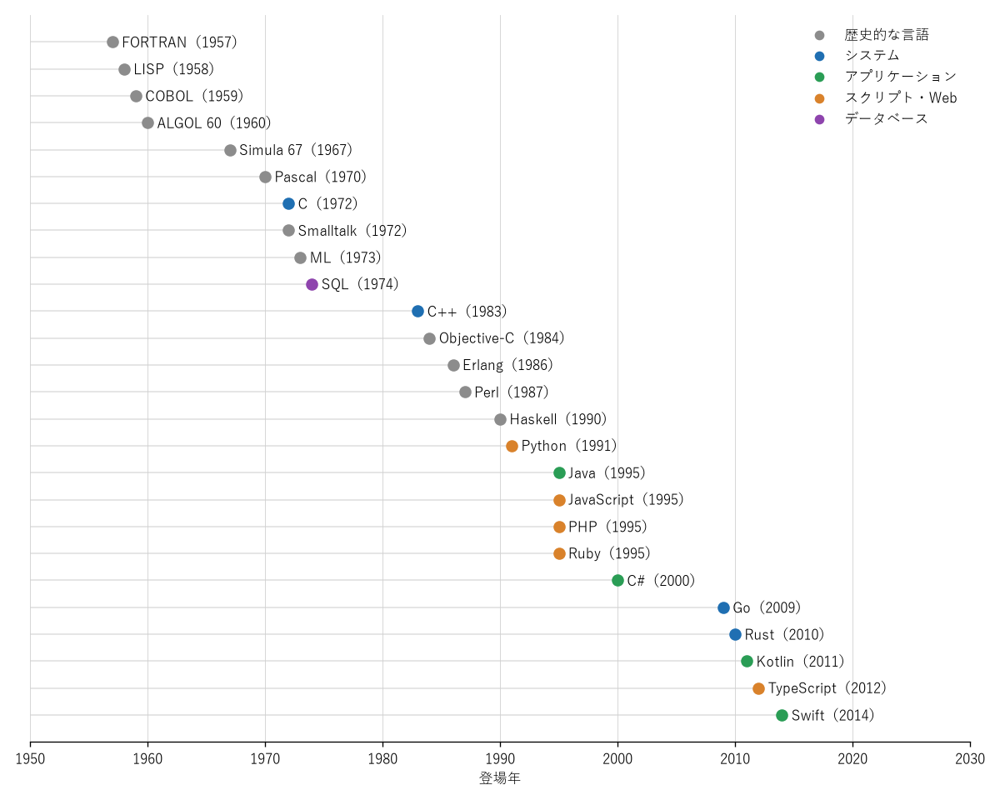

プログラミング言語の歴史
========================

本章では、1950 年代から現在までのプログラミング言語の変遷を、時代ごとの課題と結び付けて概観する。各言語の詳細は\ :doc:`languages/index`\ で述べる。

黎明期（1940〜50 年代）
-----------------------

初期のコンピュータは、機械語を直接入力するか、機械語と 1 対 1 に対応する記号で記述するアセンブリ言語でプログラミングされていた。これらはハードウェアに強く依存し、記述の手間も大きかった。

1957 年、IBM のジョン・バッカスらが科学技術計算向けの **FORTRAN**\ （FORmula TRANslation）を開発した。FORTRAN は数式に近い記法で記述でき、しかも手書きの機械語に匹敵する性能のコードを生成できることを示した。これにより、高水準言語とコンパイラが実用になり得ることが証明された。

1958 年には、ジョン・マッカーシーが記号処理と人工知能研究のために **LISP** を考案した。LISP は、関数を値として扱うこと、再帰、ガベージコレクション、プログラム自体をデータとして扱うことなど、のちの関数型言語や動的言語に受け継がれる多くの概念を最初期に実現した。

1959 年には、事務処理向けの共通言語として **COBOL** の仕様策定が始まった（最初の仕様は 1960 年）。英語に近い構文を採用し、帳票や十進数の計算に強い COBOL は、金融機関や行政の基幹システムで現在も稼働している。

構造化プログラミングの時代（1960〜70 年代）
-------------------------------------------

**ALGOL 60**\ （1960 年）は、ブロック構造、レキシカルスコープ、再帰呼び出しなどを備え、言語の文法を BNF（バッカス・ナウア記法）で厳密に定義した。ALGOL 自体の商用利用は限られたが、Pascal、C、Simula など後続の多くの言語の祖先となった。

1960 年代後半には、ソフトウェアの大規模化に伴い品質や開発期間の問題が深刻になり、「ソフトウェア危機」と呼ばれた。これに対し、``goto`` 文の乱用を避け、順次・分岐・反復の組み合わせでプログラムを構成する構造化プログラミングが提唱された。ニクラウス・ヴィルトが 1970 年に発表した **Pascal** は、構造化プログラミングの教育用言語として広く普及した。

1972 年、ベル研究所のデニス・リッチーは、UNIX を記述するために **C** を開発した。C は高水準言語の記述性と、ハードウェアに近い低水準の操作を両立し、UNIX とともに普及した。現在でも OS や組込みソフトウェアの記述に使われるほか、多くの言語の構文に影響を与えている。

同じ時期には、関数型言語 **ML**\ （1973 年）、論理型言語 **Prolog**\ （1972 年）、そしてリレーショナルデータベースの問い合わせ言語 **SQL**\ （1974 年に SEQUEL として発表）が登場した。

オブジェクト指向の普及（1980〜90 年代）
---------------------------------------

オブジェクト指向の起源は、シミュレーション用に開発された **Simula 67**\ （1967 年）にさかのぼる。Simula はクラス、オブジェクト、継承の概念を導入した。ゼロックスのパロアルト研究所でアラン・ケイらが開発した **Smalltalk**\ （1972 年。一般公開は 1980 年の Smalltalk-80）は、すべてをオブジェクトとメッセージ送信で表す純粋なオブジェクト指向言語であり、統合開発環境やグラフィカルなユーザインタフェースの先駆けともなった。

1980 年代には、C にオブジェクト指向を取り入れた言語が相次いで登場した。ビャーネ・ストロヴストルップの **C++**\ （1983 年に命名）と、Smalltalk のメッセージ送信を C に取り入れた **Objective-C**\ （1984 年）である。C++ は C との互換性と性能を保ちながら抽象化の手段を提供し、1990 年代に大規模ソフトウェア開発の主流となった。

1995 年には、サン・マイクロシステムズが **Java** を発表した。Java は C++ に似た構文を持ちながら、仮想マシン上で動作することで「一度書けばどこでも動く」移植性を実現し、ガベージコレクションによってメモリ管理の負担を取り除いた。Java は企業向けシステムの標準的な言語となった。

Web とスクリプト言語の台頭（1990〜2000 年代）
---------------------------------------------

1990 年代には、コンパイルを必要とせず手軽に書けるスクリプト言語が普及した。テキスト処理に強い **Perl**\ （1987 年）、可読性を重視した **Python**\ （1991 年）、「プログラマの楽しさ」を掲げた日本発の **Ruby**\ （1995 年）が登場した。

同じ 1995 年は、World Wide Web の普及にとって重要な年となった。ネットスケープ・コミュニケーションズのブレンダン・アイクが Web ブラウザで動作する **JavaScript** を開発し、ラスマス・ラードフが Web ページを動的に生成するための **PHP** を公開した。Java も当初はブラウザ上で動くアプレットによって注目を集めた。

2000 年には、マイクロソフトが .NET Framework の中核となる言語として **C#** を発表した。C# は Java と同様に仮想マシン上で動作する言語であり、その後ジェネリクス、LINQ、``async``・``await`` などの機能を他の主要言語に先駆けて取り入れていった。

2000 年代半ばには、Ruby on Rails（2004 年）のような Web アプリケーションフレームワークや、Ajax による動的な Web アプリケーションが普及し、スクリプト言語の存在感がさらに高まった。2009 年に登場した Node.js によって、JavaScript はサーバサイドでも広く使われるようになった。

マルチパラダイムと安全性の時代（2000 年代後半以降）
---------------------------------------------------

2000 年代後半以降、マルチコア CPU の普及、クラウドとモバイルの台頭、ソフトウェアの大規模化を背景に、新しい言語が次々と登場した。これらの言語には、既存の言語の反省を踏まえて安全性・簡潔さ・開発効率を高めようとする共通の傾向がある。

* **Go**\ （2009 年）：Google が、大規模なサーバソフトウェアの開発を効率化するために設計した。簡潔な言語仕様、高速なコンパイル、goroutine による並行処理を特徴とする。
* **Rust**\ （2010 年）：Mozilla の支援を受けて開発された。所有権の仕組みにより、GC なしでメモリ安全性を保証する。
* **Kotlin**\ （2011 年）：JetBrains が開発した JVM 上の言語である。Java との相互運用性を保ちながら、null 安全や簡潔な構文を取り入れた。
* **TypeScript**\ （2012 年）：マイクロソフトが開発した、JavaScript に静的型付けを加えた言語である。
* **Swift**\ （2014 年）：Apple が Objective-C の後継として開発した。安全性と性能を両立し、Apple のプラットフォームにおける標準的な言語となった。

既存の言語も進化を続けている。C++ は 2011 年の C++11 以降、3 年ごとに規格を改訂している。Java は 2014 年の Java 8 でラムダ式を導入し、2018 年からは 6 か月ごとに新しいバージョンを公開している。JavaScript の標準仕様である ECMAScript は、2015 年の ECMAScript 2015 で大幅に拡張され、以降は毎年改訂されている。

言語の系譜
----------

:numref:`fig-timeline` に主な言語の登場年を、:numref:`fig-lineage` に主な言語の間の影響関係を示す。系譜図では、本書で個別に取り上げる 14 言語を年表と同じ分類の色で示し、矢印は影響を与えた言語から受けた言語へ向けて描いている。影響関係は多岐にわたるため、主要なものに限って示す。

.. _fig-timeline:

   主な言語の登場年

.. _fig-lineage:

.. graphviz::
   :caption: 主な言語の影響関係
   :align: center

   digraph lineage {
     rankdir=LR;
     ranksep=0.35;
     nodesep=0.12;
     node [shape=box, style="rounded,filled", fillcolor="#eeeeee", fontsize=10, height=0.3];
     edge [color="#888888", arrowsize=0.6];

     node [fillcolor="#eeeeee"];
     FORTRAN [label="FORTRAN\n1957"];
     LISP [label="LISP\n1958"];
     ALGOL [label="ALGOL 60\n1960"];
     Simula [label="Simula 67\n1967"];
     Pascal [label="Pascal\n1970"];
     Smalltalk [label="Smalltalk\n1972"];
     ML [label="ML\n1973"];
     Scheme [label="Scheme\n1975"];
     ObjC [label="Objective-C\n1984"];
     Erlang [label="Erlang\n1986"];
     Perl [label="Perl\n1987"];
     Haskell [label="Haskell\n1990"];
     Self [label="Self\n1987"];
     Scala [label="Scala\n2004"];

     node [fillcolor="#dbe9f6"];
     C [label="C\n1972"];
     Cpp [label="C++\n1983"];
     Go [label="Go\n2009"];
     Rust [label="Rust\n2010"];

     node [fillcolor="#d9f0df"];
     Java [label="Java\n1995"];
     CSharp [label="C#\n2000"];
     Kotlin [label="Kotlin\n2011"];
     Swift [label="Swift\n2014"];

     node [fillcolor="#fde6cf"];
     Python [label="Python\n1991"];
     JavaScript [label="JavaScript\n1995"];
     PHP [label="PHP\n1995"];
     Ruby [label="Ruby\n1995"];
     TypeScript [label="TypeScript\n2012"];

     FORTRAN -> ALGOL;
     ALGOL -> Simula;
     ALGOL -> Pascal;
     ALGOL -> C;
     LISP -> Scheme;
     LISP -> Smalltalk;
     Simula -> Smalltalk;
     Simula -> Cpp;
     C -> Cpp;
     C -> ObjC;
     Smalltalk -> ObjC;
     Smalltalk -> Ruby;
     Smalltalk -> Self;
     C -> Perl;
     Perl -> Ruby;
     Perl -> PHP;
     C -> PHP;
     C -> Python;
     ML -> Haskell;
     Cpp -> Java;
     Smalltalk -> Java;
     Cpp -> CSharp;
     Java -> CSharp;
     Java -> Scala;
     Scheme -> JavaScript;
     Self -> JavaScript;
     Java -> JavaScript;
     JavaScript -> TypeScript;
     CSharp -> TypeScript;
     C -> Go;
     Pascal -> Go;
     Cpp -> Rust;
     ML -> Rust;
     Haskell -> Rust;
     Erlang -> Rust;
     Java -> Kotlin;
     Scala -> Kotlin;
     CSharp -> Kotlin;
     ObjC -> Swift;
     Rust -> Swift;
     Haskell -> Swift;
   }

この系譜から、次のような流れが読み取れる。

* C の構文は、C++、Java、C#、JavaScript、Go などに受け継がれ、「波かっこ（``{}``）でブロックを表す」言語の大きな系統を形成している。
* Simula と Smalltalk に始まるオブジェクト指向は、C++、Java、C#、Ruby を通じて主流のパラダイムとなった。
* LISP や ML、Haskell に由来する関数型の概念（第一級関数、型推論、代数的データ型、パターンマッチ）は、2000 年代以降の言語に積極的に取り入れられている。

なお、SQL は関係モデルという独自の理論に基づいて設計された言語であり、ここに示した手続き型・オブジェクト指向の系譜とは別系統である。
