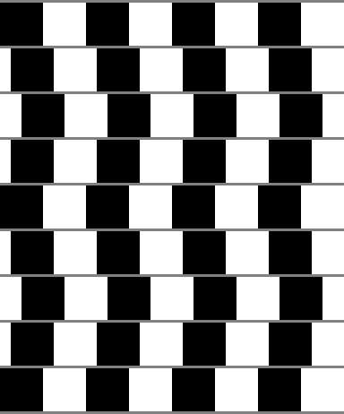
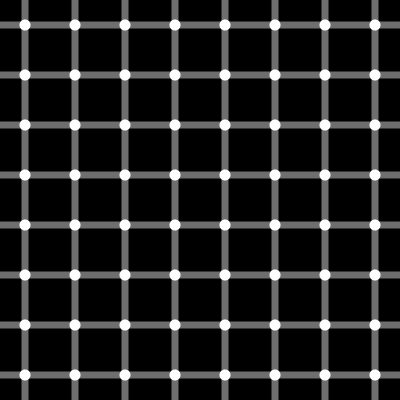
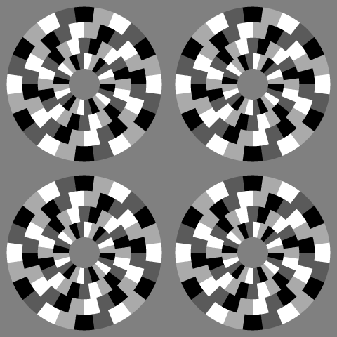
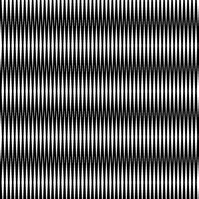
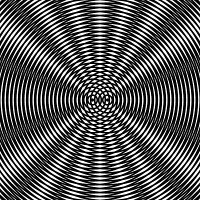
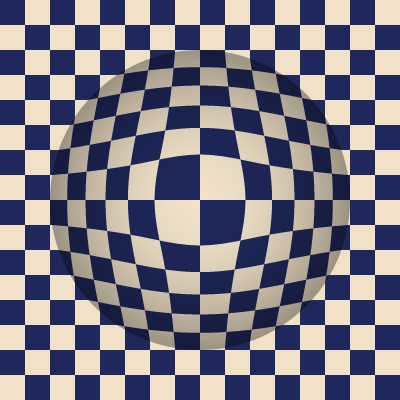

錯視とオプ・アート
==================

**錯視**\ （optical illusion）とは、実際の図形の性質とは異なる大きさ・形・明るさ・動きが見える現象である。錯視を生む図形の多くは、白と黒の縞やタイルを規則的に並べただけの単純なものであり、ここまでの章で扱ってきた「単純な規則から模様を作る」手法と相性がよい。

錯視の効果を作品の主題にした美術の潮流は\ **オプ・アート**\ （op art、optical art）と呼ばれる。Victor Vasarely や Bridget Riley らが代表的な作家で、1965 年にニューヨーク近代美術館で開かれた展覧会「The Responsive Eye」を機に広く知られるようになった。本章では、代表的な錯視の図とオプ・アート風の図を Python で描きながら、それぞれの図が成り立つ条件を確認する。

表示に関する注意
----------------

錯視の見え方は、図の大きさ・画面からの距離・見る人によって変わる。本章の図には、本文で述べる効果が弱くしか感じられないものや、まったく感じられないものもあるかもしれない。また、強い錯視の図を長く見続けると、目が疲れたり気分が悪くなったりする人がいるため、無理に見続けないようにしてほしい。

本章の図は、全て生成した画像と同じ大きさ（等倍）で表示している。細かい縞の画像を拡大・縮小して表示すると、元の画像にない縞（後述するモアレ）が生じたり、細部がつぶれて錯視が弱まったりするためである。ブラウザの表示倍率を変えた場合も同じことが起こる。

細い線や円の縁がぎざぎざになるのを抑えるため、本章の作例では、縦横 4 倍に拡大した画像で各画素の明るさを求めてから、4 × 4 画素ずつの平均を取って縮小している（スーパーサンプリング）。

.. literalinclude:: ../examples/illusions.py
   :linenos:
   :language: python
   :pyobject: pixel_grid
   :caption: examples/illusions.py の pixel_grid 関数

.. literalinclude:: ../examples/illusions.py
   :linenos:
   :language: python
   :pyobject: downsample
   :caption: examples/illusions.py の downsample 関数

カフェウォール錯視
------------------

**カフェウォール錯視**\ （café wall illusion）は、白と黒のタイルを交互に並べた行を灰色の細い目地で区切って積み、行ごとにタイルを少しずつずらすと、実際には水平で平行な目地が傾いて見える錯視である。英国ブリストルのカフェの壁で見つかり、1979 年に Richard Gregory と Priscilla Heard が報告した。

本実装では、タイルの 1/4 枚を単位として、行のずれを 0、1、2、1、0、1、… と往復させている。こうすると、隣り合う 2 行のずれが 1/4 枚ずつになり、目地が交互に逆向きに傾いて、くさび形が並んでいるように見える。

.. literalinclude:: ../examples/illusions.py
   :linenos:
   :language: python
   :pyobject: cafe_wall
   :caption: examples/illusions.py の cafe_wall 関数

この錯視は、次の条件で強くなることが知られている。いずれも、``cafe_wall`` の引数や定数を変えて確かめられる。

- 目地の明るさが、白と黒の中間にある。目地を白や黒にすると、錯視は弱まる。
- 目地が細い。目地が太くなると、錯視は弱まる。
- 隣り合う行のずれが、0 でも半枚でもない。ずれが半枚になると、市松模様になって目地は傾いて見えなくなる。

きらめき格子錯視
----------------

**きらめき格子錯視**\ （scintillating grid illusion）は、黒い背景に灰色の格子線を引き、その交点に白い円を置いた図で起こる。図全体を眺めると、視線を向けていない交点の白い円の中に、黒い点がちらついて見える。視線を向けた交点では黒い点は見えない。1994 年に E. Lingelbach らが報告した錯視で、交点が灰色に見える古典的なヘルマン格子錯視の変種である。

各画素について、最寄りの格子線までの縦・横の距離を求め、線の太さの半分より近ければ灰色に、交点からの距離が円の半径より近ければ白にしている。

.. literalinclude:: ../examples/illusions.py
   :linenos:
   :language: python
   :pyobject: scintillating_grid
   :caption: examples/illusions.py の scintillating_grid 関数

周辺ドリフト錯視
----------------

**周辺ドリフト錯視**\ （peripheral drift illusion）は、静止した図が動いて見える錯視である。1979 年に A. Fraser と K. J. Wilcox が報告し、2003 年に北岡明佳と蘆田宏が、明るさの異なる 4 色を並べることで効果を強めた図を示した。北岡の作品「蛇の回転」はその代表例である。

円盤を同心円状のリングに分け、各リングを扇形の区画に分けて、区画を「黒 → 濃い灰色 → 白 → 薄い灰色」の順で繰り返し塗る。この図を視野の端で見ると、円盤がこの順の向きに回転して見える。本実装では、隣り合うリングで塗る順を逆にし、リングどうしが逆向きに回って見えるようにしている。また、リングごとに区画を半分ずつ回して、区画の境界がそろわないようにしている。

.. literalinclude:: ../examples/illusions.py
   :linenos:
   :language: python
   :pyobject: peripheral_drift
   :caption: examples/illusions.py の peripheral_drift 関数

円盤を直接見つめるより、図の外の一点を見ながら視野の端で円盤を捉えたほうが、動きを感じやすい。視線を別の場所へ移した直後や、まばたきをした直後にも動きが強く感じられる。

モアレ
------

**モアレ**\ （moiré）は、細かい縞模様を 2 つ重ねたときに、どちらの縞にもない粗い縞が現れる現象である。重ねた図の上で線の重なり方が場所によって変わるために生じる、実際に存在する明暗の模様なので、厳密には目の錯覚ではない。しかし、単純な縞を重ねるだけで動きや奥行きを感じさせる模様が生まれるため、オプ・アートでよく使われる。

周期 :math:`d` の同じ縞を 2 つ、互いに角度 :math:`\theta` だけ回して重ねると、2 組の線は少しずつずれながら交わる。線どうしがぴったり重なる場所では黒い部分の面積が小さく（明るく）、線が互い違いになる場所では大きく（暗く）なり、この明暗が粗い縞として見える。その間隔 :math:`D` は次式で表される。

.. math::

   D = \frac{d}{2 \sin(\theta / 2)}

:math:`\theta` が小さいほど :math:`D` は大きくなる。次の作例では :math:`d = 8` ピクセル、:math:`\theta = 5^\circ` なので、:math:`D \approx 91.7` ピクセルになる。生成した画像の行ごとの平均の明るさから縞の間隔を求めると、約 91 ピクセルとなり、式とよく一致した。

.. literalinclude:: ../examples/illusions.py
   :linenos:
   :language: python
   :pyobject: line_grating
   :caption: examples/illusions.py の line_grating 関数

.. literalinclude:: ../examples/illusions.py
   :linenos:
   :language: python
   :pyobject: moire_lines
   :caption: examples/illusions.py の moire_lines 関数

同心円を 2 組、中心を少しずらして重ねても、モアレが現れる。2 つの中心からの距離を :math:`r_1`、:math:`r_2` とすると、線がぴったり重なるのは :math:`r_1 - r_2` が周期の整数倍になる点である。そのような点の集まりは、2 つの中心を焦点とする双曲線になるため、中心から放射状に広がる明暗の帯が見える。

モアレは、意図せずに生じることもある。細かい縞や格子の画像を縮小すると、縞の周期と画素の並びが干渉して、元の画像にない縞が現れる。本資料の他の章の作例でも、細い線が密に並ぶ画像（:doc:`noise`\ のフローフィールドなど）を縮小して表示すると、この現象が起こりうる。避けたい場合は、等倍で表示するか、縮小する前に画像をぼかして細かい縞を取り除くとよい。

格子の歪みによる膨らみ
----------------------

Vasarely は、市松模様や格子のマスを場所によって引き伸ばしたり縮めたりして、平面の画面が球のように膨らんで見える作品（「Vega」のシリーズなど）を数多く制作した。同じ効果は、:doc:`tiling`\ の極座標変換と同じく、模様を参照する座標を変換するだけで作れる。

中心からの距離を、膨らみの半径 :math:`R` で割った値を :math:`t` とする。:math:`t < 1` の範囲では、画素の位置 :math:`\mathbf{p}`\ （中心を原点とする）を次式で中心へ引き寄せた位置 :math:`\mathbf{p}'` の市松模様の色を使う。

.. math::

   \mathbf{p}' = t^{\gamma - 1} \, \mathbf{p} \qquad (\gamma > 1)

:math:`t^{\gamma - 1}` は中心で 0、膨らみの縁で 1 になる。そのため、中心に近い画素ほど強く中心へ引き寄せられ、中央のマスほど大きく引き伸ばされる。縁では :math:`\mathbf{p}' = \mathbf{p}` となるので、膨らみの外の模様と継ぎ目なくつながる。さらに、縁に向かって少しずつ暗くする陰影を加えると、立体感が強まる。

.. literalinclude:: ../examples/illusions.py
   :linenos:
   :language: python
   :pyobject: bulge_checkerboard
   :caption: examples/illusions.py の bulge_checkerboard 関数

まとめ
------

本章の図は、どれもタイル・格子・縞・同心円といった単純な要素を規則的に並べただけのものである。しかし、明るさの組み合わせ、ずらし方、重ね方、座標の変換を少し工夫するだけで、そこにない傾き・点・動き・奥行きが見えるようになる。:doc:`color`\ の配色、:doc:`tiling`\ の格子、:doc:`noise`\ のノイズによる座標の歪みなどと組み合わせれば、オプ・アート風の作品の幅をさらに広げられる。
