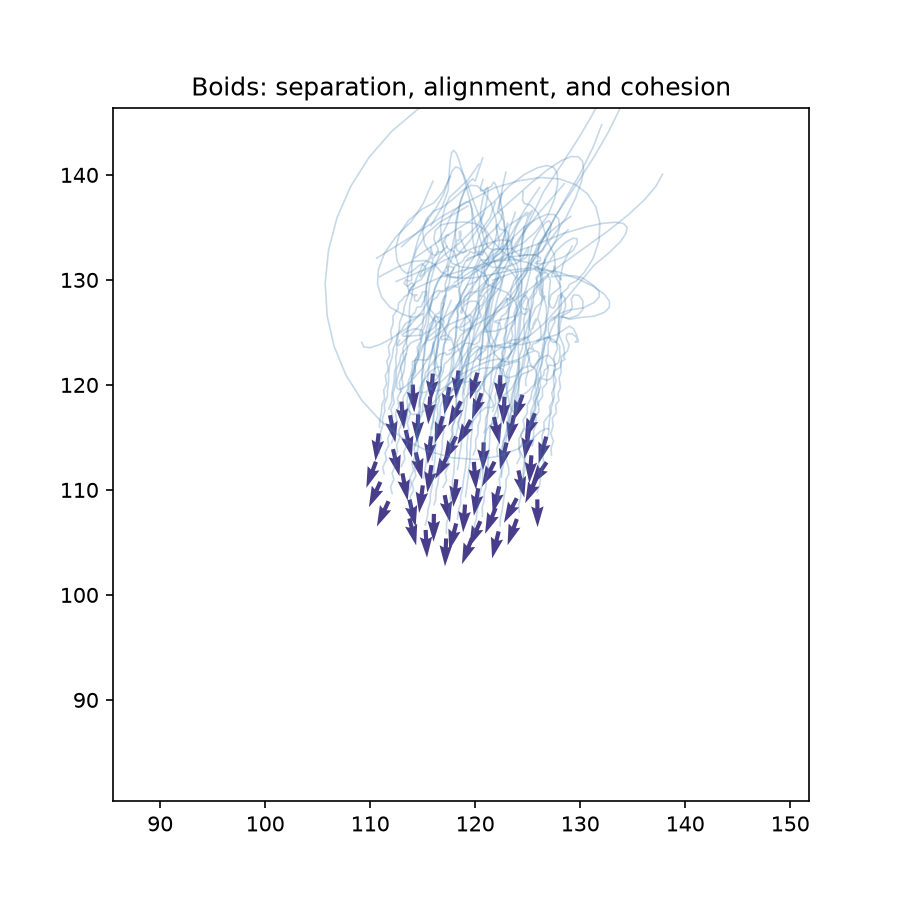
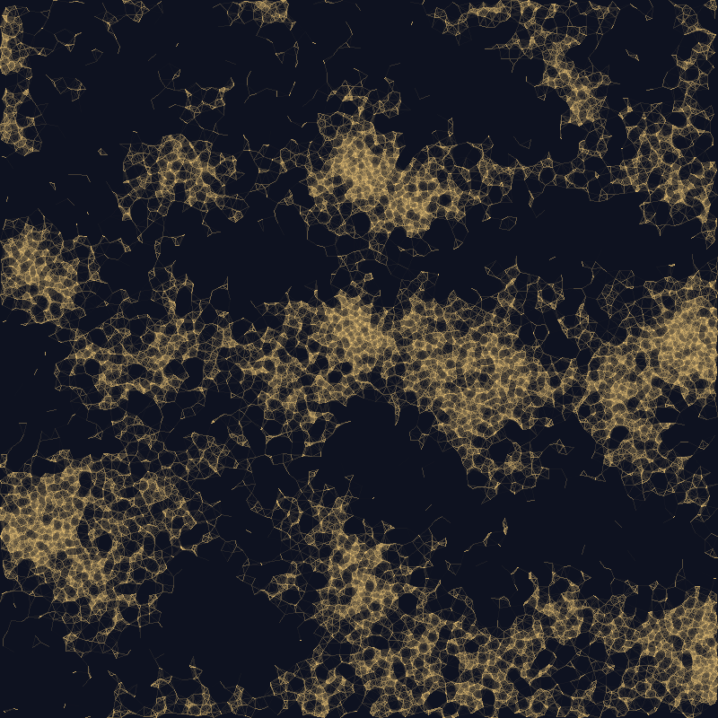
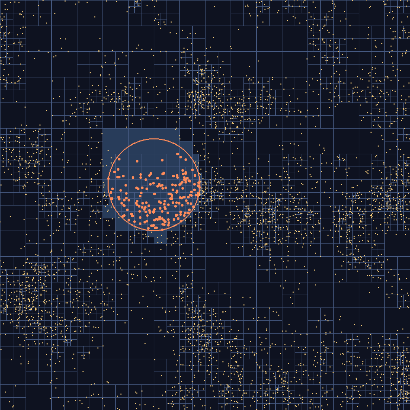
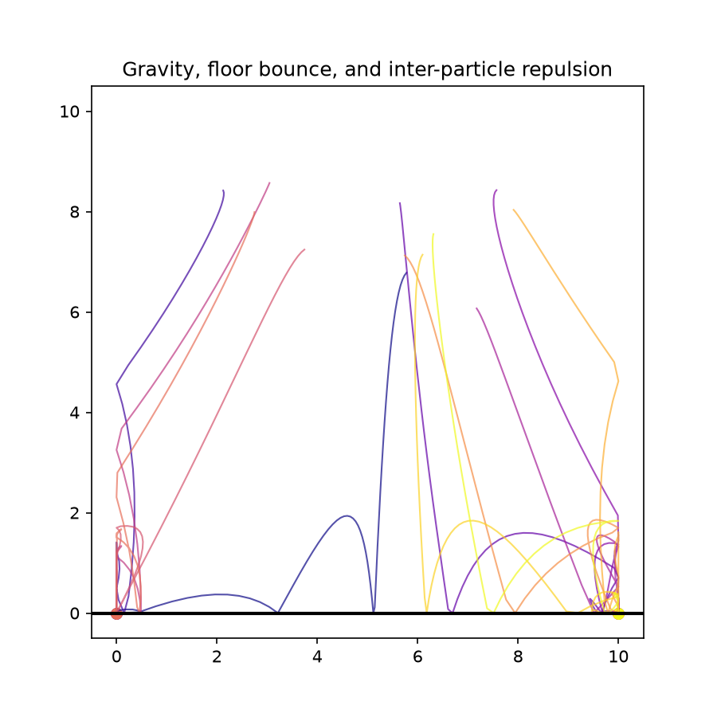
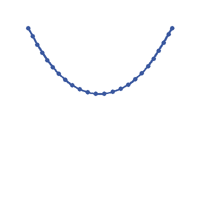
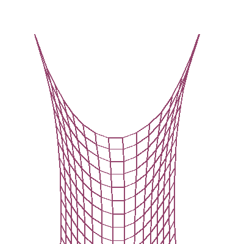
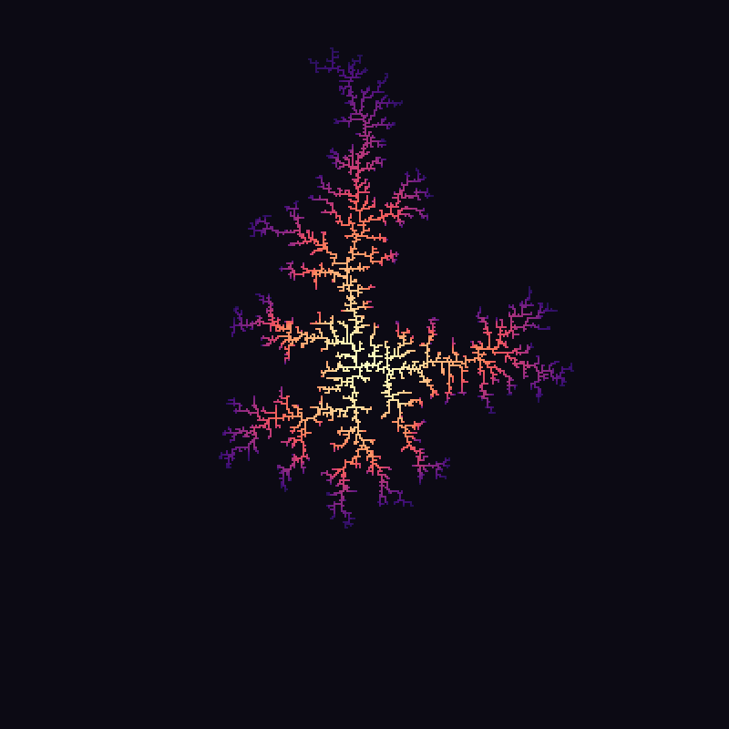
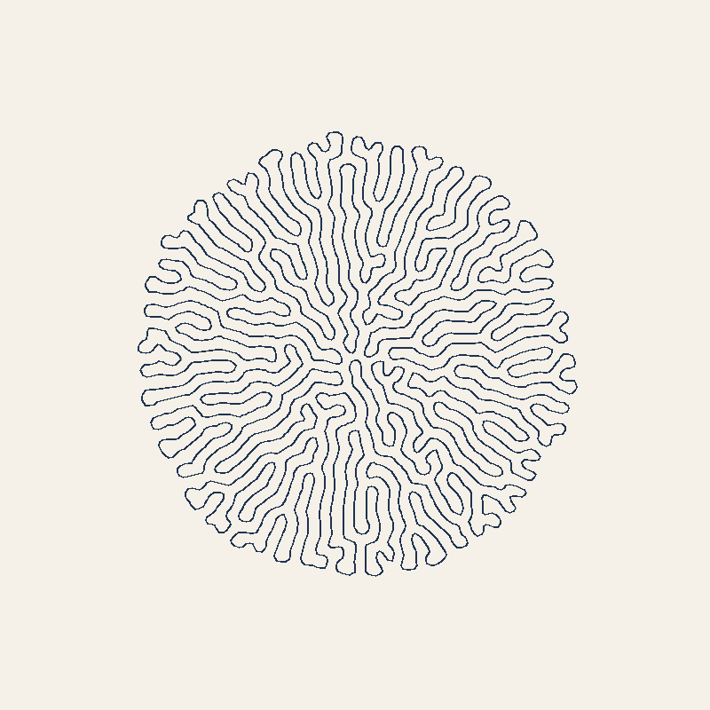

パーティクルシステム
======================

パーティクルの基本構造
------------------------

パーティクルシステムは、位置・速度・加速度という 3 つのベクトルを持つ多数の「粒子」を 1 ステップずつ更新していくことで、煙・水・群衆・炎といった有機的な動きを表現する手法である。個々の粒子の振る舞いは単純な力学法則に従うだけだが、大量に集まることで複雑で予測しづらい全体像が生まれる。

各粒子には位置 :math:`\vec{p}`・速度 :math:`\vec{v}`・加速度 :math:`\vec{a}` を持たせ、外力を加速度として蓄積したうえで、もっとも単純な数値積分法であるオイラー法によって 1 ステップ分運動を進める。厳密には、位置の更新に「更新後」の速度 :math:`\vec{v}_{t+1}` を使っているため、これは半陰的オイラー法（セミインプリシット・オイラー法、Euler-Cromer 法とも呼ばれる）と呼ばれる変種であり、通常の（陽的）オイラー法よりエネルギーが安定するという利点がある。クリエイティブコーディングの文脈では単に「オイラー法」と呼ばれることが多いため、本資料でもその慣習に従う。

.. math::

   \vec{a} \mathrel{+}= \frac{\vec{F}}{m}

.. math::

   \vec{v}_{t+1} = \vec{v}_t + \vec{a}_t \, \Delta t

.. math::

   \vec{p}_{t+1} = \vec{p}_t + \vec{v}_{t+1} \, \Delta t

力を加える ``apply_force`` と、1 ステップ進める ``update`` を分けておくと、重力・反発力・風など複数の力を独立に足し合わせてからまとめて積分できる。``update`` の最後で加速度を 0 に戻しているのは、力は毎ステップ加え直す前提（次のステップに持ち越さない）にするためである。

.. literalinclude:: ../examples/particle.py
   :linenos:
   :language: python
   :pyobject: Particle
   :caption: examples/particle.py の Particle クラス

オイラー法は実装が簡単な反面、``dt`` が大きすぎたり力が急激に変化したりすると誤差が蓄積しやすい。パーティクルシステムでは見た目のもっともらしさが重要になる場面が多く、``dt`` を十分小さく取れば実用上は問題にならないことがほとんどである。

群れの動き（Boids）
--------------------

Craig Reynolds が 1987 年に提案した **Boids** モデルは、各個体が以下の 3 つの単純なルールに従うだけで、鳥の群れや魚群のような複雑な集団運動が創発することを示した。個々の粒子は群れ全体を俯瞰しているわけではなく、あくまで近傍の個体だけを見て反応する局所的なルールである点が重要である。

分離（separation）
   近づきすぎた個体から離れる向きの力。近いほど強く働く。

   .. math::

      \vec{s}_i = \sum_{j \in N_i^{\mathrm{sep}}}
      \frac{\vec{p}_i - \vec{p}_j}{\lVert \vec{p}_i - \vec{p}_j \rVert^2}

整列（alignment）
   近傍の個体の平均速度に、自分の速度を合わせようとする力。

   .. math::

      \vec{a}_i = \frac{1}{|N_i|}\sum_{j \in N_i} \vec{v}_j - \vec{v}_i

結合（cohesion）
   近傍の個体の重心に向かおうとする力。群れがバラバラにならないようにする。

   .. math::

      \vec{c}_i = \frac{1}{|N_i|}\sum_{j \in N_i} \vec{p}_j - \vec{p}_i

3 つのベクトルを重み付けして足し合わせたものが、その個体に働く加速度になる。

.. math::

   \vec{a}_i^{\mathrm{total}} = w_s \vec{s}_i + w_a \vec{a}_i
   + w_c \vec{c}_i

各個体の近傍を求めるとき、全ての個体の組を調べる素朴な方法では、個体数 :math:`N` に対して計算量が :math:`O(N^2)` になる。さらに、個体ごとに Python のループを回すと :math:`N` が増えたときに極端に遅くなるため、以下の実装では位置・速度をまとめて ``(N, 2)`` の NumPy 配列として扱い、全個体間の差分・距離を ``(N, N, 2)`` のブロードキャスト演算で一括計算している（``perlin_noise.py`` で座標配列をまとめて評価したのと同じ発想）。この方法でも計算量は :math:`O(N^2)` のままだが、作例の 60 個体程度であれば十分に速い。個体数が数千を超える場合の高速化は、:ref:`neighbor-search`\ で扱う。境界は画面端でループするトーラス状にしており、群れが画面外に出ていかないようにするための別途の「壁を避ける」ルールを用意する必要がない。

.. literalinclude:: ../examples/boids.py
   :linenos:
   :language: python
   :caption: examples/boids.py

初期状態ではランダムに散らばっていた個体群も、数十ステップも経つと 1 つのまとまった群れとして同じ方向へ移動するようになる。

矢印は各個体の進行方向、薄い線は直近の軌跡を表す。分離・整列・結合の重みや知覚半径を変えると、群れの密度や動きのまとまり方が大きく変わる。知覚半径を狭くしすぎると個体群がいくつもの小さな群れに分裂し、逆に広くしすぎると密集した 1 つの塊になって分離の力が支配的になる。

.. _neighbor-search:

近傍探索の高速化（格子による空間分割）
-----------------------------------------

Boids の知覚範囲、粒子どうしの衝突、近い点どうしを線で結ぶ表現のように、ジェネラティブアートでは「ある半径以内にある点の組を全て求める」処理が繰り返し必要になる。このように、近くにある点を探す処理を\ **近傍探索**\ と呼ぶ。前節の Boids の実装は、全ての組の差を ``(N, N, 2)`` の配列として計算していたため、計算量もメモリも :math:`O(N^2)` になる。例えば点が 16000 個あると、位置の差を保持する配列だけで約 4 GB のメモリが必要になる。

半径 :math:`r` 以内の組だけが必要な場合は、平面を 1 辺 :math:`r` のマスに区切り、各点を自分のマスに登録しておくとよい。距離が :math:`r` 未満の 2 点は、x 座標の差も y 座標の差も :math:`r` 未満なので、同じマスか、隣接する 8 マスのどれかに必ず入っている。したがって、マスごとに自分のマスと隣接するマスの点だけを調べれば、遠く離れた点どうしの組を調べずに済む。点の密度がおおよそ一様であれば、1 マスあたりの点の数はほぼ一定になるため、計算量は点の数にほぼ比例する程度に抑えられる。

この考え方は、本資料でも既に 2 回使っている。:doc:`shapes`\ のポアソン円盤サンプリングでは、1 マスに点が高々 1 つしか入らない大きさの格子に点を登録し、候補点の周囲 5×5 マスだけを調べていた。:doc:`noise`\ の Worley ノイズでは、各マスに特徴点を 1 つずつ置き、周囲 3×3 マスの特徴点だけを調べていた。本節では、マスに入る点の数が決まっていない一般の場合を扱う。

比較のため、まず全ての組を調べる総当たりの方法を示す。

.. literalinclude:: ../examples/neighbor_search.py
   :linenos:
   :language: python
   :pyobject: brute_force_pairs
   :caption: examples/neighbor_search.py の brute_force_pairs 関数

格子を使う方法では、まず各点をマスに振り分ける。点をマスの番号で並べ替え、番号が変わる位置で区切ることで、Python のループを使わずに振り分けている。

.. literalinclude:: ../examples/neighbor_search.py
   :linenos:
   :language: python
   :pyobject: build_grid
   :caption: examples/neighbor_search.py の build_grid 関数

次に、マスごとに、自分のマスと隣接するマスの点どうしの距離を総当たりで調べる。隣接する 8 マスを全て調べると、同じ組をマス A から見たときとマス B から見たときの 2 回数えてしまう。そのため、自分のマスと、右・左下・下・右下の 4 マスだけを調べている。

.. literalinclude:: ../examples/neighbor_search.py
   :linenos:
   :start-at: # 自分のマスと
   :end-at: (1, 1)]
   :language: python
   :caption: examples/neighbor_search.py の _FORWARD_OFFSETS

.. literalinclude:: ../examples/neighbor_search.py
   :linenos:
   :language: python
   :pyobject: grid_pairs
   :caption: examples/neighbor_search.py の grid_pairs 関数

800 × 800 の範囲に一様乱数で散らした点について、距離が 16 未満の組を求める時間を比べると、次のようになった。数値は 1 つの環境での計測例で、計算機によって変わる。どの点の数でも、2 つの方法で求めた組は完全に一致した。

.. list-table::
   :header-rows: 1

   * - 点の数
     - 総当たり
     - 格子
   * - 1000
     - 0.06 秒
     - 0.06 秒
   * - 2000
     - 0.22 秒
     - 0.12 秒
   * - 4000
     - 0.74 秒
     - 0.22 秒
   * - 16000
     - （約 4 GB のメモリが必要なため計測せず）
     - 0.47 秒

点が少ないうちは、マスを 1 つずつ Python のループで処理する手間があるため、総当たりとの差はほとんどない。点が増えると、総当たりの時間は点の数の 2 乗に比例して増えるのに対し、格子の時間は緩やかにしか増えない。

格子による近傍探索を使うと、多数の点を扱う表現も現実的な時間で作れる。次の作例は、パーリンノイズの値が大きい場所ほど密になるように 12000 個の点を散らし、距離が 16 未満の点どうしを、近いほど濃い線で結んだものである。総当たりでは 12000 × 12000 の組を調べる必要があるが、格子を使えば、各点の周りのマスにある点だけを調べれば済む。結ばれた組は約 16 万組である。

.. literalinclude:: ../examples/neighbor_search.py
   :linenos:
   :language: python
   :pyobject: render_links
   :caption: examples/neighbor_search.py の render_links 関数

格子による方法には、次のような限界もある。

- 点の密度に大きな偏りがあると、一部のマスに点が集中し、そのマスの中の総当たりに時間がかかる。そのような場合は、点の多い場所ほど細かく分割する四分木（:ref:`quadtree-search`\ で扱う）や、k-d 木が使われる。「半径以内の全ての点」ではなく「もっとも近い点」を求めたい場合にも、これらの木構造が向いている。実用上は、``scipy.spatial.cKDTree`` のようなライブラリを使うのが手軽である。
- 後の「物理法則の応用」の節で扱う粒子間の反発力のように、距離に上限がなく全ての組に働く力には、調べる範囲を絞る格子の考え方はそのままでは使えない。粒子の数が多い場合は、遠くにある粒子の集まりを 1 つの重心で近似する Barnes-Hut 法（四分木を使う）によって、計算量を :math:`O(N \log N)` 程度に減らせる。本資料の作例は粒子の数が少ないため、全ての組を計算している。

なお、:doc:`shapes`\ のロイド緩和で画素ごとにもっとも近い種点を求める処理も、近傍探索の一種である。本資料では画素を数行ずつに分けた総当たりで計算しているが、種点がさらに増える場合は、同じように格子や k-d 木で高速化できる。

.. _quadtree-search:

四分木による空間分割
--------------------

前節の格子は、マスの大きさが一定である。そのため、点の密度に偏りがあると、密な場所のマスには点が集中し、疎な場所には空のマスが多数できる。**四分木**\ （quadtree）は、正方形を 4 つの小さな正方形に分けることを繰り返す木構造で、点の密度に合わせてマスの大きさを変えられる。:ref:`subdivision`\ では画像の値のばらつきで分割を止めたが、ここでは「正方形の中の点の数が上限 ``capacity`` 以下になるまで分割する」という規則を使う。

点は 1 つずつ登録する。登録先の正方形がすでに分割されていれば、点が入る子の正方形へ渡す。分割されていなければ点をそのまま持ち、点の数が上限を超えたら、正方形を 4 分割して持っていた点を子へ配り直す。同じ位置に複数の点が重なっていると、何度分割しても点の数が減らないため、深さにも上限 ``max_depth`` を設けている。

.. literalinclude:: ../examples/quadtree.py
   :linenos:
   :language: python
   :pyobject: QuadTree.insert
   :caption: examples/quadtree.py の QuadTree.insert メソッド

ある円の中の点を探すときは、根の正方形から順に、円と重なる正方形だけをたどる。円と重ならない正方形は、その下の小さな正方形も全て円と重ならないので、まとめて調べずに済む。正方形と円が重なるかどうかは、円の中心にもっとも近い正方形内の点を求め、そこまでの距離が半径以下かどうかで判定できる。

.. literalinclude:: ../examples/quadtree.py
   :linenos:
   :language: python
   :pyobject: QuadTree.intersects_circle
   :caption: examples/quadtree.py の QuadTree.intersects_circle メソッド

.. literalinclude:: ../examples/quadtree.py
   :linenos:
   :language: python
   :pyobject: QuadTree.query_circle
   :caption: examples/quadtree.py の QuadTree.query_circle メソッド

次の図は、前節と同じくパーリンノイズの値が大きい場所ほど密になるように散らした 4000 個の点を、``capacity`` を 4 として四分木に登録したものである。線は分割されていない正方形（葉）の輪郭で、点の密な場所ほど正方形が細かい。橙色の円で範囲探索をしたとき、調べた葉を明るく塗り、見つかった点を橙色で示している。円の中の 184 個の点を見つけるのに調べた点は 229 個で、残りの 3700 個あまりの点は調べずに済んでいる。見つかった点は、全ての点を調べた結果と一致する。

格子と比べた四分木の特徴は、次の通りである。

- マスの大きさを、探す半径とは無関係に、点の密度に合わせて決められる。そのため、探す半径が問い合わせごとに違う場合にも、同じ木を使い回せる。
- 近い正方形から順に調べ、それまでに見つかった最短距離より遠い正方形を飛ばせば、「もっとも近い点」も効率よく求められる。
- 本実装は点を 1 つずつ Python で処理するため、NumPy でまとめて処理する前節の格子より遅い。12000 個の点で距離が 16 未満の組を全て求めると、格子では約 0.4 秒、四分木では約 2 秒かかった（求めた組は一致した）。速さが必要な場合は、``scipy.spatial.cKDTree`` などのライブラリを使うのがよい。

四分木の葉の正方形は、それ自体が点の密度を表す模様にもなる。:ref:`subdivision`\ のモザイクと同じく、正方形の大きさで情報量を表す表現として、作品の素材に使うこともできる。

物理法則の応用
--------------

``Particle`` に力を加えていくことで、重力・反発・衝突判定といった素朴な物理法則をパーティクルシステムに組み込める。

重力は全粒子に共通の一定の力（下向きの加速度）として、毎ステップ ``apply_force`` で加えるだけでよい。

粒子間の反発力は、Boids の分離ルールと同様に全ペアの距離に依存する力だが、ここでは距離の 2 乗に反比例する斥力として実装し、Boids と同じくループを使わずブロードキャストで一括計算している。距離が 0 に近づくと力が発散してしまうため、``min_distance`` で下限をクランプするソフトニングを入れている。

.. math::

   \vec{F}_{ij} = k \, \frac{\vec{p}_i - \vec{p}_j}
   {\max(\lVert \vec{p}_i - \vec{p}_j \rVert, d_{\min})^3}

.. literalinclude:: ../examples/particle.py
   :linenos:
   :language: python
   :pyobject: repulsion_forces
   :caption: examples/particle.py の repulsion_forces 関数

衝突判定は、床や壁のような静的な形状であれば、位置がその形状を超えていないかを毎ステップチェックし、超えていればめり込み分を押し戻して速度を反転させる、という単純な処理で十分に実用になる。反発係数 :math:`e \in [0, 1]` を掛けて反転させることで、跳ね返るたびにエネルギーが失われ、やがて床に静止する。

.. math::

   v_y \leftarrow -e \, v_y \quad
   (y \le y_{\mathrm{floor}} \ \text{かつ} \ v_y < 0)

.. literalinclude:: ../examples/particle.py
   :linenos:
   :language: python
   :pyobject: simulate_gravity_bounce
   :caption: examples/particle.py の simulate_gravity_bounce 関数

重力・粒子間反発・床と壁との衝突判定を組み合わせると、粒子が落下しながら互いに押しのけ合い、床でバウンドしながらやがて広がって静止する様子が得られる。

反発力を強くしすぎたり、床・壁との反発係数を大きくしすぎたりすると、オイラー法による離散的な積分ではエネルギーが減衰せずに増幅してしまい、粒子が想定より高くバウンドし続ける不安定な挙動になりやすい。``min_distance`` を大きめに取ってソフトニングを効かせるか、``dt`` を小さくすることで安定する。

なお、力を「その場の位置に応じて決まるベクトル場」として与えるという考え方は、:doc:`noise`\ のフローフィールドとも共通している。フローフィールドをパーティクルの加速度としてそのまま ``apply_force`` に渡せば、ノイズの流れに沿って粒子が運動する表現にもつなげられる。

拘束によるロープとクロスの表現
--------------------------------

``Particle`` クラスは、速度を明示的な状態として持ち、力を毎ステップ加速度に蓄積してからオイラー法で積分する\ **力ベース**\ の方式だった。ロープやクロス（布）のように、多数の点が「一定の距離を保つ」という拘束（constraint）で連結された系では、これとは異なる **Verlet 積分**\ がよく使われる。速度を明示的には持たず、前ステップの位置との差分を暗黙の速度として扱う。

.. math::

   p_{t+1} = p_t + (p_t - p_{t-1}) \cdot \mathrm{damping} + a_t \, dt^2

.. literalinclude:: ../examples/particle.py
   :linenos:
   :language: python
   :pyobject: verlet_step
   :caption: examples/particle.py の verlet_step 関数

速度を持たないこの方式は、拘束を位置に対して直接押し引きするだけで安定して解けるという利点がある。2 点間の距離を一定に保つ拘束は、目標距離との差の半分ずつを互いに押し戻すだけで実装できる。1 回の修正では別の拘束とのつじつまが合わなくなるため、これを何度も繰り返すことで全体を緩やかに収束させる（Thomas Jakobsen の "Advanced Character Physics", 2001）。

.. literalinclude:: ../examples/particle.py
   :linenos:
   :language: python
   :pyobject: satisfy_distance_constraints
   :caption: examples/particle.py の satisfy_distance_constraints 関数

両端を固定した点の鎖に、この拘束を隣接点どうしで適用しながら重力下で Verlet 積分すると、垂れ下がったロープが理論上の懸垂線（カテナリー曲線）に近い形に落ち着く。

同じ拘束を格子状に並んだ点に縦横 2 方向で適用すると、上端の両角だけを固定したクロス（布）のシミュレーションになる。ロープが 1 本の鎖だったのに対し、クロスは格子状のネットワークが拘束を通じて力を伝え合う点が異なる。斜め方向のシア拘束を加えていないため、正方形のマスが台形状に歪みながら垂れる、やや伸縮性の高い布になる。

力ベースの積分と拘束ベースの Verlet 積分は、どちらも「毎ステップ位置を更新する」という骨格は同じだが、速度をどう扱うか、複数の粒子・点の関係をどう表現するか（独立に力を及ぼし合うか、拘束で直接連結するか）という設計が異なる。Boids の分離・整列・結合が「近傍を見て力を加減する」緩やかな協調だったのに対し、拘束は「破ってはいけない関係」を毎ステップ強制的に満たし直す、より硬い結びつきだと言える。

.. _dla:

拡散律速凝集（DLA）
-------------------

**拡散律速凝集**\ （DLA: Diffusion-Limited Aggregation）は、1981 年に T. A. Witten と L. M. Sander が提案した、ランダムウォークする粒子が付着して育つ構造のモデルである。珊瑚・雷・霜の結晶・電気めっきで析出する金属のような、枝分かれした構造が自然に現れる。

格子の中央に「種」を 1 つ置き、遠くから放った粒子を上下左右にランダムウォークさせる。粒子が凝集体（すでに付着した粒子の集まり）の隣に来たら、その場で付着して凝集体の一部になる。枝の先端は外へ突き出しているため、遠くから来た粒子は先端に付着しやすく、枝の奥の隙間まではなかなか入り込めない。そのため、先端ほど速く伸びて枝分かれが進み、隙間の多い構造になる。

粒子を 1 個ずつ歩かせると時間がかかるため、本実装では多数の粒子を同時に歩かせ、位置の更新と付着の判定を NumPy の配列演算でまとめて行う。粒子は、凝集体の外接円（中心から最も遠い粒子までの距離）より 5 格子分だけ外側の円周上から放ち、外接円から 20 格子分以上離れた粒子は放ち直す。本来の DLA では粒子は無限遠から来るが、遠くへ離れた粒子が戻るのを待つと時間がかかるため、このように簡略化している。

.. literalinclude:: ../examples/dla.py
   :linenos:
   :language: python
   :pyobject: touches_cluster
   :caption: examples/dla.py の touches_cluster 関数

.. literalinclude:: ../examples/dla.py
   :linenos:
   :language: python
   :pyobject: grow_dla
   :caption: examples/dla.py の grow_dla 関数

同時に歩かせる粒子の数には注意が要る。最初の実装で 2000 個の粒子を最初から同時に歩かせたところ、粒子が凝集体の入り口付近で次々に付着して枝の間の隙間が埋まり、中心が詰まった円盤状の塊になった。そこで、歩かせる粒子の数を、粒子を放つ円周の長さ 1 格子あたり 0.3 個に抑え、凝集体が育つにつれて増やしている。

400 × 400 の格子で育て、凝集体が格子の端に近づいた時点（約 5000 個の粒子が付着した時点）で止めると、次のようになる。付着した順番に応じて、種に近い粒子ほど明るい色で塗っている。

DLA の凝集体は、半径 :math:`r` の円の中に含まれる粒子の数が、:math:`r^2` ではなく、およそ :math:`r^{1.71}` に比例して増えることが知られている。この指数はフラクタル次元と呼ばれ、凝集体が平面を埋め尽くさない、隙間の多い図形であることを表している。

.. _differential-growth:

差分成長
--------

**差分成長**\ （differential growth）は、点をつないだ閉じた曲線が、伸びながら自分自身を押しのけ合うことで、脳のしわや珊瑚、レタスの葉の縁のように折りたたまれていく様子を表す手法である。Anders Hoff（inconvergent）の作品「Differential Line」などで広く知られるようになった。

曲線上の点を、次の 3 つの規則で毎ステップ動かす。

1. **引き寄せ**: 曲線上で隣り合う点どうしは、決まった間隔に近づこうとする。
2. **整列**: 各点は、両隣の点の中点に少し近づき、曲線をなめらかにする。
3. **反発**: 曲線上で離れていても、空間的に近い点どうしは押し合う。

さらに、長くなった辺の中点に新しい点を挿入して、曲線を伸ばす。曲線は伸び続けるが、反発のために自分自身とは交わりにくいので、限られた範囲に押し込められて折りたたまれていく。

反発の規則では、近くにある点の組を全て求める必要がある。点の数は数千になるため、:ref:`neighbor-search`\ の ``grid_pairs`` をそのまま使っている。求めた組ごとに押し離す量を計算し、同じ点が複数の組に現れても正しく足し合わされるよう、``np.add.at`` で各点の移動量に足し込む。

.. literalinclude:: ../examples/differential_growth.py
   :linenos:
   :language: python
   :pyobject: growth_step
   :caption: examples/differential_growth.py の growth_step 関数

辺の分割には、成長の速さを抑える工夫が要る。長さが基準を超えた辺を全て毎回分割すると、曲線が急に伸びて形が整う暇がなく、中心から放射状に伸びるぎざぎざの線になった。そこで、条件を満たす辺を、毎回 2% の確率でだけ分割している。

.. literalinclude:: ../examples/differential_growth.py
   :linenos:
   :language: python
   :pyobject: split_edges
   :caption: examples/differential_growth.py の split_edges 関数

半径 40 ピクセルの円周上に並べた 60 個の点から始め、点の間隔の目標を 4 ピクセル、反発が働く距離を 16 ピクセルとして、点の数が 4000 個に達するまで育てると、次のようになる。

点の数が増えるほど 1 ステップの計算に時間がかかり、作例の生成には 30 秒あまりかかる。曲線の初期形状を円以外にしたり、反発が働く距離を場所によって変えたりすると、折りたたまれ方が変わる。
