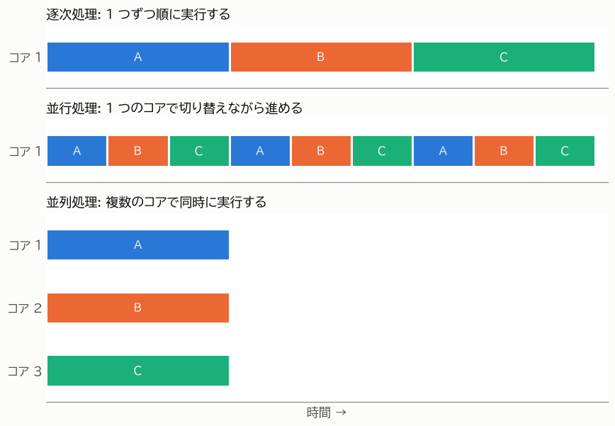
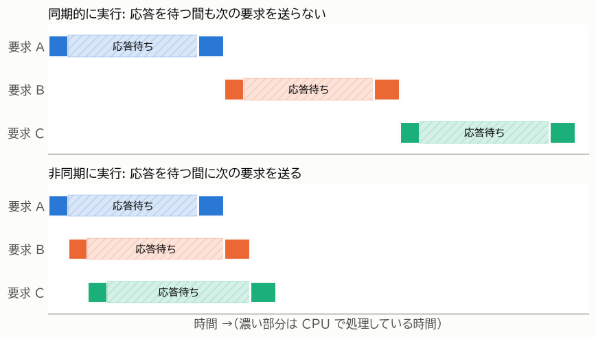

第 2 章 基本概念
================

この章では、本書全体で使う用語を定義する。「並行」「並列」「非同期」という言葉は、文献や人によって使い方が少しずつ異なる。本書では以下の定義で用語を統一する。

逐次処理・並行処理・並列処理
----------------------------

複数の処理（以下、タスクと呼ぶ）を実行する方法は、大きく次の 3 つに分けられる。

.. list-table:: 処理の実行方法
   :header-rows: 1
   :widths: 20 80

   * - 用語
     - 意味
   * - 逐次処理（sequential）
     - タスクを 1 つずつ順に実行する。前のタスクが終わるまで、次のタスクは始まらない。
   * - 並行処理（concurrent）
     - 複数のタスクを、それぞれが終わるのを待たずに進める。ある時点で実際に実行されているタスクが 1 つだけであっても、切り替えながら進めていれば並行処理である。
   * - 並列処理（parallel）
     - 複数のタスクを、複数の CPU コアで物理的に同時に実行する。

:numref:`fig-execution-models` に、3 つのタスク A、B、C を実行する様子を示す。

.. _fig-execution-models:

   逐次処理・並行処理・並列処理の比較

並行処理は「複数のタスクを扱う構造」を、並列処理は「複数のタスクを同時に実行する仕組み」を表す言葉である。並列処理は並行処理の一種であり、並行処理であっても並列処理であるとは限らない。たとえば、CPU コアが 1 つしかない計算機でも、OS がタスクを細かく切り替えることで並行処理はできる。しかし、同時に実行されているタスクは常に 1 つなので、並列処理ではない。

ここで重要なのは、**並行処理だけでは CPU の計算量は減らない**\ という点である。:numref:`fig-execution-models` の並行処理では、タスクを切り替えているだけで、全体が終わるまでの時間は逐次処理と変わらない（実際には切り替えの手間の分だけ遅くなる）。並行処理で全体の時間が短くなるのは、次に説明する「待ち時間」がある場合である。

同期処理と非同期処理
--------------------

ある処理を呼び出したとき、その処理が完了するまで呼び出し元が先に進まない方式を **同期処理（synchronous）** という。一方、処理の完了を待たずに呼び出し元が先に進み、完了したことを後から受け取る方式を **非同期処理（asynchronous）** という。

これと似た用語に、ブロッキングとノンブロッキングがある。

.. list-table:: ブロッキングとノンブロッキング
   :header-rows: 1
   :widths: 20 80

   * - 用語
     - 意味
   * - ブロッキング（blocking）
     - 処理が完了するまで、呼び出したスレッドが止まる。たとえば ``time.sleep()`` や、通常のファイル読み込み、ソケットの受信は、データがそろうまでスレッドを止める。
   * - ノンブロッキング（non-blocking）
     - 処理がすぐに完了できない場合でも、スレッドを止めずにすぐに戻る。

非同期処理は、ノンブロッキングな操作と「完了したら知らせる仕組み」を組み合わせて実現されることが多い。Python の ``asyncio`` は、この仕組みを使って 1 つのスレッドの中で多数のタスクを並行に進める（:doc:`08_asyncio_basics` で詳しく説明する）。

本書では、``asyncio`` のように ``async`` / ``await`` 構文を使って並行に処理を進めることを「非同期処理」と呼ぶ。非同期処理は並行処理を実現する方法の 1 つである。

CPU バウンドと I/O バウンド
---------------------------

並行処理や並列処理を検討するとき、最初に確認すべきことは「その処理の時間は何に使われているか」である。処理は、時間の使われ方によって次の 2 つに分けられる。

.. list-table:: CPU バウンドと I/O バウンド
   :header-rows: 1
   :widths: 20 45 35

   * - 分類
     - 意味
     - 例
   * - CPU バウンド
     - 処理時間の大部分を CPU による計算が占める。CPU が速くなれば処理も速くなる。
     - 数値計算、画像処理、圧縮、暗号化、大量のデータの集計
   * - I/O バウンド
     - 処理時間の大部分を入出力（I/O）の完了を待つ時間が占める。待っている間、CPU はほとんど使われない。
     - Web API の呼び出し、データベースへの問い合わせ、ファイルの読み書き、ユーザーの入力待ち

この違いは、経過時間（wall-clock time）と CPU 時間を比べると分かる。経過時間は処理の開始から終了までに実際に経過した時間であり、CPU 時間はそのうち CPU が実際にプログラムを実行していた時間である。次のサンプルでは、``time.perf_counter()`` で経過時間を、``time.process_time()`` で CPU 時間を測っている。

:download:`cpu_vs_io.py <../../examples/ch02_basics/cpu_vs_io.py>`

.. literalinclude:: ../../examples/ch02_basics/cpu_vs_io.py
   :language: python
   :linenos:
   :lineno-match:
   :lines: 7-

実行すると、次のような結果になる。

.. code-block:: text

   CPU バウンド: 経過時間 0.50 秒, CPU 時間 0.50 秒
   I/O バウンド: 経過時間 0.50 秒, CPU 時間 0.00 秒

CPU バウンドな処理では経過時間と CPU 時間がほぼ等しく、I/O バウンドな処理では CPU 時間がほぼ 0 になっている。I/O バウンドな処理の待ち時間は、CPU にとっては「空き時間」である。この空き時間に別のタスクを進めれば、全体の時間を短くできる。これが並行処理によって速くなる仕組みである。:numref:`fig-async-wait` に、3 つの要求を送って応答を受け取る処理を、同期的に実行した場合と非同期に実行した場合を示す。

.. _fig-async-wait:

   I/O の待ち時間を重ねることによる時間の短縮

一方、CPU バウンドな処理には空き時間が無い。CPU バウンドな処理を速くするには、複数の CPU コアで同時に計算する並列処理が必要になる。

実際のプログラムでは、CPU バウンドな部分と I/O バウンドな部分が混在していることが多い。その場合は、どちらの時間が支配的かを計測して確認する。計測の方法は :doc:`11_debugging` で説明する。

プロセス・スレッド・コルーチン
------------------------------

Python で並行処理や並列処理を行うための実行単位には、プロセス、スレッド、コルーチンの 3 つがある。

.. list-table:: プロセス・スレッド・コルーチン
   :header-rows: 1
   :widths: 16 28 28 28

   * - 項目
     - プロセス
     - スレッド
     - コルーチン
   * - 管理する主体
     - OS
     - OS
     - Python のプログラム（イベントループ）
   * - メモリ空間
     - プロセスごとに独立
     - 同じプロセス内のスレッドで共有
     - 同じスレッド内のコルーチンで共有
   * - 切り替えのタイミング
     - OS が決める
     - OS が決める（Python ではさらに GIL の制約を受ける）
     - コルーチン自身が ``await`` で制御を返したとき
   * - 作成の負荷
     - 大きい
     - 中程度
     - 小さい
   * - 並列に実行できるか
     - できる
     - 通常の Python ではできない（:doc:`03_gil` を参照）
     - できない
   * - Python の主なモジュール
     - ``multiprocessing``、``concurrent.futures``
     - ``threading``、``concurrent.futures``
     - ``asyncio``

:numref:`fig-units` に、3 つの実行単位の関係を示す。プロセスは OS が管理する独立したメモリ空間を持ち、その中で 1 つ以上のスレッドが動く。``asyncio`` のコルーチンは、1 つのスレッドの中でイベントループによって切り替えられる。

.. _fig-units:

.. graphviz::
   :caption: プロセス・スレッド・コルーチンの関係
   :align: center

   digraph units {
       graph [rankdir=TB, compound=true, nodesep=0.3, ranksep=0.3, bgcolor="transparent"];
       node [shape=box, style="rounded,filled", fillcolor="#ffffff", color="#8a8984", fontsize=11];
       edge [color="#8a8984"];

       subgraph cluster_p1 {
           label="プロセス 1（独立したメモリ空間）";
           style="rounded"; color="#2a78d6"; fontsize=11;
           mem1 [label="共有されるメモリ（変数・オブジェクト）", fillcolor="#e8f1fb"];
           subgraph cluster_t1 {
               label="スレッド 1（イベントループ）"; style="rounded,dashed"; color="#8a8984";
               c1 [label="コルーチン A"]; c2 [label="コルーチン B"]; c3 [label="コルーチン C"];
           }
           t2 [label="スレッド 2"];
       }
       subgraph cluster_p2 {
           label="プロセス 2（独立したメモリ空間）";
           style="rounded"; color="#eb6834"; fontsize=11;
           mem2 [label="プロセス 2 のメモリ", fillcolor="#fdeee7"];
           t3 [label="スレッド 1"];
       }
       mem1 -> c2 [style=invis];
       mem2 -> t3 [style=invis];
   }

スレッドはメモリを共有するため、データの受け渡しが簡単である反面、複数のスレッドが同じデータを同時に書き換えると不整合が起きる（:doc:`05_threads` で説明する）。プロセスはメモリが独立しているため、このような問題は起きにくいが、データの受け渡しにはコピーが必要になる（:doc:`06_processes` で説明する）。

並列化による高速化の限界
------------------------

並列処理で CPU コアを増やしても、処理時間がコア数に反比例して短くなるとは限らない。プログラムの中には、データの準備や結果の集計など、並列化できない部分が必ず残るためである。

プログラム全体の処理時間のうち、並列化できる部分の割合を :math:`p` とし、その部分を :math:`n` 個のコアで実行するとき、全体の速度向上率 :math:`S` は次の式で表される。これをアムダールの法則という。

.. math::

   S = \frac{1}{(1 - p) + \dfrac{p}{n}}

たとえば、処理の 90 % を並列化できる場合（:math:`p = 0.9`）、コアを 16 個使っても速度向上率は約 6.4 倍にとどまり、コアをいくら増やしても 10 倍を超えることはない。さらに実際には、プロセスの起動やデータの受け渡しにも時間がかかる。並列化を検討するときは、並列化できない部分と、並列化のために増える処理の両方に注意する必要がある。
