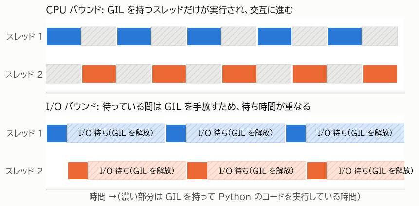

第 3 章 CPython の実行モデルと GIL
==================================

Python でスレッドを使うときに必ず知っておくべきものが GIL である。GIL は、Python のスレッドで何が速くなり、何が速くならないかを決めている。この章では、GIL の仕組みと、それがスレッドに与える影響を説明する。

CPython と GIL
--------------

Python の公式の処理系は、C 言語で実装された **CPython** である。python.org から入手できる Python や、多くの OS に含まれている Python は CPython である。本書で単に「Python」と書いた場合は CPython を指す。

CPython には **GIL（Global Interpreter Lock）** と呼ばれる仕組みがある。GIL は、1 つのプロセスの中で Python のバイトコードを実行できるスレッドを、ある時点で 1 つに制限するロックである。スレッドが Python のコードを実行するには GIL を獲得する必要があり、GIL を持っていない他のスレッドは、GIL が解放されるまで待たされる。

GIL が存在する理由
------------------

CPython は、オブジェクトがいくつの場所から参照されているかを数える **参照カウント** によってメモリを管理している。参照カウントは、変数への代入や関数の呼び出しのたびに増減する。複数のスレッドが同時に参照カウントを書き換えると、値が壊れてメモリが誤って解放されたり、解放されずに残ったりする。

GIL は、この参照カウントをはじめとするインタプリタ内部のデータを、1 つのロックでまとめて保護する仕組みである。オブジェクトごとにロックを設ける方式と比べて、次の利点がある。

* シングルスレッドのプログラムが速い（細かいロックの獲得・解放にかかる時間が無い）
* C 言語で書かれた拡張モジュールを、スレッド安全性をあまり気にせずに書ける

一方で、Python のコードを複数のスレッドで並列に実行できないという制約が生じる。

GIL が解放される場面
--------------------

GIL を持つスレッドがずっと GIL を持ち続けるわけではない。次の場面で GIL は解放され、他のスレッドが実行できるようになる。

.. list-table:: GIL が解放される主な場面
   :header-rows: 1
   :widths: 30 70

   * - 場面
     - 説明
   * - ブロッキングする I/O
     - ファイルの読み書き、ソケットの送受信、``time.sleep()`` などでは、待っている間 GIL が解放される。
   * - 一定時間の経過
     - GIL を一定時間（既定では 5 ミリ秒）持ち続けたスレッドは、他のスレッドが待っていれば GIL を手放す。この時間は ``sys.getswitchinterval()`` で確認できる。
   * - C 拡張の計算
     - C 言語で書かれた拡張モジュールは、Python のオブジェクトに触れない計算の間、GIL を解放できる。標準ライブラリの ``hashlib`` や ``zlib`` は大きなデータを処理する間 GIL を解放する。NumPy の多くの演算も GIL を解放する。

:numref:`fig-gil` に、2 つのスレッドが CPU バウンドな処理を行う場合と、I/O バウンドな処理を行う場合の動きを示す。

.. _fig-gil:

   GIL の下でのスレッドの動き

CPU バウンドな処理では、2 つのスレッドが GIL を取り合いながら交互に実行される。同時に実行されているスレッドは常に 1 つなので、全体の時間は逐次処理と変わらない。GIL の受け渡しにも時間がかかるため、逐次処理より遅くなることも多い。

I/O バウンドな処理では、スレッドは I/O を待っている間 GIL を解放する。そのため、あるスレッドが I/O を待っている間に別のスレッドが実行でき、待ち時間が重なって全体の時間が短くなる。

GIL がスレッドに与える影響のまとめ
----------------------------------

ここまでの内容から、通常の CPython でのスレッドの性質は次のようにまとめられる。

* I/O バウンドな処理は、スレッドで速くなる。
* Python で書かれた CPU バウンドな処理は、スレッドでは速くならない。並列に実行するにはプロセスを使う。
* C 拡張の中で GIL を解放する処理（NumPy の演算、大きなデータのハッシュ計算や圧縮など）は、スレッドでも並列に実行できる場合がある。

GIL はスレッド安全性を保証しない
--------------------------------

GIL があるため「Python ではスレッド間の排他制御は不要」と考えるのは誤りである。GIL が保証するのは、インタプリタ内部のデータが壊れないことだけである。プログラムのデータの整合性は保証しない。

たとえば ``counter += 1`` は、「``counter`` の値を読む」「1 を足す」「``counter`` に書き込む」という複数のバイトコードからなる。この途中で別のスレッドに切り替わると、更新が失われることがある。スレッドが共有するデータを書き換える場合は、:doc:`05_threads` で説明するロックなどを使って保護する必要がある。

GIL の無い Python
-----------------

GIL の制約を取り除くための取り組みも進んでいる。Python 3.13 では GIL を無効にした **free-threaded ビルド** が実験的に提供され、Python 3.14 で正式にサポートされた。また、Python 3.12 以降では、1 つのプロセスの中に独立した GIL を持つ **サブインタプリタ** を複数作れるようになった。これらは :doc:`10_new_options` で紹介する。

ただし、本書の執筆時点でも、通常配布されている Python は GIL が有効なビルドである。本書の説明は、特に断らない限り GIL が有効な Python を前提とする。
