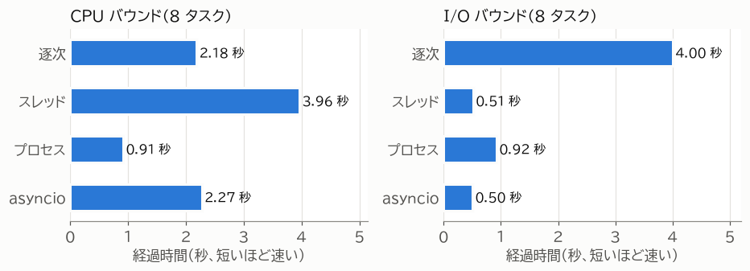

第 4 章 手法の選び方
====================

この章では、ここまでの内容をもとに、処理の性質から手法を選ぶ判断基準を示す。各手法の実装方法は次章以降で説明するが、まずこの章で「どの手法を、どのような場面で使うのか」の全体像をつかんでほしい。

判断の手順
----------

:numref:`fig-decision` に、手法を選ぶ手順を示す。

.. _fig-decision:

.. graphviz::
   :caption: 手法を選ぶ手順
   :align: center

   digraph decision {
       graph [rankdir=TB, nodesep=0.35, ranksep=0.35, bgcolor="transparent"];
       node [fontsize=11, color="#8a8984"];
       edge [color="#8a8984", fontsize=10];

       start [shape=box, style="rounded", label="処理が遅い・\n多数の処理を同時に扱いたい"];
       measure [shape=diamond, label="計測して\nボトルネックを\n特定したか"];
       do_measure [shape=box, style="rounded,filled", fillcolor="#f1f0ec", label="まず計測する\n（第 11 章）"];
       improve [shape=diamond, label="アルゴリズムや\nライブラリの改善で\n十分か"];
       no_concurrency [shape=box, style="rounded,filled", fillcolor="#f1f0ec", label="並行化しない"];
       kind [shape=diamond, label="時間の大半は\n何に使われているか"];
       count [shape=diamond, label="同時に扱う数が\n数百以上、または\n非同期ライブラリを\n使えるか"];
       asyncio [shape=box, style="rounded,filled", fillcolor="#e8f1fb", color="#2a78d6", label="asyncio\n（第 8・9 章）"];
       thread [shape=box, style="rounded,filled", fillcolor="#e8f1fb", color="#2a78d6", label="スレッド\n（第 5・7 章）"];
       gil [shape=diamond, label="計算は GIL を\n解放する C 拡張\n（NumPy など）か"];
       process [shape=box, style="rounded,filled", fillcolor="#fdeee7", color="#eb6834", label="プロセス\n（第 6・7 章）"];
       thread2 [shape=box, style="rounded,filled", fillcolor="#fdeee7", color="#eb6834", label="スレッドでも\n並列に実行できる"];

       start -> measure;
       measure -> do_measure [label="いいえ"];
       do_measure -> measure;
       measure -> improve [label="はい"];
       improve -> no_concurrency [label="はい"];
       improve -> kind [label="いいえ"];
       kind -> count [label="I/O の待ち時間"];
       kind -> gil [label="CPU の計算"];
       count -> asyncio [label="はい"];
       count -> thread [label="いいえ"];
       gil -> thread2 [label="はい"];
       gil -> process [label="いいえ"];
   }

判断のポイントは次の 3 つである。

1. **まず計測する。**\ 「遅いのは通信のせいだろう」といった推測で手法を選ぶと、効果の無い変更をすることになりやすい。どこに時間がかかっているかを計測してから判断する。
2. **CPU の計算か、I/O の待ち時間か。**\ I/O の待ち時間が支配的なら並行処理（スレッドまたは ``asyncio``）を、CPU の計算が支配的なら並列処理（プロセス）を選ぶ。
3. **I/O バウンドな処理では、規模と既存のコードで選ぶ。**\ 同時に扱う数が数十程度で、既存のコードやライブラリが同期的に書かれているならスレッドが手軽である。数百から数千の接続を同時に扱う場合や、非同期に対応したライブラリを使える場合は ``asyncio`` が向いている。

手法ごとの比較
--------------

.. list-table:: 手法ごとの比較
   :header-rows: 1
   :widths: 16 28 28 28

   * - 項目
     - スレッド
     - プロセス
     - asyncio
   * - 向いている処理
     - I/O バウンド
     - CPU バウンド
     - I/O バウンド（特に多数の接続）
   * - 並列に実行できるか
     - できない（GIL を解放する C 拡張を除く）
     - できる
     - できない
   * - 同時に扱える数の目安
     - 数十から数百
     - CPU のコア数程度
     - 数千以上
   * - 起動の負荷
     - 中程度
     - 大きい（特に Windows と macOS）
     - 小さい
   * - データの共有
     - メモリを共有する。排他制御が必要
     - 共有しない。pickle によるコピーで受け渡す
     - メモリを共有する。切り替わる場所が ``await`` に限られるため、排他制御が必要な場面は少ない
   * - 既存の同期的なコードとの相性
     - よい（そのまま呼び出せる）
     - よい（ただし関数と引数は pickle できる必要がある）
     - 悪い（ブロッキングする関数を呼ぶとイベントループが止まる）
   * - デバッグの難しさ
     - 難しい（切り替わる場所が予測できない）
     - 中程度（プロセスごとに独立している）
     - 中程度（切り替わる場所は ``await`` に限られる）

同じ処理を 4 通りで実行する
---------------------------

実際に、CPU バウンドな処理と I/O バウンドな処理を、逐次・スレッド・プロセス・``asyncio`` の 4 通りで実行して比べてみる。次のサンプルでは、それぞれの処理を 8 個ずつ実行し、経過時間を表示する。

:download:`benchmark.py <../../examples/ch04_choosing/benchmark.py>`

.. literalinclude:: ../../examples/ch04_choosing/benchmark.py
   :language: python
   :linenos:
   :lineno-match:
   :lines: 8-

``cpu_task()`` は整数の 2 乗の総和を計算する CPU バウンドな処理、``io_task()`` は ``time.sleep()`` で 0.5 秒待つ I/O バウンドな処理である。``asyncio`` で実行する場合は、``await`` を含むコルーチン版の関数（``cpu_task_async()``、``io_task_async()``）を使っている。

執筆環境（Windows 11、CPU 16 コア、Python 3.14.6）で実行した結果を :numref:`fig-benchmark` に示す。この結果は執筆環境でのものであり、目安である。

.. _fig-benchmark:

   CPU バウンドと I/O バウンドの処理の経過時間（執筆環境での結果）

この結果から、次のことが読み取れる。

* **CPU バウンドな処理**

  * プロセスだけが逐次処理より速くなった。8 個のタスクが複数のコアで並列に実行されたためである。8 倍速くならないのは、プロセスの起動とデータの受け渡しに時間がかかるためである。
  * スレッドは逐次処理より遅くなった。GIL によって同時に 1 つのスレッドしか実行できないうえ、GIL の受け渡しに時間がかかるためである。
  * ``asyncio`` は逐次処理とほぼ同じである。``cpu_task_async()`` には ``await`` が無いため、タスクは切り替わらずに 1 つずつ実行される。

* **I/O バウンドな処理**

  * スレッドと ``asyncio`` は、8 個の待ち時間が重なり、約 0.5 秒で終わった。
  * プロセスも速くなったが、プロセスの起動に時間がかかるため、スレッドや ``asyncio`` より遅い。I/O バウンドな処理にプロセスを使う利点は無い。

並行化しないという選択肢
------------------------

並行処理や並列処理は、プログラムを複雑にする。実行の順序が毎回変わるため、不具合の再現や原因の特定も難しくなる。導入する前に、次の方法で十分に速くならないかを検討するとよい。

* **アルゴリズムやデータ構造を見直す。**\ 計算量を減らす改善は、コア数を増やすより大きな効果があることが多い。
* **I/O の回数を減らす。**\ データベースへの問い合わせをまとめる、結果をキャッシュするなど、待ち時間そのものを減らす。
* **最適化されたライブラリを使う。**\ 数値計算なら NumPy など、C 言語で実装されたライブラリを使うと、Python のループより大幅に速くなることが多い。
* **外部の仕組みに任せる。**\ Web サーバーのワーカープロセスや、ジョブキュー、バッチ処理の基盤など、並行処理を提供する仕組みがすでにあれば、それを使う。

これらの方法を検討しても足りない場合に、本書で説明する手法を使う。
