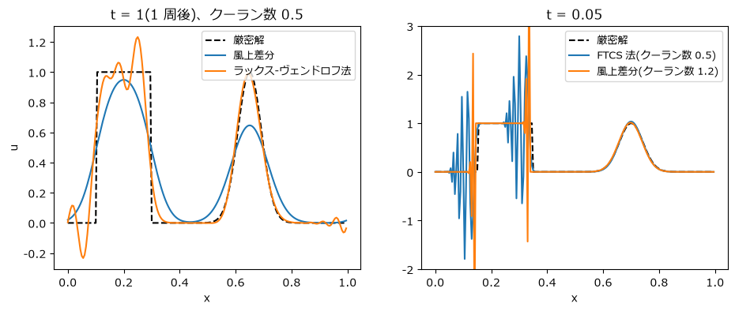
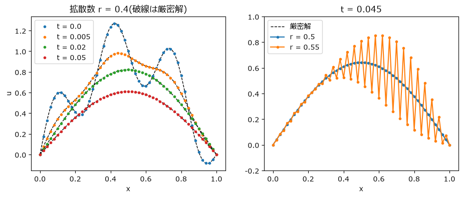

格子法の第一歩: 移流と拡散
==========================

第 5 章で見たように、ナビエ-ストークス方程式は移流項・圧力項・粘性項(拡散)・外力項からなる。この章では、そのうちの移流と拡散だけを取り出した 1 次元の方程式を、格子を使う方法(差分法)で解く。単純な方程式だからこそ厳密解と比べやすく、格子法に共通する安定性の条件や数値誤差の性質がはっきりと見える。

差分法
------

区間を間隔 :math:`\Delta x` の格子点 :math:`x_i = i\,\Delta x` に区切り、各格子点での値 :math:`u_i` だけを扱う。微分は、隣り合う格子点の値の差で近似する。これを\ **差分法**\ と呼ぶ。

テイラー展開 :math:`u(x \pm \Delta x) = u \pm u' \Delta x + \frac{1}{2} u'' \Delta x^2 \pm \frac{1}{6} u''' \Delta x^3 + \cdots` から、1 階微分には次の近似が得られる。

.. list-table:: 1 階微分の差分近似
   :header-rows: 1
   :widths: 25 45 30

   * - 名前
     - 近似式
     - 誤差
   * - 前進差分
     - :math:`\dfrac{u_{i+1} - u_i}{\Delta x}`
     - :math:`\Delta x` に比例(1 次精度)
   * - 後退差分
     - :math:`\dfrac{u_i - u_{i-1}}{\Delta x}`
     - :math:`\Delta x` に比例(1 次精度)
   * - 中心差分
     - :math:`\dfrac{u_{i+1} - u_{i-1}}{2\Delta x}`
     - :math:`\Delta x^2` に比例(2 次精度)

2 階微分は、2 つのテイラー展開を足し合わせて次のように近似できる(2 次精度)。

.. math::

   \frac{\partial^2 u}{\partial x^2} \approx \frac{u_{i+1} - 2u_i + u_{i-1}}{\Delta x^2}

時間方向は、第 2 章と同様に時間刻み幅 :math:`\Delta t` で区切り、時刻 :math:`t^n` での値を :math:`u_i^n` と書く。

1 次元移流方程式
----------------

一定の速さ :math:`c` の流れが量 :math:`u` を運ぶ様子は、**移流方程式**

.. math::

   \frac{\partial u}{\partial t} + c \frac{\partial u}{\partial x} = 0

で表される。厳密解は :math:`u(x, t) = u_0(x - ct)` で、初期の波形 :math:`u_0` が形を変えずに速さ :math:`c` で移動する。ここでは区間 :math:`[0, 1)` で周期境界条件(右端から出た波が左端から入る)を使い、:math:`c = 1` とする。:math:`t = 1` で波形はちょうど 1 周して元の位置に戻るので、初期波形と比べれば誤差がすぐに分かる。初期波形には、滑らかなガウス関数と、不連続な矩形波を並べたものを使う。

3 つの差分法
~~~~~~~~~~~~

時間に前進差分を使い、空間微分の近似を変えた 3 つの方法を比べる。式中の :math:`C = c\,\Delta t / \Delta x` は\ **クーラン数**\ と呼ばれ、1 ステップの間に波が何格子分進むかを表す。

**FTCS 法**\ (Forward Time, Centered Space)は、空間に中心差分を使う。

.. math::

   u_i^{n+1} = u_i^n - \frac{C}{2}\left(u_{i+1}^n - u_{i-1}^n\right)

**風上差分**\ は、流れの上流側(:math:`c > 0` なら左側)の点との差を使う。

.. math::

   u_i^{n+1} = u_i^n - C\left(u_i^n - u_{i-1}^n\right)

**ラックス-ヴェンドロフ法**\ は、テイラー展開を時間の 2 次まで考慮し、時間・空間とも 2 次精度にした方法である。

.. math::

   u_i^{n+1} = u_i^n - \frac{C}{2}\left(u_{i+1}^n - u_{i-1}^n\right) + \frac{C^2}{2}\left(u_{i+1}^n - 2u_i^n + u_{i-1}^n\right)

周期境界条件のもとでは、``np.roll`` で配列を 1 つずらすと隣の格子点の値の配列が得られる。``np.roll(u, 1)`` の :math:`i` 番目の要素は ``u[i - 1]`` になり、0 番目の要素には末尾の値が入る。

.. literalinclude:: ../examples/advection_1d.py
   :language: python
   :linenos:
   :lineno-match:
   :lines: 21-35

結果
~~~~

格子点数 200 で計算した結果を\ :numref:`fig-advection` に示す。

.. _fig-advection:

   移流方程式の計算結果。左: 安定な 2 つの方法で 1 周させた結果。右: 不安定になる例

左の図は、クーラン数 0.5 で 1 周させた結果である。

* **風上差分**\ の結果は安定だが、波形がなまっている。ガウス関数の山の高さは 1 から約 0.65 に下がり、矩形波の角は丸くなっている。
* **ラックス-ヴェンドロフ法**\ は、滑らかなガウス関数をほぼ正確に運んでいる。しかし矩形波の不連続な部分の前後には、元の波形にない振動(最大 1.23、最小 -0.23)が現れている。

右の図は、:math:`t = 0.05` という短い時間の結果である。

* **FTCS 法**\ は、クーラン数 0.5 でも振動が急速に成長している。この方法は、クーラン数をどれだけ小さくしても不安定である。
* **風上差分**\ でも、クーラン数を 1.2 にすると、矩形波の不連続な部分から振動が爆発的に成長する。

最も素直な中心差分(FTCS 法)が使えないこと、安定な方法でも波形がなまるか振動するかのどちらかになることは、移流を計算するうえで避けて通れない問題である。以下では、これらの性質を順に説明する。

安定性の解析と CFL 条件
-----------------------

差分法が安定かどうかは、**フォン・ノイマンの安定性解析**\ で調べられる。解を波 :math:`u_m^n = G^n e^{\mathrm{i} m \theta}`\ (:math:`m` は格子点の番号、:math:`\mathrm{i}` は虚数単位、:math:`\theta` は 1 格子あたりの位相の変化。ここでの :math:`G^n` は時刻の添字ではなく :math:`G` の :math:`n` 乗)の重ね合わせとして考え、更新式に代入して 1 ステップあたりの増幅率 :math:`G` を求める。すべての :math:`\theta` で :math:`|G| \le 1` なら安定である。

FTCS 法では :math:`G = 1 - \mathrm{i}\,C \sin\theta` となり、

.. math::

   |G|^2 = 1 + C^2 \sin^2\theta > 1

なので、どの波も少しずつ増幅され、やがて発散する。

風上差分では :math:`G = 1 - C + C e^{-\mathrm{i}\theta}` となり、

.. math::

   |G|^2 = 1 - 2C(1 - C)(1 - \cos\theta)

である。:math:`0 \le C \le 1` のとき :math:`|G| \le 1` となって安定、:math:`C > 1` では不安定になる。

この条件 :math:`C = c\,\Delta t / \Delta x \le 1` は、**CFL 条件**\ (クーラン-フリードリッヒス-レヴィ条件)と呼ばれる条件の代表例である。意味は直感的に理解できる。風上差分では、格子点の新しい値を、自分と 1 つ上流の格子点の値だけから計算する。1 ステップの間に波が 1 格子より長い距離を進むと、本来影響を受けるはずの情報が計算に含まれなくなってしまう。**1 ステップで情報が格子を飛び越えてはならない**\ というのが CFL 条件の本質であり、陽解法の格子法では一般に時間刻み幅の上限を与える。

なお、クーラン数がちょうど 1 のとき、風上差分の更新式は :math:`u_i^{n+1} = u_{i-1}^n` となり、波形を 1 格子ずつ正確にずらす操作になる。実際に計算すると、1 周後の誤差は丸め誤差の程度(:math:`10^{-18}`)にとどまる。ただし、これは速さが一定の 1 次元の問題に限った特別な場合である。

数値拡散と数値分散
------------------

風上差分の波形がなまる理由は、更新式をテイラー展開して、差分法が実際にはどのような微分方程式を解いているかを調べると分かる。風上差分は、近似的に

.. math::

   \frac{\partial u}{\partial t} + c \frac{\partial u}{\partial x} = \frac{c\,\Delta x}{2}(1 - C)\frac{\partial^2 u}{\partial x^2}

という方程式を解いている。右辺は、元の方程式にはない拡散項であり、波形をなまらせる。これを\ **数値拡散**\ と呼ぶ。格子間隔 :math:`\Delta x` を小さくすれば数値拡散は小さくなるが、0 にはならない。

ラックス-ヴェンドロフ法では、この拡散項が打ち消されている代わりに、波長によって波の進む速さがずれる誤差が残る。不連続な波形は多くの波長の波の重ね合わせなので、それぞれの波がずれて進むことで振動が生じる。これを\ **数値分散**\ と呼ぶ。

一般に、1 次精度の安定な方法は数値拡散でなまり、2 次精度以上の方法は不連続の近くで振動する。実用的な格子法では、滑らかな所では高精度に、不連続の近くでは数値拡散を加えて振動を抑えるように、場所に応じて方法を切り替える工夫(TVD 法など)が使われる。第 7 章のセミラグランジュ法も、風上差分と同様に数値拡散を持つ。

1 次元拡散方程式
----------------

次に、熱の伝わり方や、粘性による速度のならされ方を表す\ **拡散方程式**

.. math::

   \frac{\partial u}{\partial t} = \nu \frac{\partial^2 u}{\partial x^2}

を解く。:math:`\nu` は拡散係数である。区間 :math:`[0, 1]` の両端で :math:`u = 0` とし、初期条件を 2 つの正弦波の和 :math:`u_0 = \sin \pi x + 0.3 \sin 6\pi x` とする。正弦波 :math:`\sin k\pi x` は形を保ったまま :math:`e^{-\nu (k\pi)^2 t}` の割合で減衰するので、厳密解は

.. math::

   u(x, t) = e^{-\nu \pi^2 t} \sin \pi x + 0.3\,e^{-36 \nu \pi^2 t} \sin 6\pi x

となる。波数が大きい(細かい)波ほど速く減衰することが分かる。

時間に前進差分、空間に 2 階微分の中心差分を使うと、更新式は

.. math::

   u_i^{n+1} = u_i^n + r\left(u_{i+1}^n - 2u_i^n + u_{i-1}^n\right), \qquad r = \frac{\nu \Delta t}{\Delta x^2}

となる。:math:`r` を\ **拡散数**\ と呼ぶ。実装では、両端を除く内部の格子点だけを配列のスライスでまとめて更新する。

.. literalinclude:: ../examples/diffusion_1d.py
   :language: python
   :linenos:
   :lineno-match:
   :pyobject: solve

この方法の増幅率は :math:`G = 1 - 4r\sin^2(\theta/2)` で、:math:`|G| \le 1` となる条件は

.. math::

   r = \frac{\nu \Delta t}{\Delta x^2} \le \frac{1}{2}

である。結果を\ :numref:`fig-diffusion` に示す(格子点数 51、:math:`\nu = 1`)。

.. _fig-diffusion:

   拡散方程式の計算結果。左: 拡散数 0.4 の結果と厳密解。右: 拡散数 0.5 と 0.55 の比較

拡散数 0.4 では、細かい波が先に消え、全体がなだらかに減衰していく様子が厳密解とよく一致している(:math:`t = 0.05` での誤差の最大値は約 :math:`3 \times 10^{-4}`)。拡散数を 0.55 にすると、隣り合う格子点で値が交互に上下するジグザグの振動が現れる。これは :math:`\theta = \pi`\ (波長が格子間隔の 2 倍の最も細かい波)の増幅率が :math:`G = 1 - 4r = -1.2` となり、1 ステップごとに符号を変えながら 1.2 倍に成長するためである。初期条件にはこの波は含まれていないが、計算の丸め誤差として生まれたごく小さな成分が成長して目に見える大きさになる。

拡散の安定条件 :math:`\Delta t \le \Delta x^2 / (2\nu)` は、格子間隔の **2 乗**\ に比例する。格子を 2 倍細かくすると、時間刻み幅を 4 分の 1 にしなければならず、計算量は 8 倍(1 次元の場合)になる。このため、拡散の計算には、安定条件のない\ **陰解法**\ がよく使われる。陰解法では、未知の :math:`u^{n+1}` を含む連立 1 次方程式を解く必要があるが、時間刻み幅を自由に選べる。第 7 章では、拡散を陰解法で計算する。

まとめ
------

* 差分法では、微分を隣り合う格子点の値の差で近似する。中心差分は 2 次精度、前進差分と後退差分は 1 次精度である。
* 移流方程式に FTCS 法を使うと、時間刻み幅によらず不安定になる。風上差分は、CFL 条件 :math:`c\,\Delta t / \Delta x \le 1` を満たせば安定である。
* 1 次精度の方法は数値拡散によって波形をなまらせ、2 次精度の方法は不連続の近くで数値分散による振動を生じる。
* 拡散方程式の陽解法は、拡散数 :math:`\nu \Delta t / \Delta x^2 \le 1/2` のときに安定である。格子を細かくすると時間刻み幅が急激に小さくなるので、陰解法がよく使われる。
