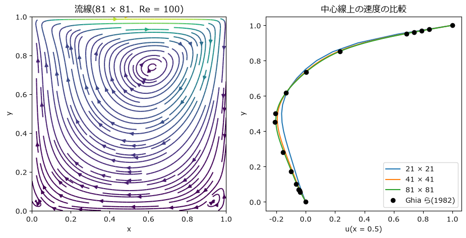

格子法の検証: キャビティ流れ
============================

第 7 章の Stable Fluids は、見た目のもっともらしさと計算の速さを重視した方法だった。この章では、計算結果を数値で検証することを目的に、格子法でよく使われるベンチマーク問題である\ **正方キャビティ流れ**\ を解き、信頼できる参照解と比較する。格子を細かくすると結果がどのように参照解に近づくかも確かめる。

ベンチマーク問題
----------------

自分で作ったシミュレーションが正しいかを確かめるには、答えが分かっている問題で比べるのが最も確実である。第 6 章までは厳密解のある問題を使ってきたが、2 次元以上のナビエ-ストークス方程式で厳密解が得られる問題はごく限られる。そこで、多くの研究者が繰り返し計算し、信頼できる結果が公表されている問題を使う。このような問題を\ **ベンチマーク問題**\ と呼ぶ。

正方キャビティ流れは、一辺 1 の正方形の容器の上の壁(ふた)だけが右向きに一定の速さで動き続ける流れである(:numref:`fig-cavity-setup`)。ふたに引きずられて容器内に大きな渦ができ、十分時間がたつと流れは時間変化しない定常状態になる。形が単純で境界条件も明確なため、非圧縮性流体の計算法の検証に広く使われている。参照解としては、Ghia らが 1982 年に発表した細かい格子による計算結果がよく使われる。

.. _fig-cavity-setup:

.. graphviz::
   :caption: 正方キャビティ流れの設定
   :align: center

   digraph cavity {
       graph [fontname="Meiryo", nodesep=0.4, ranksep=0.25];
       node [fontname="Meiryo", fontsize=11];
       lid [label="上の壁(ふた): u = 1、v = 0 で右へ動く  →", shape=box, style=filled, fillcolor="#fbeedd", width=3.2];
       box [label="流体(Re = 100)\n\n左・右・下の壁は静止(u = v = 0)", shape=box, width=3.2, height=1.6];
       lid -> box [style=invis];
   }

この章では、レイノルズ数 :math:`\mathrm{Re} = UL/\nu = 100` の場合を扱う。ふたの速さ :math:`U` と容器の一辺 :math:`L` をともに 1 としたので、動粘性係数は :math:`\nu = 1/\mathrm{Re} = 0.01` である。

射影法
------

計算には、Chorin が 1968 年に提案した\ **射影法**\ (フラクショナルステップ法)を使う。考え方は第 7 章の Stable Fluids と同じで(第 7 章の圧力投影の「投影」と射影法の「射影」は、どちらも英語の projection の訳語である)、1 ステップを「圧力以外の項による速度の更新」と「圧力による修正」に分ける(:numref:`fig-projection-flow`)。

.. _fig-projection-flow:

.. graphviz::
   :caption: 射影法の 1 ステップ
   :align: center

   digraph projection {
       graph [rankdir=LR, fontname="Meiryo", nodesep=0.3];
       node [shape=box, style="rounded,filled", fillcolor="#eef3fa", fontname="Meiryo", fontsize=11];
       edge [color="#555555"];
       s1 [label="1. 仮の速度 u*\n移流と粘性で更新"];
       s2 [label="2. 圧力 p\nポアソン方程式を解く"];
       s3 [label="3. 速度の修正\nu = u* - Δt ∇p"];
       s4 [label="定常に\n達したか", shape=diamond, fillcolor="#ffffff"];
       s1 -> s2 -> s3 -> s4;
       s4 -> s1 [label="いいえ", fontname="Meiryo", fontsize=10];
   }

密度を :math:`\rho = 1` とすると、各段階の式は次のようになる。

.. math::

   \mathbf{u}^* &= \mathbf{u}^n + \Delta t \left[ -(\mathbf{u}^n \cdot \nabla)\mathbf{u}^n + \nu \nabla^2 \mathbf{u}^n \right] \\
   \nabla^2 p^{n+1} &= \frac{1}{\Delta t} \nabla \cdot \mathbf{u}^* \\
   \mathbf{u}^{n+1} &= \mathbf{u}^* - \Delta t\, \nabla p^{n+1}

第 2 式と第 3 式は、第 7 章の圧力投影そのものである。

Stable Fluids との違いは、第 1 式の移流項と粘性項を中心差分による陽解法で計算することである。中心差分は 2 次精度で、セミラグランジュ法のような大きな数値拡散を持たない。その代わり、時間刻み幅には制限がある。第 6 章で見たように、移流を時間の前進差分と空間の中心差分で計算する FTCS 法は、移流だけなら時間刻み幅によらず不安定である。ここで計算が安定に進むのは、粘性項による拡散が振動の成長を抑えるためであり、拡散数の条件 :math:`\nu \Delta t / h^2 \le 1/4` に加えて、おおむね :math:`U^2 \Delta t / \nu \le 2` を満たす必要がある。この章で最も細かい格子(格子点数 :math:`81 \times 81`、格子間隔 :math:`h = 1/80`)で :math:`\Delta t = 0.002` とすると、クーラン数は :math:`U \Delta t / h = 0.16`、拡散数は :math:`\nu \Delta t / h^2 = 0.128`、:math:`U^2 \Delta t / \nu = 0.2` で、いずれも条件を十分に満たす。

また、中心差分では、格子間隔を代表長さとしたレイノルズ数 :math:`U h / \nu`\ (セルレイノルズ数)が 2 を超えると、解に格子規模の振動が現れやすくなる。この値は :math:`81 \times 81` の格子では 1.25 だが、:math:`41 \times 41` では 2.5、:math:`21 \times 21` では 5 になる。粗い格子の誤差が大きい一因である。

格子と境界条件
--------------

格子点は容器の境界の上にも置き、:math:`n \times n` 個の格子点の配列で速度と圧力を表す。配列の添字は第 7 章と同じく ``[y 方向, x 方向]`` の順である。境界条件は次のとおりである。

* 速度: 滑りなし条件。ふたの上では :math:`u = 1`、:math:`v = 0`、その他の壁の上では :math:`u = v = 0` とする。
* 圧力: 壁に垂直な方向の圧力の勾配を 0 とする(境界の値を 1 つ内側の値と等しくする)。

圧力の境界条件がすべて勾配で与えられているため、ポアソン方程式の解は定数を足しても解のままである。そこで、各ステップで圧力の平均を 0 にそろえる。

実装
----

.. literalinclude:: ../examples/cavity_flow.py
   :language: python
   :linenos:
   :lineno-match:
   :pyobject: solve

ステップ 1 の for 文は、:math:`u` と :math:`v` について同じ計算を行うためのものである。ポアソン方程式はヤコビ法で毎ステップ 50 回だけ反復する。1 ステップ分としては収束が不十分だが、前のステップの圧力から反復を始めるので、ステップを重ねるうちに反復が積み重なり、定常状態では圧力のポアソン方程式も満たされるようになる。

1 ステップの間の速度の変化が十分小さくなったら(変化量の最大値が :math:`10^{-6} \Delta t` 未満)、定常状態に達したとみなして計算を終える。

結果
----

格子点数を :math:`21 \times 21`、:math:`41 \times 41`、:math:`81 \times 81` の 3 通りに変えて計算した。いずれも約 10,700〜11,000 ステップ(時刻 :math:`t` が 21〜22 程度)で定常状態に達した。計算時間は筆者の環境でそれぞれ約 11 秒、18 秒、35 秒だった。

:numref:`fig-cavity` の左は、:math:`81 \times 81` の格子で得た流れの流線(各点で速度ベクトルに接する曲線。定常な流れでは流体の通り道と一致する)である。容器の中央より少し右上(およそ :math:`x = 0.62`、:math:`y = 0.74`)を中心とする大きな渦ができ、下の 2 つの角には逆向きに回る小さな渦が見える。Ghia らの結果でも、主な渦の中心は :math:`(0.6172, 0.7344)` にある。

.. _fig-cavity:

   正方キャビティ流れ(Re = 100)。左: 流線。右: 中心線(:math:`x = 0.5`)上の速度 :math:`u` の分布と Ghia らの結果の比較

右の図は、容器の中心を通る鉛直線 :math:`x = 0.5` の上での :math:`x` 方向の速度 :math:`u` の分布である。上端ではふたと同じ速さ 1 で右へ流れ、下半分では渦の戻りの流れによって左向き(負)になる。格子が細かくなるほど、計算結果は Ghia らの値(黒丸)に近づいている。

Ghia らの各点の値との差の最大値を\ :numref:`table-cavity-error` に示す。

.. _table-cavity-error:

.. list-table:: 格子点数と、Ghia らの結果との差
   :header-rows: 1
   :widths: 34 33 33

   * - 格子点数
     - 差の最大値
     - :math:`u` の最小値
   * - :math:`21 \times 21`
     - 0.049
     - -0.164
   * - :math:`41 \times 41`
     - 0.018
     - -0.194
   * - :math:`81 \times 81`
     - 0.0077
     - -0.203
   * - Ghia ら
     - ―
     - -0.211

格子間隔を半分にするごとに、差は約 2.5 分の 1 に減っている。計算法の各部分は 2 次精度の差分で作ったが、圧力の境界条件(境界の値を内側の値で置き換える)などに 1 次精度の近似が含まれるため、全体の精度は 1 次と 2 次の間になっていると考えられる。

このように、格子を段階的に細かくしながら結果が一定の値に近づくこと(**格子収束**)を確かめるのは、格子法の結果を信頼するための基本的な手続きである。1 つの格子だけの結果では、それがどの程度正しいのかを判断できない。

検証と妥当性確認
----------------

シミュレーションの信頼性を確かめる作業は、次の 2 つに分けて考えるとよい。

* **検証**\ (verification): 方程式を正しく解いているかを確かめる。厳密解との比較、精度の次数の確認、格子収束の確認、他の信頼できる計算結果との比較などがこれにあたる。
* **妥当性確認**\ (validation): 解いている方程式やモデルが、現実の現象を正しく表しているかを確かめる。実験や観測との比較が必要になる。

この章で行ったのは検証である。Ghia らの結果も数値計算によるものであり、ナビエ-ストークス方程式の解として信頼できることを確かめたにすぎない。現実の容器の中の流れを予測できるかどうかは、別に実験と比べなければ分からない。第 9 章では、モデルの仮定を多く含む SPH を扱うので、この区別が一層重要になる。

まとめ
------

* ベンチマーク問題は、自分のシミュレーションを信頼できる参照解と比較して検証するための問題である。正方キャビティ流れは非圧縮性流体の計算の代表的なベンチマーク問題である。
* 射影法は、圧力以外の項で仮の速度を求め、ポアソン方程式で求めた圧力で速度を修正する。第 7 章の圧力投影と同じ考え方である。
* 格子を細かくすると、計算結果は参照解に近づいた。格子収束を確かめることは、結果を信頼するための基本である。
* 方程式を正しく解いているかを確かめる「検証」と、モデルが現実を表しているかを確かめる「妥当性確認」は区別して考える。
