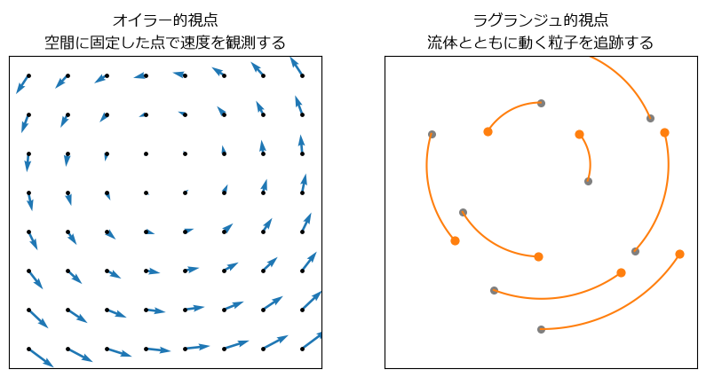

流体力学の基礎
==============

この章では、流体のシミュレーションに必要な流体力学の基礎を説明する。流れをどの視点から記述するかという考え方から始め、流体の運動を支配する連続の式とナビエ-ストークス方程式の各項の意味、流れの性質を決めるレイノルズ数を順に学ぶ。数式の厳密な導出は省き、実装の際に必要となる意味の理解を優先する。

流体と場
--------

水や空気のように、力を加えると形を変え続ける物質を\ **流体**\ と呼ぶ。流体は膨大な数の分子からなるが、私たちが扱う大きさ(ミリメートルからメートル程度)では、分子 1 個 1 個を区別せず、物質が空間を連続的に満たしているとみなせる。これを\ **連続体近似**\ と呼ぶ。

連続体近似のもとでは、流体の状態は空間の各点 :math:`\mathbf{x}` と時刻 :math:`t` の関数として表される。

* 速度 :math:`\mathbf{u}(\mathbf{x}, t) = (u, v)`\ (2 次元の場合)
* 圧力 :math:`p(\mathbf{x}, t)`
* 密度 :math:`\rho(\mathbf{x}, t)`

このように、空間の各点に値が割り当てられたものを\ **場**\ と呼ぶ。速度は向きを持つのでベクトル場、圧力や密度はスカラー場である。

オイラー的視点とラグランジュ的視点
----------------------------------

流れを記述する視点には 2 種類ある(:numref:`fig-viewpoints`)。

.. _fig-viewpoints:

   オイラー的視点(左)とラグランジュ的視点(右)

**オイラー的視点**\ では、空間に固定した観測点で、そこを通り過ぎる流体の速度や圧力を観測する。川岸に立って、目の前を流れる水の速さを測るイメージである。

**ラグランジュ的視点**\ では、流体の小さな塊(流体粒子)を一つ一つ追いかけ、その位置と速度の変化を記述する。川に浮かべたボートに乗って、流されながら周りを観測するイメージである。

数値計算の手法も、この 2 つの視点に対応して大きく 2 つに分かれる。

* **格子法**\ (オイラー的): 空間を固定した格子に区切り、格子点やセルでの物理量の時間変化を計算する。第 6〜8 章で扱う。第 10 章の格子ボルツマン法も、格子を使う方法である。
* **粒子法**\ (ラグランジュ的): 流体を多数の粒子で表し、粒子を流れとともに動かす。第 9 章の SPH がこれにあたる。

物質微分
~~~~~~~~

2 つの視点の関係を表すのが\ **物質微分**\ である。ある流体粒子の温度 :math:`T` が時間とともにどう変わるかを考える。粒子は流れに乗って移動するので、粒子の温度の変化には、その場所の温度そのものの時間変化 :math:`\partial T / \partial t` に加えて、温度の異なる場所へ運ばれることによる変化が加わる。

.. math::

   \frac{DT}{Dt} = \frac{\partial T}{\partial t} + \mathbf{u} \cdot \nabla T

左辺の :math:`D/Dt` が物質微分(流体粒子に乗って見た時間変化)、右辺第 1 項が固定点での時間変化(オイラー的視点での時間変化)である。右辺第 2 項は、流れによって物理量が運ばれる効果を表し、**移流項**\ と呼ばれる。

ラグランジュ的視点の計算では、粒子そのものが移動するので移流項を計算する必要がない。一方、格子法では移流項を差分で近似する必要があり、これが格子法の難しさの一つになる(第 6 章)。

ベクトル解析の記号
------------------

流体の方程式では、偏微分をまとめて書くための記号 :math:`\nabla`\ (ナブラ)を使う。2 次元では :math:`\nabla = (\partial/\partial x, \partial/\partial y)` である。本書で使う演算を\ :numref:`table-nabla` にまとめる。

.. _table-nabla:

.. list-table:: ナブラを使った演算
   :header-rows: 1
   :widths: 18 40 42

   * - 名前
     - 定義(2 次元)
     - 意味
   * - 勾配
     - :math:`\nabla p = \left(\dfrac{\partial p}{\partial x}, \dfrac{\partial p}{\partial y}\right)`
     - スカラー場が最も急に増える向きと、その増え方を表すベクトル
   * - 発散
     - :math:`\nabla \cdot \mathbf{u} = \dfrac{\partial u}{\partial x} + \dfrac{\partial v}{\partial y}`
     - その点から流体が湧き出す量(正なら湧き出し、負なら吸い込み)
   * - ラプラシアン
     - :math:`\nabla^2 p = \dfrac{\partial^2 p}{\partial x^2} + \dfrac{\partial^2 p}{\partial y^2}`
     - 周囲の平均と比べた、その点の値のへこみ具合

ラプラシアンは、格子で近似すると「上下左右 4 点の平均とその点の値の差」に比例する量になる。値が周囲の平均より小さい点では正になり、拡散の効果によって周囲の平均に近づこうとする。この性質は第 6 章の拡散方程式で使う。

連続の式
--------

流体の質量は、勝手に生まれたり消えたりしない。この\ **質量保存則**\ を場の言葉で書いたものが\ **連続の式**\ である。

.. math::

   \frac{\partial \rho}{\partial t} + \nabla \cdot (\rho \mathbf{u}) = 0

ある点の周りの小さな領域を考えると、領域から流れ出す質量(第 2 項)の分だけ、領域内の密度が減る(第 1 項)ことを表している。

水のような液体は、普通の条件ではほとんど圧縮されない。密度が一定(:math:`\rho` = 一定)とみなせる流体を\ **非圧縮性流体**\ と呼ぶ。このとき連続の式は次のように簡単になる。

.. math::

   \nabla \cdot \mathbf{u} = 0

これを\ **非圧縮条件**\ と呼ぶ。速度場の発散が至るところで 0、つまりどの点でも流体の湧き出しも吸い込みもないことを意味する。空気も、流れの速さが音速より十分小さい(目安として音速の 3 割程度以下)場合は非圧縮性流体とみなせる。

ナビエ-ストークス方程式
-----------------------

流体の運動を支配するのは、流体粒子に対するニュートンの運動方程式である。粘性(流体の「ねばり」)の性質が最も単純な流体(速度の差に比例した粘性の力が働く流体で、ニュートン流体と呼ぶ。水や空気が代表例である)で、非圧縮の場合、運動方程式は次のようになる。

.. math::

   \frac{\partial \mathbf{u}}{\partial t}
   = -(\mathbf{u} \cdot \nabla)\mathbf{u}
     - \frac{1}{\rho}\nabla p
     + \nu \nabla^2 \mathbf{u}
     + \mathbf{f}

これを\ **ナビエ-ストークス方程式**\ と呼ぶ。:math:`\nu` は\ **動粘性係数**、:math:`\mathbf{f}` は重力などの単位質量あたりの外力である。動粘性係数は、粘性の強さを表す粘性係数 :math:`\mu` を密度で割った量 :math:`\nu = \mu/\rho` で、単位は :math:`\mathrm{m^2/s}` である。非圧縮性流体の運動は、この方程式と非圧縮条件 :math:`\nabla \cdot \mathbf{u} = 0` の組で決まる。

右辺の各項の意味を\ :numref:`table-ns-terms` にまとめる。

.. _table-ns-terms:

.. list-table:: ナビエ-ストークス方程式の各項
   :header-rows: 1
   :widths: 22 18 60

   * - 項
     - 名前
     - 意味
   * - :math:`-(\mathbf{u} \cdot \nabla)\mathbf{u}`
     - 移流項
     - 流れが速度そのものを運ぶ効果。物質微分の移流項を速度自身に当てはめたもの
   * - :math:`-\dfrac{1}{\rho}\nabla p`
     - 圧力項
     - 圧力の高い所から低い所へ押される力
   * - :math:`\nu \nabla^2 \mathbf{u}`
     - 粘性項
     - 粘性によって速度の差がならされる効果(速度の拡散)
   * - :math:`\mathbf{f}`
     - 外力項
     - 重力、浮力などの外から加わる力

左辺と移流項をまとめると :math:`D\mathbf{u}/Dt`\ (流体粒子の加速度)になるので、ナビエ-ストークス方程式は「流体粒子の加速度 = 圧力による力 + 粘性による力 + 外力」という、単位質量あたりの運動方程式そのものである。

非圧縮性流体における圧力の役割
~~~~~~~~~~~~~~~~~~~~~~~~~~~~~~

非圧縮性流体の方程式には、圧力を直接決める式(圧力の時間変化を表す式)がない。圧力は、**速度場が非圧縮条件を満たすように**\ 決まる量である。流体がある場所に集まろうとすると、そこの圧力が上がって流体を押し返し、湧き出しも吸い込みもない状態が保たれる。

この性質のために、非圧縮性流体の計算では、各ステップで「非圧縮条件を満たすような圧力」を求める必要がある。これは第 7 章と第 8 章で扱う\ **圧力投影**\ の考え方につながる。一方、第 9 章の SPH では、流体をわずかに圧縮できるものとして扱い、密度の変化から圧力を計算する。手法によって圧力の扱い方が大きく異なることは、流体の計算法を理解するうえで重要な点である。

レイノルズ数
------------

流れの代表的な速さを :math:`U`、代表的な長さ(物体の大きさなど)を :math:`L` とするとき、

.. math::

   \mathrm{Re} = \frac{U L}{\nu}

を\ **レイノルズ数**\ と呼ぶ。レイノルズ数は、移流項(慣性の効果)と粘性項(粘性の効果)の大きさの比を表す無次元数である。

* レイノルズ数が小さい流れでは粘性が支配的で、流れは滑らかで規則的になる(**層流**)。
* レイノルズ数が大きい流れでは慣性が支配的で、流れは不規則に乱れやすくなる(**乱流**)。

身近な流れのレイノルズ数の例を\ :numref:`table-reynolds` に示す。水の動粘性係数を :math:`1.0 \times 10^{-6}\ \mathrm{m^2/s}`、空気の動粘性係数を :math:`1.5 \times 10^{-5}\ \mathrm{m^2/s}` とした。

.. _table-reynolds:

.. list-table:: レイノルズ数の例
   :header-rows: 1
   :widths: 34 22 22 22

   * - 流れ
     - 速さ :math:`U`
     - 長さ :math:`L`
     - :math:`\mathrm{Re}`
   * - 水中を泳ぐ細菌
     - 30 µm/s
     - 2 µm
     - :math:`6 \times 10^{-5}`
   * - コップの水をかき混ぜる
     - 0.1 m/s
     - 5 cm
     - :math:`5 \times 10^{3}`
   * - 走行中の自動車のまわりの空気
     - 30 m/s
     - 4 m
     - :math:`8 \times 10^{6}`

レイノルズ数には、もう一つ重要な意味がある。形が相似な 2 つの流れは、レイノルズ数が等しければ同じ流れのパターンになる(**相似則**)。模型を使った風洞実験が実物の予測に使えるのはこのためである。数値計算でも、速さや長さを 1 などの扱いやすい値にそろえ(無次元化し)、動粘性係数を :math:`\nu = UL/\mathrm{Re}` から決めることが多い。第 8 章と第 10 章では、この方法でレイノルズ数を指定する。

境界条件
--------

流体の方程式を解くには、領域の境界で流体がどう振る舞うかを指定する\ **境界条件**\ が必要である。本書で使う主な境界条件を\ :numref:`table-boundary` にまとめる。

.. _table-boundary:

.. list-table:: 主な境界条件
   :header-rows: 1
   :widths: 22 50 28

   * - 名前
     - 内容
     - 使う章
   * - 滑りなし条件
     - 壁の上で、流体の速度が壁の速度に等しい(静止した壁なら速度 0)
     - 第 8 章、第 10 章
   * - 滑り条件
     - 壁に垂直な速度成分だけが 0 で、壁に沿った流れは妨げない
     - 第 7 章
   * - 流入・流出条件
     - 領域の端から流体が入る、または出ていく
     - 第 10 章
   * - 周期境界条件
     - 領域の一方の端から出た流体が、反対側の端から入ってくる
     - 第 6 章、第 10 章

実在の流体と壁の間では、滑りなし条件が成り立つ。滑り条件は、壁の近くの薄い層(境界層)を細かく解像する代わりに用いる近似である。

また、水面のように、液体と気体の境界が自由に動く場合の境界を\ **自由表面**\ と呼ぶ。格子法で自由表面を扱うには工夫が必要だが、粒子法では粒子のない場所が自然に気体の領域になるので、比較的簡単に扱える。第 9 章のダムブレイクはその例である。

まとめ
------

* 流体は、速度・圧力・密度の場として記述する。
* 固定点で観測するオイラー的視点は格子法に、流体粒子を追跡するラグランジュ的視点は粒子法に対応する。
* 非圧縮性流体の運動は、非圧縮条件 :math:`\nabla \cdot \mathbf{u} = 0` とナビエ-ストークス方程式で決まる。ナビエ-ストークス方程式は、移流項・圧力項・粘性項・外力項からなる。
* 非圧縮性流体の圧力は、非圧縮条件を満たすように決まる。
* レイノルズ数は慣性と粘性の比を表し、流れの性質を決める。数値計算では、レイノルズ数から動粘性係数を決めることが多い。
