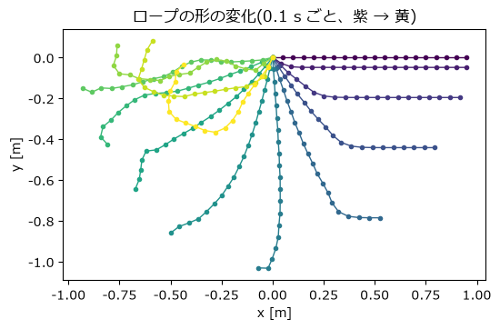
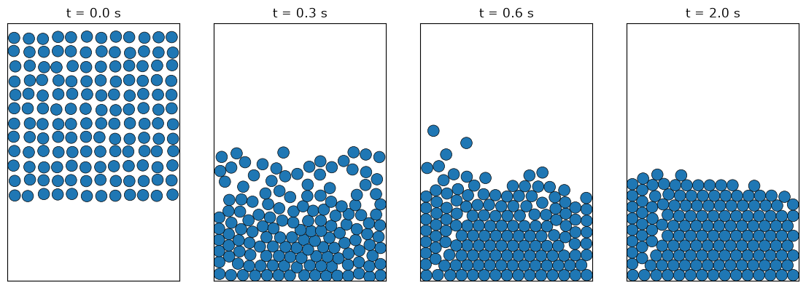
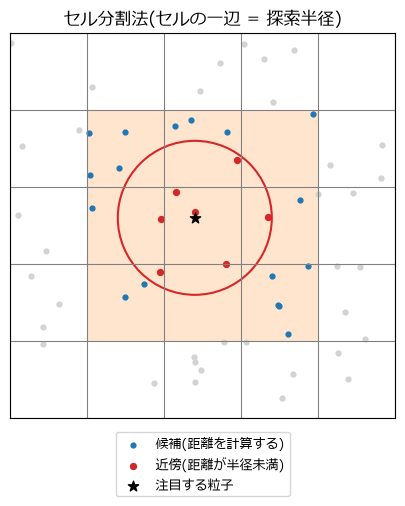
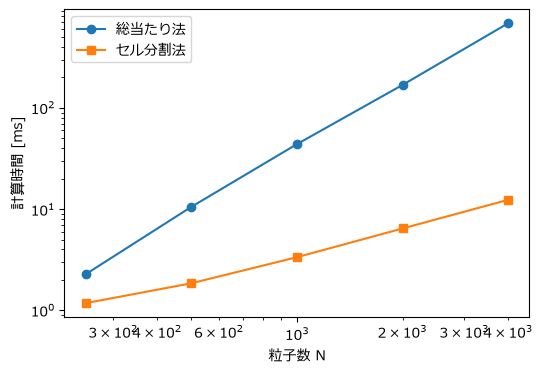

粒子間の相互作用
================

第 3 章の粒子は互いに影響し合わなかった。この章では、粒子どうしが力を及ぼし合う系を扱う。まず、質点をばねでつないだロープを作り、硬いばねが時間刻み幅を制約することを確かめる。次に、粒子どうしの衝突をばねとダッシュポット(減衰器)で表すモデルを実装する。最後に、相互作用する相手を効率よく見つける近傍探索の方法を学ぶ。

ばね-質点系
-----------

質点をばねでつないだモデルを\ **ばね-質点系**\ と呼ぶ。ロープ、布、柔らかい物体などを表現する基本的な方法である。

ばねの力
~~~~~~~~

質点 :math:`i` と :math:`j` が、自然長 :math:`L_0`、ばね定数 :math:`k` のばねでつながっているとする。:math:`\mathbf{d} = \mathbf{x}_j - \mathbf{x}_i`、その長さを :math:`L = |\mathbf{d}|`、:math:`i` から :math:`j` へ向かう単位ベクトルを :math:`\mathbf{n} = \mathbf{d}/L` とすると、質点 :math:`i` が受ける力は

.. math::

   \mathbf{f}_i = \left[ k (L - L_0) + c\,(\mathbf{v}_j - \mathbf{v}_i)\cdot\mathbf{n} \right] \mathbf{n}

である。第 1 項はフックの法則によるばねの力で、ばねが伸びていれば(:math:`L > L_0`)質点 :math:`i` を :math:`j` の方へ引く。第 2 項は、ばねが伸び縮みする速さに比例する減衰力で、振動を少しずつ弱める。:math:`c` は減衰係数である。作用・反作用の法則により、質点 :math:`j` は :math:`\mathbf{f}_j = -\mathbf{f}_i` を受ける。

ばねの一覧を、両端の質点の番号の組を並べた整数の配列 ``springs`` で表すと、すべてのばねの力をまとめて計算できる。

.. literalinclude:: ../examples/spring_mass.py
   :language: python
   :linenos:
   :lineno-match:
   :pyobject: spring_forces

最後の ``np.add.at`` は、各ばねの力を両端の質点に足し込む処理である。``force[i] += f`` と書くと、同じ質点が複数のばねにつながっている(``i`` に同じ番号が複数回現れる)場合に、足し込みが 1 回分しか行われない。``np.add.at`` は、同じ番号が何回現れても、そのすべてを足し込む。

ロープのシミュレーション
~~~~~~~~~~~~~~~~~~~~~~~~

20 個の質点(質量 0.01 kg)を、自然長 0.05 m、ばね定数 500 N/m のばねでつないだロープを考える。先頭の質点を原点に固定し、ロープを水平に伸ばした状態から放す。時間積分には半陰的オイラー法を使い、固定する質点は毎ステップ速度を 0 に戻す。

.. literalinclude:: ../examples/spring_mass.py
   :language: python
   :linenos:
   :lineno-match:
   :pyobject: simulate

:math:`\Delta t = 0.5\ \mathrm{ms}` で計算した結果を\ :numref:`fig-rope` に示す。ロープは固定点を中心に振り子のように振れ落ち、反対側へ振り上がる。

.. _fig-rope:

   ばね-質点系によるロープの運動(0.1 秒ごとの形を重ねて表示)

硬いばねと時間刻み幅
~~~~~~~~~~~~~~~~~~~~

第 2 章で見たように、半陰的オイラー法が安定であるためには、系で最も速い振動の角振動数 :math:`\omega_{\max}` に対して :math:`\omega_{\max} \Delta t < 2` でなければならない。

質点が一列に並んだ系で最も速い振動は、隣り合う質点が互いに逆向きに動く振動である。このとき各質点は両側のばねから押し引きされ、角振動数はおよそ :math:`\omega_{\max} \approx 2\sqrt{k/m}` となる。したがって、時間刻み幅の上限の目安は

.. math::

   \Delta t < \frac{2}{\omega_{\max}} \approx \sqrt{\frac{m}{k}}

で、この例では約 4.47 ms である。実際に時間刻み幅を変えて 3 秒間計算した結果を\ :numref:`table-rope-dt` に示す。

.. _table-rope-dt:

.. list-table:: 時間刻み幅とロープの計算の安定性
   :header-rows: 1
   :widths: 40 60

   * - 時間刻み幅 [ms]
     - 結果
   * - 4.0
     - 安定
   * - 4.5
     - 安定
   * - 5.0
     - 発散

目安の 4.47 ms をわずかに超える 4.5 ms でも発散しなかったのは、両端の条件(片端を固定し、もう一方は自由)のために実際の :math:`\omega_{\max}` が :math:`2\sqrt{k/m}` より少し小さいためである。このように、目安の式はやや安全側の値を与える。

ばねを硬くするほど、あるいは質点を軽くするほど、時間刻み幅を小さくしなければならない。伸びにくいロープや硬い布を陽解法で計算するのが難しいのはこのためである。

粒子どうしの衝突
----------------

第 3 章では、床との衝突を「めり込んだら速度を反転させる」という方法で扱った。この方法は、多数の粒子が互いに接触し続ける状況、たとえば箱の中に積み重なった粒子には使いにくい。そこで、接触を「重なった量に応じて押し返す力」として扱う方法を使う。このように、粒子 1 個 1 個の運動と接触を追跡する方法を\ **個別要素法**\ (DEM)と呼ぶ。

ばね-ダッシュポットモデル
~~~~~~~~~~~~~~~~~~~~~~~~~

半径 :math:`r` の 2 つの円形の粒子の中心間距離を :math:`L` とすると、重なり量は :math:`\delta = 2r - L` である。:math:`\delta > 0` のとき 2 粒子は接触しているとみなし、互いを押し離す力

.. math::

   F = k\,\delta + c\,\dot{\delta}

を中心を結ぶ方向に働かせる。第 1 項はばね(重なるほど強く押し返す)、第 2 項は\ **ダッシュポット**\ (近づく速さ :math:`\dot\delta` に比例して運動を妨げる減衰器)を表す。:numref:`fig-spring-dashpot` に模式図を示す。

.. _fig-spring-dashpot:

.. graphviz::
   :caption: ばね-ダッシュポットモデルの模式図
   :align: center

   graph spring_dashpot {
       graph [rankdir=LR, fontname="Meiryo", nodesep=0.6, ranksep=1.0];
       node [fontname="Meiryo", fontsize=11];
       edge [fontname="Meiryo", fontsize=10];
       pi [label="粒子 i", shape=circle, style=filled, fillcolor="#cfe0f3", width=0.9, fixedsize=true];
       pj [label="粒子 j", shape=circle, style=filled, fillcolor="#cfe0f3", width=0.9, fixedsize=true];
       pi -- pj [label="ばね k(重なり量に比例する力)"];
       pi -- pj [label="ダッシュポット c(近づく速さに比例する力)", style=dashed];
   }

ばねだけでは衝突が完全弾性(エネルギーが失われない)になってしまうので、ダッシュポットでエネルギーを失わせ、反発係数 :math:`e < 1` の衝突を再現する。

減衰係数と反発係数の関係
~~~~~~~~~~~~~~~~~~~~~~~~

同じ質量 :math:`m` の 2 粒子の正面衝突を考える。相対運動は、換算質量 :math:`m_\mathrm{eff} = m/2` の物体の運動として(質量 :math:`m_1`、:math:`m_2` の 2 物体の換算質量は :math:`m_1 m_2/(m_1 + m_2)` で、2 物体の相対運動を 1 物体の運動として扱うときの質量である)

.. math::

   m_\mathrm{eff}\,\ddot{\delta} + c\,\dot{\delta} + k\,\delta = 0

と書ける。これは減衰振動の方程式であり、接触は減衰振動の半周期だけ続く。固有角振動数を :math:`\omega_0 = \sqrt{k/m_\mathrm{eff}}`、減衰比を :math:`\zeta = c / (2\sqrt{m_\mathrm{eff} k})` とする。減衰比は減衰の強さを表し、:math:`\zeta < 1` のとき振動しながら減衰する(:math:`\zeta = 1` を臨界減衰と呼ぶ)。:math:`\zeta < 1` のとき、接触時間と反発係数は

.. math::

   t_c = \frac{\pi}{\omega_0 \sqrt{1 - \zeta^2}}, \qquad
   e = \exp\left( -\frac{\zeta \pi}{\sqrt{1 - \zeta^2}} \right)

となる。後者を逆に解くと、望む反発係数 :math:`e` を与える減衰比が求まる。

.. math::

   \zeta = \frac{-\ln e}{\sqrt{\pi^2 + (\ln e)^2}}

サンプルコードでは、この関係を使って反発係数から減衰係数を計算する。

.. literalinclude:: ../examples/collision.py
   :language: python
   :linenos:
   :lineno-match:
   :pyobject: ContactModel

接触力の計算
~~~~~~~~~~~~

まず、すべての粒子の組 :math:`(i, j)`\ (:math:`i < j`)について距離を計算し、接触している組だけを取り出す。その組について力を計算し、ばね-質点系と同様に ``np.add.at`` で両方の粒子に足し込む。

.. literalinclude:: ../examples/collision.py
   :language: python
   :linenos:
   :lineno-match:
   :pyobject: particle_forces

壁との接触も、同じばね-ダッシュポットの式で計算する(``wall_forces`` 関数)。ただし、重なり量は「半径 - 壁までの距離」とし、壁は質量が無限大の動かない物体として扱う。このとき換算質量は粒子の質量 :math:`m` そのものになる。減衰係数は粒子どうしの衝突(換算質量 :math:`m/2`)に合わせて決めているので、壁との衝突の減衰比は :math:`1/\sqrt{2}` 倍になり、反発係数は設定値より大きくなる(この例では約 0.62)。

時間刻み幅の選び方
~~~~~~~~~~~~~~~~~~

1 回の衝突の間に力は大きく変化するので、時間刻み幅は接触時間 :math:`t_c` より十分小さくなければならない。この例(半径 0.02 m、質量 0.01 kg、:math:`k = 2000\ \mathrm{N/m}`、:math:`e = 0.5`)では :math:`t_c \approx 5.09\ \mathrm{ms}` であり、:math:`\Delta t = t_c / 20 \approx 0.25\ \mathrm{ms}` とした。

設定どおりの反発係数が再現されるかを、2 粒子を正面衝突させて確かめた結果を\ :numref:`table-restitution` に示す。

.. _table-restitution:

.. list-table:: 設定した反発係数と、2 粒子の衝突から測定した反発係数
   :header-rows: 1
   :widths: 34 33 33

   * - 設定した反発係数
     - 測定値(:math:`\Delta t = t_c/20`)
     - 測定値(:math:`\Delta t = t_c/100`)
   * - 0.9
     - 0.899
     - 0.900
   * - 0.5
     - 0.481
     - 0.503
   * - 0.1
     - 0.068
     - 0.093

時間刻み幅を小さくすると、測定値は設定値に近づく。反発係数が小さい(減衰が強い)ほど、粗い時間刻み幅での誤差が大きい。実用上は、反発係数の誤差が許容できる範囲で、できるだけ大きな時間刻み幅を選ぶ。

なお、このモデルでは接触の終わりぎわに、減衰力がばねの力を上回って粒子どうしを引き寄せる力(引力)が一瞬働く。実際の計算では力が負にならないように 0 で打ち切ることも多いが、その場合は反発係数が上の式からわずかにずれる。

本物の砂粒や球のばね定数は非常に大きく、そのまま使うと時間刻み幅が極端に小さくなる。そのため個別要素法では、重なり量が粒子の半径に比べて十分小さい(数 % 以下)範囲で、ばね定数を実際より小さく設定するのが普通である。この例では、粒子が 10 段ほど積み重なったときの最下段の重なり量は約 0.5 mm で、半径の 2.5 % 程度である。

箱の中に落ちる粒子
~~~~~~~~~~~~~~~~~~

144 個の粒子を箱の上部に並べて落下させた結果を\ :numref:`fig-collision` に示す。粒子は床に衝突して跳ね、互いにぶつかり合いながら、やがて箱の底に積み重なって静止する。

.. _fig-collision:

   箱の中に落下して積み重なる粒子

サンプルコード :download:`collision.py <../examples/collision.py>` を実行すると、この様子がアニメーションで表示される。

近傍探索
--------

総当たり法の問題
~~~~~~~~~~~~~~~~

前の節では、すべての粒子の組について距離を計算した。粒子数を :math:`N` とすると、組の数は :math:`N(N-1)/2` で、計算量は :math:`N^2` に比例する。粒子数が 10 倍になると計算時間は 100 倍になるので、粒子数が数千を超えると計算時間の大半がこの距離計算に費やされる。

しかし、実際に力を及ぼし合うのは、距離がある値(接触なら直径、第 9 章の SPH なら影響半径)より近い粒子どうしだけである。このような近くの粒子を\ **近傍**\ と呼び、近傍を効率よく見つける処理を\ **近傍探索**\ と呼ぶ。

セル分割法
~~~~~~~~~~

代表的な近傍探索の方法が\ **セル分割法**\ (セルリスト法)である。探索半径を :math:`R` とし、空間を一辺 :math:`R` の正方形のセルに分割する。すると、ある粒子から距離 :math:`R` 未満にある粒子は、必ずその粒子が属するセルと周囲 8 セルの計 9 セルの中にある(:numref:`fig-cell-list`)。距離を計算する相手を、この 9 セルの中の粒子に限ればよい。

.. _fig-cell-list:

   セル分割法。注目する粒子(星印)の近傍は、周囲 9 セル(色を付けた範囲)の中だけを調べれば見つかる

粒子の密度が一定なら、1 つのセルに入る粒子数は粒子の総数によらないので、近傍探索の計算量はほぼ :math:`N` に比例する(粒子をセル番号の順に並べ替える処理の計算量は :math:`N \log N` に比例するが、全体に占める割合は小さい)。

ベクトル化した実装
~~~~~~~~~~~~~~~~~~

セル分割法を素直に実装すると、セルごとの for 文が必要になる。ここでは NumPy の配列演算だけで実装する。

.. literalinclude:: ../examples/neighbor_search.py
   :language: python
   :linenos:
   :lineno-match:
   :pyobject: cell_list_pairs

処理は次の 3 段階からなる。

#. 各粒子が属するセルの座標を、位置を :math:`R` で割って切り捨てることで求め、1 つの整数(セル番号)にまとめる。
#. 粒子をセル番号の順に並べ替える(``order``)。並べ替えた後の配列では、同じセルの粒子が連続して並ぶ。各セルの粒子数 ``counts`` と、各セルの粒子が並べ替え後の配列で何番目から始まるか(``starts``)を求めておく。
#. 周囲 9 セルの相対位置 ``(dx, dy)`` のそれぞれについて、各粒子と隣のセルの全粒子との組を作る。隣のセルに :math:`c` 個の粒子があれば、粒子 :math:`i` を ``np.repeat`` で :math:`c` 回繰り返し、相手には並べ替え後の配列の ``starts`` から :math:`c` 個を割り当てる。最後に、同じ組を 2 回数えないよう :math:`i < j` の組だけを残し、実際の距離で絞り込む。

結果の検証と速度の比較
~~~~~~~~~~~~~~~~~~~~~~

新しいアルゴリズムを実装したら、まず単純で確実な方法と結果が一致することを確かめる。2000 個の粒子をランダムに配置して比べると、総当たり法とセル分割法のどちらでも 9786 組の近傍が見つかり、組の一覧は完全に一致した。

次に、粒子の密度を一定に保ったまま粒子数を変えて、計算時間を比べた(:numref:`fig-neighbor-benchmark`、:numref:`table-neighbor`)。

.. _fig-neighbor-benchmark:

   粒子数と近傍探索の計算時間(両対数グラフ)

.. _table-neighbor:

.. list-table:: 近傍探索の計算時間(筆者の環境での測定値)
   :header-rows: 1
   :widths: 34 33 33

   * - 粒子数
     - 総当たり法 [ms]
     - セル分割法 [ms]
   * - 250
     - 3.6
     - 1.6
   * - 1,000
     - 42
     - 3.9
   * - 4,000
     - 665
     - 11

総当たり法は粒子数が 4 倍になると計算時間が約 16 倍になる。一方、セル分割法の計算時間は粒子数にほぼ比例して増え、4000 個では総当たり法の約 60 分の 1 になる。この関数は、第 9 章の SPH でもそのまま使う。

まとめ
------

* ばね-質点系では、ばねの力と減衰力を両端の質点に足し込む。同じ番号への足し込みには ``np.add.at`` を使う。
* ばねが硬いほど、時間刻み幅を小さくしなければならない。目安は :math:`\Delta t < \sqrt{m/k}` である。
* 粒子の衝突は、重なり量に比例するばねと、近づく速さに比例するダッシュポットで表せる。減衰係数は反発係数から決められ、時間刻み幅は接触時間の数十分の 1 にする。
* 近傍探索をセル分割法で行うと、計算量が粒子数の 2 乗から 1 乗に下がる。新しいアルゴリズムは、単純な方法と結果が一致することを必ず確かめる。
