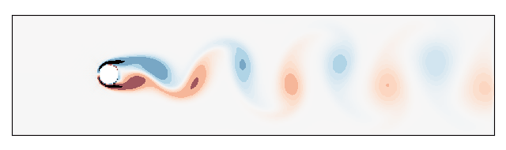
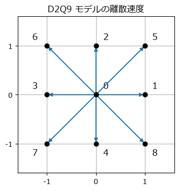
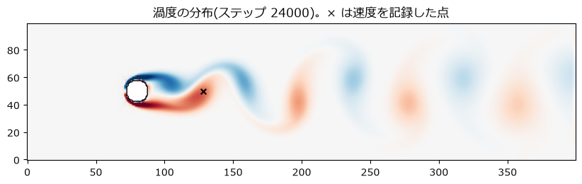
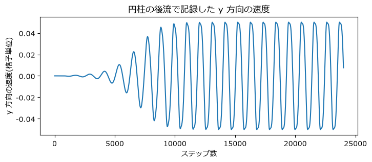

格子ボルツマン法
================

この章では、これまでとは異なる考え方で流体を計算する\ **格子ボルツマン法**\ (LBM、Lattice Boltzmann Method)を紹介する。ナビエ-ストークス方程式を直接離散化するのではなく、格子の上を飛び移りながら衝突する仮想的な粒子の集団を考え、その平均的な振る舞いとして流体の運動を再現する。題材は、一様な流れの中に置いた円柱の後ろに渦が交互に放出される\ **カルマン渦列**\ である。

   格子ボルツマン法によるカルマン渦列(色は渦度)

考え方
------

気体は膨大な数の分子からなり、分子は飛び回りながら互いに衝突している。個々の分子の運動は複雑でも、多数の分子の平均をとると、流体としての滑らかな運動(速度場や圧力場)が現れる。分子の速度の分布を表す関数(**分布関数**)の時間変化を記述するのがボルツマン方程式であり、その平均的な振る舞いからナビエ-ストークス方程式が導かれることが知られている。

格子ボルツマン法は、この考え方を思い切って単純化したものである。

* 空間を正方格子に区切り、仮想的な粒子は格子点の上にだけ存在する。
* 粒子の速度は、隣の格子点へちょうど 1 ステップで移る、ごく少数の速度だけに限る。
* 各格子点では、速度ごとの粒子の量(分布関数)だけを扱い、個々の粒子は追跡しない。

物理量はすべて\ **格子単位**\ (格子間隔 1、時間刻み幅 1)で表す。

D2Q9 モデル
-----------

2 次元で最もよく使われるのは、9 個の速度を持つ **D2Q9 モデル**\ である(2 次元 = D2、9 速度 = Q9)。速度は、静止(0 番)、上下左右の 4 方向(1〜4 番)、斜めの 4 方向(5〜8 番)からなる(:numref:`fig-d2q9`)。

.. _fig-d2q9:

   D2Q9 モデルの 9 個の離散速度と番号

各格子点は、9 個の速度に対応する分布関数 :math:`f_k`\ (:math:`k = 0, \ldots, 8`)を持つ。:math:`f_k` は、その格子点にいて速度 :math:`\mathbf{c}_k` で動く粒子の量と考えればよい。密度と速度は、分布関数の和として求まる。

.. math::

   \rho = \sum_{k=0}^{8} f_k, \qquad \rho\,\mathbf{u} = \sum_{k=0}^{8} f_k\, \mathbf{c}_k

各速度には、次の節の平衡分布関数で使う重み :math:`w_k` が決められている(:numref:`table-d2q9`)。

.. _table-d2q9:

.. list-table:: D2Q9 モデルの離散速度と重み
   :header-rows: 1
   :widths: 25 45 30

   * - 番号 :math:`k`
     - 速度 :math:`\mathbf{c}_k`
     - 重み :math:`w_k`
   * - 0
     - :math:`(0, 0)`
     - :math:`4/9`
   * - 1〜4
     - :math:`(1, 0), (0, 1), (-1, 0), (0, -1)`
     - :math:`1/9`
   * - 5〜8
     - :math:`(1, 1), (-1, 1), (-1, -1), (1, -1)`
     - :math:`1/36`

.. literalinclude:: ../examples/lbm_karman.py
   :language: python
   :linenos:
   :lineno-match:
   :lines: 22-26

平衡分布関数
------------

衝突を十分繰り返して落ち着いた状態の分布関数を\ **平衡分布関数**\ と呼ぶ。密度 :math:`\rho` と速度 :math:`\mathbf{u}` が与えられたとき、D2Q9 モデルの平衡分布関数は次の式で表される。

.. math::

   f_k^{\mathrm{eq}} = w_k\, \rho \left[ 1 + 3 (\mathbf{c}_k \cdot \mathbf{u}) + \frac{9}{2} (\mathbf{c}_k \cdot \mathbf{u})^2 - \frac{3}{2} |\mathbf{u}|^2 \right]

この式は、気体分子の速度分布(マクスウェル分布)を流速が小さいとして展開したものに相当する。平衡分布関数から求めた密度と速度は、元の :math:`\rho` と :math:`\mathbf{u}` に一致するように作られている。

.. literalinclude:: ../examples/lbm_karman.py
   :language: python
   :linenos:
   :lineno-match:
   :pyobject: equilibrium

衝突と移動
----------

格子ボルツマン法の 1 ステップは、**衝突**\ と\ **移動**\ (ストリーミング)の 2 つの操作からなる。

衝突: BGK 衝突則
~~~~~~~~~~~~~~~~

各格子点で、分布関数を平衡分布関数に向けて少しだけ近づける。

.. math::

   f_k^{*} = f_k - \frac{1}{\tau}\left( f_k - f_k^{\mathrm{eq}} \right)

これを **BGK 衝突則**\ と呼ぶ。:math:`\tau` は\ **緩和時間**\ と呼ばれる定数で、平衡に近づく遅さを表す。衝突の前後で密度と運動量(:math:`\rho` と :math:`\rho\mathbf{u}`)は変わらない。

緩和時間は、流体の動粘性係数と次の関係にある。

.. math::

   \nu = \frac{1}{3}\left( \tau - \frac{1}{2} \right)

:math:`\tau` が :math:`1/2` に近いほど粘性が小さく、レイノルズ数の高い流れになる。ただし、:math:`\tau` が :math:`1/2` に近づくほど計算は不安定になりやすく、:math:`\tau \le 1/2` では計算できない。

移動
~~~~

衝突後の分布関数 :math:`f_k^{*}` を、それぞれの速度 :math:`\mathbf{c}_k` の向きに隣の格子点へ移す。

.. math::

   f_k(\mathbf{x} + \mathbf{c}_k, t + 1) = f_k^{*}(\mathbf{x}, t)

配列全体を速度の向きにずらす操作なので、``np.roll`` で実装できる。``np.roll`` は端からはみ出した値を反対側の端に戻すので、上下の端は自動的に周期境界条件になる。

衝突は各格子点の中だけで、移動は隣の格子点との間だけで完結する。この\ **局所性**\ が格子ボルツマン法の大きな特徴で、計算が単純であり、GPU などで並列に計算しやすい。

境界条件
--------

**円柱の表面(滑りなし条件)**: 円柱の内部の格子点に入ってきた粒子を、来た向きにそのまま跳ね返す。これを\ **跳ね返り境界**\ (bounce-back)と呼ぶ。粒子が来た道を戻ることで、壁の近くの流体の平均の速度が 0 になり、滑りなし条件が実現される。円柱の内部かどうかを表す真偽値の配列さえあれば、どんな形の物体でも同じ方法で扱える。

**流入境界(左端)**: 一様な速度 :math:`U` の流れが入ってくるように、左端の分布関数を、密度 1、速度 :math:`(U, 0)` の平衡分布関数で置き換える。

**流出境界(右端)**: 右端の分布関数を、1 つ内側の格子点の値で置き換える(勾配 0 の条件)。

**上下の端**: 周期境界条件とする。

以上の操作をまとめた 1 ステップの計算は次のとおりである。

.. literalinclude:: ../examples/lbm_karman.py
   :language: python
   :linenos:
   :lineno-match:
   :pyobject: step

9 個の速度ごとに for 文で処理しているのは、:math:`(9, n_y, n_x)` の大きな配列の一時的なコピーを何度も作らないようにするためである。配列全体を一度に計算するより、この方が筆者の環境では 2 倍以上速かった。NumPy の配列演算でも、メモリーの使い方によって速度が大きく変わることがある。

ナビエ-ストークス方程式との関係
--------------------------------

格子ボルツマン法がなぜ流体の運動を再現できるのかは、チャップマン-エンスコッグ展開と呼ばれる手法で示される。その結果、流速が\ **格子の音速** :math:`c_s = 1/\sqrt{3} \approx 0.577` より十分小さければ、格子ボルツマン法の平均的な振る舞いは、前に示した関係で緩和時間から決まる動粘性係数を持つナビエ-ストークス方程式に従うことが分かっている。

逆に言えば、流速を大きくしすぎると、圧縮性の効果による誤差が大きくなる。この誤差はマッハ数 :math:`\mathrm{Ma} = U / c_s` の 2 乗に比例するので、流速は格子単位で 0.1 程度以下にするのが普通である。

計算の設定
----------

計算の設定を\ :numref:`table-lbm-params` に示す。

.. _table-lbm-params:

.. list-table:: 円柱まわりの流れの計算の設定(格子単位)
   :header-rows: 1
   :widths: 45 55

   * - 項目
     - 値
   * - 格子点数
     - :math:`400 \times 100`
   * - 円柱の半径(直径 :math:`D`)
     - 8(16)
   * - 円柱の中心
     - :math:`(80, 50)`
   * - 流入速度 :math:`U`
     - 0.08(マッハ数は約 0.14)
   * - レイノルズ数 :math:`UD/\nu`
     - 100
   * - 動粘性係数 :math:`\nu`
     - 0.0128
   * - 緩和時間 :math:`\tau`
     - 0.5384

円柱の後ろの流れは、レイノルズ数がおよそ 47 を超えると上下対称な状態が不安定になり、渦が交互に放出され始める。ただし、計算の初期状態が完全に上下対称だと、対称性を崩すきっかけが丸め誤差しかないため、渦の放出が始まるまでに長い時間がかかる。そこで、初期の流速にわずかな上下非対称の乱れ(相対的に 0.1 %)を加えている。

結果
----

24,000 ステップ計算した後の渦度の分布を\ :numref:`fig-lbm-vorticity` に示す。渦度は流体の局所的な回転の強さで、2 次元では :math:`\omega_z = \partial v / \partial x - \partial u / \partial y` である。赤は反時計回り、青は時計回りの回転を表す。

.. _fig-lbm-vorticity:

   円柱まわりの流れの渦度の分布(Re = 100)

円柱の上側からは時計回りの渦が、下側からは反時計回りの渦が交互に放出され、2 列に並んで下流へ流れていく。これがカルマン渦列である。

円柱の後方(円柱の中心から直径の 3 倍下流、:numref:`fig-lbm-vorticity` の × 印)で記録した :math:`y` 方向の速度を\ :numref:`fig-lbm-probe` に示す。

.. _fig-lbm-probe:

   円柱の後流で記録した :math:`y` 方向の速度の時間変化

最初の数千ステップは上下対称に近い流れが続くが、小さな振動が次第に成長し、約 10,000 ステップで一定の振幅の周期的な振動に落ち着く。これが渦の放出に対応する。

検証: ストローハル数
~~~~~~~~~~~~~~~~~~~~

渦の放出の周波数 :math:`f` は、**ストローハル数** :math:`\mathrm{St} = fD/U` という無次元数で表される。後半の 12,000 ステップの振動から周期を求めると、ストローハル数は約 0.189 だった。

.. literalinclude:: ../examples/lbm_karman.py
   :language: python
   :linenos:
   :lineno-match:
   :pyobject: strouhal_number

一方、周りに壁のない空間に置いた円柱では、Re = 100 のストローハル数は約 0.164 であることが実験から知られている(Williamson、1996 年)。計算結果は約 15 % 大きい。主な原因として、次の 2 つが考えられる。

* **流路の幅が狭い**: 円柱の直径は流路の幅の 16 % あり、さらに上下が周期境界なので、実際には円柱が上下に一定間隔で並んだ列の流れを計算している。周りの円柱や壁による閉じ込めの効果で、流れは円柱の脇で速くなり、渦の放出の周波数は高くなる。
* **解像度が低い**: 円柱の直径が 16 格子しかなく、表面も格子に沿った階段状になっている。

流路の幅を広げ、円柱の直径をより多くの格子で表すと、計算結果は実験値に近づいていくはずである。ここでは計算時間を優先したが、このように「どの程度ずれていて、その原因は何か」を把握したうえで結果を使うことが大切である。

筆者の環境では、1 ステップの計算に約 9.5 ms、24,000 ステップで約 4 分かかった。サンプルコード :download:`lbm_karman.py <../examples/lbm_karman.py>` を実行すると、渦度の分布がアニメーションで表示される。

格子ボルツマン法の特徴
----------------------

格子ボルツマン法の主な特徴を\ :numref:`table-lbm-features` にまとめる。

.. _table-lbm-features:

.. list-table:: 格子ボルツマン法の長所と短所
   :header-rows: 1
   :widths: 50 50

   * - 長所
     - 短所
   * - 各操作が局所的で、実装が単純であり、並列計算に向く
     - 流速を音速より十分小さくする必要がある
   * - 圧力のポアソン方程式を解く必要がない
     - 1 つの格子点あたり 9 個の値を持つので、メモリーを多く使う
   * - 跳ね返り境界で、複雑な形の物体を簡単に扱える
     - 粘性が小さい(:math:`\tau` が 1/2 に近い)と不安定になりやすい

粘性の小さい流れを安定に計算するため、BGK 衝突則を改良した MRT(多緩和時間)モデルなどが使われている。

まとめ
------

* 格子ボルツマン法は、格子上を飛び移りながら衝突する仮想的な粒子の分布関数を計算し、その平均として流体の運動を再現する。
* 1 ステップは、平衡分布関数に近づける衝突と、隣の格子点への移動からなる。緩和時間 :math:`\tau` は動粘性係数と :math:`\nu = (\tau - 1/2)/3` の関係にある。
* 滑りなし条件は、粒子を来た向きに跳ね返すだけで実現でき、複雑な形の物体も扱いやすい。
* 流速は格子単位で 0.1 程度以下にする。
* 計算したストローハル数は実験値より約 15 % 大きかった。流路の幅や解像度の影響を理解したうえで結果を評価する必要がある。
