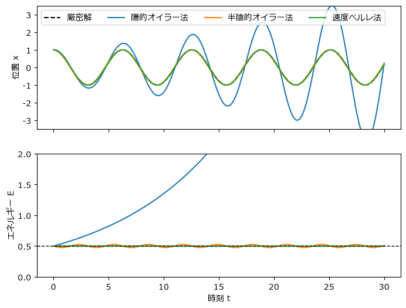
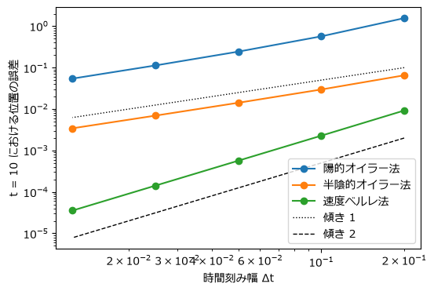

数値シミュレーションの基礎
==========================

この章では、すべてのシミュレーションの土台となる「時間を細かく区切って少しずつ進める」という考え方を学ぶ。題材として、厳密解が分かっているばね振動子を使い、3 種類の時間積分法を比較する。同じ方程式を解いているのに、方法によって結果が大きく異なることを確かめる。

運動方程式を数値的に解く
------------------------

質量 :math:`m` の物体に力 :math:`F` が働くとき、位置 :math:`x` はニュートンの運動方程式に従う。

.. math::

   m \frac{d^2 x}{dt^2} = F

2 階の微分方程式のままでは扱いにくいので、速度 :math:`v = dx/dt` を導入し、1 階の微分方程式の組に書き直す。加速度を :math:`a = F/m` とすると、次のようになる。

.. math::

   \frac{dx}{dt} = v, \qquad \frac{dv}{dt} = a(x, v, t)

力が単純な場合を除き、この方程式を手計算で解く(解を式で表す)ことはできない。そこで、時間を幅 :math:`\Delta t` の小さな区間に区切り、時刻 :math:`t^n = n \Delta t` における位置 :math:`x^n` と速度 :math:`v^n` から、次の時刻の :math:`x^{n+1}` と :math:`v^{n+1}` を近似的に求める操作を繰り返す。この操作を\ **時間積分**\ と呼び、:math:`\Delta t` を\ **時間刻み幅**\ と呼ぶ。

陽的オイラー法
--------------

最も素朴な方法は、区間の始まりの速度と加速度が区間の間ずっと一定だとみなす方法である。

.. math::

   x^{n+1} = x^n + v^n \Delta t, \qquad v^{n+1} = v^n + a^n \Delta t

これを\ **陽的オイラー法**\ と呼ぶ。「陽的」とは、右辺が既知の量(時刻 :math:`t^n` の量)だけで書けていて、そのまま計算できるという意味である。

この式は、テイラー展開

.. math::

   x(t + \Delta t) = x(t) + \frac{dx}{dt}\Delta t + \frac{1}{2}\frac{d^2 x}{dt^2}\Delta t^2 + \cdots

の 1 次の項までを残したものになっている。切り捨てた 2 次以降の項が、1 ステップごとに入り込む誤差である。

半陰的オイラー法と速度ベルレ法
------------------------------

陽的オイラー法の順序を少しだけ変え、先に速度を更新し、その\ **新しい速度**\ で位置を更新する方法を\ **半陰的オイラー法**\ (シンプレクティック・オイラー法)と呼ぶ。

.. math::

   v^{n+1} = v^n + a^n \Delta t, \qquad x^{n+1} = x^n + v^{n+1} \Delta t

違いはわずかだが、後で見るように結果は大きく変わる。

**速度ベルレ法**\ は、位置をテイラー展開の 2 次の項まで使って進め、速度は更新前後の加速度の平均で進める方法である。

.. math::

   x^{n+1} &= x^n + v^n \Delta t + \frac{1}{2} a^n \Delta t^2 \\
   v^{n+1} &= v^n + \frac{1}{2}\left(a^n + a^{n+1}\right) \Delta t

ここで :math:`a^{n+1}` は、新しい位置 :math:`x^{n+1}` で計算した加速度である。加速度の計算は 1 ステップあたり 1 回で済む(:math:`a^{n+1}` は次のステップの :math:`a^n` として再利用できる)ので、計算量はオイラー法とほとんど変わらない(本書のサンプルコードは、分かりやすさを優先して 1 ステップに 2 回計算している)。

例題: ばね振動子
----------------

質量 :math:`m`、ばね定数 :math:`k` のばねにつながれた物体の運動方程式は :math:`m\,d^2x/dt^2 = -kx` である。:math:`m = k = 1` とし、初期条件を :math:`x = 1`、:math:`v = 0` とすると、厳密解は :math:`x(t) = \cos t` となる。また、力学的エネルギー

.. math::

   E = \frac{1}{2} v^2 + \frac{1}{2} x^2

は時間がたっても一定(:math:`E = 0.5`)に保たれる。この 2 つの性質を、数値計算の結果が満たすかどうかを調べる。

3 つの時間積分法は、次のように実装できる。いずれも、位置 ``x``、速度 ``v``、時間刻み幅 ``dt`` と加速度を計算する関数 ``accel`` を受け取り、1 ステップ後の位置と速度を返す。

.. literalinclude:: ../examples/integrators.py
   :language: python
   :linenos:
   :lineno-match:
   :lines: 24-47

``simulate`` 関数は、選んだ積分法で指定したステップ数だけ計算を進め、位置と速度の履歴を配列で返す。

.. literalinclude:: ../examples/integrators.py
   :language: python
   :linenos:
   :lineno-match:
   :pyobject: simulate

サンプルコード全体は :download:`integrators.py <../examples/integrators.py>` からダウンロードできる。

結果: エネルギーが増え続ける陽的オイラー法
------------------------------------------

時間刻み幅 :math:`\Delta t = 0.1` で :math:`t = 30` まで(300 ステップ)計算した結果を\ :numref:`fig-integrators` に示す。

.. _fig-integrators:

   3 つの時間積分法による位置(上)と力学的エネルギー(下)の時間変化

陽的オイラー法では、振動の振幅がどんどん大きくなり、エネルギーは :math:`t = 30` で初期値の約 20 倍(:math:`E \approx 9.89`)に達する。摩擦のないばね振動子のエネルギーが増えることは物理的にあり得ないので、これは計算方法が作り出した誤りである。

この増え方は式で確かめられる。陽的オイラー法の更新式を :math:`E^{n+1}` に代入すると、

.. math::

   E^{n+1} = \frac{1}{2}\left(v^n - x^n \Delta t\right)^2 + \frac{1}{2}\left(x^n + v^n \Delta t\right)^2 = \left(1 + \Delta t^2\right) E^n

となり、エネルギーは 1 ステップごとに :math:`1 + \Delta t^2` 倍になる。300 ステップでは :math:`1.01^{300} \approx 19.8` 倍で、図の結果と一致する。:math:`\Delta t` を小さくすれば増え方は緩やかになるが、増え続けることに変わりはない。

一方、半陰的オイラー法のエネルギーは、正しい値 0.5 のまわりで小さく振動するだけで、長時間たっても増えも減りもしない。速度ベルレ法のエネルギーはさらに正確で、図ではほとんど 0.5 の線と重なっている。

半陰的オイラー法と速度ベルレ法は\ **シンプレクティック積分法**\ と呼ばれる種類の方法である。これらの方法は、エネルギーそのものではないが、エネルギーにごく近い量を正確に保存する性質を持つ。そのため、長時間計算してもエネルギーが一方的にずれていかない。粒子や天体の運動のように長時間の計算を行う場面では、この性質が重要になる。

誤差と精度の次数
----------------

次に、時間刻み幅 :math:`\Delta t` を変えたときに、:math:`t = 10` における位置の誤差 :math:`|x - \cos 10|` がどう変わるかを調べる(:numref:`fig-integrators-order`)。

.. _fig-integrators-order:

   時間刻み幅と誤差の関係(両対数グラフ)

.. list-table:: :math:`t = 10` における位置の誤差
   :header-rows: 1
   :widths: 25 25 25 25

   * - 時間刻み幅
     - 陽的オイラー法
     - 半陰的オイラー法
     - 速度ベルレ法
   * - 0.1
     - :math:`5.70 \times 10^{-1}`
     - :math:`2.97 \times 10^{-2}`
     - :math:`2.28 \times 10^{-3}`
   * - 0.05
     - :math:`2.44 \times 10^{-1}`
     - :math:`1.42 \times 10^{-2}`
     - :math:`5.67 \times 10^{-4}`
   * - 0.025
     - :math:`1.13 \times 10^{-1}`
     - :math:`6.95 \times 10^{-3}`
     - :math:`1.42 \times 10^{-4}`

2 つのオイラー法では、:math:`\Delta t` を半分にすると誤差もほぼ半分になる。つまり誤差は :math:`\Delta t` に比例する。一方、速度ベルレ法では、:math:`\Delta t` を半分にすると誤差は約 4 分の 1 になり、誤差は :math:`\Delta t^2` に比例する。

一定の時刻まで計算したときの誤差が :math:`\Delta t^p` に比例するとき、その方法を **p 次精度**\ と呼ぶ。オイラー法は 1 次精度、速度ベルレ法は 2 次精度である。両対数グラフでは、誤差の線の傾きが次数 :math:`p` に等しくなる。

次数は、時間刻み幅を細かくしたときの効き目を表す。1 次精度の方法で誤差を 100 分の 1 にするにはステップ数を 100 倍にする必要があるが、2 次精度の方法なら 10 倍で済む。新しく実装した方法の次数を、このように :math:`\Delta t` を変えながら確かめることは、実装の誤りを見つける有効な手段でもある。期待した傾きが出なければ、どこかに誤りがある可能性が高い。

安定性と時間刻み幅
------------------

誤差が小さいかどうかとは別に、計算が\ **安定**\ かどうかという問題がある。安定でない計算では、小さな誤差がステップごとに増幅され、やがて値が発散する。

角振動数 :math:`\omega = \sqrt{k/m}` のばね振動子を半陰的オイラー法で解く場合、1 ステップの更新は、:math:`(x^n, v^n)` に次の行列を掛ける操作として書ける。

.. math::

   \begin{pmatrix} x^{n+1} \\ v^{n+1} \end{pmatrix}
   =
   \begin{pmatrix} 1 - \omega^2 \Delta t^2 & \Delta t \\ -\omega^2 \Delta t & 1 \end{pmatrix}
   \begin{pmatrix} x^n \\ v^n \end{pmatrix}

この行列の行列式は 1 であり、2 つの固有値の積は 1 になる。固有値が絶対値 1 の複素数の組になるのは、行列のトレース :math:`2 - \omega^2 \Delta t^2` の絶対値が 2 未満のとき、つまり

.. math::

   \omega \Delta t < 2

のときである。:math:`\omega \Delta t` が 2 を超えると、片方の固有値の絶対値が 1 より大きくなり、計算は指数関数的に発散する。

この結果は、陽解法の時間積分法に共通する重要な教訓を含んでいる。**時間刻み幅は、系の中で最も速い変化の時間スケールより十分小さくなければならない**。ばねが硬い(:math:`k` が大きい)ほど、あるいは質量が小さいほど :math:`\omega` は大きくなり、使える :math:`\Delta t` は小さくなる。この制約は、第 4 章のばね-質点系や粒子の衝突、第 6 章以降の流体の計算でも形を変えて繰り返し現れる。

なお、陽的オイラー法でばね振動子を解くと、1 ステップあたりの増幅率は :math:`\sqrt{1 + \omega^2 \Delta t^2}` で常に 1 より大きい。前の節で見たエネルギーの増加は、この不安定性の表れである。どれほど :math:`\Delta t` を小さくしても安定にならないため、陽的オイラー法は振動する系には向かない。

まとめ
------

* 運動方程式は、時間を時間刻み幅 :math:`\Delta t` で区切り、位置と速度を少しずつ更新して解く。
* 陽的オイラー法は単純だが、振動する系ではエネルギーが増え続け、発散する。
* 更新の順序を変えただけの半陰的オイラー法や速度ベルレ法は、エネルギーを長時間にわたってよく保つ。本書では以降、主に半陰的オイラー法を使う。
* 誤差が :math:`\Delta t^p` に比例するとき、その方法を p 次精度と呼ぶ。:math:`\Delta t` を変えて誤差の変化を調べることは、実装を検証する有効な手段である。
* 陽解法では、時間刻み幅を系の最も速い変化より十分小さくしなければ、計算が発散する。
