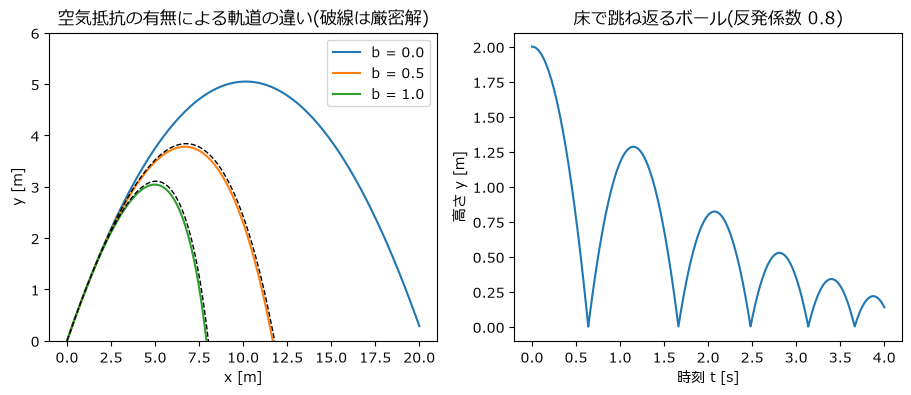
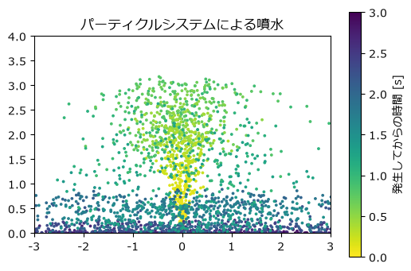

粒子シミュレーション
====================

この章では、大きさを持たない点(質点)として扱える物体の運動を計算する。まず 1 個のボールの運動を空気抵抗や床での跳ね返りを含めて計算し、厳密解と比較する。次に、大量の粒子を NumPy の配列でまとめて扱うパーティクルシステムを作り、Python の for 文と NumPy の配列演算の速度の違いを確かめる。

空気抵抗を受けるボール
----------------------

重力加速度を :math:`\mathbf{g} = (0, -9.81)\ \mathrm{m/s^2}` とし、ボールが速度に比例する空気抵抗 :math:`-m b \mathbf{v}` を受けるとする(:math:`b` は抵抗の強さを表す係数)。運動方程式は次のようになる。

.. math::

   \frac{d\mathbf{v}}{dt} = \mathbf{g} - b\,\mathbf{v}, \qquad \frac{d\mathbf{x}}{dt} = \mathbf{v}

位置と速度を 2 次元のベクトル(要素数 2 の NumPy 配列)で表すと、第 2 章の半陰的オイラー法をそのまま使える。

.. literalinclude:: ../examples/projectile.py
   :language: python
   :linenos:
   :lineno-match:
   :pyobject: acceleration

.. literalinclude:: ../examples/projectile.py
   :language: python
   :linenos:
   :lineno-match:
   :pyobject: simulate_flight

空気抵抗が速度に比例する場合、この方程式には厳密解がある。:math:`\mathbf{v}_\infty = \mathbf{g}/b` を終端速度(十分時間がたったときの速度)とすると、

.. math::

   \mathbf{v}(t) &= \mathbf{v}_\infty + (\mathbf{v}_0 - \mathbf{v}_\infty) e^{-bt} \\
   \mathbf{x}(t) &= \mathbf{x}_0 + \mathbf{v}_\infty t + (\mathbf{v}_0 - \mathbf{v}_\infty)\frac{1 - e^{-bt}}{b}

となる。実装は次のとおりである。

.. literalinclude:: ../examples/projectile.py
   :language: python
   :linenos:
   :lineno-match:
   :pyobject: analytic_flight

初速度 :math:`(10, 10)\ \mathrm{m/s}`、時間刻み幅 :math:`\Delta t = 0.01\ \mathrm{s}` で計算した結果を\ :numref:`fig-projectile` の左に示す。空気抵抗が強いほど飛距離が短くなり、軌道は放物線からずれ、落下側が急になる。数値解(実線)と厳密解(破線)は図ではほとんど重なっており、2 秒後までの位置の差の最大値は :math:`b = 0.5` で約 0.13 m だった。半陰的オイラー法は 1 次精度なので、:math:`\Delta t` を半分にすればこの差もほぼ半分になる。

.. _fig-projectile:

   空気抵抗の有無による軌道の違い(左)と、床で跳ね返るボールの高さ(右)

床での跳ね返り
--------------

床(:math:`y = 0`)で跳ね返るボールは、次のように扱える。1 ステップ進めた結果ボールが床より下にめり込んでいたら、

#. めり込んだ分だけ床の上へ押し戻す(:math:`y \leftarrow -y`)。
#. 鉛直方向の速度を反転させ、**反発係数** :math:`e` を掛ける(:math:`v_y \leftarrow -e\, v_y`)。

反発係数は、衝突後と衝突前の速さの比で、:math:`e = 1` なら完全に弾み、:math:`e = 0` なら全く弾まない。

.. literalinclude:: ../examples/projectile.py
   :language: python
   :linenos:
   :lineno-match:
   :pyobject: simulate_bounce

:numref:`fig-projectile` の右は、高さ 2 m から :math:`e = 0.8` で落とした結果である。跳ね返るたびに最高点が :math:`e^2 = 0.64` 倍に下がっていく。

この方法は、衝突が瞬間的に起こるとみなし、衝突の前後で速度を直接書き換えている。単純で扱いやすいが、多数の物体が同時に接触し続ける状況(積み重なった粒子など)にはそのまま使えない。その場合の扱い方は第 4 章で説明する。

パーティクルシステム
--------------------

煙、火花、水しぶきのように、多数の小さな粒子で表現される現象を、コンピューターグラフィックスでは\ **パーティクルシステム**\ と呼ばれる仕組みで描くことが多い。各粒子は次のような一生を送る。

#. **発生**: 発生源から、少しずつ異なる初速度で生まれる。
#. **移動**: 重力などの力を受けて動く。床や壁にぶつかれば跳ね返る。
#. **消滅**: 寿命が来たら消える。

ここでは、原点から粒子を噴き上げる噴水を作る。粒子どうしは互いに影響しないものとする。

配列による状態の管理
~~~~~~~~~~~~~~~~~~~~

粒子 1 個ごとにオブジェクトを作るのではなく、全粒子の位置・速度・経過時間・生存しているかどうかを、それぞれ 1 つの NumPy 配列にまとめて持つ。:math:`i` 番目の要素が :math:`i` 番目の粒子に対応する。

.. literalinclude:: ../examples/particle_system.py
   :language: python
   :linenos:
   :lineno-match:
   :pyobject: Particles

配列の大きさ(粒子数の上限)は最初に決めておき、消滅した粒子の要素を新しい粒子に再利用する。``emit`` 関数は、生存していない要素を探して新しい粒子を割り当てる。

.. literalinclude:: ../examples/particle_system.py
   :language: python
   :linenos:
   :lineno-match:
   :pyobject: emit

ベクトル化した更新処理
~~~~~~~~~~~~~~~~~~~~~~

全粒子の更新は、for 文を使わずに配列全体への演算として書ける。このような書き方を\ **ベクトル化**\ と呼ぶ。

.. literalinclude:: ../examples/particle_system.py
   :language: python
   :linenos:
   :lineno-match:
   :pyobject: update

床での跳ね返りは、条件を満たす粒子を選ぶ真偽値の配列であるマスク ``hit`` を作り、その粒子の要素だけを書き換えることで実現している。寿命の判定も同様である。

実行結果のスナップショットを\ :numref:`fig-fountain` に示す。サンプルコード :download:`particle_system.py <../examples/particle_system.py>` を実行すると、噴水がアニメーションで表示される。

.. _fig-fountain:

   パーティクルシステムによる噴水(色は粒子が発生してからの時間)

for 文との速度比較
~~~~~~~~~~~~~~~~~~

同じ更新処理を、Python のリストと for 文で 1 粒子ずつ書くと次のようになる(比較のため、寿命の処理は省いている)。

.. literalinclude:: ../examples/particle_system.py
   :language: python
   :linenos:
   :lineno-match:
   :pyobject: update_with_loop

1 ステップの更新にかかった時間を比べた結果を\ :numref:`table-vectorize` に示す。計算時間は実行する計算機によって変わるが、NumPy 版は for 文版より約 20〜40 倍速い。

.. _table-vectorize:

.. list-table:: 1 ステップの更新にかかった時間(筆者の環境での測定値)
   :header-rows: 1
   :widths: 25 25 25 25

   * - 粒子数
     - for 文 [ms]
     - NumPy [ms]
     - 速度比
   * - 1,000
     - 0.66
     - 0.035
     - 約 19 倍
   * - 10,000
     - 7.2
     - 0.20
     - 約 36 倍
   * - 100,000
     - 77
     - 2.7
     - 約 29 倍

Python の for 文では、1 回の繰り返しごとにインタープリターが型を調べ、オブジェクトを生成する処理が発生する。NumPy の配列演算では、同じ型の数値が並んだメモリーに対して、コンパイル済みのループが一度に処理を行う。ただし、要素数が少ないうちは NumPy の関数を呼び出すこと自体にかかる時間が目立つため、差は 1 万個程度以上で 30 倍前後になる。

本書のサンプルコードは、この考え方に従い、粒子や格子点についての繰り返しをできるだけ配列演算で書く。一方、時間のステップについての繰り返しは、前のステップの結果がないと次のステップを計算できないので、for 文のまま残る。

まとめ
------

* 位置と速度を NumPy の配列で表せば、2 次元・3 次元の運動も第 2 章の時間積分法でそのまま計算できる。
* 厳密解のある問題(線形の空気抵抗)で数値解を比較すると、実装と精度を確かめられる。
* 床での跳ね返りは、めり込みの補正と速度の反転で簡単に表現できる。
* 多数の粒子は、属性ごとの配列にまとめ、マスクを使ったベクトル化した処理で更新すると高速に計算できる。
