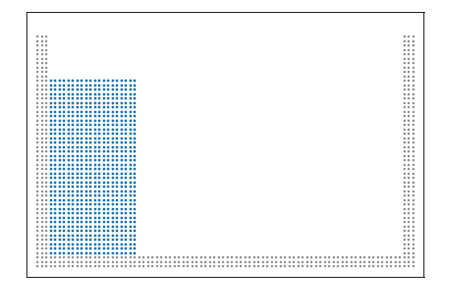
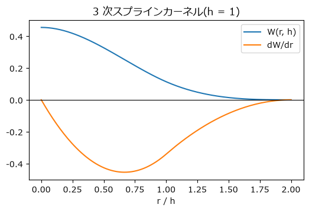
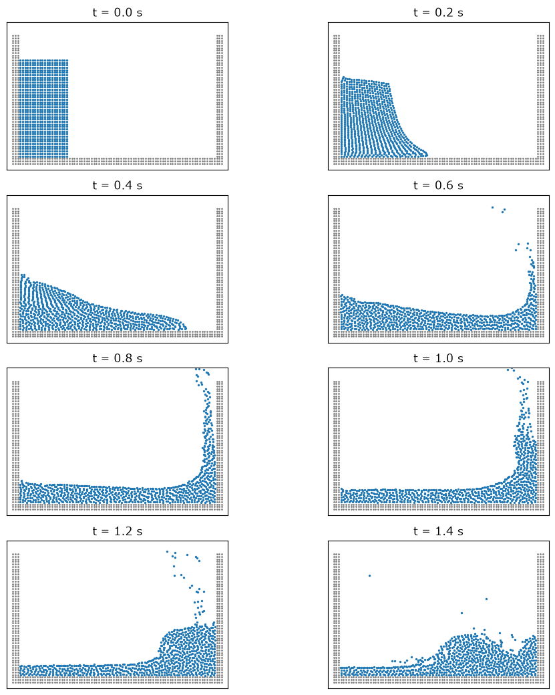
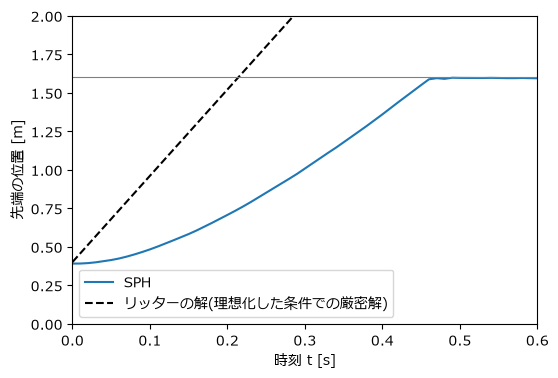

粒子法による流体: SPH
=====================

この章では、流体を多数の粒子で表して計算する **SPH**\ (Smoothed Particle Hydrodynamics、平滑化粒子流体力学)を実装する。第 3・4 章で学んだ粒子の時間積分と近傍探索に、第 5 章の流体の方程式を組み合わせる。題材は、水槽の端に置いた水柱が崩れて流れ出す\ **ダムブレイク**\ である。水面が激しく変形し、しぶきが飛ぶような流れは、格子法では扱いが難しく、粒子法が得意とする問題である。

   SPH によるダムブレイクのアニメーション

SPH の考え方
------------

SPH は、1977 年に Lucy、Gingold と Monaghan によって天体物理学の計算のために考案され、その後、水などの流れの計算に広く使われるようになった。

SPH では、流体を有限個の粒子に分割する。各粒子は質量 :math:`m_j`、位置 :math:`\mathbf{x}_j`、速度 :math:`\mathbf{v}_j`、密度 :math:`\rho_j`、圧力 :math:`p_j` を持ち、流れに乗って移動する(ラグランジュ的視点)。粒子は流体の小さな塊を代表しており、粒子のない場所の物理量は、周りの粒子の値を重み付きで平均して求める。

カーネル関数による補間
~~~~~~~~~~~~~~~~~~~~~~

位置 :math:`\mathbf{x}` での物理量 :math:`A` は、次の式で近似する。

.. math::

   A(\mathbf{x}) \approx \sum_j \frac{m_j}{\rho_j} A_j\, W(|\mathbf{x} - \mathbf{x}_j|, h)

:math:`m_j / \rho_j` は粒子 :math:`j` が代表する体積、:math:`W` は\ **カーネル関数**\ と呼ばれる重み関数である。カーネル関数は、距離 0 で最大となり、距離が大きくなるにつれて滑らかに小さくなる釣り鐘型の関数で、全空間で積分すると 1 になる。:math:`h` はカーネル関数の広がりを決める長さで、**影響半径**\ と呼ばれる距離(本書のカーネル関数では :math:`2h`)より遠い粒子の重みは 0 になる。

この式を微分すると、物理量の勾配も、カーネル関数の勾配を使って粒子の値から計算できる。

.. math::

   \nabla A(\mathbf{x}) \approx \sum_j \frac{m_j}{\rho_j} A_j\, \nabla W(|\mathbf{x} - \mathbf{x}_j|, h)

微分を格子の差分で近似する代わりに、カーネル関数の微分(解析的に計算できる)を使う点が SPH の特徴である。粒子がどのように並んでいても計算できるので、格子が不要になる。

3 次スプラインカーネル
~~~~~~~~~~~~~~~~~~~~~~

本書では、広く使われている **3 次スプラインカーネル**\ を使う。:math:`q = r / h` とすると、2 次元では

.. math::

   W(r, h) = \frac{10}{7\pi h^2}
   \begin{cases}
   1 - \dfrac{3}{2} q^2 + \dfrac{3}{4} q^3 & (0 \le q < 1) \\[2mm]
   \dfrac{1}{4} (2 - q)^3 & (1 \le q < 2) \\[2mm]
   0 & (q \ge 2)
   \end{cases}

である。係数 :math:`10/(7\pi h^2)` は、積分が 1 になるようにするための値である。関数の形を\ :numref:`fig-sph-kernel` に示す。

.. _fig-sph-kernel:

   3 次スプラインカーネルとその微分

.. literalinclude:: ../examples/sph_dam_break.py
   :language: python
   :linenos:
   :lineno-match:
   :lines: 77-90

これらの関数は、影響半径 :math:`2h` 以内の粒子の組についてだけ呼び出す前提で書いている。

密度と圧力
----------

密度
~~~~

補間の式で :math:`A = \rho` とおくと、:math:`m_j/\rho_j \cdot \rho_j = m_j` なので、密度は質量とカーネル関数だけで計算できる。

.. math::

   \rho_i = \sum_j m_j W(|\mathbf{x}_i - \mathbf{x}_j|, h)

和には粒子 :math:`i` 自身(:math:`j = i`、距離 0)も含める。粒子が密に集まった所では密度が高く、まばらな所では低くなる。

.. literalinclude:: ../examples/sph_dam_break.py
   :language: python
   :linenos:
   :lineno-match:
   :pyobject: compute_density

近傍の組 :math:`(i, j)`\ (:math:`i < j`)の一覧から、各粒子に重みを足し込むには ``np.bincount`` を使う。``np.bincount(i, w)`` は、``i`` の値ごとに ``w`` を合計した配列を返す。1 つの組は粒子 :math:`i` と :math:`j` の両方に寄与するので、``i`` と ``j`` のそれぞれについて足し込む。

弱圧縮性 SPH と状態方程式
~~~~~~~~~~~~~~~~~~~~~~~~~

第 5 章で述べたように、非圧縮性流体の圧力は非圧縮条件から決まる。これを厳密に扱うには、第 7・8 章と同様にポアソン方程式を解く必要がある。ここでは、流体をごくわずかに圧縮できるものとみなし、密度から圧力を直接計算する\ **弱圧縮性 SPH**\ (WCSPH)を使う。圧力は、水の計算でよく使われるテイトの状態方程式で求める。

.. math::

   p = B\left[\left(\frac{\rho}{\rho_0}\right)^{\gamma} - 1\right], \qquad B = \frac{\rho_0 c_0^2}{\gamma}, \quad \gamma = 7

:math:`\rho_0` は基準密度(水なら 1000 kg/m³)、:math:`c_0` は音速である。密度が :math:`\rho_0` よりわずかでも大きくなると、7 乗の効果で圧力が急激に高くなり、粒子を押し広げる。

本物の水の音速(約 1500 m/s)を使うと、後で述べる時間刻み幅の条件が厳しくなりすぎる。そこで、流れの最大速度 :math:`v_{\max}` の 10 倍程度の人工的な音速を使うのが普通である。音速が流れの速さの 10 倍なら、密度の変化はおよそ :math:`(v_{\max}/c_0)^2 = 1\ \%` 程度に収まり、ほぼ非圧縮とみなせる。この例では水柱の高さ :math:`H = 0.8\ \mathrm{m}` から :math:`v_{\max} \approx \sqrt{2gH}` と見積もり、:math:`c_0 = 10\sqrt{2gH} \approx 39.6\ \mathrm{m/s}` とした。ただし、後で見るように、しぶきなどの局所的な流れの速さはこの見積もり(約 4 m/s)を超えて 6.6 m/s 程度に達する。そのような場所では音速との比が 6 程度になり、密度の変化は数 % に達しうる。

.. literalinclude:: ../examples/sph_dam_break.py
   :language: python
   :linenos:
   :lineno-match:
   :pyobject: compute_pressure

負の圧力を 0 で打ち切っているのには理由がある。水面の近くの粒子は、外側(空気側)に相手の粒子がいないため、密度が実際より低く計算される。そのまま負の圧力を使うと、水面の粒子どうしが引き合って塊になる不自然な振る舞いが起こりやすい。打ち切りは単純な対策だが、表面張力のように流体が引き合う効果は表現できなくなる。

運動方程式
----------

圧力勾配の項 :math:`-\nabla p / \rho` を SPH で近似する方法はいくつかあるが、よく使われるのは次の形である。

.. math::

   \frac{d\mathbf{v}_i}{dt} = -\sum_j m_j \left( \frac{p_i}{\rho_i^2} + \frac{p_j}{\rho_j^2} + \Pi_{ij} \right) \nabla_i W_{ij} + \mathbf{g}

:math:`\nabla_i W_{ij}` は、カーネル関数 :math:`W(|\mathbf{x}_i - \mathbf{x}_j|, h)` を :math:`\mathbf{x}_i` で微分したもので、:math:`\mathbf{r}_{ij} = \mathbf{x}_i - \mathbf{x}_j`、:math:`r = |\mathbf{r}_{ij}|` とすると :math:`\nabla_i W_{ij} = (dW/dr)\,\mathbf{r}_{ij}/r` である。

この形では、粒子 :math:`i` が :math:`j` から受ける力と、:math:`j` が :math:`i` から受ける力が、大きさが等しく向きが逆になる(:math:`\nabla_j W_{ij} = -\nabla_i W_{ij}` のため)。作用・反作用の法則が成り立つので、全体の運動量が保存される。第 4 章の接触力と同様に、組ごとに 1 回だけ計算して両方の粒子に足し込めばよい。

人工粘性
~~~~~~~~

:math:`\Pi_{ij}` は、Monaghan による\ **人工粘性**\ の項である。

.. math::

   \Pi_{ij} =
   \begin{cases}
   -\dfrac{\alpha\, c_0\, \mu_{ij}}{\bar\rho_{ij}} & (\mathbf{v}_{ij} \cdot \mathbf{r}_{ij} < 0) \\[2mm]
   0 & (\text{それ以外})
   \end{cases}
   , \qquad
   \mu_{ij} = \frac{h\, \mathbf{v}_{ij} \cdot \mathbf{r}_{ij}}{r^2 + 0.01 h^2}

:math:`\mathbf{v}_{ij} = \mathbf{v}_i - \mathbf{v}_j`、:math:`\bar\rho_{ij}` は 2 粒子の密度の平均である。:math:`\mathbf{v}_{ij} \cdot \mathbf{r}_{ij} < 0` は 2 粒子が近づき合っていることを表し、そのときだけ互いの接近を妨げる力が働く。分母の :math:`0.01 h^2` は、距離が 0 に近いときに値が発散しないようにするための項である。人工粘性は、粒子の運動の乱れ(数値的な振動)を抑えて計算を安定にする役割を持ち、:math:`\alpha` は 0.01〜0.1 程度の値を使うことが多い。本書では :math:`\alpha = 0.05` とした。

実装
~~~~

以上をまとめると、加速度の計算は次のようになる。

.. literalinclude:: ../examples/sph_dam_break.py
   :language: python
   :linenos:
   :lineno-match:
   :pyobject: compute_acceleration

壁の表現
--------

以下では、流体を表す計算上の粒子を\ **流体粒子**\ と呼び、壁を表す粒子と区別する(第 5 章の、流体の小さな塊という意味の流体粒子に対応する)。壁は、動かない粒子(**壁粒子**)を 3 層並べて表現する。壁粒子も流体粒子と同じように密度と圧力を計算し、流体粒子に圧力による力を及ぼす。流体粒子が壁に近づくと、壁粒子の密度と圧力が上がって流体粒子を押し返す。ただし、壁粒子自身は動かさない(加速度を 0 にする)。この方法は、壁の形状を粒子の配置だけで表せるので扱いやすい。

壁粒子を 3 層にしているのは、壁の近くの流体粒子の影響半径 :math:`2h` の中を、壁粒子で埋めるためである。壁粒子が足りないと、壁際の流体粒子の密度が低く計算され、壁に引き寄せられたり、壁を通り抜けたりする原因になる。

粒子の質量の決め方
------------------

粒子は、初期状態では間隔 :math:`\Delta x = 0.02\ \mathrm{m}` の格子状に並べる。素朴には、粒子 1 個の質量を :math:`m = \rho_0 \Delta x^2` とすればよいように思える。しかし、密度は有限個の粒子についてのカーネル関数の和で計算するので、格子状に並んだ粒子の密度は、ちょうど :math:`\rho_0` にはならない。わずかでも密度がずれると、状態方程式によって大きな圧力が生じ、静止しているはずの水が動き出してしまう。

そこで、格子状に並んだ粒子の密度がちょうど :math:`\rho_0` になるように、質量を

.. math::

   m = \frac{\rho_0}{\sum_j W(|\mathbf{x}_i - \mathbf{x}_j|, h)}

と決める。ここで分母の和は、格子上の 1 点 :math:`\mathbf{x}_i` から見た周囲の格子点 :math:`\mathbf{x}_j`\ (:math:`\mathbf{x}_i` 自身を含む)についてとる。サンプルコードの ``create_state`` 関数の後半で、この計算を行っている。

時間刻み幅と近傍リスト
----------------------

時間刻み幅
~~~~~~~~~~

弱圧縮性 SPH では、圧力の変化が音速で伝わる。1 ステップの間に圧力の情報(音波)がカーネル関数の大きさ :math:`h` 程度より遠くまで伝わってはならないという CFL 条件から、時間刻み幅はおよそ

.. math::

   \Delta t \le 0.25\, \frac{h}{c_0}

に制限される。係数 0.25 は、経験的に選ばれた安全係数である。この例では :math:`h = 1.3 \Delta x = 0.026\ \mathrm{m}`\ (影響半径 :math:`2h` の円の中に 20 個程度の粒子が入るように選んだ値)なので、上限は約 :math:`1.6 \times 10^{-4}\ \mathrm{s}` であり、余裕を持たせて :math:`\Delta t = 1.0 \times 10^{-4}\ \mathrm{s}` とした。時間積分には半陰的オイラー法を使う。人工的な音速を本物の水の音速より小さくするのは、この条件を緩めるためである。

近傍リストの再利用
~~~~~~~~~~~~~~~~~~

近傍探索には第 4 章のセル分割法の関数 ``cell_list_pairs`` を使う。ただし、時間刻み幅が小さいので、1 ステップの間に粒子はわずかしか動かない。毎ステップ近傍探索をするのは無駄が多い。

そこで、影響半径 :math:`2h` より少し大きな探索半径 :math:`2.5h` で近傍の組の一覧(**近傍リスト**)を作り、それを 8 ステップの間使い回す。この方法は\ **ベルレリスト**\ と呼ばれる。8 ステップの間に 2 粒子が近づく距離が、余裕の :math:`0.5h = 13\ \mathrm{mm}` より小さければ、影響半径内の組を見落とすことはない。流れの速さは最大で 6.6 m/s 程度なので、2 粒子が正面から近づいても、8 ステップで近づく距離は約 11 mm にとどまる。

.. literalinclude:: ../examples/sph_dam_break.py
   :language: python
   :linenos:
   :lineno-match:
   :pyobject: step

近傍リストに含まれる組のうち、実際に影響半径の内側にある組だけを、``compute_acceleration`` の最初で取り出して使っている。近傍リストの再利用とこの工夫により、1 ステップの計算時間は筆者の環境で約 11 ms から平均約 5.5 ms に短縮された(流れが崩れて近傍の組が増えるにつれて、1 ステップの時間は長くなる)。

結果
----

幅 1.6 m、高さ 1.0 m の水槽の左端に、幅 0.4 m、高さ 0.8 m の水柱を置いて計算した。流体粒子は 800 個、壁粒子は 558 個である。結果を\ :numref:`fig-sph-dam-break` に示す。

.. _fig-sph-dam-break:

   SPH によるダムブレイク(青: 流体粒子、灰: 壁粒子)

水柱は自身の重さで崩れ、底に沿って右へ流れ出す。約 0.46 秒で流れの先端が右の壁に達し、水は壁を駆け上がって、一部はしぶきとなって壁より高く飛ぶ。その後、駆け上がった水が崩れ落ちて左向きの波となり、水槽の中を戻っていく。水面が大きく変形し、ちぎれて飛ぶような流れを、特別な処理なしに計算できるのが粒子法の強みである。

1.6 秒分の計算(16,000 ステップ)には、筆者の環境で約 90 秒かかった。サンプルコード :download:`sph_dam_break.py <../examples/sph_dam_break.py>` を実行すると、計算しながらアニメーションを表示する(第 4 章の :download:`neighbor_search.py <../examples/neighbor_search.py>` を同じフォルダに置くこと)。

先端の位置の比較
~~~~~~~~~~~~~~~~

流れの先端(流体粒子の :math:`x` 座標の最大値)の位置の時間変化を\ :numref:`fig-sph-front` に示す。

.. _fig-sph-front:

   流れの先端の位置の時間変化

破線は、無限に長い水深 :math:`H` の水が瞬間的に解放され、底との摩擦がない場合の浅水波理論による解(リッターの解、1892 年)で、先端は一定の速さ :math:`2\sqrt{gH} \approx 5.6\ \mathrm{m/s}` で進む。SPH の結果では、先端は静止状態から加速し、:math:`t = 0.2` 〜 0.4 s の間の平均の速さは約 3.3 m/s だった。

リッターの解は、底との摩擦や、水柱が有限の大きさであること、流れ始めの加速を無視した理想化された解であり、実際の流れの先端はこれより遅い。したがって、この比較から言えるのは、SPH の結果が理想化した上限の速さを超えておらず、桁は妥当である、ということにとどまる。定量的な妥当性確認(第 8 章)を行うには、Martin と Moyce の実験(1952 年)など、同じ条件の実験データと比較する必要がある。また、人工粘性の係数 :math:`\alpha` や粒子間隔を変えると結果がどう変わるかを調べ、結果がパラメーターにどの程度依存するかを把握しておくことも重要である。

SPH の注意点
------------

ここで実装したのは、最も基本的な形の弱圧縮性 SPH である。実用的な計算では、次のような問題が知られており、さまざまな改良手法が提案されている。

* **圧力の振動**: 密度から直接圧力を計算するため、圧力の分布に粒子規模の細かい振動が現れやすい。密度の計算法の改良(δ-SPH など)で抑えられる。
* **水面の扱い**: 水面近くでは近傍の粒子が足りず、密度や圧力の計算精度が落ちる。
* **壁の扱い**: 壁粒子の方法は簡単だが、壁際の流れの精度は高くない。
* **非圧縮性**: 人工的な音速を使うため、密度は完全には一定にならない。圧力のポアソン方程式を解く非圧縮性 SPH(ISPH)や、同様の考え方の MPS 法などもある。

まとめ
------

* SPH は、流体を粒子で表し、カーネル関数による重み付き平均で物理量とその勾配を計算する粒子法である。
* 密度は周囲の粒子の質量とカーネル関数の和で求め、弱圧縮性 SPH では状態方程式で密度から圧力を計算する。
* 圧力勾配の項を対称な形で書くと、作用・反作用の法則が成り立ち、運動量が保存される。
* 人工的な音速は流れの速さの 10 倍程度とし、時間刻み幅は :math:`0.25\,h/c_0` 以下にする。
* 粒子法は、水面が大きく変形する流れを自然に扱える。一方で、結果の定量的な信頼性を確かめるには、実験データとの比較やパラメーターの影響の調査が欠かせない。
