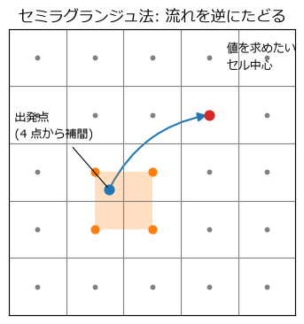
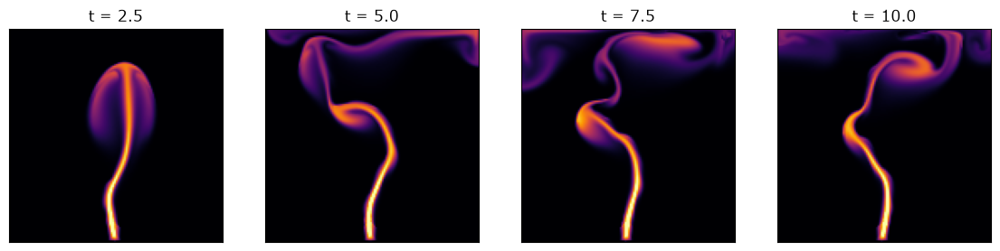

格子法による 2 次元流体: Stable Fluids
======================================

この章では、2 次元の非圧縮性流体を格子法で計算し、煙が立ち上る様子を再現する。手法には、Stam が 1999 年に発表した **Stable Fluids** 法を使う。その名のとおり、時間刻み幅を大きくしても計算が発散しない(安定な)方法であり、ゲームや映像制作で流体を実時間で計算する手法の基礎になっている。

Stable Fluids の考え方
----------------------

第 5 章のナビエ-ストークス方程式

.. math::

   \frac{\partial \mathbf{u}}{\partial t}
   = -(\mathbf{u} \cdot \nabla)\mathbf{u}
     - \frac{1}{\rho}\nabla p
     + \nu \nabla^2 \mathbf{u}
     + \mathbf{f},
   \qquad \nabla \cdot \mathbf{u} = 0

を、すべての項を同時に扱うのではなく、項ごとに分けて順番に計算する。このような方法を\ **分離解法**\ と呼ぶ。1 ステップの計算は\ :numref:`fig-stable-fluids-flow` の 4 段階からなる。

.. _fig-stable-fluids-flow:

.. graphviz::
   :caption: Stable Fluids 法の 1 ステップ
   :align: center

   digraph stable_fluids {
       graph [rankdir=LR, fontname="Meiryo", nodesep=0.3];
       node [shape=box, style="rounded,filled", fillcolor="#eef3fa", fontname="Meiryo", fontsize=11];
       edge [color="#555555"];
       u0 [label="速度場\nu(t)", shape=ellipse, fillcolor="#ffffff"];
       f [label="1. 外力\n浮力などを加える"];
       a [label="2. 移流\nセミラグランジュ法"];
       d [label="3. 拡散\n陰解法"];
       p [label="4. 圧力投影\n発散を取り除く"];
       u1 [label="速度場\nu(t + Δt)", shape=ellipse, fillcolor="#ffffff"];
       u0 -> f -> a -> d -> p -> u1;
   }

各段階は、それぞれ無条件に安定な方法で計算する。そのため、全体としても時間刻み幅の制限(CFL 条件など)を受けない。圧力の項は、第 5 章で説明したように「非圧縮条件を満たすように速度場を修正する」という第 4 段階の操作に置き換えられる。

煙は、この速度場に乗って運ばれる濃度の場(スカラー場)として表す。煙の濃度も、速度場と同じ方法で移流・拡散させる。

格子と境界条件
--------------

一辺の長さ 1 の正方形の領域を :math:`N \times N` 個の正方形のセルに分割し(本章では :math:`N = 128`)、各セルの中心に速度 :math:`(u, v)` と煙の濃度を置く。セルの幅は :math:`h = 1/N` である。

境界条件を扱いやすくするため、領域の外周に 1 層の\ **ゴーストセル**\ を加えた :math:`(N+2) \times (N+2)` の配列を使う。ゴーストセルは計算領域の外にある仮想的なセルで、壁の内側の値から境界条件に合うように値を決める。配列の添字は ``[y 方向, x 方向]`` の順とし、``imshow`` でそのまま表示できるようにしている。

領域の四方は壁とし、壁に垂直な速度成分が壁の上で 0 になるように、ゴーストセルには内側の値の符号を反転させた値を入れる。壁に平行な速度成分と煙の濃度は、内側の値をそのまま写す(壁に沿った流れは妨げない滑り条件)。

.. literalinclude:: ../examples/stable_fluids.py
   :language: python
   :linenos:
   :lineno-match:
   :pyobject: set_boundary

外力
----

外力の段階では、速度に :math:`\mathbf{f}\,\Delta t` を加えるだけである。この例では、領域の下端中央を煙の発生源とし、煙の濃度と上向きの速度を加える。さらに、流れが単調にならないよう、発生源の横向きの速度をゆっくり揺らしている。

煙は周囲の空気より温かく軽いので、煙の濃い所ほど上向きの力(浮力)を受けるものとする。

.. literalinclude:: ../examples/stable_fluids.py
   :language: python
   :linenos:
   :lineno-match:
   :pyobject: add_forces_and_sources

移流: セミラグランジュ法
------------------------

第 6 章で見たように、移流を陽解法の差分法で計算すると、CFL 条件のために時間刻み幅が制限される。Stable Fluids では、移流を\ **セミラグランジュ法**\ で計算する。

物理量 :math:`q` が流れに乗って運ばれるだけなら、時刻 :math:`t + \Delta t` に位置 :math:`\mathbf{x}` にある流体は、時刻 :math:`t` には位置 :math:`\mathbf{x} - \mathbf{u}\,\Delta t` にあったはずである。したがって

.. math::

   q^{n+1}(\mathbf{x}) = q^n(\mathbf{x} - \mathbf{u}\,\Delta t)

とすればよい。各セルの中心から流れを逆向きにたどった\ **出発点**\ の値を、前の時刻の場から読み取るのである(:numref:`fig-semi-lagrangian`)。出発点は一般にセルの中心からずれるので、周囲 4 つのセルの値から\ **双線形補間**\ で値を求める。双線形補間は、まず :math:`x` 方向に 2 回線形補間し、その 2 つの結果を :math:`y` 方向に線形補間する方法である。

.. _fig-semi-lagrangian:

   セミラグランジュ法。値を求めたいセル中心(赤)から流れを逆にたどった出発点(青)の値を、周囲 4 点(橙)から補間する

補間した値は、必ず周囲 4 点の値の最大値と最小値の間に収まる。そのため、時間刻み幅をどれだけ大きくしても値が増幅されることはなく、計算は無条件に安定である。名前に「ラグランジュ」とあるのは、流体粒子を追跡するラグランジュ的視点の考え方を、固定した格子の上で 1 ステップ分だけ使っているからである。

.. literalinclude:: ../examples/stable_fluids.py
   :language: python
   :linenos:
   :lineno-match:
   :pyobject: advect

``np.mgrid`` で全セルの添字を作り、出発点の座標と補間の重みを配列としてまとめて計算している。出発点が領域の外に出た場合は、``np.clip`` で境界のセルの範囲に収める。

一方で、補間は値を平均化する操作なので、第 6 章の風上差分と同様に\ **数値拡散**\ を生じる。ステップを重ねるたびに細かい渦や煙の輪郭がなまっていくのが、セミラグランジュ法の弱点である。

拡散: 陰解法
------------

粘性による拡散 :math:`\partial \mathbf{u} / \partial t = \nu \nabla^2 \mathbf{u}` を、第 6 章の陽解法で計算すると、拡散数の条件 :math:`\nu \Delta t / h^2 \le 1/4`\ (2 次元の場合)を満たす必要がある。そこで、右辺の :math:`\nabla^2 \mathbf{u}` を新しい時刻の値で評価する\ **陰解法**\ を使う。

.. math::

   \frac{q^{n+1} - q^n}{\Delta t} = \nu \nabla^2 q^{n+1}

ラプラシアンを差分で近似し、:math:`a = \nu \Delta t / h^2`\ (第 6 章の拡散数と同じ量)とおいて整理すると、各セルについて

.. math::

   (1 + 4a)\, q^{n+1}_{i,j} - a\left(q^{n+1}_{i+1,j} + q^{n+1}_{i-1,j} + q^{n+1}_{i,j+1} + q^{n+1}_{i,j-1}\right) = q^n_{i,j}

という連立 1 次方程式が得られる。未知数はセルの数(約 16,000 個)だけあるが、各式に含まれる未知数は 5 個だけなので、反復法で効率よく解ける。ここでは最も単純な\ **ヤコビ法**\ を使う。ヤコビ法は、上の式を :math:`q^{n+1}_{i,j}` について解いた形

.. math::

   q^{(k+1)}_{i,j} = \frac{q^n_{i,j} + a\left(q^{(k)}_{i+1,j} + q^{(k)}_{i-1,j} + q^{(k)}_{i,j+1} + q^{(k)}_{i,j-1}\right)}{1 + 4a}

を、前回の反復の値 :math:`q^{(k)}` を使って全セル同時に繰り返し計算する方法である。

.. literalinclude:: ../examples/stable_fluids.py
   :language: python
   :linenos:
   :lineno-match:
   :pyobject: diffuse

Stam によるゲーム向けの解説(2003 年)では、更新した値をすぐに次のセルの計算に使う\ **ガウス-ザイデル法**\ を使っている。ガウス-ザイデル法はヤコビ法より速く収束するが、素直な形ではセルを順番に 1 つずつ更新するため、NumPy の配列演算では書きにくい(セルを市松模様の 2 組に分けて交互に更新する red-black 順序にすれば、配列演算でも書ける)。本書では、配列演算で書けることを優先してヤコビ法を使う。

圧力投影
--------

移流と拡散を終えた速度場 :math:`\mathbf{w}` は、一般に非圧縮条件 :math:`\nabla \cdot \mathbf{w} = 0` を満たしていない。最後の段階で、この速度場から発散を取り除く。

ベクトル解析の定理(ヘルムホルツ-ホッジ分解)によれば、任意の速度場 :math:`\mathbf{w}` は、発散が 0 の速度場 :math:`\mathbf{u}` と、あるスカラー場 :math:`q` の勾配の和に分解できる。

.. math::

   \mathbf{w} = \mathbf{u} + \nabla q, \qquad \nabla \cdot \mathbf{u} = 0

両辺の発散をとると、:math:`\nabla \cdot \mathbf{u} = 0` なので

.. math::

   \nabla^2 q = \nabla \cdot \mathbf{w}

という\ **ポアソン方程式**\ が得られる。これを解いて :math:`q` を求め、:math:`\mathbf{u} = \mathbf{w} - \nabla q` とすれば、発散が 0 の速度場が得られる。この操作を\ **圧力投影**\ と呼ぶ。:math:`q` は、圧力 :math:`p` に :math:`\Delta t / \rho` を掛けたものに相当し、ナビエ-ストークス方程式の圧力項の効果をまとめて計算したことになる。

ポアソン方程式も、拡散と同様にヤコビ法で解く。発散と勾配は中心差分で計算する。:math:`q` の境界条件は、ゴーストセルに内側の値を写す(壁に垂直な方向の勾配を 0 にする)ものとする。

.. literalinclude:: ../examples/stable_fluids.py
   :language: python
   :linenos:
   :lineno-match:
   :pyobject: project

1 ステップの計算
----------------

以上の 4 段階を順に呼び出すと、1 ステップの計算になる。速度場を更新した後、新しい速度場で煙の濃度を移流・拡散させる。

.. literalinclude:: ../examples/stable_fluids.py
   :language: python
   :linenos:
   :lineno-match:
   :pyobject: step

結果
----

時間刻み幅 :math:`\Delta t = 0.05` で計算した煙の濃度を\ :numref:`fig-stable-fluids` に示す。流れの速さは最大で 0.8 程度なので、1 ステップの間に流れは最大で約 5 セル分進む。第 6 章の陽解法なら CFL 条件を満たさない時間刻み幅だが、計算は安定に進む。

.. _fig-stable-fluids:

   Stable Fluids による煙のシミュレーション(:math:`128 \times 128`、色は煙の濃度)

.. figure:: images/stable_fluids.gif
   :align: center
   :width: 300px

   煙のシミュレーションのアニメーション

煙は浮力で立ち上り、先端が丸く巻き込みながら上昇する。上の壁にぶつかると左右に広がり、発生源の揺れによって煙の柱は蛇行する。サンプルコード :download:`stable_fluids.py <../examples/stable_fluids.py>` を実行すると、この様子がアニメーションで表示される。筆者の環境では 1 ステップの計算に約 35 ms かかった。

検証: 発散は本当に消えたか
--------------------------

見た目はもっともらしいが、圧力投影は本当に非圧縮条件を満たす速度場を作れているだろうか。100 ステップ計算した後の速度場について、圧力投影の前後で発散(中心差分で計算したもの)の二乗平均平方根を比べた結果を\ :numref:`table-divergence` に示す。

.. _table-divergence:

.. list-table:: ヤコビ法の反復回数と、圧力投影後に残る発散
   :header-rows: 1
   :widths: 50 50

   * - ヤコビ法の反復回数
     - 発散の二乗平均平方根
   * - (投影前)
     - 1.229
   * - 10
     - 0.963
   * - 50(サンプルコードの設定)
     - 0.763
   * - 200
     - 0.544
   * - 1000
     - 0.351
   * - 5000
     - 0.255

サンプルコードの設定(50 回)では、発散は投影前の 6 割程度にしか減っていない。5000 回反復しても 2 割ほど残る。原因は 2 つある。

**ヤコビ法の収束が遅い。**\ ヤコビ法は、1 回の反復で情報を隣のセルにしか伝えられない。領域全体にわたる大きな波長の誤差を消すには、格子の一辺のセル数の 2 乗程度の反復が必要になる。:math:`128 \times 128` の格子では数万回にあたり、50 回ではとても足りない。

**離散化の不整合がある。**\ 中心差分の勾配と中心差分の発散を組み合わせると、セル :math:`i` と 2 つ隣のセル :math:`i \pm 2` を使う(1 つおきのセルを使う)ラプラシアンになる。一方、ポアソン方程式を解くときには、セル :math:`i` と隣のセル :math:`i \pm 1` を使う通常のラプラシアンを使っている。この 2 つの演算は一致しないため、ポアソン方程式を完全に解いても、中心差分で計算した発散は 0 にならない。特に、セルごとに値が交互に変わる市松模様の成分は、中心差分の発散や勾配からは見えないため、取り除くことができない。

映像表現が目的なら、この程度の発散が残っても見た目に大きな問題はなく、むしろ計算の速さが優先されることが多い。しかし、定量的な予測を目的とするなら、次のような改善が必要である。

* 反復法を、共役勾配法やマルチグリッド法など、より速く収束する方法に替える。
* 速度をセルの中心ではなく、セルの面の中央に置く\ **スタガード格子**\ (MAC 格子)を使う。速度の :math:`x` 成分をセルの左右の面に、:math:`y` 成分を上下の面に置くと、発散・勾配・ラプラシアンが互いに整合し、ポアソン方程式を解けば発散を(反復の誤差を除いて)厳密に 0 にできる。
* 数値拡散で失われる細かい渦を補うため、渦度閉じ込め(vorticity confinement)などの手法を加える。

次の第 8 章では、ベンチマーク問題を使って、格子法の結果を定量的に検証する。

まとめ
------

* Stable Fluids 法は、ナビエ-ストークス方程式を外力・移流・拡散・圧力投影の 4 段階に分けて計算する。各段階が無条件に安定なので、大きな時間刻み幅を使える。
* セミラグランジュ法は、流れを逆にたどった出発点の値を補間して移流を計算する。安定だが、数値拡散が大きい。
* 拡散と圧力投影では、各式が 5 個の未知数だけを含む連立 1 次方程式を反復法で解く。本書では配列演算で書けるヤコビ法を使った。
* 圧力投影は、ポアソン方程式を解いて速度場から発散を取り除く操作である。
* 反復回数の不足と、中心差分による離散化の不整合のため、投影後の速度場には発散が残る。結果が見た目にもっともらしくても、数値で確かめることが重要である。
