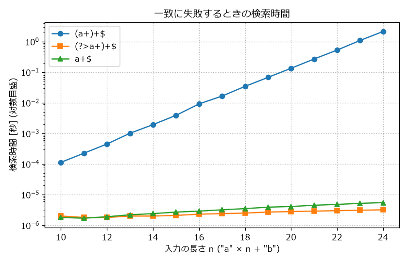

落とし穴と性能
==============

この章では、正規表現を使ううえで注意すべき点をまとめる。最も深刻なのは、特定の入力に対して処理時間が爆発的に増える問題である。あわせて、よくある間違いと、正規表現を使うべきでない場面を説明する。

破滅的バックトラック
--------------------

次のパターンと入力の組み合わせを考える。

* パターン: ``(a+)+$``
* 入力: ``a`` を n 個並べた後に ``b`` を 1 個付けた文字列

末尾に ``b`` があるので、``a`` の並びの直後で ``$`` が一致することはなく、照合は必ず失敗する。しかし、エンジンは失敗を確定する前に、あらゆる可能性をバックトラックで試す。

``(a+)+`` は「``a`` の 1 個以上の並び」の 1 回以上の繰り返しである。``aaa`` を例にとると、``(a+)+`` が ``aaa`` 全体に一致する方法は\ :numref:`fig-redos-tree` のように 4 通りある。

.. _fig-redos-tree:

.. graphviz::
   :caption: (a+)+ が aaa に一致する分け方
   :align: center

   digraph splits {
       rankdir=TB;
       bgcolor="transparent";
       node [shape=box, style=rounded, fontsize=12];
       edge [fontsize=11];
       root [label="aaa"];
       a1 [label="(aaa)"];
       a2 [label="(aa)(a)"];
       a3 [label="(a)(aa)"];
       a4 [label="(a)(a)(a)"];
       root -> a1 [label="1 回"];
       root -> a2 [label="2 回"];
       root -> a3 [label="2 回"];
       root -> a4 [label="3 回"];
   }

一般に、n 個の ``a`` を 1 個以上のまとまりに分ける方法は 2\ :sup:`n-1` 通りある。各文字の間で「区切る」「区切らない」の 2 通りを選べるからである。エンジンは、どの分け方でも最後に ``$`` が失敗することを、すべての分け方について試すまで知ることができない。そのため、n が 1 増えるごとに処理時間がおよそ 2 倍になる。

この現象を\ :term:`破滅的バックトラック`\ と呼ぶ。実際に計測した結果を\ :numref:`fig-redos-time` に示す。

.. _fig-redos-time:

   一致に失敗するときの検索時間（縦軸は対数目盛）

縦軸は対数目盛なので、``(a+)+$`` の直線は処理時間が指数関数的に増えていることを示す。n = 24 では約 2 秒かかっており、n が 10 増えると処理時間はおよそ 1000 倍になる。一方、後で説明する改善版のパターンは、n が増えてもマイクロ秒単位のままである。

この図は、次の関数で計測した結果である。

.. literalinclude:: ../examples/ch11_redos_benchmark.py
   :language: python
   :pyobject: measure
   :linenos:
   :caption: 検索時間の計測

ReDoS
-----

破滅的バックトラックを起こすパターンが、外部から入力を受け取るプログラムで使われていると、攻撃者は細工した短い文字列を送るだけで CPU を長時間占有させられる。これを :term:`ReDoS`\ （Regular expression Denial of Service）と呼ぶ。

ReDoS は理論上の問題ではない。2019 年には、Cloudflare の WAF（Web アプリケーションファイアウォール）に追加されたルールの正規表現がバックトラックで CPU を使い果たし、同社のサービスが世界的に 27 分間停止した（付録 C の参考文献を参照）。この正規表現には ``.*(?:.*=.*)`` という部分が含まれていた。``.*`` が連続しているので、文字列を 2 つの ``.*`` に分ける方法が多数ある。この場合の処理時間は ``(a+)+`` のような指数関数的な増え方ではなく、入力の長さの 2 乗や 3 乗に比例する多項式的な増え方だが、長い入力に対しては同じく致命的になる。

破滅的バックトラックを起こしやすいパターンには、次のような特徴がある。

* 量指定子が入れ子になっている（例: ``(a+)+``、``(\w+\s?)*``）
* 繰り返しの中の選択肢が同じ文字に一致し得る（例: ``(a|a)*``、``(\d|\w)+``）
* 同じ文字に一致し得る量指定子が連続している（例: ``.*.*``、``\d+\d+``）

いずれも「同じ文字列を複数の方法で分けられる」という共通点を持つ。量指定子の入れ子は指数関数的な、量指定子の連続は多項式的な処理時間の増加を招く。

破滅的バックトラックを防ぐ
--------------------------

対策は次のとおりである。

**パターンを見直す**
   最も確実なのは、同じ文字列を複数の方法で分けられない形に書き直すことである。``(a+)+$`` は ``a+$`` と同じ文字列に一致するので、入れ子は不要である。``.*`` を ``[^=]*`` のように具体的な文字クラスに置き換えることも効果がある。

**強欲量指定子かアトミックグループを使う**
   第 4 章で説明した強欲量指定子とアトミックグループは、一度一致した文字を手放さないので、分け方を試し直さない。:numref:`fig-redos-time` の ``(?>a+)+$`` がその例である。

**入力の長さを制限する**
   破滅的バックトラックの処理時間は入力の長さに対して指数関数的に増える。外部からの入力は、正規表現にかける前に長さの上限を確かめる。

**線形時間のエンジンを使う**
   Google の RE2 のように、バックトラックを使わず、入力の長さに比例する時間で照合することを保証するエンジンもある。Python からは ``google-re2`` パッケージで利用できる。ただし、後方参照や先読みなどの機能は使えない（第 12 章）。

改善したパターンの処理時間を確かめる。

.. literalinclude:: ../examples/ch11_pitfalls.py
   :language: python
   :pyobject: demo_catastrophic_fixed
   :linenos:
   :caption: 改善したパターンの処理時間

``time_search()`` は、``re.search()`` を 1 回実行するのにかかった時間を秒単位で返す関数である（サンプルコードを参照）。``(a+)+$`` では約 0.5 秒かかる n = 22 の入力でも、いずれのパターンも 1 ミリ秒未満で終わる。計測結果は実行環境によって異なるので、手元でも ``ch11_pitfalls.py`` を実行して確かめてほしい。

よくある間違い
--------------

これまでの章で説明した注意点のうち、特に間違えやすいものを一覧にまとめる。

.. list-table:: よくある間違い
   :header-rows: 1
   :widths: 35 40 25

   * - 間違い
     - 対策
     - 説明した章
   * - raw 文字列を使わない
     - パターンは常に ``r"..."`` で書く
     - 第 2 章
   * - ``\d`` が全角数字に一致することを忘れる
     - ``[0-9]`` と書くか ``re.ASCII`` を指定する
     - 第 3 章
   * - ``.*`` が意図より長く一致する
     - 否定文字クラス ``[^"]*`` などを使う
     - 第 4 章、本章
   * - ``^...$`` で検証し、末尾の改行を見逃す
     - ``re.fullmatch()`` を使う
     - 第 5 章
   * - ``re.findall()`` の結果がグループで変わる
     - 不要なグループは ``(?:...)`` にする
     - 第 6 章
   * - フラグを位置引数で渡す
     - ``flags=`` のキーワード引数で渡す
     - 第 8 章
   * - ``re.match()`` で文字列の途中を探そうとする
     - 検索は ``re.search()``、検証は ``re.fullmatch()`` を使う
     - 第 9 章、本章
   * - 外部の文字列をそのままパターンに埋め込む
     - ``re.escape()`` でエスケープする
     - 第 9 章
   * - 置換文字列のバックスラッシュを忘れる
     - 置換文字列も raw 文字列で書くか、関数を渡す
     - 第 9 章、本章

このうち、いくつかについて本章で改めて例を示す。

``re.match()`` は、文字列の先頭からしか一致を調べない。文字列の途中を探すつもりで使うと、一致しない。

.. literalinclude:: ../examples/ch11_pitfalls.py
   :language: python
   :pyobject: demo_match_vs_search
   :linenos:
   :caption: match() と search() の混同

``.*`` は、引用符で囲まれた値を取り出す場面で問題になりやすい。

.. literalinclude:: ../examples/ch11_pitfalls.py
   :language: python
   :pyobject: demo_greedy_dot
   :linenos:
   :caption: .* による読みすぎ

4 行目の ``"(.*)"`` は、最初の ``"`` から最後の ``"`` までに一致してしまう。5 行目のように ``[^"]*`` と書けば、値の途中で ``"`` を読み飛ばさない。

置換文字列の中の ``\`` も、パターンと同様に特別な意味を持つ。

.. literalinclude:: ../examples/ch11_pitfalls.py
   :language: python
   :pyobject: demo_replacement_backslash
   :linenos:
   :caption: 置換文字列のバックスラッシュ

4 行目の ``"\\"`` は、Python の文字列としては ``\`` 1 文字である。``re.sub()`` はこれを置換文字列のエスケープの始まりと解釈し、続く文字がないのでエラーになる。7 行目のように raw 文字列で ``\\`` と書くか、8 行目のように関数を渡す。関数が返した文字列は、エスケープとして解釈されない。

正規表現を使うべきでない場面
----------------------------

正規表現は強力だが、万能ではない。次のような場面では、専用の道具を使うほうが正確で読みやすい。

.. list-table:: 正規表現の代わりに使う道具
   :header-rows: 1
   :widths: 30 70

   * - 処理の対象
     - 使う道具
   * - HTML、XML
     - ``html.parser``、``xml.etree.ElementTree``、サードパーティの Beautiful Soup など
   * - JSON
     - ``json``
   * - CSV
     - ``csv``
   * - URL
     - ``urllib.parse``
   * - 日付と時刻
     - ``datetime.datetime.strptime()``
   * - 固定の文字列の検索、置換、分割
     - ``in``、``str.startswith()``、``str.replace()``、``str.split()`` など

HTML は入れ子の構造を持ち、属性の順序や引用符の種類、大文字と小文字の違いなど、表記の自由度が高い。これらをすべて正規表現で扱うのは現実的ではない。

.. literalinclude:: ../examples/ch11_pitfalls.py
   :language: python
   :pyobject: demo_html
   :linenos:
   :caption: HTML のリンクの抽出

4 行目の正規表現は、属性の順序が違う ``<a class="x" href='/b'>`` や、大文字で書かれた ``<A HREF="/c">`` を取りこぼす。``html.parser`` を使ったパーサーは、これらをすべて正しく扱える。

.. literalinclude:: ../examples/ch11_pitfalls.py
   :language: python
   :pyobject: LinkCollector
   :linenos:
   :caption: html.parser によるリンクの抽出

固定の文字列を扱うだけなら、文字列メソッドのほうが意図が明確で、多くの場合は速い。たとえば ``re.search(r"error", line)`` は ``"error" in line`` と書ける。

まとめ
------

* 同じ文字列を複数の方法で分けられるパターンは、一致に失敗する入力に対して指数関数的な時間がかかることがある。
* 外部からの入力を扱う場合は、パターンの見直し、強欲量指定子やアトミックグループの利用、入力の長さの制限などで ReDoS を防ぐ。
* HTML、JSON、CSV などの構造を持つデータは、専用のパーサーで扱う。

この章のサンプルコード: :download:`ch11_pitfalls.py <../examples/ch11_pitfalls.py>`、:download:`ch11_redos_benchmark.py <../examples/ch11_redos_benchmark.py>`
