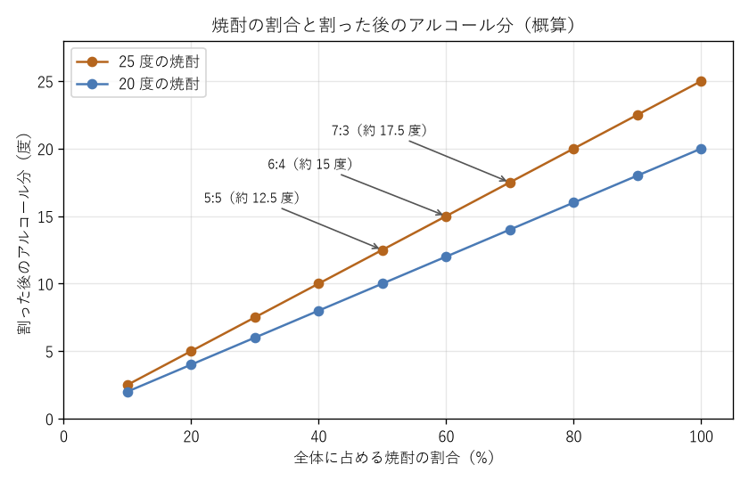

飲み方
======

薩摩焼酎は、お湯割り、水割り、ロックなど、さまざまな飲み方で楽しめる。割り方によって香りや味わいの感じ方が変わるのも焼酎の魅力である。本章では、代表的な飲み方とその作り方を紹介する。

割った後のアルコール分
----------------------

焼酎を水やお湯で割った後のアルコール分は、次の式でおおよそ求められる。

.. math::

   A = a \times \frac{S}{S + W}

ここで、:math:`A` は割った後のアルコール分（度）、:math:`a` は焼酎のアルコール分（度）、:math:`S` は焼酎の量、:math:`W` は水やお湯の量である。実際には、アルコールと水を混ぜると体積がわずかに減るため、この式の値は概算である。

例えば、25 度の焼酎 6 に対してお湯 4 で割ると、割った後のアルコール分は次のようになる。

.. math::

   A = 25 \times \frac{6}{6 + 4} = 15

焼酎の割合と割った後のアルコール分の関係を\ :numref:`fig-dilution` に示す。

.. _fig-dilution:

   焼酎の割合と割った後のアルコール分の関係（概算）

お湯割り
--------

お湯割りは、鹿児島で最も親しまれている飲み方である。温めることで香りが立ち、甘みがふくらむ。

割合
   焼酎 6 に対してお湯 4 の割合が定番とされ、\ :term:`ロクヨン`\ と呼ばれる。25 度の焼酎をロクヨンで割ると、アルコール分は約 15 度になる。軽めに飲みたい場合は、焼酎 5 に対してお湯 5（約 12.5 度）など、お湯の割合を増やすとよい。

作り方
   グラスや湯のみに先にお湯を注ぎ、その後で焼酎を注ぐ。お湯を先に入れると、後から注いだ焼酎がお湯の対流によって混ざるため、かき混ぜなくても自然になじむ。また、器が温まり、焼酎の香りも立ちやすい。お湯は沸騰したてのものより、少し冷ました 70〜80 ℃程度のものが向いている。

前割り
------

\ :term:`前割り`\ は、焼酎をあらかじめ水で割り、数日から 1 週間ほど寝かせておく方法である。寝かせることで水と焼酎がなじみ、口当たりがまろやかになる。前割りした焼酎は、そのまま冷やして飲むほか、温めて飲んでもよい。

黒ぢょか
--------

\ :term:`黒ぢょか`\ は、鹿児島の伝統的な酒器である。黒く平たい土瓶のような形をしており、薩摩焼で作られたものが多い。前割りした焼酎を黒ぢょかに入れ、直火やお湯でゆっくり温めて飲む。温めすぎるとアルコールが飛び香りも損なわれるため、人肌よりやや熱い程度にとどめるとよい。

.. note::

   黒ぢょかは素焼きに近い土の器のため、急な温度変化で割れることがある。使い方は製品の説明に従うこと。

水割り
------

焼酎を冷たい水で割る飲み方である。氷を入れたグラスに焼酎を注いで冷やし、その後で水を注いで軽く混ぜる。すっきりとした味わいになり、食事に合わせやすい。割合は焼酎 6 に対して水 4 から、焼酎 5 に対して水 5 程度が目安である。

ロック
------

大きめの氷を入れたグラスに焼酎を注ぐ飲み方である。氷が溶けるにつれて、味わいが少しずつ変わっていくのを楽しめる。アルコール分が高いまま飲むことになるため、飲む量には注意が必要である。

ストレート
----------

何も加えずにそのまま飲む飲み方である。焼酎本来の香りや味わいを最も直接感じられる。アルコール分が高いため、少量をゆっくり味わい、水を一緒に飲む（チェイサーを用意する）とよい。

ソーダ割り
----------

焼酎を炭酸水で割る飲み方である。爽やかな口当たりになり、芋焼酎の香りが苦手な人でも飲みやすい。氷を入れたグラスに焼酎を注ぎ、炭酸水を静かに注いで、炭酸が抜けないよう軽く 1 回だけ混ぜる。

飲み方の比較
------------

.. list-table:: 飲み方の比較（25 度の焼酎を使う場合）
   :header-rows: 1
   :widths: 18 32 20 30

   * - 飲み方
     - 割り方の目安
     - アルコール分の目安
     - 向いている場面
   * - お湯割り
     - 焼酎 6：お湯 4
     - 約 15 度
     - 香りと甘みを楽しみたいとき、寒い季節
   * - 前割り
     - 焼酎 6：水 4 など
     - 約 15 度
     - まろやかさを楽しみたいとき
   * - 水割り
     - 焼酎 6：水 4〜焼酎 5：水 5
     - 約 12.5〜15 度
     - 食事と合わせたいとき
   * - ソーダ割り
     - 焼酎 1：炭酸水 2〜3
     - 約 6〜8 度
     - 爽やかに飲みたいとき
   * - ロック
     - 割らない（氷が溶けて薄まる）
     - 約 25 度から下がっていく
     - 味わいの変化を楽しみたいとき
   * - ストレート
     - 割らない
     - 約 25 度
     - 焼酎本来の味わいを確かめたいとき

料理との組み合わせ
------------------

薩摩焼酎は、鹿児島の郷土料理とよく合う。甘辛い味付けや脂の多い料理と特に相性がよい。

.. list-table:: 薩摩焼酎と合わせたい鹿児島の料理
   :header-rows: 1
   :widths: 25 75

   * - 料理
     - 説明
   * - きびなごの刺身
     - 小さな青魚であるきびなごを開き、酢味噌などで食べる。
   * - さつま揚げ
     - 魚のすり身を油で揚げたもので、鹿児島では「つけあげ」と呼ぶ。
   * - 黒豚料理
     - 鹿児島特産の黒豚を、しゃぶしゃぶや豚骨（とんこつ）と呼ばれる煮込み料理などにする。
   * - 鶏刺し・鶏のたたき
     - 鶏肉の表面をあぶって刺身にしたもので、甘めの醤油で食べる。生に近い鶏肉には食中毒のおそれがあるため、衛生管理の行き届いた店で食べるようにする。
   * - 豚味噌
     - 豚肉を味噌と砂糖で甘く炒め煮にした常備菜である。

だれやめ
--------

鹿児島では、晩酌のことを\ :term:`だれやめ`\ と呼ぶ。「だれ」は疲れ、「やめ」はやめることを意味し、1 日の疲れを焼酎で癒やすという意味である。薩摩焼酎は、特別な日の酒であると同時に、日々の食卓に寄り添う酒として親しまれてきた。

ただし、毎日の晩酌は飲酒量が多くなりやすい。健康に配慮した飲み方については「:doc:`moderation`」を参照してほしい。
