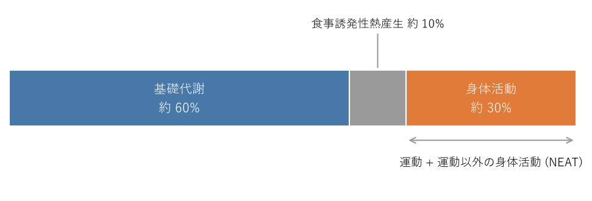

座り仕事と身体の基礎知識
========================

この章では、後の章を理解するための基礎知識として、座りすぎが体に与える影響、1 日のエネルギー消費、姿勢を支える体の仕組み、体内時計の基本を説明する。

座位行動とは
------------

座ったり寝転んだりした状態で、エネルギー消費が少ない覚醒中の行動を\ :term:`座位行動`\ という。具体的には、座位・半臥位・臥位で、エネルギー消費が 1.5 :term:`メッツ`\ 以下の行動を指す。デスクワーク、会議、通勤電車で座ること、テレビやスマートフォンを座って見ることなどが含まれる。睡眠は含まない。

座位行動が長いこと（座りすぎ）と、運動が足りないこと（運動不足）は、別の問題である。週末にジムで運動していても、平日に 1 日 10 時間座っていれば、座りすぎの状態にある。身体活動・運動ガイドも、運動量の推奨とは別に「座りっぱなしの時間が長くなりすぎないように注意する」ことを求めている。座り仕事が中心の人は、運動量を確保することと、座っている時間を減らすことの両方に取り組む必要がある。

座りすぎが体に与える影響
------------------------

座位時間が長い人ほど、死亡や心血管疾患、2 型糖尿病のリスクが高いことが、多くの研究で示されている。座りすぎが体に悪い理由として、主に次のことが考えられている。

* **脚の筋肉が働かない**：脚の大きな筋肉は、血液中の糖や脂肪を取り込んで消費する。座ったままだと筋肉がほとんど働かず、食後の血糖値や中性脂肪が下がりにくくなる。
* **血液の流れが滞る**：ふくらはぎの筋肉は、収縮することで脚の血液を心臓へ押し戻すポンプの役割を果たしている。座ったままだとこのポンプが働かず、脚がむくみやすくなる。
* **同じ姿勢が続く**：首・肩・腰の筋肉が長時間緊張し続け、こりや痛みの原因になる（:doc:`posture`\ を参照）。
* **消費エネルギーが少ない**：座っている時間が長いほど 1 日の消費エネルギーが減り、体重が増えやすくなる。

一方で、中強度以上の身体活動を十分に行うと、座りすぎによる悪影響が弱まることも分かっている。約 100 万人のデータを統合した分析では、1 日 60〜75 分程度の中強度の身体活動を行う人では、座位時間が長くても死亡リスクの上昇がほとんど見られなかった。ただし、これだけの身体活動量を毎日確保するのは簡単ではない。座位時間を減らす工夫（:doc:`sedentary`）と、運動の習慣（:doc:`exercise`）を組み合わせるのが現実的である。

1 日のエネルギー消費
--------------------

1 日に消費するエネルギーは、:term:`基礎代謝`、:term:`食事誘発性熱産生`、身体活動の 3 つに分けられる（:numref:`fig-energy-breakdown`）。

.. _fig-energy-breakdown:

   1 日のエネルギー消費量の内訳（おおよその割合）

基礎代謝と食事誘発性熱産生は、体格や食事量でほぼ決まり、日によって大きくは変わらない。人によって大きく差が出るのは身体活動の部分である。身体活動には、計画的に行う運動のほかに、通勤で歩く、階段を上る、家事をする、立って作業する、といった運動以外の身体活動が含まれる。この運動以外の身体活動による消費エネルギーを :term:`NEAT`\ （非運動性熱産生）と呼ぶ。

運動の習慣がない人では、身体活動による消費エネルギーの大部分を NEAT が占める。座り仕事の人は NEAT が少なくなりやすく、在宅勤務で通勤がなくなるとさらに減る。こまめに立って歩くことは、座りすぎの悪影響を減らすだけでなく、1 日の消費エネルギーを増やすことにもつながる。

なお、立っているだけでは消費エネルギーはあまり増えない。メッツ表では、座ってのデスクワークも、立ってのパソコン作業も、同じ 1.3 メッツとされている。消費エネルギーを増やすには、立つだけでなく、歩いたり階段を上ったりして体を動かすことが大切である。メッツの詳しい説明は\ :doc:`exercise`\ で行う。

姿勢を支える体の仕組み
----------------------

背骨と S 字カーブ
^^^^^^^^^^^^^^^^^

背骨（脊柱）は、首の 7 個の頸椎、胸の 12 個の胸椎、腰の 5 個の腰椎と、その下の仙骨・尾骨からなる。横から見ると、頸椎は前に、胸椎は後ろに、腰椎は前に緩やかに曲がっており、全体として S 字のカーブを描いている。この\ :term:`生理的弯曲`\ が、頭の重さや歩くときの衝撃をばねのように分散させている。

背骨の骨と骨の間には、クッションの役割を果たす\ :term:`椎間板`\ がある。前かがみの姿勢や、骨盤が後ろに倒れた姿勢（いわゆる猫背）では、腰椎の前向きのカーブが失われ、椎間板の前側に負担が集中しやすい。

頭の重さと首・肩の筋肉
^^^^^^^^^^^^^^^^^^^^^^

成人の頭の重さは、体重のおよそ 10% 程度、4〜6 kg ほどある。頭が背骨の真上にあれば、首や肩の筋肉は少ない力で頭を支えられる。しかし、画面をのぞき込むように頭が前に出ると、頭を支えるために首の後ろや肩の筋肉が強く緊張し続ける。詳しくは\ :doc:`posture`\ で説明する。

同じ姿勢が続くと何が起こるか
^^^^^^^^^^^^^^^^^^^^^^^^^^^^

筋肉は、縮んだり緩んだりを繰り返すことで血液の流れが保たれる。同じ姿勢で長時間じっとしていると、一部の筋肉が緊張し続けて血液の流れが悪くなり、筋肉が硬くなって、こりや痛みを感じるようになる。よい姿勢であっても、長時間続ければ負担になる。姿勢そのものに加えて、こまめに姿勢を変えることが大切なのはこのためである。

体内時計の基本
--------------

人の体には、約 24 時間の周期で体の状態を変化させる\ :term:`体内時計`\ がある。体内時計が作り出す約 1 日周期のリズムを\ :term:`サーカディアンリズム`\ （概日リズム）という。眠気や目覚め、体温、血圧、ホルモンの分泌などは、このリズムに従って 1 日の中で変化する。

体内時計の中枢は、脳の\ :term:`視交叉上核`\ にある。さらに、内臓や筋肉など全身の細胞にも時計があり、中枢の時計がそれらをまとめて調整している。

人の体内時計の周期は、平均すると 24 時間よりわずかに長い。そのため、何もしなければ毎日少しずつ後ろにずれていく。このずれを毎日リセットして 24 時間に合わせる、最も強い手がかりが光である。朝に明るい光を浴びると体内時計が前に進み、夜に明るい光を浴びると後ろにずれる。食事や運動のタイミングも、体内時計に影響を与える。

体内時計に関わる体の変化として、次の 2 つが重要である。

* **メラトニン**：夜になると脳から分泌され、体を眠りに適した状態にするホルモンである。明るい光を浴びると分泌が抑えられる。
* **深部体温**：体の内部の温度は、夕方に最も高く、明け方に最も低くなる。夜に深部体温が下がっていく過程で、眠気が強まる。

体内時計と眠気の関係は\ :doc:`sleep_mechanism`\ で、体内時計を整える方法は\ :doc:`sleep_practice`\ で詳しく説明する。
