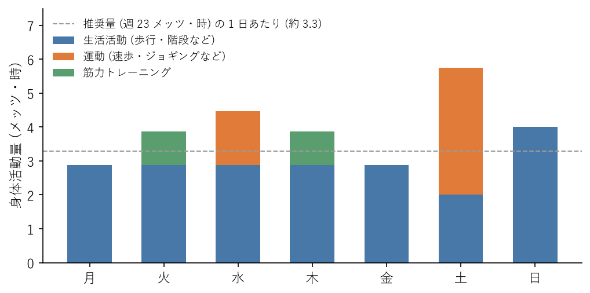

運動習慣
========

この章では、推奨される身体活動と運動の量、運動の強さの表し方、有酸素運動と筋力トレーニングの始め方、運動と睡眠の関係、安全に運動するための注意を説明する。最後に、1 週間の計画の例と、身体活動量を計算するサンプルコードを紹介する。

推奨される身体活動と運動の量
----------------------------

:term:`身体活動`\ とは、安静にしている状態よりも多くのエネルギーを消費する、すべての動きのことである。身体活動は、日常生活の中で行う\ :term:`生活活動`\ （通勤で歩く、階段を上る、家事をするなど）と、体力の維持や向上を目的に計画的に行う\ :term:`運動`\ （ジョギング、筋力トレーニングなど）に分けられる。

身体活動・運動ガイドは、成人に対して次のことを推奨している。

.. list-table:: 成人に推奨される身体活動と運動（身体活動・運動ガイドによる）
   :header-rows: 1
   :widths: 20 80

   * - 項目
     - 推奨事項
   * - 身体活動
     - 歩行またはそれと同等以上の強度（3 メッツ以上）の身体活動を 1 日 60 分以上行う。1 日約 8,000 歩以上に相当し、週 23 メッツ・時以上が目安である。
   * - 運動
     - 息が弾み汗をかく程度以上（3 メッツ以上）の運動を週 60 分以上行う。週 4 メッツ・時以上が目安である。
   * - 筋力トレーニング
     - 上記の運動の一部として、週 2〜3 日行う。
   * - 座位行動
     - 座りっぱなしの時間が長くなりすぎないように注意する。

あわせて、身体活動・運動ガイドは、個人差を踏まえて強度や量を調整し、可能なものから取り組むこと、今よりも少しでも多く体を動かすことを勧めている。推奨量に届かないからといって、あきらめる必要はない。1 日 10 分歩く時間を増やすだけでも、健康上の効果が期待できる。

運動の強さと量の表し方
----------------------

メッツ
^^^^^^

身体活動の強さは、:term:`メッツ`\ という単位で表す。座って安静にしている状態を 1 メッツとして、その何倍のエネルギーを消費するかを示す。3 メッツ以上が中強度、6 メッツ以上が高強度とされる。主な活動のメッツの値を次の表に示す。

.. list-table:: 主な活動のメッツの値（改訂第 2 版『身体活動のメッツ（METs）表』成人版による）
   :header-rows: 1
   :widths: 60 20 20

   * - 活動
     - メッツ
     - 区分
   * - 座ってデスクワークをする
     - 1.3
     - 座位行動
   * - 立ってパソコン作業をする
     - 1.3
     - 低強度
   * - ストレッチ（ゆったり）
     - 2.3
     - 低強度
   * - 歩く（時速 4 km 程度）
     - 3.0
     - 中強度
   * - 自重の筋力トレーニング（スクワット、腕立て伏せなど）
     - 3.0
     - 中強度
   * - 歩く（時速 4.5〜5.5 km）
     - 3.8
     - 中強度
   * - 自転車に乗る（時速 16 km 未満）
     - 4.0
     - 中強度
   * - 階段をゆっくり上る
     - 4.5
     - 中強度
   * - 速歩（時速 5.7〜6.3 km）
     - 4.8
     - 中強度
   * - ジョギング
     - 7.5
     - 高強度

メッツ・時と消費エネルギー
^^^^^^^^^^^^^^^^^^^^^^^^^^

身体活動の量は、強さ（メッツ）に実施した時間を掛けた\ :term:`メッツ・時`\ という単位で表す。

.. math::

   \text{身体活動量 [メッツ・時]} = \text{強さ [メッツ]} \times \text{時間 [時間]}

たとえば、時速 4 km 程度の歩行（3.0 メッツ）を 1 時間行うと 3.0 メッツ・時、速歩（4.8 メッツ）を 30 分行うと 2.4 メッツ・時になる。身体活動・運動ガイドが推奨する「週 23 メッツ・時」は、3 メッツの歩行を毎日 1 時間あまり行う量に相当する。

身体活動による消費エネルギーは、次の式で概算できる。

.. math::

   \text{消費エネルギー [kcal]} \approx 1.05 \times \text{身体活動量 [メッツ・時]} \times \text{体重 [kg]}

体重 60 kg の人が速歩を 30 分（2.4 メッツ・時）行うと、約 151 kcal を消費する。この値には、安静にしていても消費する分も含まれる。

主観的な強さ
^^^^^^^^^^^^

運動中にメッツの値を確かめるのは難しい。実際には、自分が感じるきつさ（:term:`主観的運動強度`）を目安にするとよい。中強度の運動は、「楽である」から「ややきつい」と感じる程度で、息が弾むが会話はできる強さである。高強度の運動は、「きつい」と感じ、会話が難しくなる強さである。

有酸素運動
----------

ウォーキング、ジョギング、自転車、水泳のように、大きな筋肉を使って一定のリズムで長く続ける運動を\ :term:`有酸素運動`\ という。有酸素運動には次のような効果がある。

* 心臓と肺の働きが高まり、持久力が向上する。
* 血圧、血糖値、血液中の脂質が改善する。
* 体脂肪が減りやすくなる。
* 気分が前向きになり、ストレスが和らぐ。
* 寝つきがよくなり、深い睡眠が増える。

運動の習慣がない人は、まず速歩から始めるとよい。特別な道具が要らず、けがの危険も少ない。

* 最初は 1 回 10 分程度から始め、慣れたら 1 回 20〜30 分に延ばす。
* 通勤の途中で 1 駅分歩く、昼休みに歩く、在宅勤務の日に始業前に歩く、というように、生活の中に組み込むと続けやすい。
* 10 分程度の短い運動を 1 日に何回かに分けて行ってもよい。

速歩に慣れて物足りなくなったら、ジョギングや自転車、水泳などを取り入れる。強度を上げる場合は、時間や距離を少しずつ増やす。

筋力トレーニング
----------------

:term:`筋力トレーニング`\ は、筋肉に負荷をかけて、筋力と筋肉の量を維持・向上させる運動である。筋力トレーニングには次のような効果がある。

* 筋力が向上し、日常の動作が楽になる。
* 体幹やお尻の筋肉が強くなり、よい姿勢を保ちやすくなり、腰痛の予防にもつながる。
* 筋肉が血液中の糖を取り込みやすくなり、血糖値が改善する。
* 加齢による筋肉の減少を防ぐ。

ジムに通わなくても、自分の体重を負荷にする自重トレーニングで十分に始められる。座り仕事で弱りやすい脚、お尻、体幹を中心に、次のような種目を組み合わせるとよい。

.. list-table:: 自宅でできる自重トレーニングの例
   :header-rows: 1
   :widths: 20 55 25

   * - 種目
     - 方法
     - 主に鍛える部位
   * - スクワット
     - 足を肩幅に開いて立ち、椅子に腰掛けるようにお尻を後ろに引きながら膝を曲げ、太ももが床と平行になる手前まで下ろす。膝がつま先より前に大きく出ないようにする。
     - 太もも、お尻
   * - 腕立て伏せ
     - 手を肩幅より少し広く床につき、頭からかかとまでを一直線に保って、体を下ろして上げる。きつい場合は膝をついて行う。
     - 胸、腕、肩
   * - プランク
     - うつ伏せで両肘とつま先を床につき、頭からかかとまでを一直線に保つ。腰が反ったり、落ちたりしないようにする。
     - 体幹
   * - ヒップリフト
     - 仰向けで膝を立て、お尻を持ち上げて、肩から膝までを一直線にする。ゆっくり下ろす。
     - お尻、太ももの裏
   * - バードドッグ
     - 四つんばいになり、右手と左脚を床と平行になるまで伸ばして数秒保つ。反対側も同様に行う。
     - 体幹、背中、お尻
   * - カーフレイズ
     - 壁や机に手を添えて立ち、かかとをゆっくり上げ下げする。
     - ふくらはぎ

回数とセット数は、次のようにするとよい。

* プランク以外の種目は、1 セット 10〜15 回を目安にする。最初は 1 セットから始め、慣れたら 2〜3 セットに増やす。プランクは 20〜30 秒から始める。
* 週に 2〜3 日、間に 1〜2 日の休養をはさんで行う。筋肉は休養の間に回復し、強くなる。
* 動作はゆっくり行い、息を止めずに自然に呼吸を続ける。息を止めて力むと、血圧が急に上がる。
* 正しい姿勢で行うことを優先する。回数を増やすために姿勢が崩れるなら、回数を減らす。

柔軟性とストレッチ
------------------

体の柔らかさ（柔軟性）を保つと、関節を楽に動かせるようになり、けがの予防にもつながる。座り仕事では、太ももの裏、股関節の前側、胸の筋肉が縮んだ状態が続き、硬くなりやすい。

ストレッチには、反動をつけずに筋肉をゆっくり伸ばして保つ静的ストレッチと、関節を大きく動かしながら筋肉をほぐす動的ストレッチがある。

* 運動の前には、腕や脚を大きく回す、その場で足踏みをする、などの動的ストレッチで体を温める。
* 運動の後や入浴後、就寝前には、静的ストレッチで筋肉をゆっくり伸ばす。

机の周りでできるストレッチは、:doc:`sedentary`\ で紹介した。

運動と睡眠の関係
----------------

定期的な運動は、寝つきをよくし、深いノンレム睡眠を増やす。日中に体を動かすことで睡眠圧が高まり、体温のリズムにも張りが出るためである。運動の習慣がある人は、睡眠の悩みが少ない傾向がある。

運動する時間帯は、生活に合わせて選べばよい。

* **朝**：屋外でのウォーキングなどは、朝の光を浴びることにもなり、体内時計を整える効果がある。
* **夕方から夜の早い時間**：体温が高く体がよく動く時間帯で、運動に向いている。
* **就寝直前**：激しい運動は、体を興奮させ、寝つきを悪くすることがある。就寝前の 1 時間ほどは、激しい運動を避け、軽いストレッチ程度にとどめる。

安全に運動するために
--------------------

運動による効果を得るには、けがや事故を防ぎ、安全に続けることが大切である。

* 運動の前には準備運動、後には整理運動を行う。
* 運動の前、運動中、運動後に水分をとる。
* 運動の量や強度は、急に増やさず、少しずつ増やす。
* 痛みのある部位を無理に動かさない。運動中や運動後に関節や筋肉の痛みが続く場合は、運動を休む。
* 発熱しているとき、体調が悪いとき、睡眠不足や飲酒の後は、運動を控える。

運動中に胸の痛みや圧迫感、強い息切れ、動悸、めまいなどを感じたら、すぐに運動を中止する。症状が治まらない場合は、ためらわずに救急車を呼ぶ（:doc:`warning_signs`\ を参照）。持病がある人や治療中の人は、運動を始める前に医師に相談する。

1 週間の計画の例
----------------

身体活動・運動ガイドの推奨量を満たす、出社日のある 1 週間の計画の例を次の表に示す。

.. list-table:: 1 週間の計画の例
   :header-rows: 1
   :widths: 15 85

   * - 曜日
     - 内容
   * - 月
     - 通勤などで歩く（50 分）、階段を上る（5 分）、就寝前のストレッチ（10 分）
   * - 火
     - 通勤などで歩く（50 分）、階段を上る（5 分）、自重の筋力トレーニング（20 分）
   * - 水
     - 通勤などで歩く（50 分）、階段を上る（5 分）、帰りに速歩（20 分）
   * - 木
     - 通勤などで歩く（50 分）、階段を上る（5 分）、自重の筋力トレーニング（20 分）
   * - 金
     - 通勤などで歩く（50 分）、階段を上る（5 分）、就寝前のストレッチ（10 分）
   * - 土
     - 買い物などで歩く（40 分）、ジョギング（30 分）
   * - 日
     - 買い物などで歩く（40 分）、自転車に乗る（30 分）

この計画の曜日ごとの身体活動量を\ :numref:`fig-weekly-activity` に示す。平日は通勤などの生活活動が中心だが、週末の運動と合わせて、週の合計は推奨量を上回る。在宅勤務の日は、通勤で歩く分を朝や昼休みの散歩で補う必要がある。

.. _fig-weekly-activity:

   1 週間の身体活動量の例（3 メッツ以上の身体活動）

身体活動量を計算するサンプルコード
----------------------------------

1 週間の活動記録から、身体活動量と消費エネルギーを計算し、推奨量と比べるサンプルコード activity_calc.py を用意した。ファイルは\ :doc:`samples`\ からダウンロードできる。上の計画の例は、サンプルデータ activity_sample.csv として同梱している。

記録の形式
^^^^^^^^^^

活動記録は、曜日（day）、活動の種類（activity）、時間（分、minutes）の 3 列からなる CSV ファイルにする。

.. literalinclude:: ../examples/activity_sample.csv
   :language: text
   :lines: 1-7
   :lineno-match:
   :caption: activity_sample.csv の先頭部分

活動の種類には、次のコードで定義した名前を使う。メッツの値は、前述の表と同じである。

.. literalinclude:: ../examples/activity_calc.py
   :language: python
   :start-at: ACTIVITIES: dict
   :end-at: }
   :lineno-match:
   :caption: activity_calc.py の活動の定義

``Activity`` の 3 番目の値は、その活動が運動かどうかを表す。4 番目の値は、筋力トレーニングかどうかを表す。ここにない活動を記録したい場合は、メッツ表で値を調べて追加すればよい。

使い方
^^^^^^

端末で次のように実行する。``--weight`` には体重（kg）を指定する。

.. code-block:: console
   :linenos:

   python activity_calc.py activity_sample.csv --weight 65

実行すると、次のように表示される。

.. code-block:: text

   曜日ごとの身体活動量 (3 メッツ以上)
     月:  2.9 メッツ・時
     火:  3.9 メッツ・時
     水:  4.5 メッツ・時
     木:  3.9 メッツ・時
     金:  2.9 メッツ・時
     土:  5.8 メッツ・時
     日:  4.0 メッツ・時

   身体活動 : 27.7 メッツ・時/週 (目安 23 以上) 達成
   運動     :  7.3 メッツ・時/週 (目安 4 以上) 達成
   筋トレ   : 2 日/週 (目安 2〜3 日) 達成
   消費エネルギー (記録した活動の合計) : 約 1,945 kcal

コードの説明
^^^^^^^^^^^^

集計は ``summarize`` 関数で行う。

.. literalinclude:: ../examples/activity_calc.py
   :language: python
   :pyobject: summarize
   :lineno-match:
   :caption: activity_calc.py の summarize 関数

身体活動・運動ガイドの推奨量は 3 メッツ以上の活動を数えるため、まず 3 メッツ以上の記録だけを取り出す。身体活動量はその合計、運動量はそのうち運動に当たるものの合計である。筋力トレーニングの日数は、筋力トレーニングを記録した曜日の数を数える。消費エネルギーは、前述の式を使って、記録したすべての活動について計算する。
