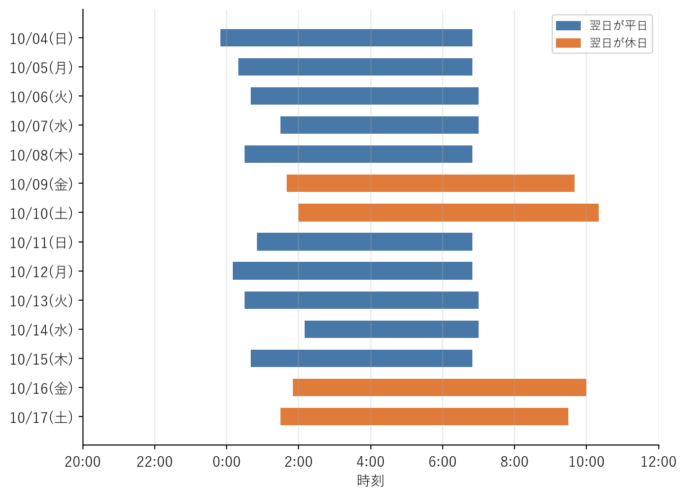

習慣化の方法
============

睡眠・姿勢・運動のどれも、一度だけ取り組んでも効果は得られない。毎日続けて、意識しなくてもできる習慣にすることが大切である。この章では、新しい行動を習慣にするための方法、記録と振り返りの方法、1 日のモデルプラン、セルフチェックリストを紹介する。

習慣ができる仕組み
------------------

習慣とは、決まったきっかけで、意識しなくても自然に行う行動のことである。習慣は、次の 3 つの要素の繰り返しで作られる（:numref:`fig-habit-loop`）。

* **きっかけ**：行動を始める合図となる出来事。時刻、場所、直前の行動など。
* **行動**：習慣にしたい行動そのもの。
* **報酬**：行動の後に得られる、よい感覚。すっきりした、達成感がある、など。

.. _fig-habit-loop:

.. graphviz::
   :caption: 習慣ができる仕組み
   :align: center

   digraph habit {
       graph [rankdir=LR, nodesep=0.6, ranksep=0.8, bgcolor="transparent"];
       node [shape=box, style="rounded,filled", fillcolor="#e8f0f8", color="#4878a8", fontsize=12, margin="0.25,0.12"];
       edge [color="#666666", fontsize=10];

       cue [label="きっかけ\n(例: CI の結果を待つ)"];
       action [label="行動\n(例: 立ってストレッチ)"];
       reward [label="報酬\n(例: 肩が軽くなる)"];
       habit [label="習慣\n(意識しなくても\nできるようになる)", fillcolor="#fbe7d9", color="#e07b39"];

       cue -> action;
       action -> reward;
       reward -> cue [label="繰り返す", constraint=false];
       reward -> habit [label="繰り返すうちに", style=dashed];
   }

同じきっかけで同じ行動を繰り返すと、きっかけと行動の結び付きが強くなり、やがて意識しなくても行動できるようになる。日常の行動を習慣にするまでの日数を調べた研究では、中央値で 66 日かかった。ただし、その日数は行動や人によって 18 日から 254 日まで大きく異なっていた。また、ときどき実行できない日があっても、習慣ができる過程にはほとんど影響がなかった。習慣にするには数か月かかるのが普通であり、途中で何日か抜けても気にせず続けることが大切である。

小さく始める
------------

新しい行動を始めるときは、物足りないと感じるくらい小さく始める。最初から「毎日 1 時間運動する」「毎晩 23 時に寝る」といった大きな目標を立てると、続けられずに挫折しやすい。

.. list-table:: 小さな始め方の例
   :header-rows: 1
   :widths: 40 60

   * - 大きな目標
     - 小さな始め方
   * - 毎日 1 時間歩く
     - 昼休みに 5 分だけ外を歩く
   * - 週 3 回筋力トレーニングをする
     - 歯を磨いた後にスクワットを 5 回する
   * - 毎晩 23 時に寝る
     - まずは起床時刻を毎朝 7 時にそろえる
   * - 就寝前にスマートフォンを見ない
     - スマートフォンを寝室の外で充電する

小さな行動が習慣になったら、少しずつ量や時間を増やしていく。

きっかけを決める
----------------

「時間があったら運動する」「気が向いたら立ち上がる」では、行動は始まらない。「〇〇したら、△△する」という形で、行動するきっかけをあらかじめ具体的に決めておくとよい。この方法を\ :term:`実行意図`\ という。すでに習慣になっている行動をきっかけにすると、新しい行動を結び付けやすい。

* 朝、コーヒーを淹れたら、ベランダに出て朝の光を浴びる。
* CI の結果を待つ間は、立ってストレッチをする。
* オンライン会議が終わったら、立ち上がって水を飲みに行く。
* 帰宅して着替えたら、自重トレーニングを 1 種目だけ行う。
* 22 時になったら、部屋の照明を暗くして、仕事のチャットを閉じる。

環境を整える
------------

意志の力に頼るより、行動しやすい環境を作るほうが確実である。

* 運動用の靴や服を、目に付く場所に置いておく。
* ストレッチ用のマットを、敷いたままにしておく。
* スマートフォンの充電器を、寝室の外に置く。
* 昇降デスクを使っている場合は、出社や始業の直後は立った状態から始める。
* 運動する予定を、仕事の予定と同じようにカレンダーに入れる。

記録と振り返り
--------------

記録を付けると、自分の生活の実態が分かり、改善の効果も確かめられる。記録が増えていくこと自体が、続ける動機にもなる。

* **睡眠**：寝床に入った時刻、起きた時刻、朝の睡眠休養感（よく休めたかどうか）を記録する。
* **身体活動**：1 日の歩数、運動の種類と時間を記録する。
* **座位**：1 日の座位時間のおおまかな見積もりを、ときどき記録する。

記録は、毎日つけたうえで、週に 1 回振り返るとよい。平均の睡眠時間、平日と休日の違い、運動できた日数などを確かめ、うまくいかなかった原因と、翌週に試すことを 1 つ決める。

ウェアラブル端末の使い方と限界
^^^^^^^^^^^^^^^^^^^^^^^^^^^^^^

スマートウォッチや活動量計を使うと、歩数や睡眠時間を自動で記録できる。手間をかけずに記録を続けられるのが大きな利点である。

ただし、ウェアラブル端末の睡眠の測定には限界がある。多くの端末は、体の動きや心拍数から睡眠を推定しており、医療機関の検査のように脳波を測っているわけではない。そのため、睡眠時間のおおまかな傾向を知るには役立つが、深い睡眠やレム睡眠の時間といった睡眠段階の推定値は、あまり正確ではない。

端末が示す「睡眠スコア」などの数値にこだわりすぎると、かえって睡眠への不安が強まり、眠れなくなることもある。数値は参考程度にとどめ、自分の睡眠休養感や日中の眠気のほうを重視するとよい。

睡眠記録を集計するサンプルコード
--------------------------------

睡眠の記録を集計するサンプルコード sleep_log.py を用意した。平均睡眠時間、平日と休日の睡眠時間、就寝時刻と起床時刻のばらつき、:term:`社会的時差ぼけ`\ を計算する。ファイルは\ :doc:`samples`\ からダウンロードできる。

記録の形式
^^^^^^^^^^

睡眠の記録は、寝床に入った日の日付（date）、寝た時刻（bedtime）、起きた時刻（wake_time）の 3 列からなる CSV ファイルにする。午前 0 時を過ぎてから寝た場合も、日付は前日の日付にする。たとえば、10 月 5 日の夜、日付が変わって 0 時 20 分に寝た場合は、date を 2026-10-05、bedtime を 00:20 とする。

.. literalinclude:: ../examples/sleep_log_sample.csv
   :language: text
   :lines: 1-8
   :lineno-match:
   :caption: sleep_log_sample.csv の先頭部分

使い方
^^^^^^

端末で次のように実行する。2 行目のように ``--plot`` を指定すると、睡眠の時間帯をグラフにして PNG ファイルに保存する。グラフを作るには matplotlib が必要である。

.. code-block:: console
   :linenos:

   python sleep_log.py sleep_log_sample.csv
   python sleep_log.py sleep_log_sample.csv --plot sleep_log.png

サンプルデータで実行すると、次のように表示される。

.. code-block:: text

   記録した夜の数        : 14 晩
   平均睡眠時間          : 6 時間 44 分
     平日 (翌日が平日)   : 6 時間 11 分
     休日 (翌日が休日)   : 8 時間 08 分
   就寝時刻のばらつき    : ±45 分 (標準偏差)
   起床時刻のばらつき    : ±84 分 (標準偏差)
   社会的時差ぼけ        : 2 時間 00 分
   * 平日と休日の睡眠の時間帯が 1 時間以上ずれている。休日も起床時刻をそろえよう。

``--plot`` で保存したグラフを\ :numref:`fig-sleep-log` に示す。

.. _fig-sleep-log:

   サンプルデータの睡眠の時間帯

このサンプルデータは、平日は 0 時半ごろに寝て 7 時前に起き、休日は 2 時ごろに寝て 10 時ごろに起きる、という生活を想定している。平日の睡眠時間は約 6 時間で、休日に約 2 時間長く寝て補っている。睡眠の時間帯も平日と休日で 2 時間ずれており、:doc:`sleep_practice`\ で説明した、週末の寝だめと社会的時差ぼけの典型的な例である。この場合、まず休日の起床時刻を平日に近づけ、平日の就寝時刻を少しずつ早めて、平日の睡眠時間を増やすことが改善の方向になる。

なお、このコードで計算する睡眠時間は、寝た時刻から起きた時刻までの時間である。寝つくまでの時間や夜中に目が覚めていた時間は差し引いていない。

コードの説明
^^^^^^^^^^^^

時刻は、寝床に入った日の 0 時からの経過時間（分）で表す。こうすると、日付をまたぐ睡眠も単純な引き算で扱える。CSV の 1 行から記録を作る ``make_record`` 関数を次に示す。

.. literalinclude:: ../examples/sleep_log.py
   :language: python
   :pyobject: make_record
   :lineno-match:
   :caption: sleep_log.py の make_record 関数

寝た時刻が正午より前であれば、午前 0 時を過ぎてから寝たとみなし、24 時間分（1,440 分）を足す。起きた時刻は、常に翌日の時刻なので 24 時間分を足す。

集計は ``summarize`` 関数で行う。

.. literalinclude:: ../examples/sleep_log.py
   :language: python
   :pyobject: summarize
   :lineno-match:
   :caption: sleep_log.py の summarize 関数

翌朝が土曜日か日曜日の夜を休日、それ以外を平日として分ける。社会的時差ぼけは、睡眠の中央の時刻（寝た時刻と起きた時刻の中間）の平均が、平日と休日でどれだけずれているかで求める。祝日は考慮していないため、必要に応じて ``SleepRecord`` の ``is_free_day`` を変更する。

挫折したときの立て直し方
------------------------

忙しい時期や体調を崩したときには、習慣が途切れることもある。途切れたときに大切なのは、その後の対応である。

* **完璧を目指さない**：1 日できなかったからといって、「もうだめだ」とすべてをやめてしまわない。前述のとおり、ときどき抜ける日があっても習慣は作られる。
* **2 日続けて休まない**：1 日休んでも、翌日は必ず再開する、とルールを決めておく。
* **量を減らして再開する**：以前と同じ量に戻すのがつらければ、最初の小さな行動に戻って再開する。
* **原因を振り返る**：続かなかった原因が、目標の大きさ、きっかけの選び方、環境のどれにあるかを考え、やり方を変える。

1 日のモデルプラン
------------------

これまでの章の内容を組み合わせた、1 日のモデルプランの例を次の表に示す。7 時に起床し、23 時に就寝する場合である。

.. list-table:: 1 日のモデルプラン（7 時起床、23 時就寝の場合）
   :header-rows: 1
   :widths: 14 43 43

   * - 時刻
     - 出社日
     - 在宅勤務の日
   * - 7:00
     - 起床。カーテンを開けて光を浴びる
     - 起床。カーテンを開けて光を浴びる
   * - 7:30
     - 朝食
     - 朝食
   * - 8:00
     - 駅まで速歩で歩く。階段を使う
     - 外を 20 分ほど散歩する（通勤の代わり）
   * - 9:00〜12:00
     - 1 時間ごとに作業休止を入れ、30 分に 1 回は立ち上がる
     - 1 時間ごとに作業休止を入れ、30 分に 1 回は立ち上がる。休憩タイマーを使う
   * - 12:00
     - 昼食。食後に少し歩く
     - 昼食。食後に外を少し歩く
   * - 13:00〜18:00
     - 午前と同様に休止を入れ、立って会議に参加する。眠気があれば 15 時までに短い昼寝（20〜30 分以内）。14 時以降はカフェインをとらない
     - 午前と同様に休止を入れ、立って会議に参加する。眠気があれば 15 時までに椅子にもたれて短い昼寝（20〜30 分以内）。14 時以降はカフェインをとらない
   * - 18:00〜19:30
     - 帰りに 1 駅分歩く。週 2 回は帰宅後に筋力トレーニング
     - 終業後に速歩やジョギング。週 2 回は筋力トレーニング
   * - 20:00
     - 夕食
     - 夕食
   * - 21:30
     - 入浴
     - 入浴
   * - 22:00
     - 照明を暗くし、仕事の連絡と画面を控える。ストレッチ
     - 作業部屋の照明を消して仕事を終える。照明を暗くし、画面を控える。ストレッチ
   * - 23:00
     - 就寝
     - 就寝

すべてをこのとおりに行う必要はない。自分の生活に合わせて、取り入れやすい項目から試すとよい。

セルフチェックリスト
--------------------

睡眠・姿勢・運動について、自分の現状を確かめるチェックリストを次の表に示す。当てはまらない項目が、取り組むべき課題の候補である。月に 1 回ほど見直すとよい。

.. list-table:: セルフチェックリスト
   :header-rows: 1
   :widths: 15 85

   * - 分類
     - 項目
   * - 睡眠
     - 平日も休日も、起床時刻はほぼ同じ（ずれは 2 時間以内）である。
   * - 睡眠
     - 6 時間以上眠っており、朝に休まった感じがある。
   * - 睡眠
     - 日中の会議や作業中に、強い眠気を感じることはない。
   * - 睡眠
     - 就寝前の 1 時間は、仕事の連絡や画面を控えている。
   * - 睡眠
     - カフェインは午後の早い時間までにしている。寝酒はしていない。
   * - 姿勢
     - 画面の上端が目の高さとほぼ同じかやや下にあり、画面との距離は 40 cm 以上ある。
   * - 姿勢
     - 椅子に深く腰掛け、足裏全体が床（または足台）に着いている。
   * - 姿勢
     - ノートパソコンで長時間作業するときは、外付けのキーボードなどを使っている。
   * - 座りすぎ
     - 1 時間に 1 回は作業休止を取り、30 分に 1 回程度は立ち上がっている。
   * - 運動
     - 歩行などの身体活動を、1 日合計 60 分以上行っている。
   * - 運動
     - 息が弾む程度の運動を、週 60 分以上行っている。
   * - 運動
     - 筋力トレーニングを、週 2 日以上行っている。
