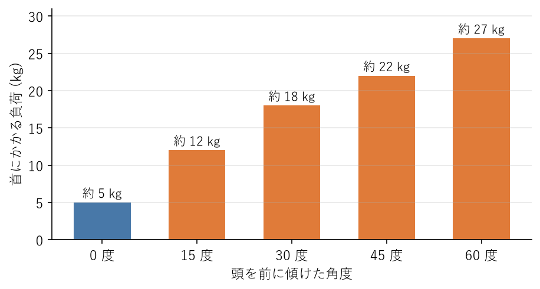
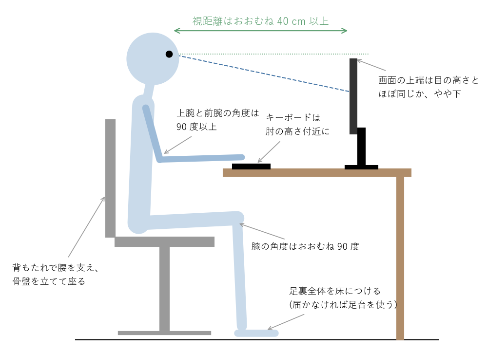

姿勢と作業環境
==============

この章では、よい座り姿勢の基本と、それを無理なく保つための作業環境の整え方を説明する。あわせて、画面作業で負担がかかりやすい目と手首の対策、肩こりと腰痛の予防についても説明する。作業環境の目安は、主に情報機器作業ガイドラインに基づく。

よい座り姿勢の基本
------------------

よい座り姿勢のポイントは次のとおりである。

* **骨盤を立てる**：お尻の下にある左右の骨（坐骨）で座面を押すように座ると、骨盤が立ち、背骨が自然な S 字カーブを保ちやすい。椅子の前のほうに浅く腰掛けて背もたれに寄りかかると、骨盤が後ろに倒れて背中が丸くなる。
* **背もたれを使う**：深く腰掛け、腰の後ろを背もたれで支える。背もたれと腰の間にすき間ができる場合は、クッションを挟む。
* **足裏全体を床につける**：膝の角度はおおむね 90 度にする。足が床に届かない場合は、足台を使う。
* **肩の力を抜く**：肩を上げたり、すくめたりしない。
* **頭を背骨の上に乗せる**：あごを軽く引き、頭が前に突き出ないようにする。

ただし、よい姿勢であっても、長時間同じ姿勢を続ければ負担になる（:doc:`basics`\ を参照）。「正しい姿勢を保ち続ける」ことよりも、「よい姿勢を基本にしながら、こまめに姿勢を変え、立ち上がる」ことが大切である。

頭の前傾と首・肩への負担
------------------------

頭が背骨の真上にあるとき、首にかかる負担は頭の重さとほぼ同じである。画面をのぞき込むように頭を前に傾けると、首の後ろの筋肉は、てこの原理で頭の重さよりはるかに大きな力で頭を支えなければならない。

コンピューターモデルを使った研究では、首にかかる負荷は、頭を 15 度前に傾けると約 12 kg、30 度で約 18 kg、60 度では約 27 kg に増えると推定されている（:numref:`fig-neck-load`）。これは計算による推定値だが、頭を前に傾けるほど首への負担が急激に増えることを示している。

.. _fig-neck-load:

   頭の前傾角度と首にかかる負荷の推定値（Hansraj, 2014 による）

画面の位置が低いノートパソコンや、手元をのぞき込むスマートフォンでは、頭が大きく前に傾きやすい。この姿勢が習慣になると、首の前向きのカーブが失われた状態（いわゆる\ :term:`ストレートネック`）になり、首や肩のこり、頭痛の原因になる。

作業環境の整え方
----------------

よい姿勢を意識で保ち続けるのは難しい。机・椅子・画面の位置を整えて、自然によい姿勢になる環境を作るほうが確実である。デスクトップパソコンで作業する場合の配置の目安を\ :numref:`fig-desk-layout` に示す。

.. _fig-desk-layout:

   モニター・椅子・机の位置関係（側面から見た模式図）

情報機器作業ガイドラインに基づく主な目安を次の表に示す。

.. list-table:: 作業環境の目安
   :header-rows: 1
   :widths: 20 80

   * - 項目
     - 目安
   * - 椅子
     - 安定していて、容易に移動できる。座面の高さを体格に合わせて調整できる。適当な背もたれがあり、その傾きを調整できることが望ましい。必要に応じて肘掛けがある。
   * - 机
     - キーボード、書類、マウスなどを適切に配置できる広さがあり、脚の周りに窮屈でない空間がある。高さが体格に合っている。
   * - 画面との距離
     - 目と画面の距離（:term:`視距離`）は、おおむね 40 cm 以上確保する。
   * - 画面の高さ
     - 画面の上端が、目の高さとほぼ同じか、やや下になるようにする。
   * - 画面と書類・キーボード
     - 画面と、キーボードや書類の、目からの距離の差を小さくする。視線を移すたびに目のピントを合わせ直す負担を減らすためである。
   * - 文字の大きさ
     - 画面上の文字の高さは、おおむね 3 mm 以上にする。
   * - 照明
     - 書類やキーボードの上の明るさは 300 ルクス以上にする。画面の明るさと周りの明るさの差は、なるべく小さくする。照明や窓の光が画面に映り込まないようにする。
   * - 姿勢
     - 椅子に深く腰掛けて背もたれに背中を十分に当て、足裏全体が床に着くようにする。届かない場合は足台を使う。座面と太ももの裏の間には、手の指が入る程度のゆとりを持たせる。上腕と前腕の角度は 90 度以上にし、キーボードに自然に手が届くようにする。

調整のポイント
^^^^^^^^^^^^^^

調整は、次の順に行うとよい。

1. 足裏全体が床に着き、膝の角度がおおむね 90 度になるように、椅子の高さを決める。
2. 肩の力を抜いて腕を下ろし、肘をおおむね 90 度に曲げたときの手の高さに、キーボードがくるようにする。机が高すぎる場合は、椅子を高くして足台を使う。
3. 画面の上端が目の高さとほぼ同じかやや下になり、視距離がおおむね 40 cm 以上になるように、画面の位置と高さを調整する。
4. 文字が小さくて画面に顔を近づけてしまう場合は、画面の拡大率や文字の大きさを上げる。

最適な位置や明るさは、人によっても、時間帯や作業内容によっても異なる。1 日に何度でも、必要に応じて調整してかまわない。

複数の画面を使う場合
^^^^^^^^^^^^^^^^^^^^

主に使う画面を体の正面に置き、補助の画面はその横に、同じ高さで並べる。2 つの画面を同じくらい使う場合は、2 つの画面の境目が体の正面にくるように置く。首を一方向にひねったまま作業を続けないようにする。大きな画面では、画面の上端が目より上にならないように注意する。

ノートパソコンでの作業
----------------------

ノートパソコンは画面とキーボードが一体になっているため、画面を目の高さに合わせるとキーボードが高くなりすぎ、キーボードを打ちやすい位置にすると画面が低くなりすぎる。長時間の作業では、次のように外付けの機器を使うとよい。

* ノートパソコン用のスタンドで画面を目の高さに近づけ、外付けのキーボードとマウスを使う。
* または、外付けのディスプレイを接続し、ノートパソコン本体は補助の画面として使う。

情報機器作業ガイドラインも、小型のノートパソコンで長時間作業する場合は、外付けのキーボードを使うことが望ましいとしている。タブレットやスマートフォンで長時間作業する場合も同様に、外付けのキーボードやディスプレイの利用を考える。

在宅勤務の作業環境
------------------

在宅勤務では、ダイニングテーブルや食卓の椅子、ソファ、ベッドの上で作業することも多い。これらは長時間の作業を前提に作られていないため、姿勢が崩れやすい。

* 椅子が低く机が高い場合は、クッションで座面を高くし、足が浮く場合は足台（箱や雑誌の束でもよい）を置く。
* 背もたれと腰の間にすき間ができる場合は、丸めたタオルやクッションを挟む。
* 画面が低い場合は、ノートパソコンを本や箱の上に置いて高さを上げ、外付けのキーボードを使う。
* ソファやベッドの上での作業は、首と腰に負担がかかるため、短時間にとどめる。

在宅勤務が長く続く場合は、高さを調整できる作業用の椅子と、外付けのディスプレイ・キーボードをそろえることを勧める。

昇降デスクと立ち作業
--------------------

情報機器作業ガイドラインは、座位だけでなく、ときどき立位を交えて作業することが望ましいとしている。天板の高さを変えられる昇降デスクを使うと、座る姿勢と立つ姿勢を切り替えながら作業できる。座りっぱなしを防ぐ方法として有効である。

ただし、立ちっぱなしもまた、脚や腰に負担がかかり、脚がむくむ原因になる。立ち作業を取り入れる場合は、次の点に注意する。

* 座る姿勢と立つ姿勢を交互に切り替える。たとえば 30〜60 分ごとに切り替えるとよい。最初は立つ時間を短くし、慣れたら徐々に長くする。
* 立つときも、天板はおおむね肘の高さに、画面の上端は目の高さとほぼ同じかやや下に合わせる。
* クッション性のある靴を履くか、足元にマットを敷く。片足に体重をかけ続けず、ときどき足踏みをする。

:doc:`basics`\ で説明したように、立っているだけでは消費エネルギーはほとんど増えない。立ち作業は座位時間を減らす工夫の 1 つであり、歩くことや運動の代わりにはならない。

目の疲れを防ぐ
--------------

画面を見続けると、目が疲れる。主な原因は次の 2 つである。

* **まばたきの減少**：画面に集中すると、まばたきの回数が普段の半分ほどに減る。目の表面が乾き、:term:`ドライアイ`\ の原因になる。
* **ピント調節の疲れ**：近くを見続けると、目のピントを合わせる筋肉が緊張し続ける。

目の疲れを防ぐには、次のことを心がける。

* 1 時間に 1 回は画面から目を離し、遠くの景色を眺めたり、目を閉じたりする（:doc:`sedentary`\ を参照）。米国眼科学会は、20 分ごとに 20 フィート（約 6 m）先を 20 秒以上見る「20-20-20 ルール」を勧めている。
* 意識してまばたきをする。エアコンの風が直接顔に当たらないようにする。
* 画面の明るさを周りの明るさに合わせる。暗い部屋で明るい画面を見続けない。
* 照明や窓の光が画面に映り込まないように、画面の向きや角度を調整する。
* 眼鏡やコンタクトレンズの度数が、画面までの距離に合っているかを確認する。遠くを見るための度数のままだと、近くを見る作業で目が疲れやすい。40 歳を過ぎると、近くにピントが合いにくくなる老眼も始まる。

手首と指の負担を減らす
----------------------

キーボードやマウスの操作では、手首や指に繰り返し負担がかかる。

* 手首を上に反らせたり、小指側に曲げたりしたまま打鍵しない。情報機器作業ガイドラインでも、手首を小指側に曲げる角度が大きいと、腕の疲れや痛みが増えるとされている。
* キーボードの手前に手首や腕を乗せる場所を確保する。手首や腕を支える台がないと、肩のこりや痛みが増えやすい。
* マウスは、肘を体から大きく離さずに操作できる位置に置く。
* キーボードのショートカットを活用して、マウス操作の回数を減らす。

指や手首の痛みやしびれが続く場合は、:doc:`warning_signs`\ を参考に医療機関を受診する。

肩こりと腰痛の予防
------------------

肩こり
^^^^^^

肩こりは、首から肩、背中にかけての筋肉が緊張し続けることで起こる。頭の前傾、肩をすくめた姿勢、画面の注視による目の疲れ、精神的な緊張が、主な原因である。予防には次のことが役立つ。

* 作業環境を整え、頭が前に出ない姿勢で作業する。
* こまめに休止を入れ、肩を回したり、肩甲骨を寄せたり離したりして、筋肉を動かす（:doc:`sedentary`\ を参照）。
* 体を温め、入浴で血液の流れをよくする。
* 定期的に運動し、肩や背中の筋肉を動かす。

腰痛
^^^^

腰痛の多くは、骨折や神経の圧迫などの明らかな原因が見つからない\ :term:`非特異的腰痛`\ である。長時間の座位、前かがみの姿勢、運動不足による筋力や柔軟性の低下が、主な原因と考えられている。予防には次のことが役立つ。

* 背もたれを使って骨盤を立てて座り、前かがみの姿勢を続けない。
* 長時間座り続けず、こまめに立ち上がって歩く。
* 体幹とお尻の筋肉を鍛え、太ももの裏や股関節の柔軟性を保つ（:doc:`exercise`\ を参照）。

急に腰が痛くなった場合でも、強い痛みがなければ、安静にしすぎず、痛みの範囲内で普段の生活を続けるほうが回復が早いとされている。ただし、足のしびれや力が入らないなどの症状がある場合は、:doc:`warning_signs`\ を参考に医療機関を受診する。
