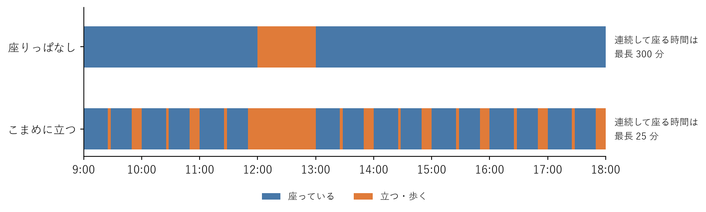

座りすぎを防ぐ
==============

この章では、作業中にこまめに休止を入れ、座りっぱなしの時間を減らす方法を説明する。机の周りでできるストレッチ、仕事に組み込む工夫、休憩を知らせるタイマーのサンプルコードも紹介する。

座りっぱなしを中断する効果
--------------------------

:doc:`basics`\ で説明したように、長時間座り続けると、脚の筋肉が働かず、血液中の糖や脂肪が使われにくくなる。座っている時間を短い活動でこまめに区切ると、こうした悪影響を減らせる。

たとえば、座り続ける場合と、20 分ごとに 2 分間軽く歩く場合とを比べた実験では、歩いて区切った場合のほうが、食後の血糖値とインスリンの上昇が小さかった。軽い歩行でも、中程度の速さの歩行とほぼ同じ効果が見られた。激しい運動をしなくても、こまめに立って少し歩くだけで効果がある。

座りっぱなしを中断すると、ほかにも次のような効果がある。

* 首・肩・腰の筋肉の緊張がほぐれ、こりや痛みを防げる。
* 画面から目を離すことで、目の疲れを防げる。
* 気分が切り替わり、集中力が回復する。行き詰まっていた問題の解決策を思いつくこともある。

作業中の休止の目安
------------------

情報機器作業ガイドラインは、作業時間の管理について次の目安を示している。

* 1 回の連続した作業時間が 1 時間を超えないようにする。
* 次の連続作業までの間に、10〜15 分の\ :term:`作業休止`\ を設ける。
* 連続作業の途中でも、1〜2 回程度の\ :term:`小休止`\ （1〜2 分程度）を設ける。小休止は、時間を決めずに自由に取れるようにする。

ここでいう作業休止は、昼休みのような休憩時間とは別のものである。画面の注視、キー操作、同じ姿勢の継続から離れるための時間であり、遠くの景色を眺める、目を閉じる、ストレッチをする、画面を使わない別の仕事をする、といった過ごし方をする。

座り仕事の人は、この目安を参考に、30 分に 1 回程度は立ち上がることを習慣にするとよい。座りっぱなしの 1 日と、こまめに立つ 1 日を比べると、連続して座る時間は大きく変わる（:numref:`fig-sitting-breaks`）。

.. _fig-sitting-breaks:

   座りっぱなしの 1 日と、こまめに立つ 1 日の比較

机の周りでできるストレッチ
--------------------------

作業休止や小休止の時間には、座っていた間に縮こまった部位を伸ばすストレッチが効果的である。机の周りでできる主なストレッチを次の表に示す。

.. list-table:: 机の周りでできるストレッチ
   :header-rows: 1
   :widths: 15 65 20

   * - 部位
     - 方法
     - 目安
   * - 首
     - 背筋を伸ばし、頭をゆっくり右に傾けて、首の左側を伸ばす。反対側も同様に行う。
     - 左右 15〜30 秒
   * - 肩
     - 両肩を大きく前から後ろへ回す。次に、後ろから前へ回す。
     - 前後 10 回ずつ
   * - 肩甲骨
     - 両肘を曲げて脇を締め、肩甲骨を背骨に寄せるように胸を張る。その後、腕を前に伸ばして背中を丸め、肩甲骨を開く。
     - 10 回
   * - 胸
     - 背中の後ろで両手を組み、肩を後ろに引いて胸を開く。
     - 15〜30 秒
   * - 背中・腰
     - 椅子に座ったまま、上半身をゆっくり右にひねり、背もたれをつかんで止める。反対側も同様に行う。
     - 左右 15〜30 秒
   * - お尻・股関節
     - 椅子に座り、右の足首を左の膝に乗せる。背筋を伸ばしたまま上半身を前に倒す。反対側も同様に行う。
     - 左右 15〜30 秒
   * - 太ももの裏
     - 椅子に浅く座り、片方の脚を前に伸ばしてかかとを床につける。背筋を伸ばしたまま上半身を前に倒す。反対側も同様に行う。
     - 左右 15〜30 秒
   * - ふくらはぎ
     - 立って机に手をつき、かかとの上げ下げを繰り返す。
     - 10〜20 回
   * - 手首・前腕
     - 腕を前に伸ばして手のひらを前に向け、反対の手で指先を手前に引く。手の甲を前に向けても同様に行う。
     - 左右 15〜30 秒

ストレッチを行うときは、次の点に注意する。

* 反動をつけず、ゆっくり伸ばす。
* 痛みを感じない、気持ちよく伸びている程度にとどめる。
* 息を止めず、自然に呼吸を続ける。
* 回転式の椅子は不安定なため、ひねる動作や前に倒す動作では、椅子が動かないように注意する。

仕事に組み込む工夫
------------------

立ち上がる機会は、意識しないとなかなか作れない。普段の仕事の流れの中に組み込むと続けやすい。

* **待ち時間に立つ**：ビルド、テスト、デプロイ、CI の結果を待つ間に立ち上がり、ストレッチをしたり水を飲みに行ったりする。
* **会議中に立つ**：オンライン会議や電話のうち、画面を見る必要が少ないものは、立って参加する。少人数の打ち合わせや 1 対 1 の面談は、歩きながら行ってもよい。
* **移動を増やす**：少し遠くのトイレや給湯室を使う。エレベーターの代わりに階段を使う。
* **水を飲む**：大きなボトルではなく小さなコップで水を飲むと、注ぎに行くたびに立ち上がることになる。
* **作業の区切りを使う**：コミットした後、プルリクエストを出した後など、作業の区切りで立ち上がる。
* **時間で区切る**：25 分の作業と 5 分の休止を繰り返すポモドーロ・テクニックのように、時間で作業を区切る。

集中しているときに作業を中断するのは難しい。区切りのよいところまで進めてから立つ、短いメモを残してから立つ、など自分なりのルールを決めておくとよい。

休憩タイマーのサンプルコード
----------------------------

作業時間と休止時間を交互に知らせるタイマーのサンプルコード break_timer.py を用意した。ファイルは\ :doc:`samples`\ からダウンロードできる。

このタイマーは、作業開始、作業中の立ち上がりの合図、休止の開始を、時刻と共に端末に表示する。表示と同時にベルを鳴らすため、端末の設定によっては音や通知でも知らせてくれる。既定では、50 分の作業と 10 分の休止を 8 回繰り返し、作業中は 25 分ごとに立ち上がる合図を出す。

使い方
^^^^^^

端末で次のように実行する。Ctrl+C で終了する。

.. code-block:: console
   :linenos:

   python break_timer.py
   python break_timer.py --work 45 --rest 15
   python break_timer.py --stand 0

1 行目は既定の設定で実行する。2 行目は作業時間を 45 分、休止時間を 15 分にする。3 行目は作業中の立ち上がりの合図を出さない。主なオプションを次の表に示す。

.. list-table:: break_timer.py のオプション
   :header-rows: 1
   :widths: 20 60 20

   * - オプション
     - 意味
     - 既定値
   * - ``--work``
     - 1 回の作業時間（分）
     - 50
   * - ``--rest``
     - 休止時間（分）
     - 10
   * - ``--stand``
     - 作業中に立ち上がる合図を出す間隔（分）。0 にすると合図を出さない
     - 25
   * - ``--cycles``
     - 作業と休止を繰り返す回数
     - 8

時間は小数でも指定できる。たとえば ``--work 0.2 --rest 0.1 --stand 0.1 --cycles 1`` と指定すると、数十秒で動作を確認できる。

コードの説明
^^^^^^^^^^^^

知らせる内容と時刻の一覧は、``build_schedule`` 関数で作る。

.. literalinclude:: ../examples/break_timer.py
   :language: python
   :pyobject: build_schedule
   :lineno-match:
   :caption: break_timer.py の build_schedule 関数

作業と休止を 1 組として、``cycles`` 回繰り返す。各組では、作業開始の時刻、作業中に ``stand`` 分ごとに立ち上がる合図の時刻、休止開始の時刻を順に追加する。最後に終了の時刻を追加する。作った一覧は ``run`` 関数に渡され、各時刻になるとメッセージが表示される。

一覧を作る処理と、時間を待って表示する処理を分けているため、一覧の中身を確かめるだけなら待つ必要がない。たとえば ``build_schedule(50, 10, 25, 1)`` を呼び出すと、0 分に作業開始、25 分に立ち上がりの合図、50 分に休止開始、60 分に終了という一覧が得られる。

座位時間を把握する
------------------

座りすぎを減らすには、まず自分がどれくらい座っているかを把握するとよい。

* 平日と休日それぞれについて、通勤、仕事、食事、自宅でくつろぐ時間など、場面ごとの座位時間をおおまかに書き出して合計する。
* スマートウォッチや活動量計の多くには、一定時間動かないと知らせる機能がある。これを利用すると、座りっぱなしに気づきやすい。

座位時間をどこまで減らせばよいかについて、明確な数値の基準はまだない。現在の座位時間を把握し、そこから少しでも減らすことを目標にするとよい。
