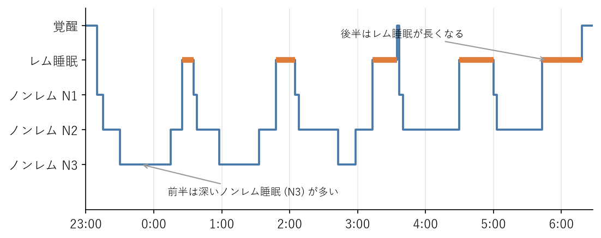
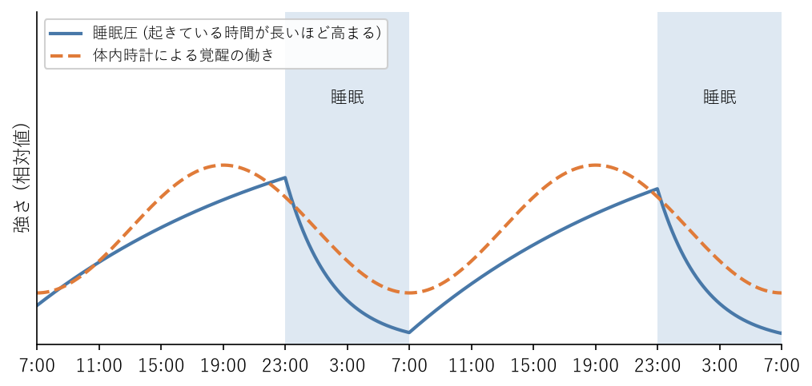

睡眠のしくみ
============

この章では、睡眠の役割、睡眠の段階、眠気が生まれる仕組み、必要な睡眠時間を説明する。よく眠るための具体的な方法は\ :doc:`sleep_practice`\ で扱う。

睡眠の役割
----------

睡眠は、単に活動を休むための時間ではない。眠っている間に、脳と体では次のような働きが進んでいる。

* **脳の回復と記憶の整理**：日中に覚えた情報が整理され、記憶として定着する。新しい技術や知識を身につけるうえでも、睡眠は欠かせない。
* **体の修復**：深い睡眠の間に成長ホルモンが多く分泌され、筋肉などの組織の修復が進む。
* **免疫の維持**：睡眠が不足すると免疫の働きが弱まり、感染症にかかりやすくなる。
* **食欲と代謝の調整**：睡眠が不足すると、食欲を抑えるホルモン（レプチン）が減り、食欲を高めるホルモン（グレリン）が増える。その結果、食べすぎや体重の増加につながりやすい。
* **感情の安定**：睡眠が不足すると、不安やいらだちを感じやすくなり、気分が落ち込みやすくなる。

レム睡眠とノンレム睡眠
----------------------

睡眠は、:term:`レム睡眠`\ と\ :term:`ノンレム睡眠`\ の 2 種類に分けられる。ノンレム睡眠は、眠りの深さによって、さらに N1、N2、N3 の 3 段階に分けられる。

.. list-table:: 睡眠の段階
   :header-rows: 1
   :widths: 20 80

   * - 段階
     - 特徴
   * - ノンレム睡眠 N1
     - 寝入りばなの浅い眠り。物音などですぐに目が覚める。
   * - ノンレム睡眠 N2
     - 一晩の睡眠の中で最も長い時間を占める、中程度の深さの眠り。
   * - ノンレム睡眠 N3
     - 最も深い眠りで、徐波睡眠とも呼ばれる。成長ホルモンが多く分泌され、脳と体の回復が進む。
   * - レム睡眠
     - 体の筋肉は緩んでいるが、脳は活発に働いている眠り。閉じたまぶたの下で眼球がすばやく動く。夢の多くはこの段階で見る。

眠りにつくと、まずノンレム睡眠が始まって徐々に深くなり、その後レム睡眠が現れる。このノンレム睡眠とレム睡眠の組み合わせを約 90 分の周期で繰り返し、一晩で 4〜5 回の周期を経る（:numref:`fig-hypnogram`）。周期の長さには個人差があり、同じ人でも夜によって変わる。

.. _fig-hypnogram:

   一晩の睡眠段階の推移（模式図）

一晩の前半には深いノンレム睡眠（N3）が多く現れ、後半になるほどレム睡眠の時間が長くなる。睡眠時間を削ると、主に後半のレム睡眠が失われる。一方、寝つきが悪かったり夜中に何度も目が覚めたりすると、前半の深い睡眠が妨げられる。睡眠時間と睡眠の質の両方が大切なのはこのためである。

眠気を決める 2 つの要因
-----------------------

眠気の強さは、主に\ :term:`睡眠圧`\ と体内時計という 2 つの要因で決まる。この考え方を 2 プロセスモデルという（:numref:`fig-two-process`）。

.. _fig-two-process:

   睡眠圧と体内時計による眠気の調節（2 プロセスモデルの模式図、23 時就寝、7 時起床の場合）

睡眠圧
^^^^^^

睡眠圧は、起きている時間が長くなるほど高まり、眠ると下がる「眠りへの欲求」である。起きている間に脳内に\ :term:`アデノシン`\ という物質がたまることが、睡眠圧を高める仕組みの 1 つと考えられている。コーヒーなどに含まれるカフェインは、アデノシンの働きを妨げることで眠気を一時的に弱める。カフェインは眠気の感覚を抑えるだけで、睡眠圧そのものを解消するわけではない。

体内時計による覚醒の働き
^^^^^^^^^^^^^^^^^^^^^^^^

体内時計は、日中に体を目覚めさせる働きをしており、その強さは時刻によって変わる。覚醒の働きは夕方から夜の早い時間にかけて最も強くなり、明け方に最も弱くなる。

2 つの要因の組み合わせ
^^^^^^^^^^^^^^^^^^^^^^

日中は、睡眠圧が高まっていく一方で、体内時計の覚醒の働きも強まるため、眠気は抑えられる。夜になると覚醒の働きが弱まり、高まった睡眠圧が表に出て眠くなる。2 つの要因の組み合わせから、次のことが説明できる。

* **いつもより早く寝ようとしても寝つけない**：いつもの就寝時刻の 2〜3 時間前は、体内時計の覚醒の働きが強く、眠りにくい時間帯である。
* **昼食後に眠くなる**：午後の早い時間には、体内時計の働きが一時的に弱まり、眠気を感じやすい。昼食の内容とは関係なく起こる。
* **徹夜明けの朝に眠気が少し和らぐ**：睡眠圧は高いままだが、朝になると体内時計の覚醒の働きが強まり始めるためである。眠気が和らいでも、集中力や判断力は低下したままである。

必要な睡眠時間
--------------

睡眠ガイドは、成人の睡眠時間について次のように推奨している。

.. list-table:: 睡眠ガイドの推奨事項（成人・高齢者）
   :header-rows: 1
   :widths: 20 80

   * - 対象
     - 推奨事項
   * - 成人
     - 適正な睡眠時間には個人差があるが、6 時間以上を目安として必要な睡眠時間を確保する。食生活や運動などの生活習慣、寝室の環境などを見直して、:term:`睡眠休養感`\ を高める。睡眠の不調や睡眠休養感の低下がある場合は、生活習慣などの改善を図ることが重要であるが、病気が潜んでいる可能性にも留意する。
   * - 高齢者
     - 長い時間寝床で過ごすと健康を損なうおそれがあるため、寝床にいる時間が 8 時間以上にならないことを目安にする。

6 時間はあくまで目安であり、必要な睡眠時間には個人差がある。自分の睡眠が足りているかどうかは、日中の状態で判断するとよい。

* 朝、目覚めたときに休まった感じ（睡眠休養感）がある。
* 日中の会議や単調な作業中に、強い眠気を感じない。
* 休日に、平日より 2 時間以上長く寝ることがない。

休日に平日よりも大幅に長く眠ってしまう場合は、平日の睡眠が足りていない可能性が高い。

一方、眠れないのに長い時間寝床で過ごすと、眠りが浅くなり、かえって睡眠休養感が下がる。睡眠時間を確保することと、寝床にいる時間（:term:`床上時間`）を必要以上に長くしないことの両方が大切である。

睡眠不足の影響
--------------

仕事への影響
^^^^^^^^^^^^

睡眠が不足すると、注意力、判断力、記憶力、問題を解決する力が低下する。ミスが増え、新しいことを学ぶ効率も下がる。

睡眠不足の影響は、毎日少しずつ積み重なる。この積み重なりを\ :term:`睡眠負債`\ という。睡眠時間を 1 晩あたり 4 時間、6 時間、8 時間に制限して 2 週間過ごした実験では、4 時間と 6 時間の人の注意力は日を追うごとに低下し続けた。6 時間以下の睡眠を 2 週間続けると、注意力などの低下は、最大で 2 晩続けて徹夜した場合と同じ程度に達した。それにもかかわらず、本人が感じる眠気は最初の数日で増えた後はあまり変わらず、本人は能力の低下に十分気づいていなかった。

「6 時間寝ていれば大丈夫」「慣れれば平気」という感覚は、当てにならない。睡眠ガイドが示す 6 時間は、多くの人にとって下限に近い目安であり、6 時間で日中に眠気を感じる人は、もっと長く眠る必要がある。

健康への影響
^^^^^^^^^^^^

睡眠不足が長く続くと、肥満、高血圧、2 型糖尿病、心血管疾患、うつ病などのリスクが高まる。睡眠不足は、日中の眠気によって体を動かす意欲も低下させ、運動不足の原因にもなる。
