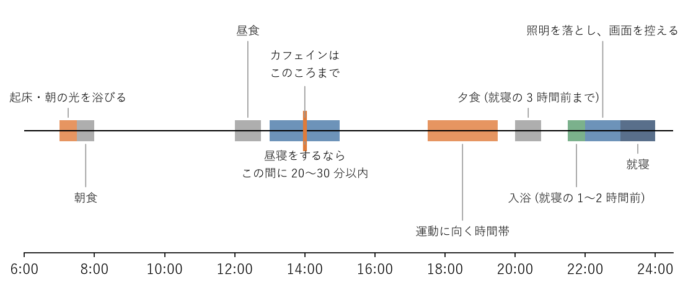

睡眠を整える実践
================

この章では、:doc:`sleep_mechanism`\ で説明した仕組みに基づいて、よく眠るための具体的な方法を説明する。すべてを一度に取り入れる必要はない。自分にとって取り入れやすいものから始めるとよい。

起床時刻をそろえ、朝の光を浴びる
--------------------------------

体内時計を整えるうえで最も効果が大きいのは、毎朝同じ時刻に起きて、明るい光を浴びることである。

就寝時刻は、その日の疲れや仕事の状況で変わりやすい。一方、起床時刻は目覚まし時計で固定できる。起床時刻をそろえると、体内時計が毎朝同じ時刻にリセットされ、夜に眠くなる時刻も自然にそろってくる。寝つけないからといって起床時刻を遅らせると、体内時計が後ろにずれ、次の夜はさらに寝つきにくくなる。

起きたらカーテンを開け、できれば屋外の光を浴びる。室内の照明は数百ルクス程度だが、屋外の光は曇りの日でも数千ルクス以上あり、体内時計を進める効果がはるかに大きい。朝の光を浴びてからおよそ 14〜16 時間後に、メラトニンが分泌されて眠気が訪れる。

在宅勤務の日は、通勤がないため朝の光を浴びる機会が少なくなる。始業前に 10〜20 分ほど外を歩く「通勤の代わりの散歩」を習慣にすると、朝の光と身体活動の両方を確保できる。

夜の光と画面
------------

夜に明るい光を浴びると、メラトニンの分泌が抑えられ、体内時計が後ろにずれる。特に、画面などに多く含まれる青い光（ブルーライト）は、この作用が強い。夜は次のことを心がける。

* 就寝の 1 時間ほど前からは、部屋の照明を暗めにする。白っぽい光より、暖かい色の光のほうがよい。
* 画面の明るさを下げる。パソコンやスマートフォンの夜間モードも利用できるが、それだけで十分とはいえない。
* 就寝前の 1 時間ほどは、画面を見ること自体をなるべく控える。

光と同じくらい注意したいのが、画面に映る内容による刺激である。就寝直前にチャットの通知やメールを確認したり、コードレビューをしたり、ゲームや SNS に没頭したりすると、頭が興奮して寝つきが悪くなる。仕事の連絡は就寝の 1 時間前までに済ませ、スマートフォンは寝床から手の届かない場所で充電するとよい。

カフェイン
----------

カフェインはアデノシンの働きを妨げて眠気を弱める。その効果は摂取後、数時間続く。体内で半分に減るまでの時間は数時間程度だが、個人差が大きく、カフェインに敏感な人ではさらに長く残る。夕方以降にカフェインをとると、寝つきが悪くなったり、眠りが浅くなったりする。

* カフェインを含む飲み物は、午後の早い時間までにとどめる。遅くとも就寝の 6 時間前以降は控える。
* 健康な成人では、1 日のカフェインの摂取量を 400 mg 程度までにとどめるのが目安とされている（欧州食品安全機関による）。

主な飲み物のカフェインの量の目安を次の表に示す（農林水産省の資料による）。

.. list-table:: 主な飲み物のカフェインの量（目安）
   :header-rows: 1
   :widths: 40 30 30

   * - 飲み物
     - 100 mL あたり
     - 1 杯（150 mL）あたり
   * - コーヒー（ドリップ）
     - 60 mg
     - 90 mg
   * - 紅茶
     - 30 mg
     - 45 mg
   * - 煎茶
     - 20 mg
     - 30 mg
   * - エナジードリンク・眠気覚まし用の飲料
     - 28〜300 mg（製品により大きく異なる）
     - 1 本あたり 50〜170 mg 程度

コーヒーを 1 日に 3〜4 杯飲むと、それだけで 300 mg 前後になる。エナジードリンクや眠気覚ましの錠剤を併用すると、気づかないうちに摂取量が多くなるため注意が必要である。

飲酒
----

アルコールを飲むと寝つきはよくなるが、睡眠の後半になると眠りが浅くなり、夜中に目が覚めやすくなる。利尿作用でトイレに起きることも増え、いびきや睡眠中の呼吸の乱れも悪化する。さらに、寝酒を続けると同じ量では眠れなくなり、飲む量が増えていきやすい。眠るための飲酒（寝酒）は避ける。飲む場合は量を控えめにし、就寝の数時間前までに済ませる。

食事と入浴
----------

* **夕食**：就寝直前に食事をすると、消化のために体が活動を続け、眠りが浅くなる。夕食は就寝の 3 時間前までに済ませる。残業で遅くなる日は、夕方に軽く食べておき、帰宅後は消化のよいものを少量にするとよい。
* **入浴**：入浴で一時的に上がった深部体温が下がっていく過程で、眠気が訪れやすくなる。就寝の 1〜2 時間前に、38〜40 ℃ 程度のぬるめのお湯につかるとよい。熱すぎるお湯や就寝直前の入浴は、かえって体を目覚めさせる。

寝室の環境
----------

* **暗さ**：寝室はできるだけ暗くする。照明は消し、外の光が入る場合は遮光カーテンを使う。夜中にトイレに起きる場合は、足元を照らす程度の弱い明かりにする。
* **静かさ**：外の騒音が気になる場合は、耳栓を使ったり、寝具の位置を変えたりする。
* **温度・湿度**：暑すぎても寒すぎても眠りが妨げられる。季節に応じてエアコンや寝具を調整し、快適に感じる温度と湿度を保つ。
* **寝具**：体に合った硬さのマットレスと、首に負担のかからない高さの枕を選ぶ。
* **寝室の使い方**：寝床で仕事をしたり、長時間スマートフォンを見たりしない。寝床は眠るための場所にすると、寝床に入ると自然に眠くなりやすくなる。

眠れないときは
--------------

眠くないのに寝床に入っても、なかなか寝つけない。寝つけないまま寝床で過ごすと、「寝床は眠れない場所」という結び付きができ、さらに寝つきが悪くなる。

* 眠くなってから寝床に入る。
* 寝床に入ってしばらくしても眠れないときは、いったん寝床を出て、暗めの照明の下で静かに過ごし、眠くなったら再び寝床に戻る。
* 時計を何度も見ると焦りが強まるため、時計は目に入らない位置に置く。

寝つけない夜があっても、翌朝はいつもの時刻に起きる。そうすれば、次の夜は睡眠圧が高まって眠りやすくなる。

昼寝の取り方
------------

昼寝は、午後の眠気を解消し、作業の効率を回復させるのに役立つ。ただし、取り方を誤ると夜の睡眠を妨げる。

* 午後の早い時間（15 時ごろまで）に、20〜30 分以内にとどめる。
* 長く眠ると深いノンレム睡眠に入り、起きた後にしばらく頭がぼんやりする（:term:`睡眠慣性`）。夜の睡眠圧も下がり、寝つきが悪くなる。
* 夕方以降の昼寝は避ける。

在宅勤務では昼寝をしやすいが、寝床で横になると長く眠ってしまいやすい。椅子にもたれる、ソファで座ったまま目を閉じる、アラームをかける、といった工夫をするとよい。

週末の寝だめと社会的時差ぼけ
----------------------------

平日の睡眠不足を補うために、休日に昼近くまで眠る人は多い。しかし、休日の起床時刻が遅くなると、体内時計が後ろにずれ、日曜の夜に寝つけず、月曜の朝がつらくなる。平日と休日で睡眠の時間帯がずれることを\ :term:`社会的時差ぼけ`\ という。海外旅行の時差ぼけと同じことを、毎週繰り返しているような状態である。社会的時差ぼけが大きいほど、日中の眠気が強く、健康上の問題も多いことが報告されている。

* 休日も、平日の起床時刻からのずれを 2 時間以内にとどめる。
* 睡眠不足を補いたい場合は、朝寝坊よりも、前の晩に早めに寝床に入るほうがよい。午後の早い時間に短い昼寝をするのもよい。
* 根本的には、休日に寝だめをしなくて済むように、平日の睡眠時間を確保する。

平日と休日の睡眠の時間帯のずれは、:doc:`habits`\ で紹介するサンプルコードで計算できる。

仕事の場面別の対処
------------------

座り仕事、特にエンジニアの仕事でよくある場面ごとに、睡眠を守るための対処を次の表に示す。

.. list-table:: 仕事の場面別の対処
   :header-rows: 1
   :widths: 25 75

   * - 場面
     - 対処
   * - 在宅勤務
     - 起床時刻を固定し、始業前に外を歩いて朝の光を浴びる。作業する場所と寝室を分け、寝床では仕事をしない。パソコンを閉じる、作業部屋の照明を消すなど、仕事の終わりの区切りを決めておく。
   * - 締め切り前の夜更かし
     - 徹夜や極端な夜更かしは、ミスや手戻りを増やし、かえって作業を遅らせる。区切りのよいところで切り上げて眠り、翌朝に続けるほうが効率がよいことが多い。やむを得ず夜更かしした翌日も、起床時刻は大きく変えず、午後の早い時間に短い昼寝で補う。
   * - オンコール・夜間の障害対応
     - 対応後すぐに眠れなくても焦らない。照明は必要最小限にし、対応が終わったら画面から離れる。翌日は短い昼寝で補う。当番の頻度や翌日の勤務の扱いは、個人ではなくチームや組織で調整すべき課題である。
   * - 時差のある拠点との会議
     - 深夜や早朝の会議が続かないよう、開催時刻を持ち回りにするなど、チームで調整する。深夜の会議の後は、画面を見続けずに早めに休む。
   * - 出張や旅行での時差
     - 到着地の朝に光を浴び、到着地の時刻に合わせて食事をとる。短期間の出張では、無理に現地の時刻に合わせないほうが楽な場合もある。

1 日の過ごし方の例
------------------

ここまでの内容をまとめた 1 日の過ごし方の例を\ :numref:`fig-daily-timeline` に示す。7 時に起床し、23 時に就寝する場合の例である。起床時刻や就寝時刻が異なる場合は、それに合わせて各項目の時刻をずらせばよい。

.. _fig-daily-timeline:

   体内時計を整える 1 日の過ごし方の例（7 時起床、23 時就寝の場合）

夕方の運動と睡眠の関係については、:doc:`exercise`\ で説明する。
