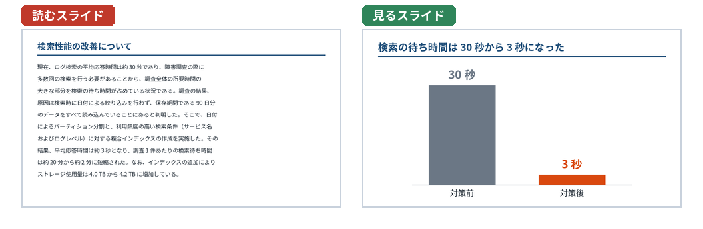

プレゼンテーションとは
======================

この章では、文書とプレゼンの違いを整理し、スライドが果たす役割を確認する。ここで述べる違いが、以降の章で説明する考え方の前提になる。

文書とプレゼンの違い
--------------------

エンジニアは、設計書や README、技術ブログなどの文書を書くことには慣れている。しかし、文書をそのままスライドに貼り付けても、よいプレゼンにはならない。両者は情報の受け取られ方が大きく異なるからである。

.. graphviz::
   :caption: 文書とプレゼンの情報の流れ
   :align: center

   digraph flow {
     rankdir=LR;
     node [shape=box, style="rounded,filled", fillcolor="#eef3f8", color="#1f4e79"];
     edge [color="#6b7785"];
     subgraph cluster_doc {
       label="文書"; color="#c8d1dc";
       doc [label="文書"];
       reader [label="読み手\n（読む速さ・順序を\n自分で決める）"];
       doc -> reader [label="読む"];
       reader -> doc [label="読み返す", style=dashed];
     }
     subgraph cluster_pre {
       label="プレゼン"; color="#c8d1dc";
       speaker [label="発表者\n（速さ・順序を決める）"];
       slide [label="スライド"];
       listener [label="聞き手"];
       speaker -> listener [label="話す（耳）"];
       speaker -> slide [label="操作する"];
       slide -> listener [label="見る（目）"];
     }
   }

.. list-table:: 文書とプレゼンの違い
   :header-rows: 1
   :widths: 20 40 40

   * - 観点
     - 文書
     - プレゼン
   * - 進む速さ
     - 読み手が決める。難しい箇所はゆっくり読める
     - 発表者が決める。聞き手は自分の速さで理解できない
   * - 順序
     - 読み手が決める。目次から必要な箇所だけを読める
     - 発表者が決める。聞き手は話の順にしか受け取れない
   * - 読み返し
     - いつでもできる
     - できない。聞き逃した部分は戻れない
   * - 情報の経路
     - 目（文字と図）だけ
     - 耳（話）と目（スライド）の 2 つ
   * - 時間
     - 制約がない
     - 持ち時間が決まっている
   * - 情報量
     - 多くてもよい。網羅性が求められることも多い
     - 少なく絞る必要がある。聞き手が覚えて帰れる量は限られる

この表から、プレゼンで守るべき原則がいくつか導ける。

* 聞き手は話を巻き戻せないので、最初に結論と全体像を示し、いま何の話をしているかを常に分かるようにする（4 章）。
* 聞き手の理解の速さは発表者には分からないので、1 枚のスライドに載せる情報を絞り、話す速さと間に気を配る（5 章、9 章）。
* 時間が決まっているので、伝える内容を事前に選び、時間内に収まることをリハーサルで確かめる（3 章、8 章）。

プレゼンの種類
--------------

仕事のプレゼンは、目的によって大きく 4 つに分けられる。種類によって、重視すべき点と構成が変わる。

.. list-table:: プレゼンの種類
   :header-rows: 1
   :widths: 18 32 50

   * - 種類
     - 例
     - 重視すること
   * - 報告
     - 進捗報告、障害報告、調査結果の共有
     - 結論（状況は予定どおりか、問題はあるか）を最初に示す。事実と意見を分ける
   * - 提案
     - 新しいツールの導入、設計方針の決定、予算の申請
     - 聞き手に求める判断を明確にする。選択肢と、それぞれの長所・短所・費用を示す
   * - 説明・教育
     - 新人研修、社内勉強会、手順の説明
     - 聞き手の前提知識に合わせる。具体例と練習を用意する
   * - 技術共有
     - 技術発表、LT、カンファレンスでの発表
     - 聞き手が持ち帰れる学びを 1 つか 2 つに絞る。背景と結果を、実装の詳細より優先する

1 回の発表が複数の種類にまたがることもある。たとえば、障害報告では事実を報告したうえで再発防止策を提案することが多い。その場合も、発表の最後に聞き手にしてほしいこと（承認か、理解か、協力か）を 1 つに決めておくと、構成がぶれにくい。この点は 3 章で詳しく説明する。

スライドの役割
--------------

スライドには、性質の異なる 2 つの使われ方がある。

発表を補助するスライド
   発表者の話と一緒に見ることを前提にしたスライドである。1 枚に載せる情報は少なく、図や大きな数字、短い言葉で、話の要点を目に見える形にする。スライドだけを読んでも内容の一部しか分からないが、発表の場では最も伝わりやすい。

ドキュメント型スライド
   発表者がいなくても、読めば内容が分かるように作ったスライドである。会議の前に配布して読んでもらう資料や、発表後に共有する資料に向いている。文章や表が多くなり、1 枚の情報量は多い。

問題になりやすいのは、この 2 つを区別せずに 1 つの資料で両方を満たそうとすることである。ドキュメント型スライドをそのまま投影して読み上げると、聞き手には伝わりにくい。理由は次の節で説明する。

両方が必要な場合は、次のいずれかの方法をとる。

* 投影用のスライドは発表を補助する形で作り、詳しい説明は発表者ノート（スライドごとに書く発表者向けのメモ。7 章、8 章）に書く。配布するときは発表者ノート付きの PDF にする。
* 投影用のスライドと、配布用の文書（またはドキュメント型スライド）を別に作る。
* 本編のスライドは補助用に絞り、詳しいデータや補足は付録のスライドにまとめる。

読むことと聞くことは同時にできない
----------------------------------

文字で埋まったスライドを見せながら話すと、聞き手は困った状態になる。スライドを読もうとすると話が耳に入らず、話を聞こうとするとスライドが読めない。

人が一度に意識の中に保持して処理できる情報の量（ワーキングメモリの容量）には限りがある。また、文字を読むときにも頭の中で言葉を処理するので、話を聞くことと文字を読むことは、同じ言葉を処理する働きを奪い合う。教育心理学者の Mayer は、学習者が図と話で学ぶとき、話と同じ文章を画面にも表示すると、かえって学習の成果が下がる場合があることを実験で示し、これを冗長性の原則（redundancy principle）と呼んだ。

   読むスライドと見るスライド

上の図の左のスライドは、正確だが、聞き手が話を聞きながら読むことはできない。右のスライドは、タイトルで結論を述べ、グラフで変化の大きさを見せている。細かな経緯は発表者が話し、必要なら発表者ノートや付録に書いておけばよい。

発表を補助するスライドでは、スライドに載せるのは「話の要点」と「話だけでは伝わりにくいもの（図、グラフ、数字、構成）」にする。話す内容をすべてスライドに書く必要はない。

この章のまとめ
--------------

* プレゼンでは、進む速さと順序を発表者が決め、聞き手は話を巻き戻せない。
* プレゼンの種類（報告、提案、説明・教育、技術共有）によって、重視すべき点が変わる。
* 発表を補助するスライドと、ドキュメント型スライドを区別して作る。
* 話を聞きながら長い文章を読むことはできない。スライドには要点と、話だけでは伝わりにくいものを載せる。
