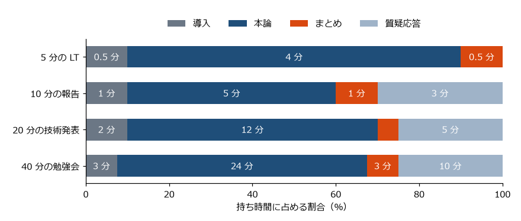

ストーリーを組み立てる
======================

ゴールとキーメッセージが決まったら、話の構成（ストーリー）を組み立てる。プレゼンでは聞き手が話を巻き戻せないので、構成のよしあしが伝わりやすさを大きく左右する。この章では、構成の基本となる結論先行とピラミッド構造、代表的な構成の型、アウトラインからスライドを作る手順を説明する。

結論を先に言う
--------------

仕事のプレゼンでは、原則として結論を最初に言う。理由は 2 つある。

* **聞き手が話の行き先を知ったうえで聞ける**: 結論を知っていれば、聞き手は以降の説明を「結論を支える根拠」として整理しながら聞ける。結論が最後だと、聞き手は何のための説明か分からないまま聞き続けることになる。
* **時間が足りなくなっても、結論は伝わる**: 質問で話が中断したり、前の発表が延びて持ち時間が減ったりしても、最初に結論を言っておけば最も重要なことは伝わる。

エンジニアは、調査や開発を行った順（背景 → 調査 → 試行錯誤 → 結果）に話しがちである。この順序は発表者にとっては自然だが、聞き手が知りたいのは多くの場合、結果とその意味である。時系列で話す場合でも、冒頭で「結論から言うと、検索は 10 倍速くなった。そこに至るまでの経緯を順に説明する」と先に示すとよい。

ただし、勉強会のように聞き手の興味を引きながら順に理解してもらう発表では、問いを先に示し、答えを後で明かす構成も効果的である。その場合も、冒頭で「今日は何が分かるようになるか」を示しておく。

ピラミッド構造
--------------

結論を先に言うだけでは、話は整理されない。結論を支える根拠を、どのような単位でまとめて、どの順に話すかを決める必要がある。そのための考え方がピラミッド構造である。Minto が『The Pyramid Principle』（邦訳『考える技術・書く技術』）で体系化した。

.. graphviz::
   :caption: ピラミッド構造の例
   :align: center

   digraph pyramid {
     rankdir=TB;
     node [shape=box, style="rounded,filled", fillcolor="#eef3f8", color="#1f4e79", fontsize=12];
     edge [color="#6b7785", arrowhead=none];
     top [label="結論\n読む範囲を日付で絞ると\nログ検索は 10 倍速くなる", fillcolor="#1f4e79", fontcolor="white"];
     a [label="根拠 1\n検索の 9 割は\n直近 24 時間が対象"];
     b [label="根拠 2\n読む範囲を絞ると\n検索時間は比例して減る"];
     c [label="根拠 3\n実際に 30 秒から\n3 秒になった"];
     a1 [label="検索履歴\n1 か月分の集計"];
     b1 [label="パーティションの\n仕組み"];
     c1 [label="対策前後の\n計測結果"];
     c2 [label="容量の増加は\n5 % だけ"];
     top -> a; top -> b; top -> c;
     a -> a1; b -> b1; c -> c1; c -> c2;
   }

ピラミッド構造には次の性質がある。

* 頂点に結論（キーメッセージ）を置き、その下に結論を支える根拠を置く。根拠の下には、さらにそれを支える事実やデータを置く。
* 上の要素は、下の要素をまとめた内容になっている。下の要素は、上の要素に対して「なぜそう言えるのか」「具体的には」という問いに答える。
* 同じ階層に並ぶ要素は、同じ種類のもの（たとえば、すべて理由、すべて手順）にする。

ピラミッド構造ができれば、プレゼンの構成はほぼ決まる。結論を最初に述べ、根拠を 1 つずつ説明し、最後に結論を繰り返す。根拠は 3 つ前後にするとよい。多すぎると聞き手が覚えきれず、1 つだけでは説得力が弱くなりやすい。

代表的な構成の型
----------------

よく使われる構成の型を知っておくと、ゼロから考えるよりも速く構成を決められる。

.. graphviz::
   :caption: PREP と SCQA の流れ
   :align: center

   digraph types {
     rankdir=LR;
     node [shape=box, style="rounded,filled", fillcolor="#eef3f8", color="#1f4e79", fontsize=12];
     edge [color="#6b7785"];
     subgraph cluster_prep {
       label="PREP"; color="#c8d1dc";
       p1 [label="Point\n結論"]; r [label="Reason\n理由"]; e [label="Example\n具体例"]; p2 [label="Point\n結論"];
       p1 -> r -> e -> p2;
     }
     subgraph cluster_scqa {
       label="SCQA"; color="#c8d1dc";
       s [label="Situation\n状況"]; c [label="Complication\n問題"]; q [label="Question\n問い"]; a [label="Answer\n答え"];
       s -> c -> q -> a;
     }
   }

.. list-table:: 代表的な構成の型
   :header-rows: 1
   :widths: 22 40 38

   * - 型
     - 流れ
     - 向いている場面
   * - PREP
     - 結論 → 理由 → 具体例 → 結論
     - 短い報告、質疑応答での回答、スライド 1 枚の中の構成
   * - SCQA
     - 状況 → 問題 → 問い → 答え
     - 提案、技術発表の導入。聞き手と前提を共有してから本題に入れる
   * - 問題解決型
     - 問題 → 原因 → 解決策 → 効果
     - 障害の振り返り、改善の報告、技術発表
   * - 比較型
     - 選択肢の提示 → 評価の基準 → 比較 → 推奨案
     - 技術選定、方針の決定、予算の申請
   * - 時系列型
     - 過去 → 現在 → 今後
     - 進捗報告、プロジェクトの振り返り

SCQA は Minto が導入部の構成として提案したもので、聞き手が知っている状況（S）から始め、そこで起きた問題（C）を示し、聞き手が抱く問い（Q）を明示して、その答え（A）として結論を述べる。答え（A）がそのままキーメッセージになる。たとえば次のようになる。

* S: 障害が起きると、ログを何十回も検索して原因を調べている。
* C: 1 回の検索に 30 秒かかり、調査の時間の多くが待ち時間になっている。
* Q: どうすれば検索を速くできるか。
* A: 日付で絞り込むようにすれば、検索は 10 倍速くなる。

型は組み合わせて使ってよい。たとえば、全体を SCQA で導入し、本論の根拠を問題解決型で説明し、各スライドの中は PREP で構成する、という使い方ができる。

いきなりスライドを作らない
--------------------------

構成を考えるときは、スライド作成ツールを開く前に、テキストでアウトラインを作ることを勧める。スライド作成ツールで考え始めると、1 枚ごとの見た目に注意が向き、全体の流れや論理の抜けに気付きにくいからである。

アウトラインは、次の手順で作る。

#. 3 章で決めたゴール、聞き手、キーメッセージを一番上に書く。
#. キーメッセージを支える根拠を 3 つ前後書く（ピラミッド構造の 2 段目）。
#. 根拠ごとに、それを示す事実、データ、例を書く。
#. 構成の型に沿って、話す順に並べ替える。
#. 各項目に、使う時間の目安を書く。

アウトラインは、Markdown の見出しと箇条書きで書くと扱いやすい。たとえば次のようになる。

.. code-block:: markdown
   :linenos:

   # ゴール: 他チームが同じ対策を自分のログ検索に適用できると判断できる
   # キーメッセージ: 読む範囲を日付で絞ると、ログ検索は 10 倍速くなる

   ## 導入（2 分）
   - 障害調査で検索を 40 回繰り返し、待ち時間が 20 分になっていた

   ## 原因: 毎回 90 日分すべてを読んでいた（4 分）
   - 検索の 9 割は直近 24 時間が対象
   - 実際には毎回 4 TB を読んでいた

   ## 対策: 日付のパーティションとインデックス（6 分）
   - パーティションの仕組み
   - インデックスを付ける項目の選び方

   ## 結果: 30 秒から 3 秒に（3 分）
   - 計測結果、容量の増加は 5 %

   ## まとめ（1 分）

Marp を使う場合は、このアウトラインの見出しをそのままスライドの区切りにして書き進められる（7 章）。

アクションタイトル
------------------

各スライドのタイトルは、「背景」「結果」のような話題の名前ではなく、そのスライドで言いたいことを文にしたものにする。本書ではこれをアクションタイトルと呼ぶ。工学系の発表では、Alley が提唱した assertion-evidence（主張と証拠）という方式が知られている。タイトルに主張を 1 文で書き、本文にはその主張を裏付ける図や写真などの証拠を置く方式である。

.. list-table:: 話題のタイトルとアクションタイトル
   :header-rows: 1
   :widths: 30 70

   * - 話題のタイトル
     - アクションタイトル
   * - 背景
     - 障害調査のたびに検索を何十回も繰り返している
   * - 原因
     - すべての検索が全期間のデータを読んでいた
   * - 結果
     - 平均の検索時間は 10 分の 1 になった
   * - 今後の予定
     - 次は検索画面で日付の指定を必須にする

アクションタイトルには次の利点がある。

* 聞き手は、タイトルを読むだけでそのスライドの要点が分かる。本文の図や表を、何を確かめるために見ればよいかが分かる。
* 発表者は、そのスライドで言うべきことを忘れない。
* タイトルだけを順に読むと、発表全体の要約になる。

最後の点は、構成の確認に使える。スライドを作ったら、タイトルだけを抜き出して上から読んでみる。話がつながらない、説明が飛んでいる、同じことを繰り返している、といった問題があれば、構成を見直す。Marp では Markdown の ``##`` で始まる行を抜き出せばよく、PowerPoint ではアウトライン表示で確認できる（7 章）。

アクションタイトルは長くなりがちなので、2 行に収まる長さを目安にする。表紙、目次、区切りのスライドには、話題のタイトルを使ってよい。

スライドの枚数と時間配分
------------------------

スライドの枚数は、持ち時間から見積もる。目安としてよく使われるのは、1 枚あたり 1〜2 分である。ただし、これは経験則であり、スライドの作り方によって大きく変わる。大きな数字や 1 文だけのスライドは数十秒で進むが、複雑な図を説明するスライドには数分かかる。枚数は目安にとどめ、最終的にはリハーサルで時間を測って調整する（8 章）。

LT のような短い発表には、決まった形式もある。ペチャクチャ（PechaKucha）は 20 枚のスライドを 1 枚 20 秒で自動的に送る形式（合計 6 分 40 秒）、Ignite は 20 枚を 1 枚 15 秒で送る形式（合計 5 分）である。いずれも、短い時間で要点だけを伝える練習になる。

時間配分は、導入、本論、まとめ、質疑応答に分けて決める。次の図は、時間配分の一例である。

   時間配分の例

時間配分を決めるときは、次の点に注意する。

* 導入は短くする。自己紹介や会社紹介に時間を使いすぎない。導入の役割は、聞き手の関心を本題に向け、結論と全体像を示すことである。
* まとめの時間を必ず確保する。時間が足りなくなると、最も重要なまとめが駆け足になりやすい。
* 質疑応答の時間が別に決まっていない場合は、持ち時間の中に含めて考える。

場面別の構成例
--------------

エンジニアがよく出会う場面ごとに、構成の例を示す。付録 B に、そのまま使えるテンプレートを用意している。

進捗報告（10 分）
   結論（予定どおりか、問題はあるか）→ 進捗の数値 → リスクと対策 → 依頼事項（判断してほしいこと）→ 次の予定。依頼事項がある場合は、結論のスライドで先に予告する。

提案（15 分）
   SCQA で現状と問題を共有する → 提案の結論 → 選択肢の比較 → 推奨案の理由 → 費用とスケジュール → 判断してほしいことと期限。

技術発表（20 分）
   結論 → 背景と問題 → 原因 → 対策 → 結果 → 学び → まとめ。対策の実装の詳細は 1〜2 枚にとどめ、残りは付録に回す。

LT（5 分）
   1 つのメッセージに絞る。問題 → 解決 → 結果 → メッセージの繰り返し。背景の説明は 1 枚以内にする。

7 章と付録 C で紹介する Marp のサンプルは、技術発表、進捗報告、LT のそれぞれについて、この構成に沿って作っている。

この章のまとめ
--------------

* 仕事のプレゼンでは、原則として結論を最初に言う。
* ピラミッド構造で、結論とそれを支える根拠を整理する。
* PREP、SCQA、問題解決型、比較型、時系列型などの型を使うと、構成を速く決められる。
* スライド作成ツールを開く前に、テキストでアウトラインを作る。
* 各スライドのタイトルはアクションタイトルにし、タイトルだけを読んで話が通るか確かめる。
* 枚数は 1 枚 1〜2 分を目安に見積もり、時間配分は導入・本論・まとめ・質疑応答に分けて決める。
