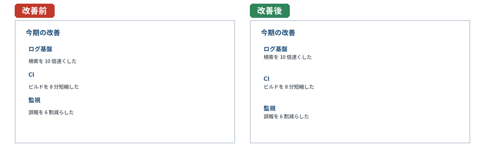
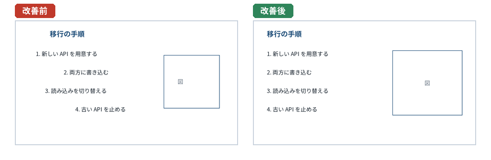
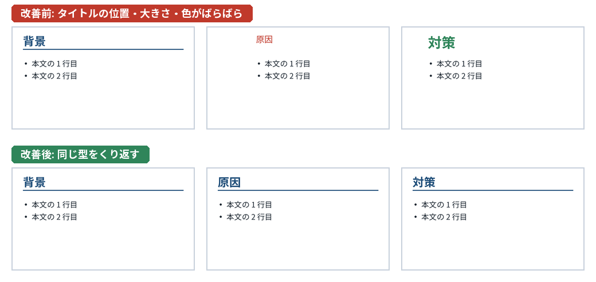
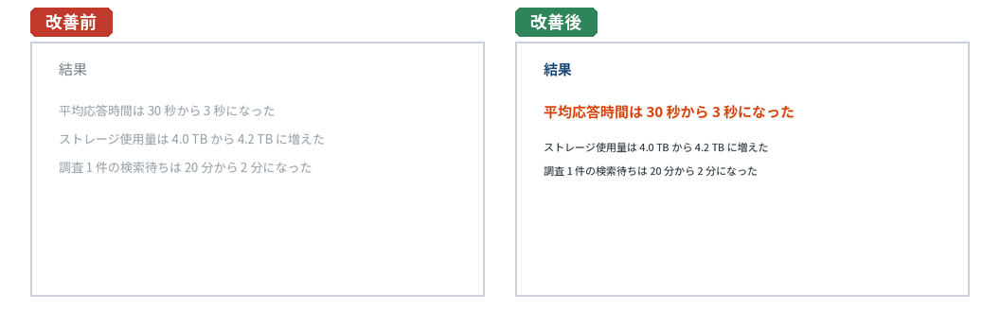
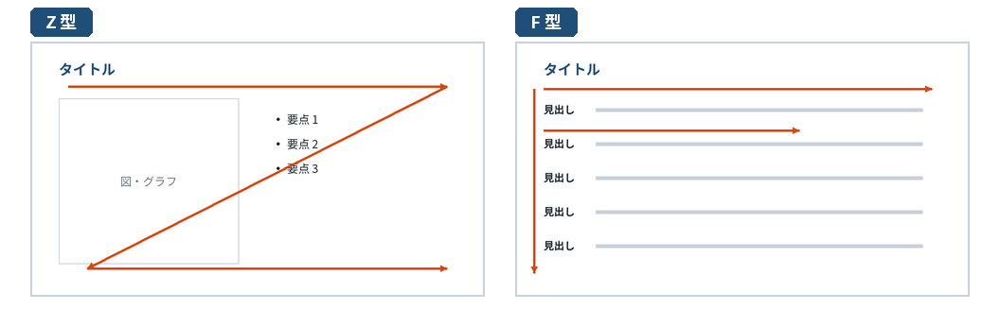
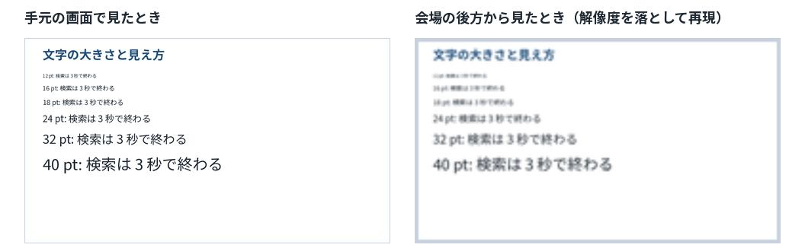
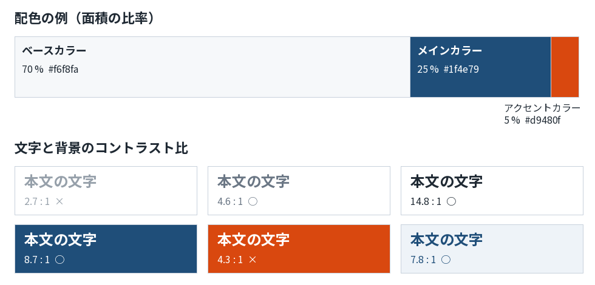
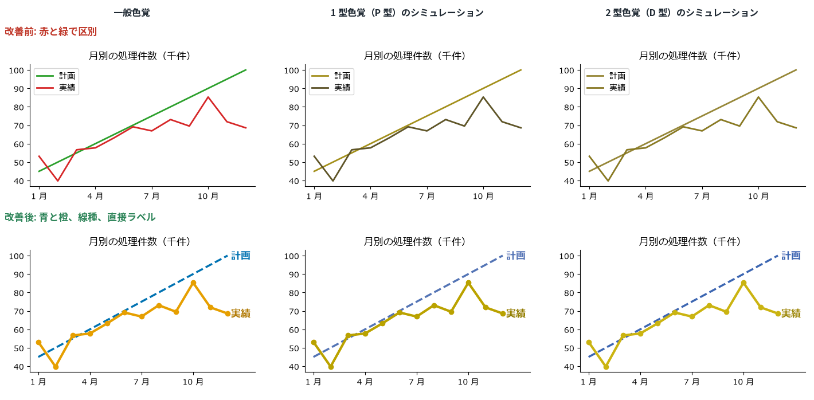

スライドデザインの基礎
======================

構成が決まったら、スライドを作る。この章では、スライドのデザインの基本を説明する。ここでいうデザインは、見た目を飾ることではない。聞き手が短い時間で正しく情報を読み取れるように、文字や図の配置、大きさ、色を決めることである。

1 スライド 1 メッセージ
-----------------------

スライドデザインの最も基本的な原則は、1 枚のスライドで伝えるメッセージを 1 つにすることである。4 章で説明したアクションタイトルは、そのメッセージを文にしたものである。

1 枚に複数のメッセージを詰め込むと、聞き手はどこを見ればよいか分からなくなる。発表者も、1 枚のスライドに長く留まることになり、話のテンポが悪くなる。メッセージが 2 つあるなら、スライドを 2 枚に分ける。スライドの枚数が増えることを恐れる必要はない。1 枚あたりの情報が少なければ、1 枚にかかる時間も短くなる。

迷ったときは、次の問いでスライドを点検するとよい。

* このスライドのメッセージを 1 文で言えるか。
* そのメッセージはタイトルに書かれているか。
* 本文の要素はすべて、そのメッセージを支えているか。関係のない要素はないか。

デザインの 4 原則
-----------------

デザインの専門家でなくても使える原則として、Williams が『The Non-Designer's Design Book』（邦訳『ノンデザイナーズ・デザインブック』）で示した 4 つの原則がある。近接、整列、反復、コントラストである。この 4 つを意識するだけで、スライドの読みやすさは大きく変わる。

近接
~~~~

関係の深い要素は近くに置き、関係の薄い要素は離す。人は、近くにあるものを 1 つのまとまりとして認識するからである。

   近接: 関係のある要素をまとめる

左のスライドでは、項目名と説明が等間隔に並んでいるので、どの説明がどの項目のものか一目では分からない。右のスライドでは、項目名と説明の間を狭くし、項目と項目の間を広くしたので、3 つのまとまりがあることがすぐに分かる。線や枠で囲まなくても、余白の大きさだけでまとまりを表現できる。

整列
~~~~

スライド上の要素は、見えない線にそろえて配置する。左端、中央、右端のいずれかにそろえると、スライドに秩序が生まれ、聞き手は要素の関係を読み取りやすくなる。

   整列: 見えない線に要素をそろえる

日本語の横書きのスライドでは、文章の読み始めの位置がそろう左揃えを基本にするとよい。中央揃えは、表紙や 1 文だけのスライドのように、要素が少ない場合に向いている。複数行の箇条書きを中央揃えにすると、行の始まりがそろわず読みにくくなる。

PowerPoint と Google スライドには、要素を整列させる機能や、ドラッグ中に他の要素との位置関係を示すガイドがある（7 章）。目で見てそろえるのではなく、これらの機能を使ってそろえる。

反復
~~~~

同じ種類の要素には、同じデザインを繰り返し使う。タイトルの位置・大きさ・色、本文の文字の大きさ、強調の方法、図の描き方などを、すべてのスライドで統一する。

   反復: 同じ種類の要素は同じデザインにする

反復には 2 つの効果がある。1 つは、資料全体がまとまって見えることである。もう 1 つは、聞き手がスライドの読み方を覚えられることである。タイトルの位置が毎回同じなら、聞き手は新しいスライドが表示されたとき、まずそこを見ればよいと分かる。逆に、デザインが変わると、聞き手は「何か意味があるのか」と考えてしまう。

反復を手作業で守るのは難しい。PowerPoint のスライドマスター、Google スライドのテーマ、Marp のテーマ CSS を使って、デザインを 1 か所で定義する（7 章）。

コントラスト
~~~~~~~~~~~~

異なるものは、はっきりと異ならせる。重要な要素とそうでない要素、見出しと本文の差を、大きさ・太さ・色で明確にする。

   コントラスト: 重要な要素をはっきり目立たせる

コントラストは中途半端にしないことが大切である。文字の大きさを 24 pt と 26 pt にしても違いは伝わらない。差を付けるなら、はっきりと付ける。また、強調するものを増やしすぎると、何も強調していないのと同じになる。1 枚のスライドで強調するのは 1 か所、多くても 2 か所にとどめる。

視線の流れ
----------

人がスライドを見るときの視線の動きには、おおまかな傾向がある。横書きの資料では、左上から読み始めることが多い。よく知られているモデルとして、Z 型と F 型がある。

   視線の流れ（Z 型と F 型）

Z 型
   左上 → 右上 → 左下 → 右下 と視線が動くモデルである。要素の少ないスライドや、図と文章を左右に並べたスライドで見られる。左上にタイトル、左下から右下にかけて図や結論を置くと、自然な流れで読まれる。

F 型
   上の数行を横に読み、その後は左端を縦に流し読みしながら、気になる行だけを横に読むモデルである。文章や箇条書きの多い画面で見られる。各行の書き出しに重要な言葉を置くと、流し読みでも内容が伝わる。

これらは経験的なモデルであり、常にこのとおりに視線が動くわけではない。大切なのは、聞き手に見てほしい順序に要素を並べること、そして最も重要な要素を目に入りやすい位置（多くの場合は上部）に置くことである。発表中は、発表者が話している箇所を指し示したり、アニメーションで順に表示したりして、視線を誘導することもできる（6 章）。

余白とグリッド
--------------

余白は、何も置かれていない無駄な場所ではない。要素のまとまりを示し（近接）、重要な要素を目立たせ（コントラスト）、スライドに落ち着きを与える役割がある。スライドの端いっぱいまで文字や図を詰めると、窮屈で読みにくくなる。

* スライドの上下左右には、一定の余白を確保する。目安として、スライドの幅の 5 % 程度の余白をとると落ち着いて見える。
* 投影する環境によっては、画面の端が切れることがある。端の近くに重要な情報を置かない。

要素の配置に迷ったら、スライドを縦横に等分した見えない格子（グリッド）を想定し、要素の端を格子の線にそろえる。たとえば、横を 2 等分して左に図、右に説明を置く、横を 3 等分して 3 つの項目を並べる、という使い方をする。グリッドに沿って配置すると、整列と反復が自然に守られる。

文字
----

フォントの選び方
~~~~~~~~~~~~~~~~

投影するスライドでは、線の太さが均一で、遠くからでも読みやすいゴシック体（サンセリフ体）を基本にする。明朝体は、横線が細いので投影すると見えにくいことがある。

日本語のフォントは、次のような観点で選ぶ。

* **発表する環境に入っているか**: 自分のパソコンにしかないフォントを使うと、別のパソコンで開いたときに別のフォントに置き換わり、レイアウトが崩れる。配布や他のパソコンでの発表が予定されている場合は、OS に標準で入っているフォント（Windows の游ゴシックやメイリオ、macOS のヒラギノ角ゴシックなど）か、PDF に変換して発表する。
* **太字があるか**: 強調や見出しに太字を使うので、太さの種類（ウェイト）を持つフォントを選ぶ。
* **英数字が読みやすいか**: エンジニアの資料にはコマンド、数値、英単語が多い。英数字の形がきれいで、数字の 0 とアルファベットの O、数字の 1 とアルファベットの l などを区別しやすいフォントがよい。コードには等幅フォントを使う（6 章）。

1 つの資料で使うフォントは、本文用と見出し用を合わせて 2 種類まで、コード用の等幅フォントを入れても 3 種類までにする。フォントの種類が増えると、反復が崩れて資料がまとまりのない印象になる。

文字の大きさ
~~~~~~~~~~~~

投影するスライドの文字は、思っている以上に大きくする必要がある。会場の後方の席から見ると、手元の画面で読める大きさの文字でも読めないことが多い。

   文字の大きさと見え方

文字の大きさの目安を次の表に示す。いずれも PowerPoint の標準の 16:9 のスライド（幅 13.33 インチ、高さ 7.5 インチ）を想定した値であり、経験則である。会場の広さ、画面の大きさ、聞き手との距離によって変わるので、可能であれば実際の会場で後方の席から確認する。

.. list-table:: 文字の大きさの目安（16:9、13.33 × 7.5 インチのスライド）
   :header-rows: 1
   :widths: 30 25 45

   * - 要素
     - 大きさの目安
     - 補足
   * - タイトル
     - 32〜44 pt
     - 2 行に収まるように調整する
   * - 本文
     - 24〜32 pt
     - 広い会場では大きめにする
   * - 補足・注記・出典
     - 18 pt 以上
     - これより小さい文字は、後方の席からは読めないと考える
   * - グラフの軸ラベル・凡例
     - 18 pt 以上
     - グラフを画像で貼る場合は、元のグラフの文字を大きくして作り直す

よく引用される経験則に、Kawasaki の 10/20/30 ルールがある。スライドは 10 枚、発表は 20 分、文字は 30 pt 以上にするというもので、もともとは投資家向けのプレゼンについての助言である。そのまま守る必要はないが、30 pt 以上の文字しか使えないとすれば、スライドに載せられる文章の量はおのずと絞られる、という点は覚えておくとよい。

スライドのサイズの単位はツールによって異なる。Marp の標準の 16:9 のスライドは 1280 × 720 px で、PowerPoint の 13.33 × 7.5 インチのスライドと同じ縦横比である。換算すると、Marp の 1 px は約 0.75 pt に当たるので、Marp で 24 pt 相当の文字にするには 32 px にする。

行間と文字量
~~~~~~~~~~~~

* **行間**: 文字の大きさの 1.3〜1.5 倍程度にすると読みやすい。行間が狭いと行を読み間違えやすく、広すぎると行と行のつながりが分かりにくくなる。
* **1 行の長さ**: 1 行が長すぎると、次の行の先頭を探しにくくなる。スライドの幅いっぱいに長い文を書かず、短い文に分ける。
* **1 枚の文字量**: 箇条書きは 1 枚に 3〜5 項目、1 項目は 1 行に収めることを目安にする。「1 枚 6 行、1 行 6 語まで」という 6 × 6 ルールも知られているが、日本語では語の数え方が英語と異なるので、行数と 1 行の長さで考えるとよい。

箇条書きの項目では、文末の形をそろえる。体言止め（「〜の改善」）と文（「〜を改善した」）を混ぜない。また、句点（。）を付けるかどうかも資料全体で統一する。

色
--

配色の基本
~~~~~~~~~~

スライドで使う色は少なくする。基本は次の 3 色である。

ベースカラー
   背景や広い面積に使う色。白や、ごく薄い灰色にすることが多い。

メインカラー
   タイトル、図の主要な要素、表の見出しなどに使う色。資料の印象を決める。会社やチームのテンプレートがあれば、その色を使う。

アクセントカラー
   最も強調したい箇所にだけ使う色。メインカラーとはっきり区別できる色を選ぶ。

これに、本文の文字色（黒に近い濃い灰色）と、補足的な要素に使う薄い灰色を加える。面積の比率は、ベースカラー 70 %、メインカラー 25 %、アクセントカラー 5 % 程度が目安として知られている。アクセントカラーは、使う面積が小さいほど強調の効果が高くなる。

   配色の例とコントラスト比

色には意味を持たせ、資料全体で一貫させる。たとえば、アクセントカラーを「注目してほしい数値」に使うと決めたら、他の目的には使わない。赤と緑のように、一般に意味が連想される色（赤は警告や悪化、緑は正常や改善）は、その意味に反する使い方を避ける。

コントラスト比
~~~~~~~~~~~~~~

文字の色と背景の色は、明るさの差（コントラスト）を十分にとる。プロジェクターで投影すると、明るい会場では画面全体が白っぽくなり、パソコンの画面で見るよりもコントラストが下がる。

コントラストの基準として、Web コンテンツのアクセシビリティの指針である WCAG（Web Content Accessibility Guidelines）のコントラスト比が使える。2 つの色のうち、明るいほうの相対輝度を :math:`L_1`、暗いほうの相対輝度を :math:`L_2` とすると、コントラスト比は次の式で求められる。

.. math::

   \text{コントラスト比} = \frac{L_1 + 0.05}{L_2 + 0.05}

コントラスト比は 1 : 1（同じ色）から 21 : 1（白と黒）の範囲の値をとる。WCAG 2 では、通常の文字には 4.5 : 1 以上、大きな文字（18 pt 以上、または 14 pt 以上の太字）には 3 : 1 以上を求めている（達成基準 1.4.3、レベル AA）。

相対輝度 :math:`L` は、色の R、G、B の値を 0〜1 に正規化し、ガンマ補正を取り除いた値 :math:`R_\text{lin}`、:math:`G_\text{lin}`、:math:`B_\text{lin}` から次のように求める。

.. math::

   L = 0.2126 R_\text{lin} + 0.7152 G_\text{lin} + 0.0722 B_\text{lin}

自分で計算する必要はない。コントラスト比を計算するツールは多数あり、ブラウザの開発者ツールでも確認できる。上の図では、薄い灰色の文字（2.7 : 1）が基準を満たしていない。また、橙色の背景に白い文字（4.3 : 1）は通常の文字の基準をわずかに下回るので、この組み合わせは大きな太字の見出しなどに限って使う。

色覚の多様性への配慮
~~~~~~~~~~~~~~~~~~~~

色の見え方は人によって異なる。日本では、男性の約 5 %（20 人に 1 人）、女性の約 0.2 % が、赤と緑の区別がつきにくい色覚の特性を持つとされている。50 人の聞き手がいれば、そのうち 1 人以上がこの特性を持っている可能性は高い。

   色覚のシミュレーションによる比較（Machado らのモデルによる近似）

上の図は、1 型色覚と 2 型色覚の見え方をシミュレーションしたものである。改善前のグラフは、赤と緑の 2 本の線がほぼ同じ色に見え、凡例と線の対応も分からなくなる。改善後のグラフは、次の工夫により、どの見え方でも区別できる。

* 赤と緑の組み合わせを避け、青と橙のように明るさにも差のある色を使う。
* 色だけに頼らず、線種（実線と破線）やマーカーの形の違いも使う。
* 凡例を使わず、線の近くに直接ラベルを書く。

PowerPoint には、色覚による見え方の違いを確認する機能はない。スライドを画像に書き出してブラウザで開き、開発者ツールの色覚のエミュレーション機能を使うか、Color Oracle のようなシミュレーターを使うと確認できる。明るさの差だけを確認したい場合は、Windows のカラーフィルターのグレースケールも使える。

スライドのサイズとテンプレート
------------------------------

スライドの縦横比は、現在は 16:9 が標準である。PowerPoint、Google スライド、Marp のいずれも、新規作成時の既定は 16:9 になっている。ただし、古いプロジェクターや会議室の設備では 4:3 の場合もあるので、3 章で確認した会場の条件に合わせる。縦横比は作り始める前に決める。後から変更すると、図や文字の配置が崩れ、作り直しが必要になる。

会社やチームに公式のテンプレートがある場合は、それを使う。テンプレートには、色、フォント、ロゴの位置などが定義されており、反復の原則を自然に守れる。テンプレートを使う場合も、次の点は確認する。

* 本文の文字の大きさが小さすぎないか（テンプレートの既定が 18 pt などになっていることがある）。
* 装飾が多すぎて、本文に使える面積が狭くなっていないか。
* 背景の画像や模様が、文字や図の読みやすさを妨げていないか。

テンプレートを自作する場合は、この章の内容を、タイトルスライド、本文スライド、区切りスライドの 3 種類程度のレイアウトにまとめる。Marp のテーマ CSS の例を 7 章で示す。

この章のまとめ
--------------

* 1 枚のスライドで伝えるメッセージは 1 つにする。
* 近接、整列、反復、コントラストの 4 原則で、情報の関係と重要度を見た目に表す。
* 見てほしい順序に要素を並べ、重要な要素を目に入りやすい位置に置く。
* 余白を確保し、見えないグリッドに沿って要素を配置する。
* 投影する文字は大きくする。本文は 24 pt 以上、最小でも 18 pt を目安にする。
* 色はベースカラー、メインカラー、アクセントカラーの 3 色を基本にし、十分なコントラスト比を確保する。色だけに頼って情報を区別しない。
