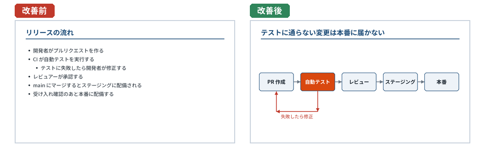
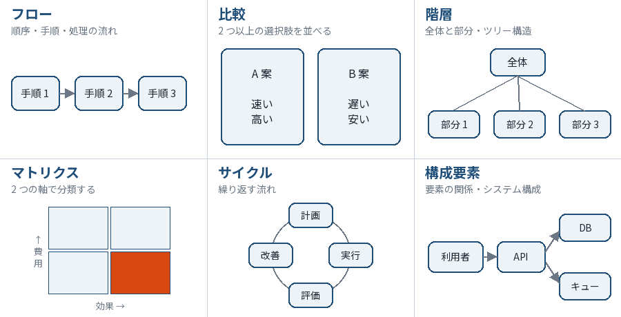
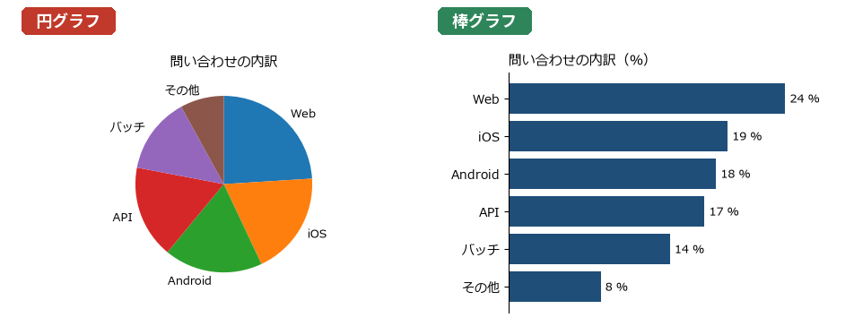
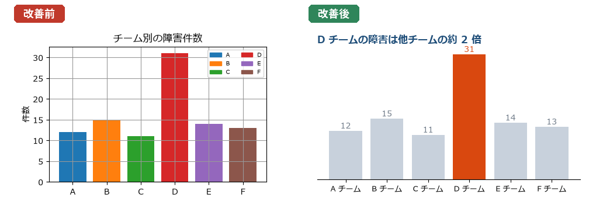
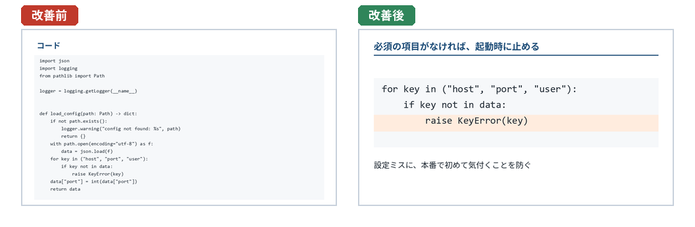

図表とデータの見せ方
====================

2 章で述べたとおり、スライドに載せる価値が高いのは、話だけでは伝わりにくいもの、つまり図、グラフ、表、数字である。この章では、箇条書きを図解に変える方法、グラフと表の見せ方、画像の扱い、そしてエンジニアの発表に特有のコードやアーキテクチャ図の見せ方を説明する。

箇条書きを図解に変える
----------------------

箇条書きは手軽だが、項目どうしの関係（順序、因果、対立、包含）を表せない。すべての項目が同じ形で並ぶので、聞き手は関係を自分で読み解かなければならない。項目の間に関係があるなら、その関係を図で示す。

   箇条書きをフロー図に変える

左のスライドは、手順を正しく並べているが、テストに失敗したときに戻る流れが字下げでしか表現されていない。右のスライドは、流れを矢印で示し、失敗したときに戻る経路を別の色の矢印で描いている。タイトルも、図から読み取ってほしいメッセージ（テストに通らない変更は本番に届かない）にした。

図解にはいくつかの基本の型がある。項目の関係に合った型を選ぶ。

   図解の基本の型

.. list-table:: 図解の型と使いどころ
   :header-rows: 1
   :widths: 18 37 45

   * - 型
     - 表す関係
     - エンジニアの資料での例
   * - フロー
     - 順序、手順、処理の流れ
     - リリースの手順、データの処理の流れ、障害の時系列
   * - 比較
     - 2 つ以上の選択肢の違い
     - 技術選定、移行前後の比較、案 A と案 B
   * - 階層
     - 全体と部分、親と子
     - 組織、モジュールの構成、課題の分解
   * - マトリクス
     - 2 つの軸による分類
     - 効果と費用による施策の優先順位、影響度と発生確率によるリスクの評価
   * - サイクル
     - 繰り返す流れ
     - 開発のイテレーション、PDCA、監視と改善の循環
   * - 構成要素
     - 要素とその間のつながり
     - システム構成図、サービス間の依存関係

図解を作るときは、次の点に気を付ける。

* 図の要素の数は少なくする。1 枚の図に 7 つ以上の箱が並ぶ場合は、まとめられないか、2 枚に分けられないかを考える。
* 矢印の意味（データの流れか、処理の順序か、依存関係か）を 1 枚の図の中で混ぜない。
* 図の中の文字も、5 章の文字の大きさの目安を守る。図を縮小して貼り付けると、文字が小さくなりやすい。

グラフの見せ方
--------------

グラフを選ぶ
~~~~~~~~~~~~

グラフの種類は、データで何を伝えたいかによって選ぶ。

.. list-table:: 伝えたいこととグラフの種類
   :header-rows: 1
   :widths: 35 30 35

   * - 伝えたいこと
     - グラフ
     - 注意点
   * - 項目どうしの大きさの比較
     - 棒グラフ
     - 縦軸は 0 から始める。項目が多いときや項目名が長いときは横棒にする
   * - 時間による変化
     - 折れ線グラフ
     - 系列は 3〜4 本までにする。強調する系列以外は薄い色にする
   * - 2 つの量の関係
     - 散布図
     - 相関があっても因果関係があるとは限らないことに注意する
   * - 全体に占める割合
     - 積み上げ棒グラフ、円グラフ
     - 円グラフは項目が少なく、差が大きいときだけ使う
   * - 分布
     - ヒストグラム、箱ひげ図
     - 応答時間のように偏った分布では、平均値だけでなくパーセンタイル値も示す

円グラフは注意して使う。人は角度や面積の違いを、長さの違いほど正確には読み取れない。次の図の左の円グラフでは、Web、iOS、Android、API のどれが大きいかを読み取るのは難しいが、右の棒グラフなら順位も差もすぐに分かる。

   円グラフと棒グラフの比較

伝えたい点を強調する
~~~~~~~~~~~~~~~~~~~~

スライドに載せるグラフは、データを正確に示すだけでなく、聞き手に見てほしい点がすぐに分かるようにする。分析のために作ったグラフをそのまま貼ると、多くの場合、情報が多すぎる。

   グラフの改善前と改善後

上の図の改善後のグラフでは、次のように変更している。

* タイトルを、グラフから読み取ってほしいメッセージ（D チームの障害は他チームの約 2 倍）にした。
* 棒の色を 1 色の灰色にそろえ、注目してほしい棒だけをアクセントカラーにした。色分けに意味がないなら、色は使わない。
* 凡例をなくし、項目名を軸に直接書いた。凡例とグラフの間で視線を往復させずに済む。
* 格子線と縦軸の目盛りをなくし、棒の上に値を直接書いた。値を読むためだけの要素は不要になる。

matplotlib などで作ったグラフをスライドに貼る場合は、スライド用に作り直すことを勧める。分析用のグラフは文字が小さく、スライドに貼ると読めない。図の大きさを、スライド上に表示する大きさに合わせて指定し、文字を大きくして出力するとよい。

グラフで誤解を招かない
~~~~~~~~~~~~~~~~~~~~~~

グラフは、意図せずに誤解を招くことがある。次の点に注意する。

* 棒グラフの縦軸を 0 以外から始めると、差が実際よりも大きく見える。差を拡大して見せたい場合は、折れ線グラフにするか、軸が 0 から始まっていないことを明示する。
* 3D のグラフは、奥行きのために値が読み取りにくくなり、手前の要素が大きく見える。スライドでは使わない。
* 比較する 2 つのグラフは、軸の範囲をそろえる。
* 出典と、データの期間・条件を小さく添える。

表の見せ方
----------

表は、正確な数値を示したいときや、複数の項目を複数の観点で比較したいときに向いている。ただし、表は読むのに時間がかかるので、スライドでは次のように絞る。

* **行と列を減らす**: 伝えたいメッセージに必要な行と列だけを残す。全データは付録や配布資料に回す。
* **注目してほしい箇所を強調する**: 結論に関わる数値を、太字やアクセントカラーにする。比較する数値が離れている場合は、列の並びを変えて隣に並べる。
* **数値は右揃えにし、桁と単位をそろえる**: 小数点以下の桁数をそろえると、大きさを比べやすい。単位は見出しに書き、セルには数値だけを書く。
* **罫線を減らす**: 縦の罫線はなくても読める。行を区別するには、1 行おきに薄い背景色を付ける方法もある。

表の例は、7 章で紹介する Marp のサンプル（進捗報告の「依頼」のスライド）にある。

画像・アイコン・スクリーンショット
----------------------------------

写真やアイコンは、内容の理解を助ける場合にだけ使う。スライドの空いた場所を埋めるための飾りの画像は、聞き手の注意をメッセージからそらす。

画像を使う場合は、権利を確認する。

* Web で見つけた画像を、許可なくスライドに使ってはならない。社内の発表であっても、著作権の問題は生じうる。
* 素材サイトやアイコン集の画像は、利用規約（商用利用の可否、クレジットの表記が必要か、改変してよいか）を確認する。
* 他の人が作った図やグラフを引用する場合は、出典を明記する。
* 製品やサービスのロゴは、各社のガイドラインに従って使う。

自社のシステムや社内ツールのスクリーンショットを使う場合は、次の点に注意する。

* 個人情報、顧客の情報、パスワード、API キー、社内のサーバー名などが写り込んでいないか確認する。社外で発表する場合は特に注意する。
* 画面全体ではなく、説明に必要な部分だけを切り抜く。注目してほしい箇所を枠で囲むか、それ以外の部分を暗くする。
* 画面の文字が小さすぎる場合は、ブラウザやアプリを拡大表示してから撮影する。

エンジニアの発表に特有の要素
----------------------------

コード
~~~~~~

技術発表ではコードを見せたくなるが、スライドに載せたコードは、聞き手にとっては読むのに時間のかかる文章である。コードを見せるときは、次のようにする。

* **量を絞る**: 説明に必要な数行だけを載せる。import 文、エラー処理、ログ出力などの本質でない部分は省く。省いたことは ``...`` などで示す。目安として、1 枚に 10 行程度までにする。
* **文字を大きくする**: 等幅フォントで、18 pt 以上にする。小さくしないと入らない量のコードは、載せる量を減らす。
* **注目してほしい行を強調する**: 背景色を変える、その行以外を薄くする、などの方法で、どこを見ればよいかを示す。
* **タイトルでコードの意味を言う**: 「コード」「実装」ではなく、そのコードで何をしているか、なぜそうしたかをタイトルに書く。

   コードのスライドの改善前と改善後

コードの全体は、リポジトリへのリンクや付録で示せばよい。発表後に資料を共有する場合は、コードをコピーできるよう、画像ではなくテキストで載せておくと親切である。Marp では、Markdown のコードブロックがそのままテキストとして出力され、構文の色分けも自動で行われる。

アーキテクチャ図
~~~~~~~~~~~~~~~~

システムの構成を説明する場合は、設計書の構成図をそのまま使わず、発表のメッセージに必要な要素だけを残した図を作る。

* 説明に関係しないコンポーネントは省くか、1 つの箱にまとめる。
* 今回の変更箇所や、問題が起きた箇所をアクセントカラーで示す。
* 変更の前後を比べる場合は、同じ配置の図を 2 枚並べるか、続けて表示する。要素の位置が変わると、聞き手は何が変わったのかを見つけにくい。
* AWS などのクラウドサービスの公式アイコンを使う場合は、提供元のガイドラインに従う。アイコンに頼りすぎず、名前も書き添える。

数式
~~~~

数式は、その場で読み解いてもらうのが難しい要素である。スライドに数式を載せる場合は、式の意味を言葉で添え、記号の意味を説明する。聞き手が数式に慣れていない場合は、式の代わりに具体的な数値の例や図で説明できないかを考える。Marp では、``$...$`` と ``$$...$$`` で囲んで TeX の記法で数式を書ける。

ターミナルの出力とログ
~~~~~~~~~~~~~~~~~~~~~~

コマンドの実行結果やログを見せる場合は、必要な行だけを抜き出す。ターミナルのスクリーンショットは、背景が黒く文字が小さいことが多く、投影すると読みにくい。テキストとして貼り付け、文字を大きくして、注目してほしい行を強調する。

アニメーションと画面切り替え
----------------------------

アニメーション（スライド上の要素を順に表示する効果など）と、画面切り替え（スライドが変わるときの効果）は、控えめに使う。

効果的な使い方は、要素を話の順に 1 つずつ表示することである。複雑な図や箇条書きをいきなり全部見せると、聞き手は発表者の話より先に全体を読もうとする。話に合わせて順に表示すれば、聞き手の視線を、いま話している箇所に誘導できる。

一方で、次のような使い方は避ける。

* 回転する、跳ねる、飛び込んでくるなど、動きの大きい効果。内容と関係のない動きは、聞き手の注意をそらす。
* すべてのスライドに異なる画面切り替えの効果を付けること。反復の原則に反する。
* 操作が複雑になるほど多くのアニメーションを付けること。発表中にクリックの回数を間違えやすくなる。

アニメーションを使ったスライドは、PDF に変換すると最終的な状態だけが残る。配布用の資料を PDF で作る場合は、PDF でも内容が伝わるかを確認する。

この章のまとめ
--------------

* 項目の間に関係があるなら、箇条書きではなく図解で関係を示す。図解にはフロー、比較、階層、マトリクス、サイクル、構成要素などの型がある。
* グラフは伝えたいことに合わせて選び、伝えたい点を強調し、不要な要素を減らす。
* 表は行と列を絞り、注目してほしい数値を強調する。
* 画像は理解を助ける場合にだけ使い、権利と写り込みを確認する。
* コードは量を絞り、文字を大きくし、注目してほしい行を強調する。
* アニメーションは、話の順に要素を表示して視線を誘導する目的で、控えめに使う。
