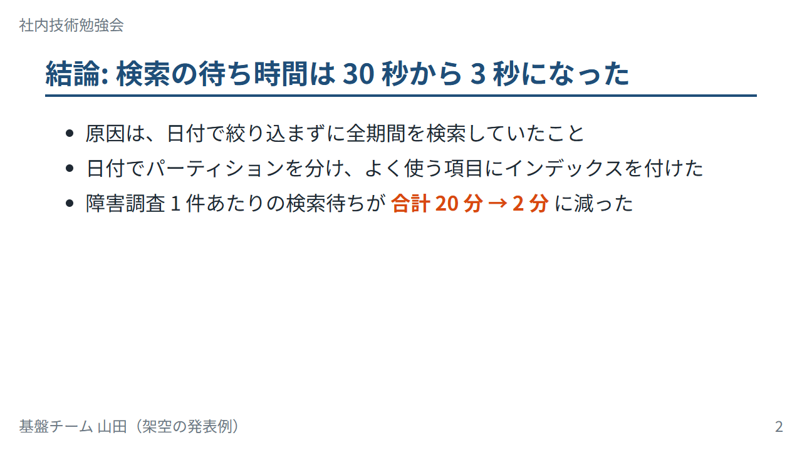
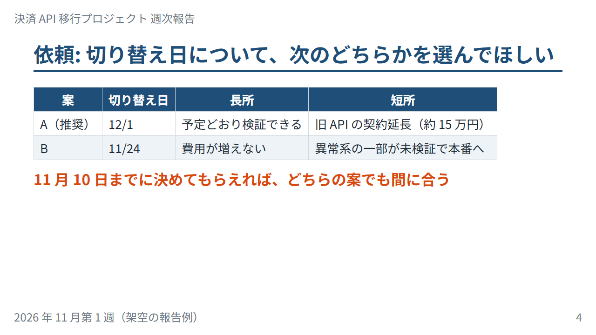

ツール別の作り方
================

この章では、スライドを作るツールとして PowerPoint、Google スライド、Marp を取り上げ、5 章と 6 章で説明した原則を実際に適用するための機能を説明する。最後に、Python で PowerPoint のファイルを自動生成する方法を簡単に紹介する。

ツールの画面やメニューの名前は、バージョンの更新によって変わることがある。本章の記述は 2026 年 11 月時点のものである。見つからない場合は、各ツールのヘルプで機能の名前を検索してほしい。

ツールの比較
------------

.. list-table:: スライド作成ツールの比較
   :header-rows: 1
   :widths: 16 28 28 28

   * - 観点
     - PowerPoint
     - Google スライド
     - Marp
   * - 作り方
     - 画面上で図形や文字を配置する
     - 画面上で図形や文字を配置する（ブラウザで動く）
     - Markdown のテキストを書き、HTML や PDF に変換する
   * - デザインの自由度
     - 高い。図形の描画や細かな配置ができる
     - 中程度。PowerPoint より機能は少ない
     - テーマ CSS の範囲で決まる。図は別のツールで作って画像として貼る
   * - 共同編集
     - Microsoft 365 の共有機能で可能
     - 得意。複数人での同時編集とコメントが標準でできる
     - Git でテキストとして管理し、プルリクエストでレビューできる
   * - 再利用と自動化
     - スライドマスター、テンプレート。python-pptx で自動生成できる
     - テーマ、テンプレート。Google Slides API で操作できる
     - テキストなので、コピー、置換、差分の確認、スクリプトでの生成が容易
   * - 出力形式
     - PPTX、PDF、画像、動画
     - PPTX、PDF、画像（ブラウザで公開も可能）
     - HTML、PDF、PPTX（画像のスライド）、画像
   * - 向いている場面
     - 社外向けの資料、図の多い資料、会社の標準形式が PowerPoint の場合
     - チームでの共同作成、ブラウザだけで完結させたい場合
     - 技術発表、LT、コードの多い資料、Git で管理したい資料

参考として、他のツールも挙げておく。

* **Keynote**: Apple のプレゼンテーションソフト。macOS、iPadOS、iOS で使える。アニメーションの表現が豊富である。
* **reveal.js**: HTML、CSS、JavaScript でスライドを作るためのフレームワーク。ブラウザで動くので、Web の技術で自由に表現できる。
* **Slidev**: Markdown でスライドを書くツールで、Vue のコンポーネントを埋め込める。Web フロントエンドの開発者に向いている。

PowerPoint
----------

PowerPoint は、Microsoft が提供するプレゼンテーションソフトで、仕事の資料で最も広く使われている。機能が多いが、スライド作成に重要なのは次の機能である。

スライドマスターとレイアウト
~~~~~~~~~~~~~~~~~~~~~~~~~~~~

スライドマスターは、資料全体のデザイン（背景、フォント、色、タイトルや本文の位置と大きさ）を定義する場所である。「表示」タブの「スライド マスター」で編集する。スライドマスターの下には、「タイトル スライド」「タイトルとコンテンツ」などのレイアウトがあり、スライドの種類ごとの配置を定義している。

5 章の反復の原則を守るには、個々のスライドで文字の大きさや色を直接変更するのではなく、スライドマスターとレイアウトで定義する。たとえば、本文の文字の大きさを変えたいときは、スライドマスターの本文のプレースホルダー（文字や図を入れる枠）の書式を変更する。そうすれば、すべてのスライドに一度に反映される。

テーマのフォントと色も、スライドマスターの画面で設定できる。「フォント」で見出しと本文のフォントを、「配色」でメインカラーやアクセントカラーを設定しておくと、新しく追加した図形や表にも自動的に適用される。

配置と整列
~~~~~~~~~~

PowerPoint では、図形をドラッグすると、他の図形の端や中心とそろう位置に破線のガイド（スマートガイド）が表示される。これを使えば、目分量に頼らず要素をそろえられる。

複数の図形をまとめてそろえるには、図形を選択して「ホーム」タブの「配置」から「配置」を選び、「左揃え」「上揃え」「左右に整列」などを使う。「左右に整列」「上下に整列」は、3 つ以上の図形の間隔を等しくする機能である。また、「表示」タブで「グリッド線」を表示すると、スライド全体に等間隔の格子が表示され、5 章で説明したグリッドの目安になる。同じタブの「ガイド」を表示すると、ドラッグして位置を変えられる縦横の線が表示され、余白の位置や列の境目をそろえるのに使える。

アウトライン表示
~~~~~~~~~~~~~~~~

「表示」タブの「アウトライン表示」では、各スライドのタイトルと本文の文字だけが一覧で表示される。4 章で説明した「タイトルだけを順に読んで話が通るか」の確認に使える。アウトライン表示では文字を直接編集できるので、構成を考える段階で使ってもよい。

発表者ツール
~~~~~~~~~~~~

各スライドの下にあるノート欄には、発表者ノート（話す内容のメモ）を書ける。発表するときは、「スライド ショー」タブで「発表者ツールを使用する」を有効にしておくと、プロジェクターには通常のスライドを、手元の画面には発表者ツールを表示できる。発表者ツールには、現在のスライド、次のスライド、発表者ノート、経過時間が表示される。

スライドショー中には、次のキー操作が使える。

* :kbd:`B` キー: 画面を黒くする（もう一度押すと戻る）。話に集中してほしいときや、休憩のときに使う。
* :kbd:`W` キー: 画面を白くする。
* 数字を入力して :kbd:`Enter` キー: 指定した番号のスライドに移動する。質疑応答で付録のスライドを見せるときに便利である。
* :kbd:`Ctrl` + :kbd:`L` キー: マウスポインターをレーザーポインターにする。

その他の機能
~~~~~~~~~~~~

* **PDF への出力**: 「ファイル」の「エクスポート」から、PDF を作成できる。配布する場合や、別のパソコンで発表する場合にフォントが置き換わるのを防げる。
* **アクセシビリティ チェック**: 「校閲」タブの「アクセシビリティ チェック」で、画像の代替テキストの不足や、読みにくい色の組み合わせなどを確認できる。
* **デザイナー**: Microsoft 365 の PowerPoint では、スライドの内容に合わせたレイアウトの候補を提案する機能がある。候補をそのまま使う場合も、5 章の原則に照らして確認する。

Google スライド
---------------

Google スライドは、Google が提供するブラウザで動くプレゼンテーションソフトである。ファイルは Google ドライブに保存され、URL を共有するだけで複数人で同時に編集できる。

テーマ
~~~~~~

Google スライドのテーマは、PowerPoint のスライドマスターに相当する。「表示」メニューの「テーマビルダー」で、資料全体の背景、フォント、色、レイアウトごとの配置を編集する。PowerPoint と同様に、個々のスライドで書式を直接変更するのではなく、テーマで定義する。

チームで共通のテーマを使う場合は、テーマを設定した空の資料をテンプレートとして共有し、新しい資料はそれをコピーして作るとよい。

配置と整列
~~~~~~~~~~

図形をドラッグすると、他の図形との位置関係を示すガイドが表示される。複数の図形をそろえるには、図形を選択して「配置」メニューの「整列」や「均等に配置」を使う。「表示」メニューの「ガイド」で、任意の位置にガイドの線を追加することもできる。

共同編集とコメント
~~~~~~~~~~~~~~~~~~

Google スライドの最大の利点は、共同編集である。

* 複数人が同時に同じ資料を編集できる。他の人がどのスライドを編集しているかが表示される。
* スライド上の要素を選んでコメントを付けられる。コメントで相手を指名（@ の後にメールアドレスや名前を入力）すると、相手に通知が届き、対応すべき作業として割り当てることもできる。12 章で説明するレビューに使える。
* 「ファイル」メニューの「変更履歴」で、過去の版を確認し、必要なら元に戻せる。

発表
~~~~

「スライドショー」ボタンの横の矢印から「プレゼンター表示」を選ぶと、発表者ノート、次のスライド、タイマーを表示する画面が別のウィンドウで開く。プレゼンター表示の「視聴者ツール」では、聞き手がスマートフォンなどから質問を投稿できる Q&A の機能を使える。

Google スライドはブラウザで動くので、発表する会場でインターネットにつながらない場合に備える必要がある。事前にオフラインで使えるように設定しておくか、PDF や PPTX にダウンロードしておく（「ファイル」メニューの「ダウンロード」）。PPTX に変換すると、フォントやレイアウトが変わることがあるので、変換後のファイルを必ず確認する。

Marp
----

Marp は、Markdown でスライドを作るためのツール群である。テキストエディタで Markdown を書き、HTML、PDF、PPTX、画像に変換する。エンジニアにとっては、次の利点がある。

* **テキストで書ける**: 普段使っているエディタで、キーボードだけでスライドを作れる。4 章で作った Markdown のアウトラインを、そのままスライドに育てられる。
* **Git で管理できる**: 変更の差分を確認でき、プルリクエストでスライドのレビューができる。
* **内容とデザインを分けられる**: デザインはテーマ CSS で 1 か所に定義するので、本文を書くときは内容に集中できる。反復の原則が自動的に守られる。
* **コードを載せやすい**: Markdown のコードブロックがそのまま使え、構文が自動で色分けされる。

一方で、図形を自由に配置するのは苦手である。図は、Graphviz、Mermaid、draw.io、matplotlib などで作成し、画像として貼り付ける。

導入
~~~~

Marp には主に 2 つの使い方がある。

Marp for VS Code
   VS Code の拡張機能である。拡張機能のビューで「Marp for VS Code」を検索してインストールすると、Markdown のプレビューにスライドが表示されるようになる。コマンドパレットの「Marp: Export Slide Deck」で、HTML、PDF、PPTX、画像に出力できる。

Marp CLI
   コマンドラインから変換するツールである。Node.js が必要で、npm でインストールする。複数のファイルの一括変換や、ビルドの自動化に向いている。

Marp CLI は、次のいずれかの方法で使う。

.. code-block:: bash
   :linenos:

   # グローバルにインストールする（marp コマンドが使えるようになる）
   npm install -g @marp-team/marp-cli
   marp --version

   # インストールせずに一時的に使う
   npx @marp-team/marp-cli@latest slide.md --pdf

   # プロジェクトごとにインストールする（プロジェクトのフォルダで実行する）
   npm install --save-dev @marp-team/marp-cli
   npx marp slide.md --pdf

PDF、PPTX、画像に変換するには、Google Chrome、Microsoft Edge、Firefox のいずれかのブラウザがインストールされている必要がある。Marp CLI は、これらのブラウザを使ってスライドを描画している。

基本の書き方
~~~~~~~~~~~~

Marp のスライドは、通常の Markdown ファイルである。先頭のフロントマター（``---`` で囲んだ部分）に ``marp: true`` を書くと、Marp のスライドとして扱われる。スライドとスライドの区切りには、``---`` だけの行を使う。

.. code-block:: markdown
   :linenos:

   ---
   marp: true
   theme: default
   paginate: true
   ---

   # ログ検索を 10 倍速くした話

   インデックスの見直しで、障害調査の待ち時間を減らした

   ---

   ## 結論: 検索の待ち時間は 30 秒から 3 秒になった

   - 原因は、日付で絞り込まずに全期間を検索していたこと
   - 日付でパーティションを分け、よく使う項目にインデックスを付けた

   <!--
   発表者ノート: 最初に結論を言い切る。
   -->

1〜5 行目がフロントマター、11 行目がスライドの区切りである。18〜20 行目のように HTML のコメントで書いた内容は、スライドには表示されず、発表者ノートとして扱われる。

ディレクティブ
~~~~~~~~~~~~~~

Marp では、ディレクティブと呼ばれる設定でスライドの見た目を制御する。ディレクティブは、フロントマターか HTML のコメントの中に書く。

.. list-table:: よく使うディレクティブ
   :header-rows: 1
   :widths: 25 15 60

   * - ディレクティブ
     - 種類
     - 意味
   * - ``theme``
     - グローバル
     - 使うテーマ。組み込みのテーマとして ``default``、``gaia``、``uncover`` がある
   * - ``size``
     - グローバル
     - スライドの縦横比。``16:9`` または ``4:3``。既定は ``16:9`` で、大きさは 1280 × 720 px になる
   * - ``headingDivider``
     - グローバル
     - 指定したレベルの見出しの前で、自動的にスライドを区切る。たとえば ``2`` にすると ``##`` ごとに区切られる
   * - ``paginate``
     - ローカル
     - ページ番号を表示するかどうか
   * - ``header``、``footer``
     - ローカル
     - ヘッダーとフッターに表示する文字
   * - ``class``
     - ローカル
     - スライドに付ける CSS のクラス。テーマで定義したレイアウトの切り替えに使う
   * - ``backgroundColor``、``color``
     - ローカル
     - 背景色と文字色

グローバルディレクティブは資料全体に適用される。ローカルディレクティブは、書いたスライドとそれ以降のスライドに適用される。ローカルディレクティブの名前の前に ``_`` を付けると、そのスライドだけに適用される（スポットディレクティブ）。たとえば、表紙だけページ番号を消すには、表紙のスライドに次のように書く。

.. code-block:: markdown
   :linenos:

   <!-- _paginate: false -->
   <!-- _class: lead -->

   # ログ検索を 10 倍速くした話

画像
~~~~

画像は Markdown の画像の記法で貼り付ける。代替テキストの位置に、大きさや配置のキーワードを書ける。

.. code-block:: markdown
   :linenos:

   

   

   

1 行目は幅 600 px で表示する。3 行目の ``bg`` は、画像をスライドの背景にする。5 行目の ``bg right:40%`` は、スライドの右側 40 % を画像にし、左側に本文を表示する。図と説明を左右に並べるレイアウトが簡単に作れる。

ローカルの画像ファイルを使うスライドを Marp CLI で PDF、PPTX、画像に変換する場合は、``--allow-local-files`` オプションが必要になる。

テーマ CSS
~~~~~~~~~~

Marp のテーマは CSS で書く。1 枚のスライドは ``section`` 要素で表されるので、``section`` に対してスタイルを指定する。CSS の先頭に ``/* @theme テーマ名 */`` というコメントを書くと、テーマ名が登録される。``@import 'default';`` と書けば、組み込みのテーマを土台にして、変えたい部分だけを上書きできる。

本書のサンプルでは、5 章の原則に沿って作ったテーマ ``simple`` を使っている。次はその一部である（全体は付録 C からダウンロードできる）。

.. literalinclude:: ../examples/marp/themes/simple.css
   :language: css
   :linenos:
   :lines: 1-48

このテーマでは、次の点を定義している。

* 配色: メインカラー（紺）とアクセントカラー（橙）を CSS の変数として定義し（15〜16 行目）、ベースカラーの白を背景に指定している（25 行目）。
* 文字の大きさ: 本文を 32 px（24 pt 相当）、スライドのタイトル（``##``）を 44 px にしている。
* 強調: ``**太字**`` で書いた部分を、アクセントカラーで表示する。
* レイアウトの種類: 表紙や区切りに使う ``lead`` と、1 文だけを大きく見せる ``message`` の 2 つのクラスを定義している（全体のファイルを参照）。

自作のテーマを使うには、Marp CLI では ``--theme-set`` オプションでテーマ CSS のファイルかフォルダを指定する。Marp for VS Code では、VS Code の設定 ``markdown.marp.themes`` にテーマ CSS のパスを追加する。

.. code-block:: bash
   :linenos:

   # テーマを指定して HTML に変換する
   marp tech_talk.md --theme-set themes/simple.css -o tech_talk.html

   # PDF に変換する
   marp tech_talk.md --theme-set themes/simple.css --pdf

``--theme-set`` は複数の値を受け取るオプションなので、入力ファイルより後ろに書く。前に書くと、入力ファイルの名前までテーマとして解釈されることがある。

出力形式
~~~~~~~~

Marp CLI は、次の形式に出力できる。

.. list-table:: Marp CLI の出力形式
   :header-rows: 1
   :widths: 20 30 50

   * - 形式
     - オプション
     - 特徴
   * - HTML
     - （指定なし）
     - ブラウザで発表できる。キーボードの矢印キーで移動し、:kbd:`P` キーで発表者ノート付きの発表者用の画面を開ける
   * - PDF
     - ``--pdf``
     - 配布に向く。``--pdf-notes`` を付けると、発表者ノートを PDF の注釈として含める
   * - PPTX
     - ``--pptx``
     - PowerPoint で開いて発表できる。ただし、各スライドは画像として埋め込まれるので、PowerPoint で文字を編集することはできない。発表者ノートは PowerPoint のノートに入る
   * - 画像
     - ``--images png``、``--image png``
     - ``--images`` はすべてのスライドを、``--image`` は 1 枚目だけを画像にする。SNS やブログでの紹介に使える

PPTX の出力は、会場のパソコンに PowerPoint しかない場合などに便利だが、受け取った人が PowerPoint で編集することはできない点に注意する。編集できる PPTX を出力する実験的な機能もあるが、LibreOffice が必要で、レイアウトが完全には再現されない。編集してもらう必要がある場合は、最初から PowerPoint か Google スライドで作るほうがよい。

開発中は、``-w`` オプション（ファイルの変更を監視して自動で変換する）や ``-p`` オプション（変換後にプレビューのウィンドウを開く）を使うと、編集しながら結果を確認できる。

Git での管理
~~~~~~~~~~~~

Marp のスライドはテキストなので、ソースコードと同じように Git で管理できる。

* スライドの変更をコミットとして記録し、差分で何が変わったかを確認できる。
* 共同で作る場合は、プルリクエストでレビューできる。誤字や数値の誤りを、行単位でコメントできる。
* 変換した HTML や PDF はリポジトリに含めず、CI（継続的インテグレーション）で Marp CLI を実行して生成する方法もある。

サンプルスライド
~~~~~~~~~~~~~~~~

本書では、4 章の構成例に沿った 3 つのサンプルを用意した。いずれも、テーマ ``simple`` を使っている。HTML 版と PDF 版の閲覧、Markdown のダウンロード、変換のコマンドは、:doc:`appendix_c_samples` にまとめている。

技術発表（11 枚）
   社内勉強会での「ログ検索を 10 倍速くした話」。結論 → 背景 → 原因 → 対策 → 結果 → まとめ → 付録 の順に構成している。

進捗報告（6 枚）
   決済 API の移行プロジェクトの週次報告。結論と依頼を最初に示し、判断を求める。

LT（8 枚）
   5 分の LT「レビューの指摘を半分にした話」。1 つのメッセージに絞り、大きな文字で見せる。

次に、技術発表のサンプルの Markdown と、変換したスライドの一部を示す。

.. literalinclude:: ../examples/marp/tech_talk.md
   :language: markdown
   :linenos:
   :lines: 1-33

   表紙のスライド（上の 10〜20 行目）

   結論のスライド（上の 24〜32 行目）

表紙では、スポットディレクティブで ``lead`` クラスを指定し、ページ番号とヘッダーを消している。結論のスライドでは、アクションタイトルで結論を述べ、``**`` で囲んだ数値をアクセントカラーで強調している。

進捗報告のサンプルの「依頼」のスライドでは、Markdown の表で選択肢を比較し、判断の期限を強調している。

   依頼のスライド（進捗報告のサンプル）

LT のサンプルでは、``message`` クラスを使って、1 文だけを大きく見せるスライドを挟んでいる。

   1 文だけを見せるスライド（LT のサンプル）

PowerPoint ファイルの自動生成
-----------------------------

毎週の報告資料のように、同じ形式のスライドにデータだけを入れ替えて作る資料は、プログラムで自動生成できる。Python では、python-pptx というライブラリで PowerPoint のファイル（PPTX）を作成・編集できる。ここでは、どのようなことができるかを簡単に紹介する。

python-pptx は pip でインストールする。

.. code-block:: bash
   :linenos:

   pip install python-pptx

次のコードは、タイトルのスライドと箇条書きのスライドを 1 枚ずつ作り、ファイルに保存する。

.. code-block:: python
   :linenos:

   from pptx import Presentation

   prs = Presentation('team_template.pptx')  # 会社やチームのテンプレートを読み込む

   title_slide = prs.slides.add_slide(prs.slide_layouts[0])  # 0 番目のレイアウト（タイトル スライド）
   title_slide.shapes.title.text = '決済 API 移行プロジェクト 週次報告'
   title_slide.placeholders[1].text = '2026 年 11 月第 1 週'

   body_slide = prs.slides.add_slide(prs.slide_layouts[1])  # 1 番目のレイアウト（タイトルとコンテンツ）
   body_slide.shapes.title.text = '進捗: 12 本中 9 本の移行が完了した'
   text_frame = body_slide.placeholders[1].text_frame
   text_frame.text = '完了: 9 本'
   for line in ['作業中: 2 本', '未着手: 1 本']:
       paragraph = text_frame.add_paragraph()
       paragraph.text = line

   prs.save('weekly_report.pptx')

3 行目で既存のテンプレートを読み込み、5 行目と 9 行目でテンプレートのレイアウトを指定してスライドを追加している。``Presentation()`` のように引数なしで呼ぶと python-pptx に付属する既定のテンプレートが使われるが、その縦横比は 4:3 なので、実際の資料ではスライドマスターを整えた自分たちのテンプレートを読み込むのがよい。レイアウトの番号やプレースホルダーの番号は、テンプレートによって異なる。

python-pptx では、このほかに表、グラフ、画像の追加や、既存のスライドの文字の置き換えもできる。

自動生成は、次のような場合に向いている。

* 毎週・毎月の定型の報告で、データの集計からスライドの作成までを自動化したい場合
* 多数の対象（サービスごと、顧客ごとなど）について、同じ形式の資料を作る場合

一方で、ストーリーの組み立てや、メッセージに合わせた図の工夫が必要な資料には向いていない。自動生成した資料も、発表の前に人が読み、4 章と 5 章の観点で確認する。

ツールの選び方
--------------

どのツールを使うかは、次の観点で決める。

* **職場の標準と、受け取る人の環境**: 資料を受け取った人が編集する必要があるなら、相手が使えるツールで作る。社外とのやり取りでは PowerPoint が最も無難である。
* **共同編集の必要性**: 複数人で同時に作るなら Google スライドが便利である。エンジニアだけで作るなら、Marp と Git での共同作業も選択肢になる。
* **図の量**: 図解を多く描くなら、図形を自由に配置できる PowerPoint か Google スライドが向いている。
* **コードの量と再利用性**: コードが多い技術発表や、過去のスライドを部分的に再利用することが多い場合は、Marp が向いている。

どのツールを使う場合も、3 章から 6 章で説明した原則は変わらない。ツールの機能は、原則を手間なく守るための手段である。

この章のまとめ
--------------

* PowerPoint ではスライドマスター、Google スライドではテーマ、Marp ではテーマ CSS で、デザインを 1 か所に定義する。
* 要素の配置には、目分量ではなく整列の機能やガイドを使う。
* 発表者ノートと発表者用の画面（発表者ツール、プレゼンター表示、Marp の HTML の発表者用の画面）を活用する。
* Marp は Markdown でスライドを書き、Git で管理できる。図形の自由な配置は苦手なので、図は別のツールで作る。
* 定型の資料は、python-pptx などで自動生成できる。
* ツールは、職場の標準、共同編集の必要性、図とコードの量で選ぶ。
