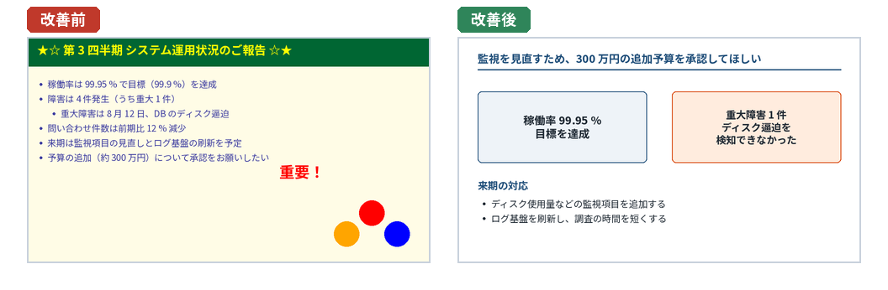

レビューと改善
==============

スライドと発表は、見直すことで良くなる。この章では、発表の前に行う自己レビューの観点、他の人からフィードバックをもらう方法、よくあるアンチパターンとその改善、発表後の振り返りと資料の再利用を説明する。

自己レビューの観点
------------------

スライドができたら、発表の前に次の 3 つの観点で見直す。具体的な確認項目は、付録 A のチェックリストにまとめている。

構成
   3 章と 4 章の観点で見直す。キーメッセージが冒頭で示されているか、タイトルだけを順に読んで話が通るか、ゴールに不要なスライドがないか、を確認する。スライドを 1 枚ずつ見るのではなく、一覧表示（PowerPoint のスライド一覧、Google スライドのグリッド表示、Marp の HTML を縮小して見るなど）で全体を眺めると、流れの問題に気付きやすい。

デザイン
   5 章と 6 章の観点で見直す。1 枚に 1 つのメッセージになっているか、文字が小さすぎないか、デザインがスライド間で統一されているか、色の使い方に一貫性があるか、を確認する。スライドを縮小表示して、それでも要点が分かるかを見るのも有効である。

時間
   8 章のリハーサルで時間を測り、持ち時間に収まるかを確認する。時間を超過する場合は、内容を減らす。

自分の資料を自分で見直すと、内容を知っているために問題に気付きにくい。見直しは、作成してから時間をおいて（できれば翌日に）行うとよい。

フィードバックをもらう
----------------------

他の人に資料を見てもらったり、リハーサルを聞いてもらったりすると、自分では気付けない問題が見つかる。フィードバックの質は、頼み方で大きく変わる。

頼み方
~~~~~~

* **前提を伝える**: 発表の目的、聞き手、持ち時間を伝える。前提が分からないと、相手は的確な意見を言えない。
* **見てほしい観点を伝える**: 「全体の流れが分かりやすいか」「この図で言いたいことが伝わるか」のように、特に見てほしい点を具体的に伝える。「何か気付いたことがあれば」とだけ頼むと、誤字の指摘ばかりになりがちである。
* **時間に余裕を持って頼む**: 発表の直前に頼むと、大きな問題を指摘されても直す時間がない。構成の段階（アウトライン）で一度、スライドができた段階で一度、見てもらうのが理想である。

受け方
~~~~~~

* **まず最後まで聞く**: 指摘に対してすぐに反論や説明をしない。本番の聞き手には、その説明をする機会はない。
* **指摘の背景を聞く**: 「分かりにくい」と言われたら、どこで、なぜ分かりにくかったのかを聞く。具体的な箇所が分かれば、直し方も分かる。
* **すべてを反映する必要はない**: 指摘を発表の目的と聞き手に照らして判断し、反映するかどうかを決める。ただし、複数の人から同じ指摘を受けた場合は、反映すべき可能性が高い。
* **感謝を伝える**: フィードバックには時間と労力がかかっている。

7 章で説明したように、Google スライドのコメントや、Marp のスライドのプルリクエストを使うと、フィードバックを記録し、対応状況を管理できる。

アンチパターン集
----------------

よく見られる問題のあるスライドと、その改善の方向を示す。

   アンチパターンの改善の例

上の図の改善前のスライドには、次の問題がある。

* タイトルが話題の名前で、聞き手に何をしてほしいか（予算の承認）が最後の行まで分からない。
* 記号の装飾、強い背景色、意味のない図形、「重要！」という文字が、内容から注意をそらしている。
* 箇条書きの項目の重要度がすべて同じに見える。

改善後のスライドでは、依頼事項をタイトルにし、判断の材料となる 2 つの事実（目標を達成したことと、重大障害の原因）を並べて示し、来期の対応を短くまとめている。

その他の代表的なアンチパターンを、次の表にまとめる。

.. list-table:: 代表的なアンチパターンと改善の方向
   :header-rows: 1
   :widths: 30 35 35

   * - アンチパターン
     - 問題
     - 改善の方向（関連する章）
   * - 文章で埋まったスライド
     - 聞き手は読むか聞くかのどちらかしかできない
     - 要点だけを残し、詳細は話すか発表者ノートや付録に回す（2 章、5 章）
   * - 結論が最後のスライドにある
     - 聞き手は何の話か分からないまま聞き続ける
     - 冒頭で結論を示す（4 章）
   * - 「背景」「課題」などの話題のタイトル
     - スライドのメッセージが分からない
     - アクションタイトルにする（4 章）
   * - 1 枚に複数のメッセージ
     - どこを見ればよいか分からない
     - スライドを分ける（5 章）
   * - スライドごとにデザインが異なる
     - まとまりがなく、デザインの違いに意味があるのかと迷わせる
     - スライドマスターやテーマで統一する（5 章、7 章）
   * - 色の使いすぎ
     - 強調が強調にならない。色の意味が分からない
     - 3 色を基本にし、色に一貫した意味を持たせる（5 章）
   * - 分析用のグラフをそのまま貼る
     - 文字が小さく、何を見ればよいか分からない
     - スライド用に作り直し、伝えたい点を強調する（6 章）
   * - 長いコードを小さな文字で貼る
     - 読めない。どこが重要か分からない
     - 数行に絞り、文字を大きくし、重要な行を強調する（6 章）
   * - 過剰なアニメーション
     - 内容から注意をそらし、操作も難しくなる
     - 話の順に要素を表示する目的に限って使う（6 章）
   * - 最後のスライドが「ご清聴ありがとうございました」だけ
     - 質疑応答の間、聞き手が要点を見返せない
     - まとめやキーメッセージを表示したまま質疑応答に入る（10 章）

最後の項目について補足する。発表の最後のスライドは、質疑応答の間ずっと表示されることが多い。そこにお礼の言葉だけが表示されていると、聞き手は発表の要点を思い出す手がかりを失う。お礼は口頭で伝え、スライドにはまとめや連絡先を表示しておくとよい。7 章の技術発表のサンプルでは、まとめのスライドの最後に質問を促す一文を入れている。

発表後の振り返り
----------------

発表が終わったら、記憶が新しいうちに振り返る。次の点を短く書き留めておくと、次の発表の準備に役立つ。

* **ゴールは達成できたか**: 3 章で決めたゴール（聞き手にどうなってほしいか）は達成できたか。判断を求めた場合は、判断は得られたか。
* **時間はどうだったか**: 予定どおりに進んだか。どこで時間が延びたか。
* **どんな質問が出たか**: 想定していた質問か。想定外の質問は、次の発表で本編に入れるべき内容かもしれない。
* **聞き手の反応**: どこで反応がよかったか、どこで聞き手が戸惑っていたか。
* **自分の話し方**: 録画があれば見返し、9 章の観点で確認する。

可能なら、聞き手の何人かに感想を聞く。社内勉強会などでは、短いアンケートを用意するのもよい。

資料の再利用
------------

一度作った資料は、別の発表でも部分的に再利用できる。再利用しやすくするために、次のことをしておく。

* **資料を整理して保存する**: 発表後に、修正を反映した最終版を、決まった場所に保存する。PowerPoint や Google スライドでは、ファイル名に発表日と発表の場を入れる。Marp では、Git のリポジトリで管理し、発表ごとにタグを付けておく方法もある。
* **よく使うスライドを部品にする**: チームの紹介、システムの全体構成図、用語の説明など、繰り返し使うスライドは、部品として別のファイルにまとめておく。
* **再利用するときは聞き手に合わせて直す**: 同じ内容でも、聞き手が変われば必要な説明は変わる（3 章）。過去の資料をそのまま使わず、ゴールと聞き手に合わせて構成を見直す。

この章のまとめ
--------------

* 発表の前に、構成、デザイン、時間の 3 つの観点で自己レビューする。
* フィードバックを頼むときは、前提と見てほしい観点を伝え、時間に余裕を持って頼む。
* 代表的なアンチパターンを知り、自分の資料に当てはまらないか確認する。
* 発表後は、ゴールの達成、時間、質問、反応を振り返り、次に生かす。
* 資料を整理して保存し、再利用するときは聞き手に合わせて直す。
