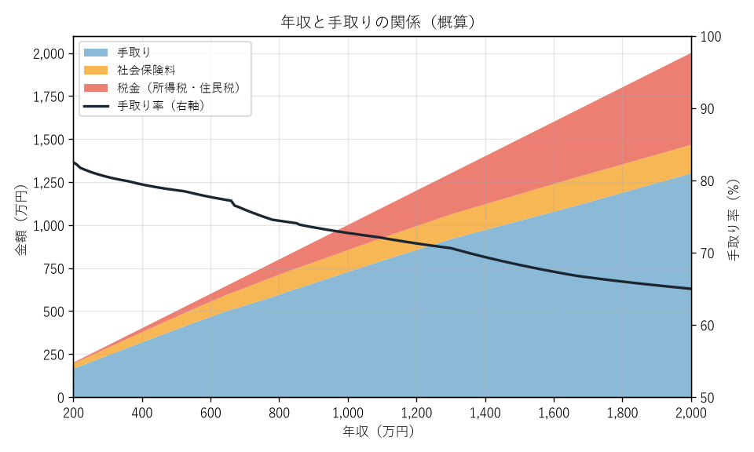

第 2 章 税金と社会保険の全体像
============================================================================

この章では、個別の制度に入る前に、税金と社会保険がそれぞれどのような目的を持ち、どのように分類されるのかを整理する。最後に、会社員の給与明細を例に、額面の給与から手取りが決まるまでの流れを確認する。

税金と社会保険の違い
----------------------------------------------------------------------------

税金も社会保険料も、国や地方公共団体などに支払うお金である点は共通している。しかし、その性格は大きく異なる。

.. list-table:: 税金と社会保険料の違い
   :header-rows: 1
   :widths: 20 40 40

   * - 観点
     - 税金
     - 社会保険料
   * - 目的
     - 道路・教育・警察・防衛など、公共サービス全般の財源
     - 病気・老後・失業・介護などのリスクに備える保険の財源
   * - 支払と給付の関係
     - 納めた額と受けるサービスの間に直接の対応関係はない
     - 保険料を納めることで、給付を受ける権利が生じる
   * - 決まり方
     - 所得・消費・財産などに応じて法律で定める
     - 主に給与や所得に料率を掛けて計算する
   * - 主な納付先
     - 国（税務署）、都道府県、市区町村
     - 健康保険組合、全国健康保険協会、日本年金機構、市区町村など

社会保険料は「保険」であるため、納めていないと必要なときに給付を受けられないことがある。たとえば国民年金の保険料を長期間納めていないと、将来の年金が減るだけでなく、障害年金を受けられない場合もある。一方で、税金と同様に法律で加入と納付が義務付けられており、自分の意思で加入をやめることはできない。

税金の分類
----------------------------------------------------------------------------

日本には 50 種類近くの税金がある。主なものを、課税する主体（国か地方か）と、納め方（直接か間接か）で分類すると次のようになる。

.. list-table:: 主な税金の分類
   :header-rows: 1
   :widths: 20 40 40

   * - 区分
     - 直接税
     - 間接税
   * - 国税
     - 所得税、法人税、相続税、贈与税
     - 消費税、酒税、たばこ税、印紙税
   * - 地方税
     - 住民税、個人事業税、固定資産税、自動車税
     - 地方消費税、地方たばこ税、ゴルフ場利用税

直接税
   税金を負担する人が、自ら（または勤務先などを通じて）納める税金。所得税や住民税がその代表である。

間接税
   税金を負担する人と納める人が異なる税金。消費税は買い物をした消費者が負担するが、税務署に納めるのは商品を販売した事業者である。

国税
   国が課税する税金。税務署が窓口になる。

地方税
   都道府県や市区町村が課税する税金。都道府県税事務所や市区町村の税務課が窓口になる。

個人の家計に最も大きく影響するのは、所得にかかる **所得税** と **住民税** である。本書の第 II 部ではこの 2 つを中心に解説する。

社会保険の分類
----------------------------------------------------------------------------

日本の社会保険は、次の 5 つの保険で構成されている。会社員の場合、このうち健康保険・介護保険・厚生年金保険をまとめて「社会保険」、雇用保険と労災保険をまとめて「労働保険」と呼ぶこともある。

.. list-table:: 社会保険の種類
   :header-rows: 1
   :widths: 18 37 45

   * - 種類
     - 備えるリスク
     - 主な制度
   * - 医療保険
     - 病気・けが・出産
     - 健康保険（会社員）、国民健康保険（自営業者など）、後期高齢者医療制度（75 歳以上）
   * - 年金保険
     - 老齢・障害・死亡
     - 国民年金（全員）、厚生年金保険（会社員・公務員）
   * - 介護保険
     - 要介護状態
     - 介護保険（40 歳以上）
   * - 雇用保険
     - 失業・育児休業・介護休業
     - 雇用保険（雇用される人）
   * - 労災保険
     - 仕事中・通勤中のけが・病気
     - 労働者災害補償保険（雇用される人。保険料は全額事業主負担）

どの制度に加入するかは、主に働き方によって決まる。会社員は勤務先を通じて健康保険と厚生年金保険に加入し、自営業者やフリーランスは自分で国民健康保険と国民年金に加入する。詳しくは :doc:`09_social_insurance_basics` で解説する。

.. graphviz::
   :caption: 税金と社会保険の全体像
   :align: center

   digraph overview {
     rankdir=LR;
     node [shape=box, style="rounded,filled", fillcolor="#ffffff", fontsize=11];
     edge [color="#7f8c8d"];

     root [label="税金と社会保険", fillcolor="#d6eaf8"];

     tax [label="税金", fillcolor="#fadbd8"];
     national [label="国税\n所得税・消費税・相続税・贈与税など"];
     local [label="地方税\n住民税・固定資産税・自動車税など"];

     si [label="社会保険", fillcolor="#d5f5e3"];
     medical [label="医療保険\n健康保険・国民健康保険・後期高齢者医療"];
     pension [label="年金保険\n国民年金・厚生年金保険"];
     care [label="介護保険"];
     employment [label="雇用保険"];
     accident [label="労災保険"];

     root -> tax;
     root -> si;
     tax -> national;
     tax -> local;
     si -> medical;
     si -> pension;
     si -> care;
     si -> employment;
     si -> accident;
   }

給与明細で見る「天引き」
----------------------------------------------------------------------------

会社員の場合、税金と社会保険料の多くは給与から差し引かれる（天引きされる）。これは、勤務先が本人に代わって計算し、納付する仕組みになっているためである。税金の場合は源泉徴収・特別徴収、社会保険料の場合は保険料の控除と呼ぶ。

次の表は、協会けんぽに加入する 30 歳・単身の会社員で、毎月の給与（額面）が 30 万円、賞与がない場合の給与明細の例である。健康保険料は協会けんぽの全国平均の料率で計算した。税金は年額を 12 で割った目安である。

.. list-table:: 給与明細の例（月給 30 万円、30 歳、単身）
   :header-rows: 1
   :widths: 40 25 35

   * - 項目
     - 金額（月額）
     - 説明
   * - 総支給額（額面）
     - 300,000 円
     - 基本給と各種手当の合計
   * - 健康保険料
     - 14,850 円
     - 標準報酬月額 × 9.9 % ÷ 2
   * - 子ども・子育て支援金
     - 345 円
     - 標準報酬月額 × 0.23 % ÷ 2。2026 年 4 月分から徴収
   * - 厚生年金保険料
     - 27,450 円
     - 標準報酬月額 × 18.3 % ÷ 2
   * - 雇用保険料
     - 1,500 円
     - 給与 × 0.5 %
   * - 所得税
     - 約 3,700 円
     - 源泉徴収される。年末調整で 1 年分を精算する
   * - 住民税
     - 約 12,500 円
     - 前年の所得に基づき、6 月から翌年 5 月までの 12 回で特別徴収される
   * - 差引支給額（手取り）
     - 約 239,700 円
     - 額面の約 80 %

この例では、額面 30 万円のうち約 6 万円が差し引かれている。内訳を見ると、税金（所得税と住民税）よりも社会保険料のほうが大きい。多くの会社員にとって、社会保険料は税金以上に大きな負担になっている。

なお、社会保険料は会社も同額（雇用保険は会社のほうが多い額）を負担している。これを **労使折半** という。会社が負担する分を含めると、1 人の従業員を雇うために会社が支払う費用は額面の給与よりも約 15 % 多い。

額面と手取りの関係
----------------------------------------------------------------------------

年収が増えると、手取りも増えるが、その増え方は次第に緩やかになる。所得税は所得が多いほど税率が上がる累進課税であるため、年収が高くなるほど手取りの割合（手取り率）が下がるからである。

   年収と手取りの関係（会社員、30 歳、単身、賞与なしの概算）

この図は、付録の :doc:`appendix_d_script` で計算したものである。年収 300 万円程度では手取り率が約 80 % だが、年収 1,000 万円では約 73 %、年収 2,000 万円では約 65 % まで下がる。年収 660 万円付近で手取り率が下がっているのは、所得税の基礎控除が所得に応じて段階的に減るためである（:doc:`03_income_tax` を参照）。

一方で、社会保険料は所得税ほど急には増えない。厚生年金保険料には上限（標準報酬月額 65 万円）があり、月給がそれを超えると保険料が増えなくなるためである。

.. note::

   手取りは「年収 − 社会保険料 − 所得税 − 住民税」で計算できる。この 4 つの要素のうち、社会保険料と所得税は自分の努力（控除の活用など）で変えられる部分が少ないように見えるが、実際には各種の所得控除や制度の選択によって変わる部分がある。それらは第 II 部以降で順に解説する。
