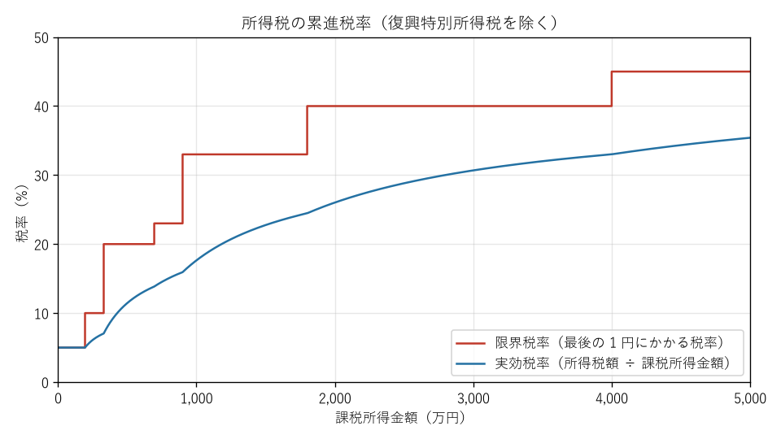

第 3 章 所得税のしくみ
============================================================================

所得税は、個人が 1 年間（1 月 1 日から 12 月 31 日まで）に得た所得に対して国が課す税金である。個人の家計にかかる税金の中では最も基本的なものであり、住民税や社会保険の多くの制度も所得税の考え方（所得の区分や控除）をもとに組み立てられている。この章で所得税の仕組みを理解しておくと、以降の章が読みやすくなる。

所得税の特徴
----------------------------------------------------------------------------

暦年課税
   1 月 1 日から 12 月 31 日までの 1 年間の所得に対して課税する。この期間を「年分」と呼び、2026 年の所得に対する所得税は「2026 年分（令和 8 年分）の所得税」という。

申告納税制度
   納税者が自ら所得と税額を計算し、翌年の 2 月 16 日から 3 月 15 日までに確定申告をして納めるのが原則である。ただし、会社員の場合は勤務先が源泉徴収と年末調整を行うため、多くの人は確定申告をしなくてよい（:doc:`05_employee_tax` を参照）。

累進課税
   所得が多いほど高い税率が適用される。税率は 5 % から 45 % までの 7 段階である。

計算の流れ
----------------------------------------------------------------------------

所得税は、次の手順で計算する。

.. graphviz::
   :caption: 所得税の計算の流れ
   :align: center

   digraph income_tax_flow {
     rankdir=TB;
     node [shape=box, style="rounded,filled", fillcolor="#ffffff", fontsize=11, width=3.6];
     edge [color="#7f8c8d", fontsize=10];

     revenue [label="① 収入金額\n（給与の額面、売上など）", fillcolor="#d6eaf8"];
     income [label="② 所得金額\n（10 種類の所得ごとに計算し、合計する）"];
     taxable [label="③ 課税所得金額"];
     tax [label="④ 所得税額（税率を適用）"];
     final [label="⑤ 納める税額\n（税額控除を差し引き、復興特別所得税を加える）", fillcolor="#fadbd8"];

     revenue -> income [label="  必要経費・給与所得控除などを差し引く"];
     income -> taxable [label="  所得控除を差し引く"];
     taxable -> tax [label="  税率を掛ける"];
     tax -> final [label="  税額控除・復興特別所得税"];
   }

この流れの中で、税額を減らす要素は 3 か所ある。

1. 収入から所得を求める段階で差し引く **必要経費** や **給与所得控除**
2. 所得から課税所得を求める段階で差し引く **所得控除**
3. 税額から直接差し引く **税額控除**

同じ「控除」という言葉が使われるが、所得控除は「税率を掛ける前の金額」を減らすのに対し、税額控除は「税額そのもの」を減らす。そのため、同じ 10 万円の控除でも、税率 10 % の人にとって所得控除 10 万円の効果は 1 万円だが、税額控除 10 万円の効果は 10 万円である。

収入と所得の違い
----------------------------------------------------------------------------

日常会話では「収入」と「所得」を区別せずに使うことが多いが、税金の世界では明確に区別する。

収入
   受け取ったお金の総額。会社員なら給与の額面（年収）、個人事業主なら売上である。

所得
   収入から、それを得るためにかかった費用を差し引いた額。個人事業主なら「売上 − 必要経費」、会社員なら「給与収入 − 給与所得控除」である。

会社員は、仕事のための費用（スーツ代など）を個別に経費として差し引く代わりに、収入に応じて一定額を差し引く **給与所得控除** が認められている。2026 年分の給与所得控除額は次のとおりである。

.. list-table:: 給与所得控除額（2026 年分）
   :header-rows: 1
   :widths: 45 55

   * - 給与等の収入金額
     - 給与所得控除額
   * - 190 万円以下
     - 74 万円
   * - 190 万円超 360 万円以下
     - 収入金額 × 30 % + 8 万円（74 万円に満たない場合は 74 万円）
   * - 360 万円超 660 万円以下
     - 収入金額 × 20 % + 44 万円
   * - 660 万円超 850 万円以下
     - 収入金額 × 10 % + 110 万円
   * - 850 万円超
     - 195 万円（上限）

給与所得控除の最低額（最低保障額）は、2025 年分に 55 万円から 65 万円に引き上げられ、2026 年分にはさらに本則で 69 万円となり、2026 年分と 2027 年分に限って 5 万円を上乗せする特例により 74 万円となった。このため、2026 年分は給与収入 220 万円以下であれば給与所得控除額は 74 万円である。

.. note::

   実際の年末調整では、給与収入 660 万円未満の場合、上の計算式ではなく国税庁が定める「年末調整等のための給与所得控除後の給与等の金額の表」を使う。表では収入金額を 4,000 円単位などで区切っているため、計算式による値と数百円程度ずれることがある。

所得の 10 区分
----------------------------------------------------------------------------

所得税法では、所得をその性質に応じて 10 種類に分け、それぞれ計算方法を定めている。

.. list-table:: 所得の種類
   :header-rows: 1
   :widths: 15 45 40

   * - 所得の種類
     - 主な例
     - 所得の計算方法（概要）
   * - 利子所得
     - 預貯金の利子、公社債の利子
     - 収入金額（源泉分離課税で完結することが多い）
   * - 配当所得
     - 株式の配当、投資信託の分配金
     - 収入金額 − 株式取得のための借入金の利子
   * - 不動産所得
     - 土地・建物の賃貸料
     - 総収入金額 − 必要経費
   * - 事業所得
     - 個人事業の売上
     - 総収入金額 − 必要経費
   * - 給与所得
     - 給料、賞与、パートの賃金
     - 収入金額 − 給与所得控除額
   * - 退職所得
     - 退職金、iDeCo の一時金
     - （収入金額 − 退職所得控除額）× 1/2
   * - 山林所得
     - 5 年を超えて所有する山林の伐採・譲渡
     - 総収入金額 − 必要経費 − 特別控除額
   * - 譲渡所得
     - 土地・建物・株式・ゴルフ会員権の売却益
     - 収入金額 −（取得費 + 譲渡費用）− 特別控除額
   * - 一時所得
     - 懸賞の賞金、生命保険の満期保険金、競馬の払戻金
     - （総収入金額 − 収入を得るための支出 − 特別控除額 50 万円）× 1/2 で総所得に算入
   * - 雑所得
     - 公的年金、副業の原稿料、暗号資産の売却益
     - 公的年金等：収入金額 − 公的年金等控除額、その他：総収入金額 − 必要経費

総合課税と分離課税
   多くの所得は合計して税率を適用する **総合課税** の対象になる。一方、退職所得、山林所得、土地・建物や株式の譲渡所得などは、ほかの所得と分けて税額を計算する **分離課税** の対象である。預貯金の利子のように、支払の際に一定の税率で源泉徴収されて課税関係が終わる **源泉分離課税** もある。

損益通算
   不動産所得、事業所得、山林所得、譲渡所得の赤字（損失）は、一定の順序でほかの所得の黒字と相殺できる。これを損益通算という。給与所得や雑所得の赤字はほかの所得と相殺できない。

合計所得金額
   総合課税の所得と分離課税の所得を合計した金額（損益通算後、繰越控除前）を **合計所得金額** という。基礎控除の額や、配偶者控除・扶養控除の対象になるかどうかは、この合計所得金額で判定する。

所得控除
----------------------------------------------------------------------------

所得控除は、納税者の個人的な事情（家族構成、病気、災害、保険の加入など）を税額に反映させるための仕組みである。所得税の所得控除は、次の 16 種類がある。

.. list-table:: 所得控除の一覧（2026 年分）
   :header-rows: 1
   :widths: 22 43 35

   * - 控除の名称
     - 対象となる場合
     - 控除額（概要）
   * - 基礎控除
     - 合計所得金額が 2,500 万円以下の人
     - 最大 104 万円（後述）
   * - 配偶者控除
     - 合計所得金額 62 万円以下の配偶者がいる
     - 最大 38 万円（70 歳以上の配偶者は最大 48 万円）
   * - 配偶者特別控除
     - 配偶者の合計所得金額が 62 万円超 133 万円以下
     - 最大 38 万円
   * - 扶養控除
     - 16 歳以上で合計所得金額 62 万円以下の扶養親族がいる
     - 1 人あたり 38 万円〜 63 万円
   * - 特定親族特別控除
     - 19 歳以上 23 歳未満で、合計所得金額が 62 万円超 123 万円以下の親族がいる
     - 最大 63 万円
   * - 障害者控除
     - 本人・配偶者・扶養親族が障害者
     - 27 万円（特別障害者 40 万円、同居特別障害者 75 万円）
   * - 寡婦控除
     - 夫と死別・離婚し、再婚していない一定の人
     - 27 万円
   * - ひとり親控除
     - 生計を一にする子がいる、婚姻していない人
     - 35 万円
   * - 勤労学生控除
     - 合計所得金額 89 万円以下で、給与以外の所得が 10 万円以下の学生
     - 27 万円
   * - 社会保険料控除
     - 健康保険料・年金保険料などを支払った
     - 支払った全額
   * - 小規模企業共済等掛金控除
     - iDeCo の掛金、小規模企業共済の掛金を支払った
     - 支払った全額
   * - 生命保険料控除
     - 生命保険・介護医療保険・個人年金保険の保険料を支払った
     - 最大 12 万円
   * - 地震保険料控除
     - 地震保険の保険料を支払った
     - 最大 5 万円
   * - 医療費控除
     - 一定額を超える医療費を支払った
     - 最大 200 万円
   * - 寄附金控除
     - ふるさと納税など、特定の寄附をした
     - 寄附金額 − 2,000 円（上限あり）
   * - 雑損控除
     - 災害・盗難・横領により資産に損害を受けた
     - 損失額に応じて計算

このうち、会社員が年末調整で受けられないのは、医療費控除、寄附金控除、雑損控除の 3 つである。これらを受けるには確定申告が必要である（:doc:`07_tax_return` を参照）。ただし、ふるさと納税については、確定申告をせずに住民税から控除を受けられる「ワンストップ特例」がある（:doc:`04_resident_tax` を参照）。

基礎控除
^^^^^^^^^^^^^^^^^^^^^^^^^^^^^^^^^^^^^^^^^^^^^^^^^^^^^^^^^^^^^^^^^^^^^^^^^^^^

基礎控除は、ほぼすべての納税者が受けられる控除である。2025 年分の改正で本則が 48 万円から 58 万円に引き上げられ、さらに 2026 年分の改正（令和 8 年度税制改正）で本則が 62 万円となった。加えて、中低所得者には時限的な上乗せ（特例）がある。2026 年分の基礎控除額は次のとおりである。

.. list-table:: 所得税の基礎控除額（2026 年分・2027 年分）
   :header-rows: 1
   :widths: 40 20 20 20

   * - 合計所得金額
     - 本則
     - 特例による加算
     - 控除額
   * - 489 万円以下
     - 62 万円
     - 42 万円
     - 104 万円
   * - 489 万円超 655 万円以下
     - 62 万円
     - 5 万円
     - 67 万円
   * - 655 万円超 2,350 万円以下
     - 62 万円
     - なし
     - 62 万円
   * - 2,350 万円超 2,400 万円以下
     - 48 万円
     - なし
     - 48 万円
   * - 2,400 万円超 2,450 万円以下
     - 32 万円
     - なし
     - 32 万円
   * - 2,450 万円超 2,500 万円以下
     - 16 万円
     - なし
     - 16 万円
   * - 2,500 万円超
     - 0 円
     - なし
     - 0 円

特例による加算は 2026 年分と 2027 年分に限った措置である。2028 年分以後は、合計所得金額 132 万円以下の人に限って 37 万円を加算することになっている。基礎控除の本則と給与所得控除の最低保障額は、今後、直近 2 年間の消費者物価の上昇率に合わせて適時に見直す方針が示されている。

.. tip::

   給与収入だけの人の場合、2026 年分は給与所得控除 74 万円と基礎控除 104 万円の合計 178 万円までは所得税がかからない。これが、いわゆる「178 万円の壁」である。詳しくは :doc:`13_income_walls` で解説する。

配偶者控除・扶養控除
^^^^^^^^^^^^^^^^^^^^^^^^^^^^^^^^^^^^^^^^^^^^^^^^^^^^^^^^^^^^^^^^^^^^^^^^^^^^

配偶者や子・親などを養っている場合は、配偶者控除や扶養控除を受けられる。対象になるのは、納税者と生計を一にし、合計所得金額が 62 万円以下（給与収入だけなら 136 万円以下）の親族である。

.. list-table:: 扶養控除の額
   :header-rows: 1
   :widths: 50 50

   * - 扶養親族の区分（その年の 12 月 31 日時点の年齢）
     - 控除額
   * - 16 歳未満
     - なし（児童手当が支給されるため）
   * - 16 歳以上 19 歳未満、23 歳以上 70 歳未満（一般の扶養親族）
     - 38 万円
   * - 19 歳以上 23 歳未満（特定扶養親族）
     - 63 万円
   * - 70 歳以上（老人扶養親族）
     - 48 万円
   * - 70 歳以上で、納税者またはその配偶者の直系尊属と同居（同居老親等）
     - 58 万円

配偶者控除は、納税者本人の合計所得金額が 1,000 万円を超えると受けられない。本人の合計所得金額が 900 万円以下なら 38 万円で、900 万円を超えると段階的に減る。配偶者の所得が 62 万円を超えて配偶者控除の対象から外れても、133 万円以下であれば配偶者特別控除を受けられる。配偶者の合計所得金額が 95 万円以下なら控除額は配偶者控除と同じ 38 万円で、それを超えると段階的に減り、133 万円を超えると 0 になる。

特定親族特別控除は、2025 年分から設けられた控除である。19 歳以上 23 歳未満の子などがアルバイトで稼いで扶養控除の対象から外れても、合計所得金額が 123 万円以下であれば、所得に応じて最大 63 万円の控除を受けられる。

.. note::

   扶養控除の対象になるかどうかの判定（所得 62 万円以下）と、健康保険の被扶養者になれるかどうかの判定（年収 130 万円未満など）は、基準も計算方法も異なる。両者を混同しないよう注意してほしい（:doc:`13_income_walls` を参照）。

医療費控除
^^^^^^^^^^^^^^^^^^^^^^^^^^^^^^^^^^^^^^^^^^^^^^^^^^^^^^^^^^^^^^^^^^^^^^^^^^^^

本人や生計を一にする家族のために 1 年間に支払った医療費が一定額を超える場合に受けられる。控除額は次の式で計算する。

.. math::

   \text{医療費控除額} = \text{支払った医療費} - \text{保険などで補填される金額} - 10\text{ 万円}

総所得金額等が 200 万円未満の人は、10 万円の代わりに総所得金額等の 5 % を差し引く。控除額の上限は 200 万円である。

対象になるのは、診療費・治療費、処方薬の購入費、通院のための交通費（電車・バス）、出産費用などである。健康診断の費用や美容目的の施術、自家用車のガソリン代は原則として対象外である。

医療費控除の特例として、**セルフメディケーション税制** がある。健康診断や予防接種などを受けている人が、対象となる市販薬（スイッチ OTC 医薬品など）を年間 12,000 円を超えて購入した場合に、超えた額（上限 88,000 円）を控除できる。通常の医療費控除とどちらか一方を選択する。

生命保険料控除・地震保険料控除
^^^^^^^^^^^^^^^^^^^^^^^^^^^^^^^^^^^^^^^^^^^^^^^^^^^^^^^^^^^^^^^^^^^^^^^^^^^^

2012 年 1 月 1 日以後に契約した生命保険（新契約）の場合、生命保険料控除は「一般生命保険料」「介護医療保険料」「個人年金保険料」の 3 つに分かれ、それぞれ最大 4 万円、合計で最大 12 万円を控除できる。2026 年分は、23 歳未満の扶養親族がいる場合に限り、一般生命保険料の控除の上限が 6 万円に引き上げられている（3 つの合計の上限は 12 万円のまま）。

地震保険料控除は、地震保険料の全額（上限 5 万円）を控除できる。火災保険料は対象外である。

税率
----------------------------------------------------------------------------

課税所得金額が求まったら、次の速算表を使って所得税額を計算する。

.. list-table:: 所得税の速算表
   :header-rows: 1
   :widths: 50 20 30

   * - 課税所得金額
     - 税率
     - 控除額
   * - 1,000 円から 194 万 9,000 円まで
     - 5 %
     - 0 円
   * - 195 万円から 329 万 9,000 円まで
     - 10 %
     - 97,500 円
   * - 330 万円から 694 万 9,000 円まで
     - 20 %
     - 427,500 円
   * - 695 万円から 899 万 9,000 円まで
     - 23 %
     - 636,000 円
   * - 900 万円から 1,799 万 9,000 円まで
     - 33 %
     - 1,536,000 円
   * - 1,800 万円から 3,999 万 9,000 円まで
     - 40 %
     - 2,796,000 円
   * - 4,000 万円以上
     - 45 %
     - 4,796,000 円

.. math::

   \text{所得税額} = \text{課税所得金額} \times \text{税率} - \text{控除額}

課税所得金額は 1,000 円未満を切り捨てる。

速算表の「控除額」は、累進課税の計算を 1 回の掛け算で済ませるための調整額である。日本の所得税は、課税所得のうち税率の区分を超えた部分にだけ高い税率を適用する **超過累進税率** を採用している。たとえば課税所得が 400 万円の場合、400 万円全体に 20 % を掛けるのではなく、195 万円までの部分に 5 %、195 万円を超え 330 万円までの部分に 10 %、330 万円を超える部分に 20 % を掛けて合計する。この結果は速算表で「400 万円 × 20 % − 427,500 円 = 372,500 円」と計算した値に一致する。

このため、「年収が少し増えたら税率が上がって手取りが減った」ということは、所得税の税率の仕組みだけでは起こらない。

   課税所得金額と所得税の税率

図の赤い線は、課税所得が 1 円増えたときにかかる税率（限界税率）である。青い線は、所得税額を課税所得金額で割った実際の負担率（実効税率）である。実効税率は常に限界税率を下回り、なだらかに上昇する。

税額控除
----------------------------------------------------------------------------

所得税額から直接差し引ける主な税額控除は次のとおりである。

.. list-table:: 主な税額控除
   :header-rows: 1
   :widths: 30 70

   * - 名称
     - 概要
   * - 住宅借入金等特別控除（住宅ローン控除）
     - 住宅ローンを利用して住宅を取得した場合に、年末の借入金残高の 0.7 % を最長 13 年間控除する（:doc:`07_tax_return` を参照）。
   * - 配当控除
     - 総合課税を選択した国内株式の配当所得について、一定割合を控除する。
   * - 政党等寄附金特別控除
     - 政党や政治資金団体への寄附について、所得控除の代わりに選択できる。
   * - 外国税額控除
     - 外国で課税された所得について、二重課税を調整する。

復興特別所得税と防衛特別所得税
----------------------------------------------------------------------------

東日本大震災からの復興財源に充てるため、2013 年分から 2037 年分まで、所得税額の 2.1 % の **復興特別所得税** が上乗せされている。このため、実際に納める所得税は「所得税額 × 102.1 %」になる。

令和 8 年度税制改正により、2027 年分からは復興特別所得税の税率が 1.1 % に引き下げられ、代わりに防衛力強化の財源として税率 1 % の **防衛特別所得税** が創設される予定である。同時に、復興特別所得税の課税期間は 2047 年分まで延長される。2027 年分以後も上乗せの合計は 2.1 % で変わらないが、上乗せが続く期間は長くなる。

計算例
----------------------------------------------------------------------------

給与収入 500 万円、30 歳、単身、社会保険料 735,748 円（第 2 章の例と同じ条件）の会社員の 2026 年分の所得税を計算する。

1. 給与所得控除額：500 万円 × 20 % + 44 万円 = 144 万円
2. 給与所得（合計所得金額）：500 万円 − 144 万円 = 356 万円
3. 所得控除：基礎控除 104 万円（合計所得金額 489 万円以下）+ 社会保険料控除 735,748 円 = 1,775,748 円
4. 課税所得金額：356 万円 − 1,775,748 円 = 1,784,252 円 → 1,000 円未満を切り捨てて 1,784,000 円
5. 所得税額：1,784,000 円 × 5 % = 89,200 円
6. 復興特別所得税を含めた税額：89,200 円 × 102.1 % = 91,073 円 → 100 円未満を切り捨てて 91,000 円

この人の所得税の負担は年収の約 1.8 % である。2025 年分の制度（この所得水準の基礎控除は 68 万円）で計算すると課税所得金額が 36 万円多くなり、所得税額は約 28,000 円多くなる。

2026 年分の改正の反映時期
----------------------------------------------------------------------------

令和 8 年度税制改正による基礎控除と給与所得控除の引上げは、2026 年分の所得税から適用される。ただし、毎月の給与から差し引く源泉徴収税額は 2026 年 12 月までは改正前の基準のままで、改正後の源泉徴収税額表は 2027 年 1 月以後に支払う給与から使われる。2026 年分の改正の効果は、2026 年 12 月の年末調整でまとめて精算される。このため、2026 年の年末調整では例年よりも還付額が大きくなる人が多い。
