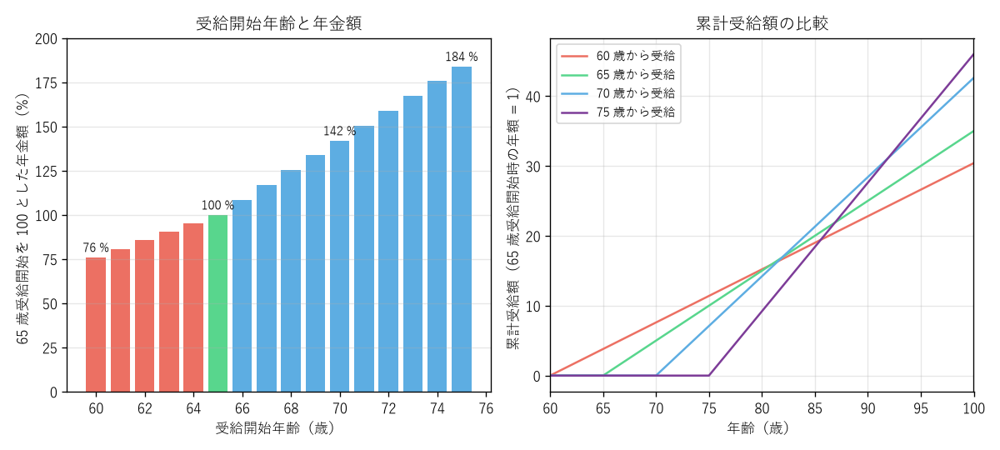

第 11 章 公的年金
============================================================================

公的年金は、老後の生活を支えるだけでなく、病気やけがで障害が残ったときや、家計を支える人が亡くなったときにも給付を行う、総合的な保険である。公的年金は終身で受け取れ、物価や賃金の変動に応じて額が改定されるという、民間の保険や貯蓄にはない特徴を持つ。この章では、公的年金の仕組み、受け取れる年金の種類、保険料を納められないときの制度、受け取り方の選択肢を解説する。

2 階建ての仕組み
----------------------------------------------------------------------------

日本の公的年金は、すべての人が加入する **国民年金（基礎年金）** を 1 階部分、会社員や公務員が加入する **厚生年金保険** を 2 階部分とする「2 階建て」の構造になっている。その上に、企業年金や iDeCo（個人型確定拠出年金）などの私的年金が 3 階部分として位置付けられる。

.. graphviz::
   :caption: 公的年金の 2 階建ての構造
   :align: center

   digraph pension_structure {
     rankdir=BT;
     node [shape=box, style="filled", fontsize=11, width=2.2, height=0.6];
     edge [style=invis];

     subgraph cluster_1 {
       label="第 1 号被保険者\n（自営業者・学生など）";
       style="rounded"; color="#aab7b8"; fontsize=11;
       a1 [label="国民年金（基礎年金）", fillcolor="#d6eaf8"];
       a2 [label="国民年金基金・iDeCo\n付加年金", fillcolor="#fdebd0"];
       a1 -> a2;
     }
     subgraph cluster_2 {
       label="第 2 号被保険者\n（会社員・公務員）";
       style="rounded"; color="#aab7b8"; fontsize=11;
       b1 [label="国民年金（基礎年金）", fillcolor="#d6eaf8"];
       b2 [label="厚生年金保険", fillcolor="#d5f5e3"];
       b3 [label="企業年金・iDeCo", fillcolor="#fdebd0"];
       b1 -> b2 -> b3;
     }
     subgraph cluster_3 {
       label="第 3 号被保険者\n（第 2 号の被扶養配偶者）";
       style="rounded"; color="#aab7b8"; fontsize=11;
       c1 [label="国民年金（基礎年金）", fillcolor="#d6eaf8"];
       c2 [label="iDeCo", fillcolor="#fdebd0"];
       c1 -> c2;
     }
   }

図の下から順に、1 階が国民年金、2 階が厚生年金保険、3 階が私的年金である。

国民年金の被保険者
----------------------------------------------------------------------------

日本に住む 20 歳以上 60 歳未満のすべての人は、国民年金に加入する。被保険者は次の 3 種類に分かれる。

.. list-table:: 国民年金の被保険者の種類
   :header-rows: 1
   :widths: 18 37 45

   * - 種類
     - 対象者
     - 保険料
   * - 第 1 号被保険者
     - 自営業者、フリーランス、学生、無職の人など
     - 定額（2026 年度は月額 17,920 円）を自分で納める
   * - 第 2 号被保険者
     - 会社員、公務員など厚生年金保険の加入者
     - 厚生年金保険料に含まれており、国民年金保険料を別に納める必要はない
   * - 第 3 号被保険者
     - 第 2 号被保険者に扶養されている 20 歳以上 60 歳未満の配偶者（年収 130 万円未満など）
     - 負担なし（配偶者の加入する厚生年金保険の制度全体で負担する）

会社員が退職して自営業者になったときや、第 3 号被保険者の配偶者が退職したときなどは、市区町村で第 1 号被保険者への種別変更の手続きが必要である。

老齢年金
----------------------------------------------------------------------------

老齢基礎年金
^^^^^^^^^^^^^^^^^^^^^^^^^^^^^^^^^^^^^^^^^^^^^^^^^^^^^^^^^^^^^^^^^^^^^^^^^^^^

老齢基礎年金は、保険料を納めた期間と免除を受けた期間などの合計（受給資格期間）が 10 年以上ある人が、原則として 65 歳から受け取れる。20 歳から 60 歳になるまでの 40 年間（480 か月）すべて保険料を納めると、満額を受け取れる。

2026 年度の老齢基礎年金の満額は、年額 847,300 円（月額 70,608 円）である（1956 年 4 月 2 日以後に生まれた人の場合）。保険料を納めた期間が 40 年に満たない場合は、その期間に応じて減額される。

.. math::

   \text{老齢基礎年金の額} = \text{満額} \times \frac{\text{保険料を納めた月数} + \text{免除期間の月数} \times \text{免除の割合に応じた率}}{480}

老齢厚生年金
^^^^^^^^^^^^^^^^^^^^^^^^^^^^^^^^^^^^^^^^^^^^^^^^^^^^^^^^^^^^^^^^^^^^^^^^^^^^

老齢厚生年金は、厚生年金保険に加入していた期間がある人が、老齢基礎年金の受給資格を満たした場合に、老齢基礎年金に上乗せして受け取れる。額は、加入していた期間の給与・賞与の平均額（平均標準報酬額）と加入期間によって決まる。

.. math::

   \text{老齢厚生年金の額（報酬比例部分）} \approx \text{平均標準報酬額} \times \frac{5.481}{1000} \times \text{加入月数}

たとえば、平均標準報酬額 40 万円（賞与を含めた年収 480 万円程度）で 38 年間（456 か月）加入した場合、老齢厚生年金は約 100 万円（月額約 8.3 万円）となる。老齢基礎年金の満額と合わせると、年額約 185 万円（月額約 15.4 万円）である。

一定の要件を満たす配偶者や子がいる場合は、加給年金額が加算される。

障害年金
----------------------------------------------------------------------------

障害年金は、病気やけがで一定の障害が残った場合に、年齢にかかわらず受け取れる年金である。

.. list-table:: 障害年金の種類
   :header-rows: 1
   :widths: 25 40 35

   * - 種類
     - 対象
     - 年金額（概要）
   * - 障害基礎年金
     - 初診日に国民年金に加入していた人（20 歳前の傷病を含む）で、障害等級 1 級・2 級に該当する人
     - 2 級は老齢基礎年金の満額と同額、1 級はその 1.25 倍。子がいる場合は加算あり
   * - 障害厚生年金
     - 初診日に厚生年金保険に加入していた人で、障害等級 1 級 〜 3 級に該当する人
     - 報酬比例の額（1 級は 1.25 倍）。3 級には最低保障額がある

障害年金を受け取るには、初診日の前日において、初診日のある月の前々月までの保険料の納付・免除期間が加入期間の 3 分の 2 以上あること（または直近 1 年間に未納がないこと）が必要である。保険料の未納があると、障害を負っても障害年金を受け取れないおそれがある。

遺族年金
----------------------------------------------------------------------------

遺族年金は、年金の被保険者や受給者が亡くなった場合に、その人に生計を維持されていた遺族が受け取れる年金である。

遺族基礎年金
   亡くなった人に生計を維持されていた「子のある配偶者」または「子」が受け取れる。ここでいう子は、18 歳になった年度の末日までの子（障害のある子は 20 歳未満）である。年金額は老齢基礎年金の満額と同額に、子の人数に応じた加算額を加えた額である。

遺族厚生年金
   亡くなった人が厚生年金保険の被保険者だった場合などに、配偶者、子、父母、孫、祖父母のうち優先順位の高い人が受け取れる。年金額は、亡くなった人の老齢厚生年金の報酬比例部分の 4 分の 3 である。

2025 年の年金制度改正により、遺族厚生年金は 2028 年 4 月から段階的に見直される予定である。子のいない 20 代から 50 代の配偶者に対する遺族厚生年金は、男女ともに原則 5 年間の有期給付となり、その代わりに年金額が加算される。

保険料を納められないとき
----------------------------------------------------------------------------

第 1 号被保険者で、所得の減少や失業などにより保険料を納めるのが難しい場合は、次の制度を利用できる。いずれも申請が必要である。

.. list-table:: 保険料の免除・猶予の制度
   :header-rows: 1
   :widths: 25 40 35

   * - 制度
     - 対象
     - 老齢基礎年金への反映
   * - 全額免除・一部免除（4 分の 3、半額、4 分の 1）
     - 本人・世帯主・配偶者の前年の所得が一定額以下の人。失業した人は特例あり
     - 免除の割合に応じて、満額の 2 分の 1 〜 8 分の 7 として計算される
   * - 納付猶予制度
     - 50 歳未満で、本人と配偶者の前年の所得が一定額以下の人
     - 受給資格期間には算入されるが、年金額には反映されない
   * - 学生納付特例制度
     - 本人の前年の所得が一定額以下の学生
     - 受給資格期間には算入されるが、年金額には反映されない
   * - 産前産後期間の免除
     - 出産する第 1 号被保険者（所得要件なし）
     - 保険料を納めたものとして計算される

免除や猶予を受けた期間の保険料は、10 年以内であれば後から納めること（追納）ができ、追納すると年金額が満額に近づく。

.. warning::

   保険料を免除や猶予の手続きをせずに未納のまま放置すると、その期間は受給資格期間にも年金額にも反映されない。さらに、障害年金や遺族年金を受け取れなくなるおそれがある。保険料を納められないときは、必ず市区町村または年金事務所で免除・猶予の申請をしてほしい。

受け取り方の選択：繰上げと繰下げ
----------------------------------------------------------------------------

老齢年金は原則として 65 歳から受け取るが、60 歳から 75 歳までの間で受け取りを始める時期を選べる。

繰上げ受給
   65 歳より前に受け取りを始めること。1 か月早めるごとに年金額が 0.4 % 減り、60 歳から受け取ると 24 % 減る。減った額は一生続く。

繰下げ受給
   66 歳以後に受け取りを始めること。1 か月遅らせるごとに年金額が 0.7 % 増え、70 歳から受け取ると 42 %、75 歳から受け取ると 84 % 増える。増えた額は一生続く。

   受給開始年齢と年金額・累計受給額の関係（税・社会保険料を考慮しない場合）

右のグラフは、受給開始年齢ごとの累計受給額を、65 歳から受け取る場合の年額を 1 として示したものである。65 歳から受け取る場合と比べて、70 歳から受け取る場合は約 82 歳、75 歳から受け取る場合は約 87 歳で累計額が逆転する。長生きするほど繰下げ受給が有利になり、早く亡くなるほど繰上げ受給が有利になる。

ただし、実際の手取り額で比べる場合は、次の点に注意が必要である。

* 年金額が増えると、所得税・住民税や、国民健康保険料・介護保険料も増える。このため、手取り額の増加率は額面の増加率よりも小さくなる。
* 繰下げ待機中は、加給年金額を受け取れない。
* 繰上げ受給をすると、障害基礎年金を請求できなくなるなどの制約がある。
* 老齢基礎年金と老齢厚生年金は、別々に受給開始時期を選べる。

健康状態、働き方、ほかの収入や資産の状況を踏まえて判断することが大切である。

働きながら年金を受け取る：在職老齢年金
----------------------------------------------------------------------------

60 歳以上で厚生年金保険に加入して働きながら老齢厚生年金を受け取る場合、給与（総報酬月額相当額）と老齢厚生年金（基本月額）の合計が一定額（支給停止調整額）を超えると、老齢厚生年金の一部または全部が支給停止になる。これを **在職老齢年金** という。

.. math::

   \text{支給停止額（月額）} = (\text{基本月額} + \text{総報酬月額相当額} - \text{支給停止調整額}) \times \frac{1}{2}

支給停止調整額は、2025 年度は 51 万円だったが、2025 年の年金制度改正により 2026 年 4 月から大幅に引き上げられ、2026 年度は 65 万円となった。老齢基礎年金は支給停止の対象にならない。

年金額の改定
----------------------------------------------------------------------------

公的年金の額は、毎年 4 月に、物価や賃金の変動に応じて改定される。ただし、少子高齢化の中で年金制度を長期的に維持するため、現役世代の人数の減少や平均余命の伸びに応じて改定率を抑える **マクロ経済スライド** という仕組みが組み込まれている。このため、物価や賃金が上昇しても、年金額はそれよりも小さい率でしか増えない。2026 年度の改定率は、国民年金（基礎年金）がプラス 1.9 %、厚生年金がプラス 2.0 % であった。

自分の年金を確認する
----------------------------------------------------------------------------

ねんきん定期便
   毎年の誕生月に、日本年金機構から届く。これまでの加入期間、保険料の納付額、年金見込額などが記載されている。35 歳、45 歳、59 歳の節目の年は、全期間の加入記録が記載された封書で届く。

ねんきんネット
   日本年金機構のウェブサイトで、いつでも自分の年金記録や年金見込額を確認できる。マイナポータルから連携して利用することもできる。

公的年金シミュレーター
   厚生労働省が提供するウェブサービスで、ねんきん定期便の二次元コードを読み取ると、働き方や受給開始時期を変えた場合の年金見込額を簡単に試算できる。

年金の記録に漏れや誤りがあると、受け取れる年金が少なくなる。転職や結婚で姓や勤務先が変わった人は、特に記録を確認しておくとよい。年金の請求手続きは、受給開始年齢が近づくと日本年金機構から届く年金請求書を使って行う。年金は請求しないと受け取れない。

年金にかかる税金
----------------------------------------------------------------------------

公的年金の老齢給付は、雑所得として所得税と住民税の課税対象になる。収入金額から **公的年金等控除** を差し引いた額が所得になる。65 歳以上の人の公的年金等控除は最低 110 万円（公的年金等以外の所得が 1,000 万円以下の場合）であり、ほかの所得がなければ年金収入 110 万円までは雑所得が 0 になる。一方、障害年金と遺族年金は非課税である。

年金からは、所得税（一定額以上の場合）、住民税、介護保険料、国民健康保険料（または後期高齢者医療保険料）が天引きされることが多い。
