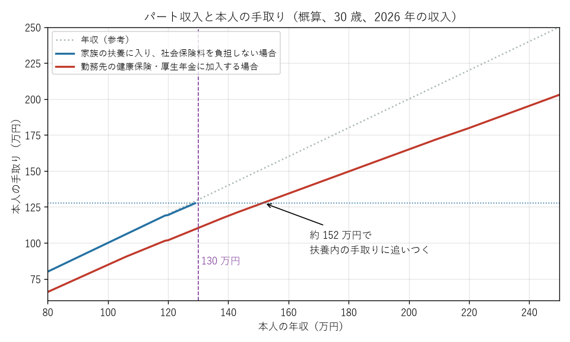

第 13 章 扶養と「年収の壁」
============================================================================

パートタイマーやアルバイトとして働く人、特に配偶者や親に扶養されている人の間では、「年収 ○○ 万円を超えると損をする」という意味で「年収の壁」という言葉が使われる。しかし、壁と呼ばれるものには、税金に関するものと社会保険に関するものがあり、それぞれ性質がまったく異なる。この章では、第 II 部と第 III 部の知識を使って、各「壁」の正体と、働き方を決める際の考え方を整理する。

「扶養」には 2 種類ある
----------------------------------------------------------------------------

「扶養に入る」「扶養から外れる」というときの「扶養」には、税金の扶養と社会保険の扶養の 2 種類がある。両者は制度も基準も異なる。

.. list-table:: 税金の扶養と社会保険の扶養
   :header-rows: 1
   :widths: 20 40 40

   * - 観点
     - 税金の扶養
     - 社会保険の扶養
   * - 意味
     - 扶養している人（納税者）が、配偶者控除・扶養控除などを受けられる
     - 扶養されている人が、保険料を負担せずに健康保険の被扶養者・国民年金の第 3 号被保険者になれる
   * - 誰に影響するか
     - 扶養している人の税金
     - 扶養されている人の保険料
   * - 判定の基準
     - 扶養されている人の合計所得金額（給与収入なら給与所得控除後の額）
     - 扶養されている人の年間収入の見込み（交通費を含む）
   * - 判定の期間
     - その年の 1 月から 12 月までの実績
     - これから 1 年間の見込み
   * - 超えた場合の影響
     - 控除額が段階的に減る（配偶者特別控除など）ものが多い
     - 基準を超えると保険料の負担が一度に生じる

主な「年収の壁」の一覧
----------------------------------------------------------------------------

2026 年の給与収入について、主な「壁」をまとめると次のとおりである。いずれも給与収入だけがある場合の目安である。

.. list-table:: 主な「年収の壁」（2026 年の給与収入の場合）
   :header-rows: 1
   :widths: 15 20 65

   * - 年収
     - 種類
     - 内容
   * - 119 万円
     - 本人の住民税
     - これを超えると本人に住民税がかかり始める（単身・1 級地の場合。市区町村により異なる）。2025 年の収入では 110 万円だった
   * - 130 万円
     - 社会保険の扶養
     - 健康保険の被扶養者・国民年金の第 3 号被保険者でいられる上限（130 万円未満）。19 歳以上 23 歳未満（配偶者を除く）は 150 万円未満
   * - 136 万円
     - 家族の税金
     - これ以下なら、扶養している人が配偶者控除（38 万円）や扶養控除（特定扶養親族は 63 万円）を受けられる
   * - 163 万円
     - 本人の税金
     - 学生の場合、これ以下なら勤労学生控除を受けられる
   * - 169 万円
     - 家族の税金
     - これ以下なら、扶養している人が配偶者特別控除の満額（38 万円）を受けられる
   * - 178 万円
     - 本人の所得税
     - これを超えると本人に所得税がかかり始める
   * - 197 万円
     - 家族の税金
     - 19 歳以上 23 歳未満の子などの場合、これ以下なら扶養している人が特定親族特別控除を受けられる
   * - 207 万円
     - 家族の税金
     - これを超えると配偶者特別控除が 0 になる
   * - 年収にかかわらない
     - 本人の社会保険
     - 週 20 時間以上働くなどの要件を満たすと、勤務先の健康保険・厚生年金保険に加入する（従来の「106 万円の壁」は 2026 年 10 月に撤廃）

このうち、配偶者控除・配偶者特別控除・扶養控除・特定親族特別控除は、扶養している人の税金の話である。扶養している人の所得や税率によって影響額は変わるが、多くの場合、年間数万円程度である。

税金の壁は「壁」ではない
----------------------------------------------------------------------------

税金に関する壁は、超えたからといって世帯の手取りが減るものではない。

本人の所得税・住民税
   所得税も住民税も、課税されるのは基準を超えた部分だけである。たとえば年収が 178 万円から 188 万円に 10 万円増えた場合、本人の所得税の増加は 5,000 円程度にすぎず、手取りは増える。

配偶者特別控除
   配偶者の年収が 136 万円を超えて配偶者控除の対象から外れても、配偶者特別控除によって同じ 38 万円の控除を受けられる（169 万円まで）。その後も控除額は段階的に減るため、配偶者の年収が増えて世帯の手取りが減るということは基本的に起こらない。

特定親族特別控除
   大学生の子のアルバイト収入が 136 万円を超えて扶養控除の対象から外れても、特定親族特別控除によって、197 万円までは収入に応じた控除を受けられる。

ただし、勤務先が支給する家族手当（配偶者手当）が、税金や社会保険の扶養を基準にしている場合は、基準を超えると手当がなくなり、世帯の収入が大きく減ることがある。家族手当の基準は勤務先によって異なるため、就業規則などで確認してほしい。

社会保険の壁は本当の「壁」
----------------------------------------------------------------------------

社会保険の扶養（130 万円）の壁は、超えると保険料の負担が一度に生じるため、手取りが実際に減る。

130 万円の壁
   扶養されている人の年収が 130 万円以上になると、扶養から外れ、自分で社会保険に加入しなければならない。勤務先の被用者保険の加入要件を満たしていれば健康保険と厚生年金保険に、満たしていなければ国民健康保険と国民年金に加入する。後者の場合、国民年金保険料だけで年額 215,040 円（2026 年度）かかり、さらに国民健康保険料が加わるため、手取りの減少が特に大きい。

被用者保険の加入（旧 106 万円の壁）
   2026 年 10 月から、従業員数 51 人以上の企業で週 20 時間以上働く人は、年収にかかわらず勤務先の健康保険と厚生年金保険に加入することになった。この場合、130 万円未満であっても扶養から外れ、保険料の負担が生じる。企業規模の要件は 2027 年 10 月以後、段階的に縮小・撤廃される（:doc:`09_social_insurance_basics` を参照）。

次の図は、30 歳の人がパートで働く場合に、家族の扶養に入って社会保険料を負担しない場合と、勤務先の健康保険・厚生年金保険に加入する場合の、本人の手取りを比較したものである。

   パート収入と本人の手取り（概算）

扶養に入っている場合、年収 129 万円台での手取りは約 127 万円である。勤務先の社会保険に加入すると、社会保険料（年収の約 15 %）がかかるため、この手取りを上回るには年収約 152 万円が必要になる。つまり、130 万円付近で扶養から外れる場合は、年収をおよそ 150 万円以上まで増やさないと、手取りが扶養内で働いていたときを下回る。

.. note::

   この図は、扶養している家族の税金（配偶者控除など）や、勤務先の家族手当への影響を含んでいない。世帯全体の手取りで考える場合は、それらも考慮する必要がある。

一時的に収入が増えた場合
^^^^^^^^^^^^^^^^^^^^^^^^^^^^^^^^^^^^^^^^^^^^^^^^^^^^^^^^^^^^^^^^^^^^^^^^^^^^

繁忙期の残業や人手不足による一時的な収入の増加で年収が 130 万円以上になった場合は、勤務先が「一時的な収入の増加である」ことを証明すれば、引き続き被扶養者として認定を受けられる特例がある（同じ人について原則として連続 2 回まで）。

また、2026 年 4 月からは、給与収入だけの人の被扶養者の認定は、労働条件通知書などに記載された労働契約の内容から見込まれる年間収入で判定する取扱いとなった。契約上の時給と所定労働時間から見込まれる年収が 130 万円未満であれば、残業などで結果的に 130 万円を超えても、原則として認定は取り消されない（:doc:`10_health_insurance` を参照）。

働き方を決めるための考え方
----------------------------------------------------------------------------

「年収の壁」を意識して働く時間を抑えることには、目先の手取りを守るという意味があるが、長い目で見ると次の点も考慮する必要がある。

将来の年金が増える
   厚生年金保険に加入すると、老齢基礎年金に老齢厚生年金が上乗せされる。たとえば、年収 150 万円で 10 年間厚生年金保険に加入すると、老齢厚生年金は年額約 8 万円増え、これが終身で続く。障害厚生年金や遺族厚生年金の保障も手厚くなる。

病気や出産のときの保障が手厚くなる
   健康保険の被保険者本人になると、病気やけがで休んだときの傷病手当金、出産で休んだときの出産手当金を受け取れる。

収入を増やす余地が広がる
   壁を気にせずに働けるため、昇給や正社員への転換などのキャリアの選択肢が広がる。

壁を気にして働くかどうかは、扶養している家族の収入、勤務先の家族手当、本人の健康状態、将来の働き方の希望などによって答えが異なる。付録の :doc:`appendix_d_script` を使うと、年収ごとの本人の手取りを概算できるので、判断の材料にしてほしい。
